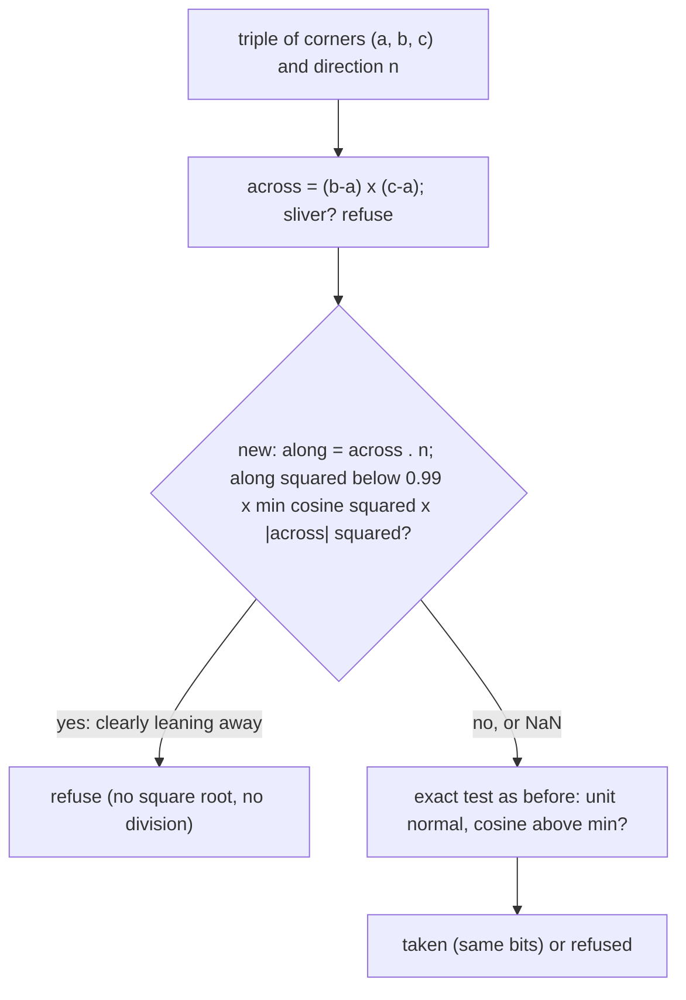

# Review 8-99: a triple of corners that leans far from the search direction is refused by its squared cosine, before the square root; a rolling prism is about 3% to 5% faster (noise of the same order), same answer bit for bit

Task: 8-99 (from 8-78). Class 2 (physics `face_clip.rs`, hot path; no `unsafe`, no protected path). Owner go-ahead: "Go on with 8-97 to 8-99" and "Go on with 8-99" (2026-11-28). The change keeps every bit of the answer, so no golden or pin moves and no governance task is needed.

In plain words: to find the flat face a hull touches with, the code looks at triples of corners and asks whether the plane through them faces the search direction. Each triple used to cost a square root and a division even when the plane obviously faces somewhere else. Now a cheap test on the squared cosine refuses those triples first. The margin is 1% of the square, thousands of times the rounding error of the exact test, so a triple that was refused is still refused and a triple that was taken is still taken, with the same normal to the last bit. **That removes about 11% of the cost of the second try for a face (`widest_face`) and about 3% to 5% of the step of a rolling prism (three alternated rounds; the noise between runs is of the same size, and the 8-sided prism's gain is not established).** What the card hoped for from the first try (`fitted_face`) is not there: see below.

## What was measured

Method: two throwaway probes, not in the repository (a unit test timing the two functions and a copy of `d3_hull_contacts.rs` with a timing test), release build, Windows, one thread, the laptop of the earlier cards (an editor and an agent session open). The old and the new binary were built from the same tree (the change stashed for the old one) and run alternately.

| item | 8 sides | 12 sides | 16 sides |
|---|---|---|---|
| `widest_face`, ns a call, 4,000 directions up to 15 degrees off a face, minimum of 9 passes, before | 1,014 | 1,506 | 1,900 |
| after | 899 | 1,321 | 1,689 |
| change | -11% | -12% | -11% |
| `fitted_face`, same directions, before / after (one pass, no noise estimate: +2%, -3%, -11%) | 82 / 84 | 119 / 115 | 177 / 158 |
| `fitted_face`, directions up to 1.5 degrees off a face (the first triple is the face), before | 206 | 266 | 311 |
| rolling prism step (the 240-step rolls of `d3_hull_contacts.rs`, speeds 1.0, 1.4, 1.8, 2.0, ten rolls each; best of 7 passes), three alternated runs, before, µs | 5.44 to 5.55 | 5.74 to 5.98 | 6.18 to 6.31 |
| after, µs | 5.21 to 5.48 | 5.56 to 5.61 | 6.02 to 6.06 |
| change, best of three against best of three | -4.2% | -3.2% | -2.6% |
| change, paired rounds, median (mean) | -4.2% (-2.7%) | -5.2% (-4.8%) | -2.8% (-3.0%) |

The new runs of the 8-sided prism spread over 5.21 to 5.48 µs (5%), as wide as the gain. The paired rounds: 8 sides -4.3%, +0.5%, -4.2%; 12 sides -6.9%, -2.2%, -5.2%; 16 sides -3.9%, -2.1%, -2.8% (one round of the 8-sided prism shows no gain). The outputs of the probe (the sizes of the faces found, summed) are the same before and after. The saving of 0.14 to 0.23 µs a step fits one `widest_face` call a step (115 to 211 ns saved). The direction set of the probe is synthetic (up to 15 degrees off a face), not a trace of the solver.

## What was found about the first try

| item | result |
|---|---|
| the card's guess | that rejecting triples before the square root would cut the 1.2 to 1.4 µs a step of the first try (`fitted_face`; 13% to 18% of a step in the timer run of card 8-78, whose steps were 7.4 to 11.7 µs; 19% to 26% of the 5.4 to 6.3 µs steps here) |
| what the probe shows | for a direction near a face, the first triple of the window is the face: 1.0 triples tried a call, one scan of every corner, found. The cosine refusal has nothing to refuse there. With directions up to 15 degrees off a face (mostly the "no face" path, since the first try accepts 1.8 degrees), 0.4 to 2.4 triples are tried and `fitted_face` costs 82 to 177 ns, a mixed difference within the noise of one pass |
| so | the 200 to 310 ns of a first try that finds a face are the passes over all corners (the reach of the solid, the window of the farthest plane, the scan of every corner, the face with its corners put in order), not the square roots. The new test does not touch them (the probe's `fitted_face` differences are not claimed as a gain) |
| not tried | making those passes cheaper (the reach of a hull does not change between steps; the window and the top plane could share one pass over the corners); caching the world corners between the two clips; a scene with many hulls to see where the time of a crowd goes. Each of them is a card |

## What changed

| item | result |
|---|---|
| code | `face_clip.rs`: `plane_facing` computes `along = across . n` and refuses the triple when `along` squared is below `CLEARLY_BELOW` (0.99) times the squared minimum cosine times the squared length of `across`, only for a minimum cosine of one half or more (`MIN_REFUSED_COSINE`; the two tries use 0.7 and 0.9995); otherwise the exact test of before runs unchanged (also for a NaN, for which the comparison is false). The comparison is homogeneous in the length of `n`, so the answer does not depend on `n` being a unit direction |
| why the bits do not move | a triple refused by the new test has a true cosine at least 0.5% below the minimum; the exact test computes the same cosine with a rounding error of about 3e-7 relative, so it refuses it too. The restriction to a minimum of one half or more is because a relative margin does not hold near zero, where the margin would be as small as the rounding error of the dot product. Every other triple reaches the exact test with the same inputs as before |
| new test | `a_triple_is_refused_by_its_squared_cosine_only_when_the_exact_test_refuses_it_too`: the old `plane_facing` is kept in the test module as `plane_facing_by_the_square_root` and compared to the bit with the new one on 80,000 random triple, direction and minimum cosine cases (minimum 0.7, 0.9995, 0.1 and -0.5), and on 324 triples whose plane leans from `Vec3::Y` by a cosine from 2% below the minimum up to 2% above it, clamped to 1 (for the minimum 0.9995 only the first step above is below 1, the others are the same plane), in both senses of the winding. It asserts that more than 25,000 random cases are refused and that more than 100 of the near-edge cases are taken. It is a characterisation test of a refactor: green before the change and after it, so the red evidence is the hand mutations |
| hand mutations | 3 tried: the margin `CLEARLY_BELOW` at 1.02 instead of 0.99 (killed: a triple that the exact test takes is refused); the guard removed (killed by the minimum of -0.5; it survived until that case was added); the guard lowered from one half to zero (survived: no case has a minimum between 0 and one half where the rounding would show, so that threshold is a safety margin the test does not exercise) |
| other tests | the unit tests of the crate (476), the integration tests of the `physics` crate and of the bench crate pass on Windows and on Linux x86-64 (WSL2); rustfmt and Clippy with warnings denied are clean |
| 3D golden | unchanged: the GOLDEN lines recorded on Windows and on Linux x86-64 (WSL2) compared with `gates/golden/physics3d-replay.toml`: equal (5 scenes) |

## Decisions

1. The change is the squared-cosine refusal only, with a margin, so the answer is the same bit for bit; no pin, hash or golden moves. The card's other idea, a refusal without a margin (nearest to the edge), would move bits at the edge and is not done (a governance task if ever wanted).
2. The margin is 1% of the square (0.5% of the cosine). A smaller margin would keep more of the saving only if the refusal were tighter than the noise of the measurement; the saving is dominated by triples far from the edge. The refusal is used only for a minimum cosine of one half or more, which both tries satisfy.
3. Three Backlog cards are opened (for the open points of the first try, the cached corners and a crowd of hulls): 8-107 (cheaper passes over the corners of the first try: reach of a hull and one pass for window and top plane), 8-108 (cache the world corners of a hull between the two clips of a pair), 8-109 (a scene with many hulls, to see what a crowd costs in `face_clip`).

## Not verified

- One laptop, Windows, one thread; the rolling prism gain is 2.6% to 4.2% on the best of three runs and one round of the 8-sided prism shows none. The timing of the new test in a crowd of hulls was not measured.
- That the margin is enough for every input: it is argued (rounding error against 0.5% of the cosine) and tested on 80,000 random cases and the edge cases, not proven. A triangle so small that its squared area is a denormal (a reach below about 1e-10) is outside the argument.
- Whether the `cross-platform-determinism` feature is on or off does not enter the argument (no new operation beyond `*`, `<` and a dot product); the golden was checked with it on.
- The probes use a synthetic direction set (up to 15 degrees off a face) and one rolling prism, not a trace of the solver or a crowd of hulls.
- The test counts and the golden figures are from the run of the author; the reviewer re-derived the arithmetic, not the runs.
- The cost split of the first try (reach, window, scan, face) is inferred from the probe, not timed pass by pass.
- ARM64 not run; no hosted `ci`.
- Mermaid read by the author, not rendered.

## R1 to R8

| phase | result |
|---|---|
| R1 self | the probe modules and test copies were removed before the commit; the diff is `face_clip.rs` (the refusal, a constant, the test) and this report |
| R2 automated | rustfmt, Clippy with warnings denied (the first version of the test was too nested and casts a `u64`: flattened), the crate tests on both platforms, the golden on both |
| R3 independent | one read-only review, no blocker; two majors and several minors fixed (Loops) |
| R4 QA | an oracle test against the old function, two of three hand mutations killed (the third is a margin, see above), an alternated A/B of the old and the new binary |
| R5 architecture | no new dependency or interface; one private constant |
| R6 security | none; no `unsafe`, no input from outside |
| R7 performance | measured above: -11% of the second try, about 3% to 5% of a rolling prism step |
| R8 product fit | a small bit-identical gain on the hull path; the larger idea of the card (the first try) is answered with a measurement and three cards |

## Loops

| loop | finding | handling |
|---|---|---|
| 1 | major: the report said the prefilter needs a unit `n`; it does not | comment and report corrected (the test is homogeneous in the length of `n`) |
| 1 | major (latent): a relative margin does not hold for a small minimum cosine | guard raised from 0 to one half, `MIN_REFUSED_COSINE`; a case with a minimum of 0.1 added |
| 1 | major: `taken > 100` was met by the -0.5 cases alone | the test asserts the near-edge taken count and the refused random count separately |
| 1 | major: headline from the best of three; `fitted_face` 'no change' | title and text: about 3% to 5%, noise of the same order, paired medians and the 8-sided spread given; the `fitted_face` differences called mixed |
| 1 | minor: clamped near-edge cases, card's 13% to 18%, Not verified omissions, empty Loops | stated and added |
