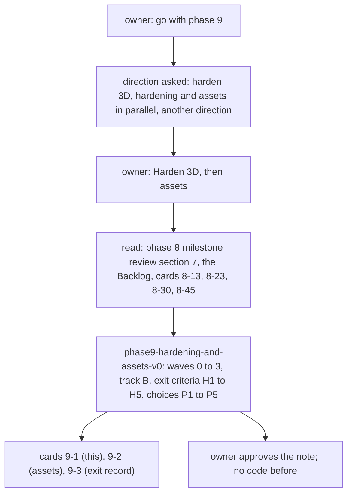

# Review 9-1: phase 9 design note

Task: 9-1. Class 1 (documentation only). Ordinary card into `develop`. Owner go-ahead: "Could we go with phase9?"; owner choice among three directions: "Harden 3D, then assets".

## What was done

| item | result |
|---|---|
| the question | "Could we go with phase9?": the roadmap row for phase 9+ is a list of topics, so the direction was asked; the owner chose "Harden 3D, then assets" |
| the note | `wiki/architecture/phase9-hardening-and-assets-v0.md`: evidence table, four waves (evidence, contact correctness, cost, features and hygiene), track B (assets), exit criteria H1 to H5, new cards, what it does not settle, five choices P1 to P5 for the owner, risks |
| stale pages found | the phase 8 milestone review lists F-HOSTED ("no hosted CI has run phase 8 code") and F-GOLDEN ("no 3D golden hash and no Linux run") as open; the phase 8 release of 2026-11-19 (`ci` run 44605816554, success) ran the 3D golden jobs on Windows and Ubuntu and the 3D instruction-count job green. Found by the independent review, not by me: my first draft built Wave 0 on the stale rows. The note now says what that run did and did not do (baseline recorded without comparing); the review page is not edited (a dated record) |
| cards | 9-1 (this note), 9-2 (assets: `dmesh` or an importer), 9-3 (exit record) |
| index | `wiki/README.md` row 51 and changelog v1.117 |

## Decisions

1. The note starts with evidence (the next release PR with the hosted run of the 67 later commits and the first icount comparison, the reference-machine figures), not with fixes: the later waves are measured against numbers that Wave 0 may move.
2. Existing cards keep their ids and stay on the board; the note groups them, it does not copy or renumber them.
3. The exit criteria are proposals for the owner; the hardening track is capped by them, so a new finding becomes a Backlog card, not an extension of the phase.
4. The milestone review is not edited: it is a dated record, and the note names the row that is out of date.

## Evidence

- Read: the CI run 44605816554 (jobs and conclusions), `git log origin/main`, `docs/budgets/physics-benchmark-8-14.md` section 5, `reviews/8-13.md`, section 5 to 8 of `wiki/spikes/phase8-milestone-review.md`, the Backlog list (33 cards) and the cards 8-13, 8-23, 8-30, 8-45 (search), `reviews/8-13.md` and `reviews/8-45.md` exist, `git rev-list --count origin/main..origin/develop` = 67 and 31 merge commits.
- Documentation only: no test, build or benchmark is involved. The wiki lint and digest check run in the local gates (see the PR).

## Not verified

- Every figure of section 1 was read on 2026-11-24 and will drift (the board changes with each card).
- The texts of the Backlog cards (8-20, 8-21, 8-22, 8-28, 8-30, 8-56 to 8-80, 9-2, 9-3): they are on the board, not in the repository; the note tags them unverified. Card 8-30's text predates the release run.
- Whether any other row of the phase 8 review is out of date; F-HOSTED, F-GOLDEN and F-BUDGET were checked against the CI history, the others were not.
- Mermaid read by the author, not rendered.

## R1 to R8

| phase | result |
|---|---|
| R1 self | first draft of the order was from the review's list; reading the board showed 8-13 and 8-23 done and 8-30, 8-61, 8-76 to 8-80 present, so the note was rebuilt from the board; the CI history was not read (the blocker of loop 1) |
| R2 automated | wiki lint, digest check (local gates) |
| R3 independent | see Loops |
| R4 to R7 | no code; no security or performance effect |
| R8 product fit | the owner gets an order, exit criteria and five choices, and nothing starts before approval |

## Loops

| loop | finding | handling |
|---|---|---|
| 1 | blocker: the premise of Wave 0 was stale: the phase 8 release of 2026-11-19 already ran the 3D golden and icount jobs hosted, green | verified (`gh run view`, `git log`, the budget page); Wave 0, H1, P1, P2, the diagram, the risks, the README line and this file rewritten around what is true: the 67 later commits, the first comparison, the reference machine |
| 1 | major: the review file said `gates/` and the CI history were not read | the CI history and the budget page are now read and listed under Evidence |
| 1 | major: more than F-GOLDEN of the phase 8 review is stale | F-HOSTED, F-GOLDEN, F-BUDGET checked; named in the note and here |
| 1 | major: cards cited as [K] that are only on the board | tagged [U] with the reason; 8-30 flagged as predating the run |
| 1 | major: the golden hashes were already verified across platforms (WSL2) | added to section 1 |
| 1 | minor: 8-70 missing from the diagram, 8-63 listed twice, no class or review statement per wave | diagram and text aligned; Wave 1 states the review phase |
| 1 | minor: 9-2 and 9-3 existence | stated: all three cards are on the board |
| 1 | nit: the cost of a hosted run | one release PR, not one per card (risks) |
| 1 | note: the loop-1 fixes were not seen by a second reviewer | stated |
