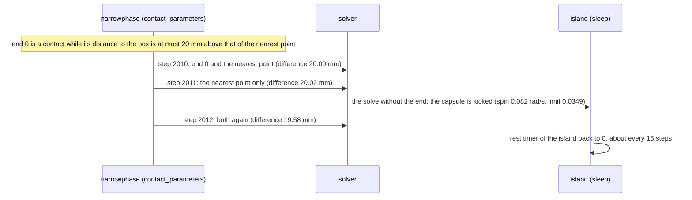

# Review 9-10: the two piles that stay awake chatter at the 20 mm band

Task: 9-10 (open point of 9-7). Class 2 (physics narrowphase, sleeping); this change is documentation only. Outcome: **an investigation with no code change: in seed 3 (and, by the same pattern, seed 13) a capsule end that is a contact on one step and not on the next, because its distance to the box is 20.00 mm above the nearest point's, a rule that sits on the band in a pile that hovers at it; the solve without that point kicks the capsule and resets the rest timer of the pile every 15 to 22 steps. Five variants of the point choice were run over 20 seeds: none is distinguishable from the code of develop except one that is clearly worse; the cure needs a design in which a point enters and leaves continuously, not another number. One follow-up card (9-12).** Owner go-ahead: "9-8 then 9-10" (2026-11-26).

## What was found

| item | result |
|---|---|
| seed 3, the dropout | after card 9-9 the capsule 38 lies on the box 22 with two points: the nearest point of its axis (at 0.71 of the axis) and its end 0. End 0 is 20 mm farther from the box than the nearest point (printed per call: 0.26155 against 0.24155 m at step 2010, 0.26157 at step 2011, 0.26112 at step 2012; the band is the 20 mm margin). With 20.00 mm the end is a contact, with 20.02 mm it is not: at step 2011 the manifold has the nearest point only, at 2012 both again. The kick (spin 0.082 rad/s, speed 0.0137 m/s) is in the solve of step 2012, the one that used the manifold of 2011 (the point list printed after a step is the one the next step uses, as in 9-7). Same for 1997, 2012, 2028, 2043, 2055, 2069, 2084, 2098: every 14 to 16 steps |
| a phantom end | the end is a contact by its separation to the plane of the nearest point (-1.4 mm), but its true distance to the box is 18.6 mm (0.2616 m minus the radius 0.243 m): it lies past the edge of the box, where the box is not. So the point carries load that the box does not give; when it leaves, the load goes to the other contacts in one step and the capsule is kicked. That the capsule hovers at the band is what a chatter looks like (the support drops, the capsule turns, the end comes back inside, the support is back, the end is pushed out); the turning was not traced step by step |
| seed 13 | bodies 29 (a capsule), 57 and 77 are kicked in the same step (spin 0.095, 0.037, 0.043 rad/s), every 21 to 22 steps (1998, 2016, 2038, 2059, 2081, 2105). The manifold of body 29 with the body 13 has two points at 2009 to 2014 and one at 2015; the kick is at 2016. So it is the same pattern (one of two points of a manifold missing for one step); the distance difference was not printed for this seed |
| the variants | mixed pile, seeds 1 to 20, 2000 steps, piles asleep: develop 18; the end band 40 mm: 16 (seeds 4, 8, 9 and 17 awake); the end band 100 mm: 20 (the last at 1234 steps); the end separation faded from the plane gap to the true gap over the band: 16; the true gap as the separation of every point: 8. None of 16, 18 and 20 is distinguishable from the others at this size (one standard error of a count of 18 of 20 is about 1.3 piles, and a small change of the code moves which piles sleep, 9-6); the wider band moves the place where the chatter can start, it does not remove it, and the fade is a continuity that did not help. The true gap loses the support the piles use, and 8 of 20 sleep |
| the cost of a wide band | with an end band of 100 mm a capsule is held by an end that is 100 mm off the box: a phantom support that grows with the number (9-7 showed a plane-based choice that held a capsule 0.45 m past an edge). Not run as a world test here |
| change | none. Probes (a seed, a per-call print in `round_box`, a per-step trace) are not in the repository |

## Decisions

1. No change of the point choice: no variant is better than develop beyond what 20 seeds can tell, and the one that looks best (100 mm) buys it with a phantom support.
2. The cure is a design: a contact that enters and leaves continuously (a weight on a point, so that the solver gives it less and less as it nears the band), or a narrowphase that remembers the choice of the last step (hysteresis). Both change a public type or add state: card 9-12, for the owner to pick.
3. The mixed-pile tests of card 9-8 keep their share (8 of 10); they do not pin seeds 3 and 13.

## Not verified

- Seed 13 down to the numbers of the band (not printed), and why the three bodies of seed 13 are kicked together.
- That the turning of the capsule after the point has left is what brings the end back inside the band (the chatter): only the sequence 20.00, 20.02, 19.58 mm is shown, not the cause of the last step.
- Seeds 3 and 13 were traced on Windows only; the variants were run once per seed; their differences are within the noise of 20 seeds.
- The effect of the fade and of the wide band on anything but the mixed pile; any world test of a phantom support for them.
- The sphere and hull contacts for the same kind of dropout; the capsule-capsule far end (kept since 8-90), which enters and leaves the same way.
- The local gates (card 8-88, not run). Mermaid read by the author, not rendered.

## R1 to R8

| phase | result |
|---|---|
| R1 self | the first guess was an end dropped at 2011 by the plane separation; the printed values showed the plane separation is -1.4 mm throughout and the distance difference is what changes |
| R2 automated | no code change: nothing to build |
| R3 independent | one read-only review of the claims (Loops) |
| R4 QA | per-call print of the point choice around the dropout; a per-step list of the bodies that reset the rest timer for seeds 3 and 13; five variants over 20 seeds |
| R5 to R7 | none |
| R8 product fit | the open point is answered with the mechanism and a design question, and the numbers show why a tuning is not the answer |

## Loops

| loop | finding | handling |
|---|---|---|
| 1 | filled after the independent review | see below |
