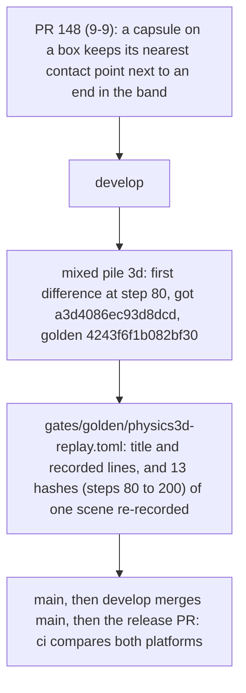

# Review 9-11: re-record the 3D golden hashes of "mixed pile 3d" after card 9-9

Task: 9-11. Class 3 (governance: `gates/golden/physics3d-replay.toml` is a protected path). Governance card: PR into `main` first, then `develop` merges `main` in, then the release PR. Owner go-ahead: "I approve, then 9-11" (2026-11-26). That is the author's reading as a declaration of the governance task (the declaration of 9-4 was explicit); the owner confirms it when approving this PR.

## What was done

| item | result |
|---|---|
| why | card 9-9 changed which contact points a capsule on a box gets (the nearest point is kept next to an end inside the band, up to three points), by design and reviewed (`reviews/9-9.md` and card 9-11 on the board, both outside this branch: the report is on `develop`; it named the stored golden as the open governance point). The scene `mixed pile 3d` has capsules and boxes |
| the change | `gates/golden/physics3d-replay.toml`, written by `golden_check.py record --i-am-changing-the-golden-file` from the recorder output of `develop` (e13686a; the physics crate is unchanged at c4ab6eb, the later changes are tests and reports): the title comment, the `recorded` line and the 13 hashes of `mixed pile 3d` from step 80 to step 200. Steps 10 to 70 of that scene and the four other scenes are unchanged. 30 lines changed (15 and 15) |
| lint and verify | `golden_check.py lint`: ok (5 scenes, 97 hashes). `verify` against the Windows recorder output: equal. `verify` against the recorder output from Linux x86-64 (WSL2 Ubuntu, same code): equal. Before the change `verify` named the first difference at step 80 only |
| Linux | the 108 `GOLDEN` lines printed on Linux (feature on) differ from the Windows ones only in the platform line, so every step of every scene is equal on both (the `fma` line is one of the equal lines); this is the first full cross-platform comparison of the 3D golden by a local run (8-81 and 9-4 had Windows values only) |
| 2D file | `gates/golden/physics-replay.toml` untouched: its 12 scenes are equal on `develop` (checked in card 8-88, written on the card, not in a report) |

## Decisions

1. The golden file changes because behaviour changed in a reviewed card (9-9); no threshold is lowered, no test weakened, no waiver.
2. The `recorded` line now says what is true: both platforms printed the same hashes locally; the hosted comparison is the `ci` run on the release PR. The old words "Linux not compared yet" are dropped.
3. After this merge `main` holds the new golden and the old 3D code: its 3D golden job is red on the push to `main` until the release PR merges, as after 8-81 and 9-4 (deliberate, to be said to the owner before the merge). The release workflow does not depend on `ci`, so it still publishes one patch version for this PR.
4. The file records `develop` at this state: a later physics change on `develop` needs a fresh record. The open design card 9-12 (a weight or hysteresis for a point at the band) would move this scene again and need another record.

## Not verified

- The hosted `ci` comparison (Windows and Ubuntu runners): only the local Windows and WSL2 runs were compared (both with the feature on).
- Card 9-12 is cited as open on the board, not checked here. ARM64 is not gated.
- The local gates for this PR: this change is the golden file and a report; card 8-88 ran all of them on `develop` before it.
- That `main` plus this file is red exactly as said in Decision 3 (not run).
- Mermaid read by the author, not rendered.

## R1 to R8

| phase | result |
|---|---|
| R1 self | diff read: two comment/header lines and 13 hash lines of one scene; the other scenes' lines are untouched |
| R2 automated | `golden_check.py lint` and `verify` on both platforms' output |
| R3 independent | one read-only review, no blocker or major (Loops) |
| R4 QA | `verify` before (red at step 80) and after (equal, Windows and Linux) |
| R5 architecture | no code |
| R6 security | none; data read by a tool from `main` |
| R7 performance | none |
| R8 product fit | the release PR can pass its 3D golden job; the owner reads a 30-line diff |

## Loops

| loop | finding | handling |
|---|---|---|
| 1 | minor: the owner's words are weaker than the declaration of 9-4 | stated as the author's reading, owner to confirm |
| 1 | minor: 'said to the owner' before it was; 9-9 and 8-88 not in this tree; the `recorded` line; fma and 9-12 not in Not verified | reworded and added |
