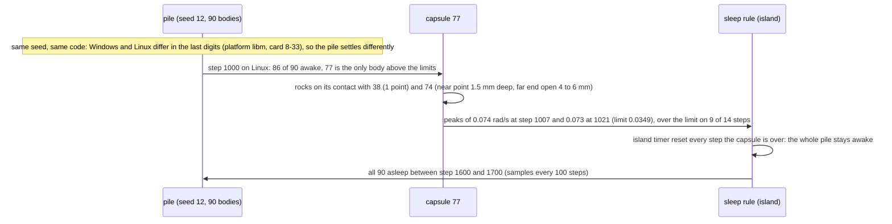

# Review 9-13: on Linux the catalogue mixed pile sleeps between step 1600 and 1700, not by 1200; one capsule rocks on two others meanwhile

Task: 9-13 (found by 8-88). Class 2 (physics narrowphase, sleeping); this change is documentation only. Outcome: **an investigation with no code change: on Linux x86-64 the mixed pile of the catalogue (seed 12) is not stuck, it is fully asleep between step 1600 and 1700 (Windows: between 400 and 600; samples every 100 steps), so `the_mixed_pile_comes_to_rest_and_sleeps` (bound 1200 steps) fails there with 4 of 90 asleep. The one body above the sleep limits in steps 1000 to 1300 is a capsule (index 77) that rocks smoothly, peaking at about 0.07 rad/s against the 0.0349 limit, period 14 steps, touching two capsules with a contact each while its far end to one of them is open by 4 to 6 mm. No wrong contact was found (that is not a proof that none is wrong, see Not verified), so no narrowphase change is proposed; the levers are the test (its bound, its seed or its form) and the sleep rule, which are the owner's.** Owner go-ahead: "I approve then 9-13" (2026-11-26); the owner chose "keep 1200, fix the pile" before this result was known.

## What was found

| item | result |
|---|---|
| the failure | Linux x86-64 (WSL2 Ubuntu, debug, the bench crate): 17 of the 18 scene tests pass; the one that fails is the seed-12 mixed pile at 1200 steps, 4 of 90 asleep. With `narrowphase.rs` of `e2f1bec` (before 9-9) put in the tree, the same test passed on Linux (one run, in 1.5 s). On Windows with the code of `develop` it passes |
| not stuck | probe over 4000 steps on Linux: 4 asleep at steps 400 to 1600, all 90 asleep at 1700 and at every later sample (every 100 steps). On Windows (same code): 89 asleep at 400, 90 at 600. So the pile is slow on Linux, not awake for ever |
| what keeps it awake | in steps 1000 to 1300 the only body above the limits (0.05 m/s, 0.0349 rad/s) is body 77, a capsule (shape by index: 77 mod 3 is 2). Its angular speed rises and falls smoothly with a period of 14 steps (peaks 0.074 at step 1007 and 0.073 at 1021; the per-step lists after 1100 peak at 0.065 to 0.064, so the peak may fall slowly, the samples are not one phase of the cycle and no decay rate is claimed) and its speed is 0.01 to 0.02 m/s: a slow rocking, not the one-step kick of 9-7 and 9-10. It is above the angular limit on 9 steps in every 14 (the printed lists) |
| its contacts | steps 1000 to 1030: with body 38 (a capsule) one point 1.4 mm deep; with body 74 (a capsule) two points, the near one 1.5 mm deep sliding 4.8 cm along the axis and back in the same 14 steps, and the far end open by 3.9 to 6.3 mm (it oscillates with the rocking). From the printed separations the far end looks like a contact that does not load (it is open 4 to 6 mm and the rocking moves it a fraction of a millimetre per step; impulses were not printed), which would leave the capsule held by two points on two bodies, rocking about the line between them. This is the situation the far end of `far_end` (8-89) was written to prevent, a near-parallel capsule rocking on one point, except that here the far end exists and is open. All three contacts are capsule-capsule, which the change of 9-9 (capsule-box) does not touch |
| why it passed before 9-9 | not traced. The Windows time after 9-9 (asleep between 400 and 600) is faster than the 683 of the comment in `scenes3d.rs` and of 8-21, which is from before 9-9 (the comment is now stale on Windows; not changed here). The two builds give different piles after step 80 (the golden hash of the pile changes at step 80), and 8-90 and 9-6 measured that this pile's time to sleep is a distribution (13 or 12 of 20 seeds asleep at 2000 steps before 9-9; 18 after), with the catalogue seed at the fast end on Windows. That a different trajectory is the whole difference is an inference, not shown |
| change | none. The probe (a public accessor for the tracked bodies, a test printing per-step velocities and the contacts of body 77) is not in the repository |

## Decisions

1. No change of the narrowphase proposed: the contacts of capsule 77 are what the code builds (a near point and a far end that is open), no wrong contact was found, and a change aimed at one body of one pile on one platform would fit a seed (8-90 found that the catalogue seed is one lucky pile, not an effect of the far-end bound). Two things stay open and are not excluded: the near point slides 4.8 cm along the axis over 14 steps (an ill-conditioned closest point of a near-parallel pair, or a lost warm start, were not checked), and the far gap of 3.9 to 6.3 mm straddles the 5 mm `MIN_END_BAND` and the 20 mm margin was not compared with it (a point entering and leaving the manifold, as in 9-10, is not excluded for the pair 77 and 74).
2. The options for the failing test are the owner's: (a) the bound of the seed-12 test from 1200 to 2000 steps (the value the ten-seed test of 9-8 already uses; it loosens a test, so it is not done without the owner; Linux needs between 1600 and 1700, so the margin is 300 to 400 steps on one platform, ARM64 not run); (b) a larger angular sleep limit (the peak is about twice the 0.0349 limit, so the limit would have to roughly double) or a limit on a smoothed velocity (9-6 reasoned, as an inference not run, that a larger limit would let such piles sleep: a rocking of 0.07 rad/s moves the tips of a capsule about 0.035 m/s, below the linear limit; it changes sleeping for every scene, a design card); (c) a damping of the rocking mode (a design: what removes energy from a capsule on two points); (d) take the catalogue test off the single seed: test the pile of the catalogue on the ten-seed share of 9-8 (which passes on Linux) or choose another catalogue seed (which hides this pile instead of explaining it, and changes the golden of that scene: a governance task); (e) leave the test red on Linux. The owner's first answer was to keep 1200 and fix the pile; (c) is the closest to a fix of the pile and is a design, with no cure shown.
3. A hosted `ci` run on Linux would be red on this test if it runs it as the WSL2 debug run did (the `ci` profile was not checked) until one of them is done.

## Not verified

- Why the same pile sleeps between step 400 and 600 on Windows and between 1600 and 1700 on Linux (the difference is in the platform libm, card 8-33; not traced step by step).
- That the rocking is the reason the pile stays awake until 1650: only that body 77 is the only one above the limits between 1000 and 1300 and that the pile sleeps by 1700. Steps 1300 to 1700 were sampled every 100 for the asleep count only, not per body.
- That the far end does not load (impulses not printed), that a point does not enter and leave at the band for the pair 77 and 74, and that the near point's sliding keeps its warm start (not checked).
- That 77 does not touch anything else (the list is the manifolds printed; the pair with 38 and 74 are the only two).
- Linux only through WSL2 on x86-64, one run; ARM64 not run. The probe on Windows ran 2000 steps once.
- The decay of the rocking (the peaks fall at most from 0.074 to about 0.064 between steps 1007 and 1150, sampled at different phases): what removes the energy, and whether it would end at the limit without further help, is not known.
- The effect of options (a) to (c) on any other pile; none was run.
- The local gates (card 8-88 ran them on `develop`: all 31 steps passed; this change adds a file under `reviews/`). Mermaid read by the author, not rendered.

## R1 to R8

| phase | result |
|---|---|
| R1 self | the first guess was a 9-10 kind of kick at the band; the per-step list showed one body with a smooth 14-step rocking and its contacts, all capsule-capsule |
| R2 automated | no code change: nothing to build |
| R3 independent | one read-only review, no blocker, three majors fixed (Loops) |
| R4 QA | asleep counts every 100 steps to 4000 on Linux and 2000 on Windows; per-step velocities and manifolds of body 77 over steps 1000 to 1300 |
| R5 to R7 | none |
| R8 product fit | the open point is answered with a cause that is not a defect and four options; the choice is the owner's |

## Loops

| loop | finding | handling |
|---|---|---|
| 1 | major: decay claimed from samples at different phases; 'as designed' too strong; options omit the owner's choice | peaks only, decay not claimed; 'what the code builds', two open points; options (c) and (d) added, owner's choice named |
| 1 | minor: 1700 against bounds, 'rocks about 0.07', never loads, 9-10 coincidence, 9-6 inference, margin, ci profile, 683, e2f1bec run, 8-90 wording | all reworded or added |
