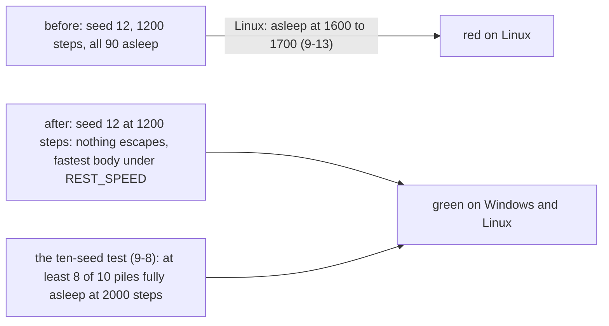

# Review 9-14: the catalogue mixed-pile test asks for the share of ten seeds to sleep, not one seed at 1200 steps

Task: 9-14 (decision after 9-13). Class 1 (bench crate test only; no engine code). Outcome: **`the_mixed_pile_comes_to_rest_and_sleeps` (seed 12, all 90 asleep at 1200 steps, red on Linux with 4 of 90) becomes `the_mixed_pile_comes_to_rest`: for seed 12 nothing escapes the box and the fastest body is under `REST_SPEED` at step 1200; that a pile sleeps is asked of the ten-seed share of 9-8 (8 of 10 at 2000 steps), which already exists and passed once on Linux (its count was not printed). With the narrowphase from before 8-21 both the new test and the ten-seed test are red on Windows, so the guard against that regression stays. This loosens one assertion by the owner's explicit choice.** Owner go-ahead: "I approve, then ten-seed share" (2026-11-26), after the options of `reviews/9-13.md`.

## What changed

| item | result |
|---|---|
| test | renamed `the_mixed_pile_comes_to_rest`; its asleep-count assertion is replaced by `found.escaped == 0`; the speed check `final_speed < REST_SPEED` (0.02 m/s) is kept; the doc comment says why (9-13) and names the ten-seed test. One doc link updated and one added; the old text "sleeps at step 683" is dropped (Windows is now between 400 and 600 since 9-9) |
| red evidence | the old test failed on Linux (WSL2, debug) with "4 of 90 asleep" (card 8-88, 9-13); the new one passes on Linux and on Windows |
| speed at step 1200 | seed 12, `final_speed`: 0 on Windows, 0.0074 m/s on Linux (limit 0.02): a margin of 2.7 on Linux |
| the 8-21 guard | `narrowphase.rs` of `b0e02b5^` (before 8-21) put in the tree: `the_mixed_pile_comes_to_rest` FAILED and `the_mixed_piles_of_ten_seeds_stay_in_the_box_and_most_sleep` FAILED (Windows, 16 of 18 pass). So both still catch the old defect; the doc comment says 0.06 m/s was that code's speed at step 800, as 8-21 measured |
| checks | the bench crate scene tests: 18 of 18 pass on Windows and on Linux; rustfmt and Clippy with warnings denied clean on the bench crate |
| the sleeping requirement | unchanged in the other tests: sphere pile at 1200 steps (seed 12), the ten-seed share of the sphere pile and of the mixed pile |

## Decisions

1. The single-seed sleep requirement is dropped, not the check that the pile comes to rest: what holds on every platform and every seed is still asked of seed 12.
2. The bound of the share (8 of 10) and the seeds (1 to 10) are those of 9-8, not changed.
3. Not chosen: raising the seed-12 bound to 2000 steps (300 to 400 steps of margin on one platform) and a change of the catalogue seed (governance golden).

## Not verified

- Which of the two red tests with the old code (seed 12 speed, or the ten-seed share) is the one that catches it alone: not separated (both failed in one run).
- The count of piles asleep in the ten-seed mixed test on Linux (it passed; the count was not printed), so its margin there is unknown; on Windows 9 of 10 against 8 (the figure of 9-8).
- ARM64 and the hosted `ci` run.
- The local gates (card 8-88 ran them on `develop`; this change is one test file). Mermaid read by the author, not rendered.

## R1 to R8

| phase | result |
|---|---|
| R1 self | the doc link in `PILE_STEPS` still named the old test; fixed |
| R2 automated | rustfmt, Clippy, the bench tests on Windows and Linux |
| R3 independent | one read-only review, no blocker; two majors fixed (Loops) |
| R4 QA | the scene tests on both platforms |
| R5 to R7 | none |
| R8 product fit | the release PR no longer waits on a single seed; the loss is that one seed no longer has to sleep by 1200, the guard of 8-21 was re-run and stays; the share has one seed of margin on Windows and an unknown one on Linux |

## Loops

| loop | finding | handling |
|---|---|---|
| 1 | major: the 8-21 guard dropped and the speed check claimed from numbers not measured at step 1200 | old narrowphase run against the new tests: both red; the doc comment and report say 0.06 m/s was at step 800 |
| 1 | major: 'passes on Linux' too strong; no Linux speed | softened; Linux final speed 0.0074 against 0.02 measured and written |
| 1 | minor: SEEDS comment half true; links count; margin wording; empty R3 | comment, links, R8 and R3 fixed |
