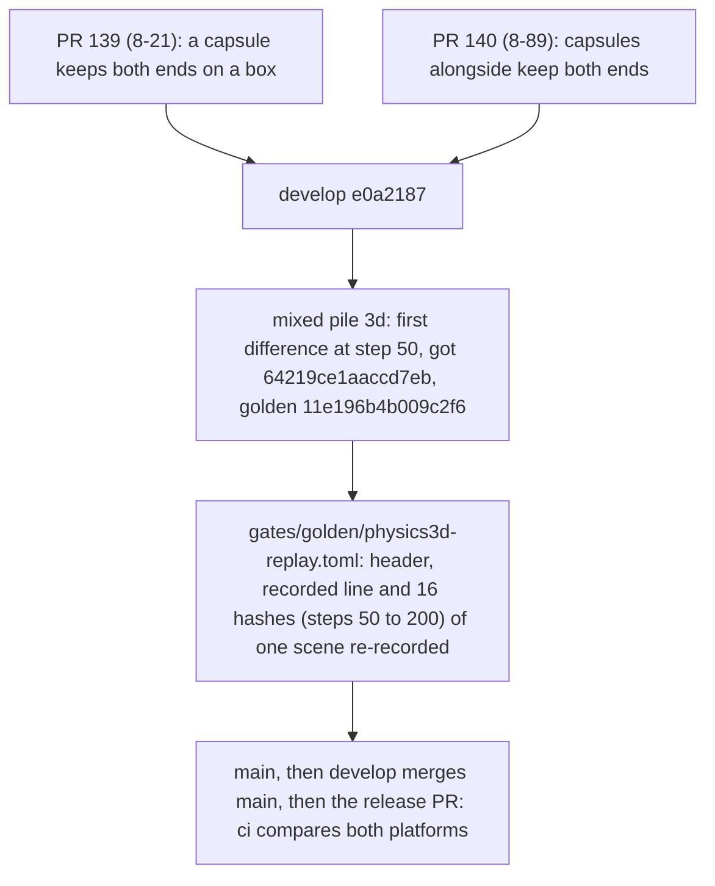

# Review 9-4: re-record the 3D golden hashes of "mixed pile 3d" after cards 8-21 and 8-89

Task: 9-4. Class 3 (governance: `gates/golden/physics3d-replay.toml` is a protected path). Governance card: PR into `main` first, then `develop` merges `main` in, then the release PR. Owner go-ahead: "declare the governance task for the golden hash now" (2026-11-25).

## What was done

| item | result |
|---|---|
| why | cards 8-21 and 8-89 changed which contact points a capsule gets (two where there was one), by design and reviewed; the scene `mixed pile 3d` has capsules. Both reviews named the stored golden as the open governance point |
| the change | `gates/golden/physics3d-replay.toml`, written by `golden_check.py record --i-am-changing-the-golden-file` from the recorder output of `develop` at `e0a2187`: the title comment, the `recorded` line and the 16 hashes of `mixed pile 3d` from step 50 to step 200. Steps 10 to 40 of that scene (equal before and after) and the four other scenes are unchanged. 36 lines changed (18 and 18) |
| lint and verify | `golden_check.py lint` and `verify` against the recorder output of `develop`: equal on Windows (5 scenes). Before the change `verify` named the first difference at step 50 only |
| 2D file | `gates/golden/physics-replay.toml` untouched: its 12 scenes are equal on `develop` (checked on both capsule cards) |

## Decisions

1. The golden file changes because behaviour changed in two reviewed cards (8-21, 8-89); no threshold is lowered, no test weakened, no waiver.
2. One scene differs from step 50: the recorder printed `64219ce1aaccd7eb` at step 50 for 8-21 alone (8-21 verification) and for 8-21 with 8-89 (8-89 verification and this recording); the later steps were not compared between the two states.
3. Windows values only. Nothing says steps 50 to 200 are equal on Linux: the hosted comparison stops at the first difference. The first full comparison is the `ci` run on the release PR.
4. After this merge `main` holds the new golden and the old 3D code: its 3D golden job is red on the push to `main` until the release PR merges, as after 8-81 (a deliberate red, said to the owner before the merge). The release workflow does not depend on `ci`, so it still publishes one patch version for this PR. The release PR's `ci` is the first full Linux comparison of steps 50 to 200; if Linux differs, a second governance PR is needed before the release can pass. The file records `develop` at `e0a2187`: a later physics change on `develop` needs a fresh record.
5. The line "Linux x86-64 confirmed at step 10" of 8-81 is dropped: step 10 of this scene is unchanged by this PR, so that fact still holds but is no longer written in the file.

## Not verified

- Linux values of steps 50 to 200 (Decision 3).
- That the full local gates pass on `develop` (card 8-88: not run, low memory); no code changes in this PR.
- The reviewer read the diff and ran `lint` only; the recorder and `verify` figures are the author's.
- Mermaid read by the author, not rendered.

## R1 to R8

| phase | result |
|---|---|
| R1 self | diff read: 2 comment/header lines and 16 hash lines of one scene; the other scenes' lines are untouched |
| R2 automated | `golden_check.py lint`, `verify` (the full local gates were not run, see Not verified) |
| R3 independent | one read-only review (Loops) |
| R4 QA | `verify` before (red at step 50) and after (equal) |
| R5 architecture | no code |
| R6 security | none; data read by a tool from `main` |
| R7 performance | none |
| R8 product fit | the release PR can pass its 3D golden job; the owner reads a 36-line diff |

## Loops

| loop | finding | handling |
|---|---|---|
| 1 | minor: this table empty | this table |
| 1 | minor: Decision 2 (step 50 equal for 8-21 alone and with 8-89) without evidence | source stated, later steps said not compared |
| 1 | minor: `verify`/recorder figures not re-run by the reviewer | stated in Not verified |
| 1 | minor: R2 read as complete while the local gates did not run | R2 reworded |
| 1 | nit: the version bump and the Linux risk of the release PR | Decision 4 |
| 1 | nit: the dropped "confirmed at step 10" | Decision 5 |
| 1 | note: the loop-1 text was not read by a second reviewer | stated |
