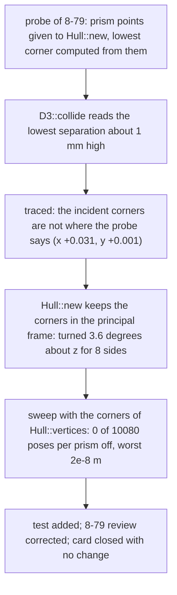

# Review 9-5: the "1 mm" of a flat prism face was an error of the probe

Task: 9-5 (opened from card 8-79, `reviews/8-79.md`). Class 2 as opened (physics: `face_clip.rs`); outcome: **no defect found in the swept space (see Not verified); one test added; a correction of the 8-79 review. No production code changed.** Owner go-ahead: "9-5" (2026-11-25).

## What was done

| item | result |
|---|---|
| the finding | a prism of 8 sides on a floor, turned 0.13 degree, lowest corner 0.5 mm above the floor: `D3::collide` reported 2 points with separation 1.54 mm, and the same 1 mm excess at every floor width |
| trace | a temporary print in `clip_manifold` (removed): the incident corners were `x = +0.0312, y = +0.00147` from where the probe put the lowest corner, 1 mm higher on a circle of radius 0.5 (`y = x^2`). The shape is the hull in its principal frame: `Hull::orientation` of the 8-sided prism is a rotation about z of 0.0624 rad (3.6 degrees); for 12 sides 10.3 degrees, for 16 sides 45 degrees |
| cause | `Hull::new` re-expresses the points in the principal frame of the solid (centre of mass at the origin, axes of the inertia tensor); for a regular prism the in-plane axes are degenerate and the frame is arbitrary. The probe placed the hull by its own input points, so its "lowest corner" was not the engine's |
| the check | the same sweep as 8-75 and 8-79 (8, 12 and 16 sides, 360 turns of half a degree, tilts 0 to 0.01 rad, 7 heights from 0.5 mm above to 0.2 m sunk), through `D3::collide`, with the lowest corner taken from `Hull::vertices`: 0 poses without a manifold, 0 off by more than 1 mm, worst error 2.3e-8 m (10080 poses per prism) |
| change | one test, `the_lowest_point_of_a_prism_manifold_is_at_the_height_of_its_lowest_corner` (`d3_narrowphase.rs`): 3 prisms, turns every 3 degrees, 4 poses, error under 0.1 mm (`PRISM_HEIGHT_TOLERANCE`). The 16-sided prism cannot show the probe's error (its frame is turned by 45 degrees, a multiple of its 22.5-degree period); the 8- and 12-sided ones do. It passes before and after (no defect). As a check that it is not vacuous, the same test with the corners taken from the input points instead of the hull fails (the symptom of the card). Also a correction paragraph in `reviews/8-79.md` |

## Decisions

1. The card is closed with no production change: there is no defect to fix.
2. The test is kept: the full manifold path had no test that its lowest separation is the height of the lowest corner (the 8-75 test is at the GJK level).
3. The 8-79 review is corrected by an added paragraph, the rest stays as written then.

## Not verified

- Prisms with other numbers of sides, other tilts, a floor that is not a box, and the hull against a hull; the sweep is the one of 8-75.
- The sweep runs on Windows only (the test uses a coarser grid, 720 poses).
- The full local gates (not run, memory, card 8-88); mutation, coverage, Miri.
- Mermaid read by the author, not rendered.

## R1 to R8

| phase | result |
|---|---|
| R1 self | the trace found that the numbers of the card did not describe the engine's shape; the first guess (the fitted-face rule of 8-71) was wrong |
| R2 automated | fmt, clippy `-D warnings`, the physics suite (partial gates: the full local gates were not run) |
| R3 independent | one read-only review (Loops) |
| R4 QA | trace of six poses, then the full sweep with the right corners; the test fails with the wrong corners |
| R5 architecture | none |
| R6 security | none |
| R7 performance | none |
| R8 product fit | an invented finding is withdrawn before anyone fixes it |

## Loops

| loop | finding | handling |
|---|---|---|
| 1 | minor: 'no defect' stronger than the evidence | header: 'found in the swept space' |
| 1 | minor: '10080 poses' is per prism | stated per prism in the table, diagram and the 8-79 correction |
| 1 | minor (merge-blocking): this table empty | this table |
| 1 | nit: the 16-sided case cannot detect the probe error; the tolerance a bare literal; R2 partial | comment and table say so; `PRISM_HEIGHT_TOLERANCE`; R2 reworded |
| 1 | nit: the 8-79 correction should open with WITHDRAWN and name the lines | done |
| 1 | note: the claim that the test fails with the input points was not re-run by the reviewer (it was run by the author) | stated |
