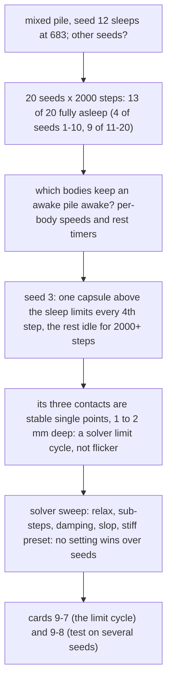

# Review 9-6: why the mixed pile does not sleep for most seeds

Task: 9-6 (open point of 8-90). Class 2 as opened (physics: contacts / sleeping); outcome: **an investigation with no code change: the pile's time to sleep is a chaotic distribution; one cause found in one pile (a 4-step jitter of a capsule on three single-point contacts); no solver setting removes it; two follow-up cards.** Owner go-ahead: "9-6" (2026-11-26).

## What was found

| item | result |
|---|---|
| distribution | with the default solver the mixed pile (90 bodies) is fully asleep at step 2000 for 13 of 20 seeds (seeds 1 to 10: 4, seeds 11 to 20: 9); none escapes, none blows up. Seed 12, the scene's own, is the fast end (asleep at 683). Longer runs: of seeds 1, 2, 3, 5, 7 (earlier probe) 1, 2, 5, 7 are asleep by 4000 steps or earlier, seed 3 not |
| what keeps a pile awake | the island sleeps when every body has rested 0.5 s below 0.05 m/s and 2 degrees per second; one body above the limits resets the whole island (a pile is one island). In seed 3 at steps 750 to 3000 nothing is above the limits at the moments sampled, but one body (the 38th of the pile, a capsule, 1.03 m up) has a rest timer of 0 to 0.07 s: it is above the limits for one step in every four |
| the jitter | a period of 4 steps: angular speed 0.055 rad/s (limit 0.0349) and linear 0.015 m/s (limit 0.05) in the step of the kick, 0.002 to 0.008 rad/s in the three steps between; its height changes by 0.1 mm. Its contacts (three single-point manifolds with three other bodies, separations -2.1, -1.5 and -1.1 mm) do not flicker: same bodies, same point counts at every step. So it is a limit cycle of the soft contact solver with three contacts a millimetre or two deep (the slop is 1 mm), not a narrowphase effect |
| thresholds | the angular limit is crossed by 0.055 against 0.0349: the kick is 1.6 times the limit and moves the capsule's ends by about 0.03 m/s, below the linear limit; a larger angular limit would let this pile sleep. Not tried as a change: the limit follows Box2D v2 and is a tunable of the world |
| solver sweep | seeds 1 to 10 at 2000 steps fully asleep: default 4, 2 relax passes 6, 8 sub-steps 4, `STIFF_CONTACTS` 5, damping ratio 3 gives 6, slop 3 mm 8; on 20 seeds: default 13, slop 2 mm 12, slop 3 mm 13, slop 5 mm 9. Seed 3 alone: asleep with 2 relax passes, 8 sub-steps, the stiff preset, slop 3 and 5 mm; not with 4 relax passes or damping 3; seed 2 alone: only 8 sub-steps fails. No setting is better than the default over 20 seeds, and the sweep on 10 seeds that looked best (slop 3 mm, 8 of 10) is noise at 20 |
| change | none. Probes (a seed, a solver choice and a per-step trace through environment variables) are not in the repository |

## Decisions

1. No solver or sleep change: nothing in the sweep beats the default over 20 seeds, and the one mechanism found (a 4-step limit cycle) needs its own investigation.
2. Two cards: 9-7 (the limit cycle) and 9-8 (the catalogue tests one seed: a test on several seeds).
3. The 8-90 statement "the pile is chaotic" is now measured: it is a distribution of times to sleep.

## Not verified

- The mechanism of the 4-step cycle (which contact, which pass of the solver, warm start): only that the manifolds are stable and the cycle exists in seed 3 at steps 1400 to 1440.
- Only one pile (seed 3) was traced to a body; seed 2 showed a rocking capsule (angular 0.15 to 0.27 rad/s at steps 1000 to 1750) and a box that were not traced.
- Windows only; 20 seeds, 2000 and 3000 steps; the fraction asleep at 2000 has an uncertainty of about 10 points at this size.
- A larger angular sleep limit was reasoned about, not run.
- The local gates (not run, card 8-88). Mermaid read by the author, not rendered.

## R1 to R8

| phase | result |
|---|---|
| R1 self | the sampled velocities every 250 steps showed nothing above the limits; the rest timers showed the jitter |
| R2 automated | no code change: nothing to build |
| R3 independent | one read-only review of the claims (Loops) |
| R4 QA | per-step trace of the body and of its manifolds; the sweep on 20 seeds corrected the one on 10 |
| R5 to R7 | none |
| R8 product fit | the open point is answered with numbers and the next questions are cards |

## Loops

| loop | finding | handling |
|---|---|---|
| 1 | (filled after the review) | |
