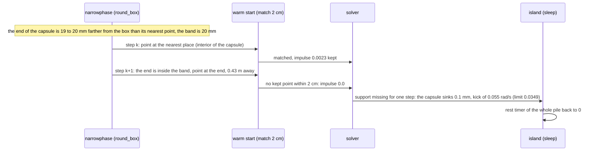

# Review 9-7: the capsule that kicks every fourth step is a jump of a contact point, not the solver

Task: 9-7 (open point of 9-6). Opened as Class 2 (physics: contact solver, sleeping); this change is documentation only; outcome: **an investigation with no code change: the 4-step kick of 9-6 is a contact point of the capsule-box narrowphase that jumps 0.43 m between two steps, so the warm start of that contact is lost and the capsule is kicked; it is not a limit cycle of the solver (9-6 said "consistent with", and that is corrected here). One change of the point choice, tried and not merged, lifts the mixed pile from 12 to 18 of 20 seeds asleep at 2000 steps; a second, simpler-looking change is rejected (it holds a capsule up in the air); two follow-up cards.** Owner go-ahead: "9-7" (2026-11-26).

## What was found

| item | result |
|---|---|
| the point | seed 3, capsule index 38 (body slot 43), against the box index 22 (slot 27). `round_box` takes the nearest point of the capsule to the box by a search along its axis, then `contact_parameters` replaces it by the ends of the capsule when an end is within the band (`margin.max(5 mm)`, the margin is 20 mm) of the nearest distance, and keeps the nearest point only when neither end is. In the 30 calls printed (several steps, not one per step) the difference between the distance of end 0 to the box and that of the nearest point was 18.7 to 19.9 mm whenever the end was taken, and 20.03 to 23.3 mm whenever the nearest point was taken, so the flip is at the band, 20 mm; the chosen point flips between "end 0" and "nearest, 0.68 to 0.70 of the axis". The capsule axis is 0.608 m long, so the two points are 0.43 m apart |
| the warm start | the point list after step 1403 and after step 1407 holds the other point; the solver then starts the next step with a kept impulse of 0.0 for that pair (printed from inside the solver), although the step before ended at 0.0033. The kick is in that next step (steps 1404, 1408, ...): speed 0.015 m/s, spin 0.055 rad/s, and the capsule is 0.1 mm lower. Step by step: 4 steps of the cycle, one with the point at the other place |
| cause or correlation | a test of the cause: with the match distance of the warm start widened from 2 cm to 0.6 m (a blunt change, only for this test) the kick of this capsule is gone (its rest timer rises without a break from step 1401 to 1424). So the lost warm start is the cause of the kick, and the point flip is the cause of the lost warm start |
| the effect on the pile | the number of piles asleep at 2000 steps (20 seeds, one run each, the runs are deterministic) is 12 with the code of develop (`891010c`); with the widened match 10, so that change is no remedy, only a test |
| a change of the point choice (V1, not merged) | keep the nearest point when it is at least 1 mm nearer than every end that is taken, and take the ends within the band as before; up to 3 points. Piles asleep at 2000 steps: **18 of 20**, times to sleep 370 to 1492 steps (seeds 1 to 10: 9, seeds 11 to 20: 9); the 4-step kick of seed 3 is gone. All 469 tests of the physics crate and the 15 of the scene catalogue pass with it (release profile, Windows). The golden hash of "mixed pile 3d" changes (a protected file) |
| a second change (V2, rejected) | choose the ends by their distance to the plane of the nearest point instead of to the box: all 20 seeds asleep, 359 to 754 steps. But it holds a capsule up in the air: a test with a capsule (half length 0.5 m, radius 0.1 m) lying across the edge of a static box, with its centre 0.45 m beyond the edge, stays at rest on the box for 2 s with V2 (height 0.099 m) and falls with the code of develop and with V1 (with V2 a centre up to 0.5 m beyond the edge is held, 0.75 m beyond falls). So V2 builds a contact at a place where the box is not |
| what remains in V1 | seeds 3 and 13 are still awake at 2000 steps. In seed 3 the capsule 38 still kicks (spin 0.082, about every 15 steps): the manifold with the box 22 goes from 2 points to 1 point at step 2011 and back to 2 at step 2012, so a point enters and leaves, and the kick is in the step after the point returns. That is the same band crossing for an end instead of for the nearest point; the band is not shown to be the cause here (not traced). In seed 13 three bodies (29, 57, 77) are above the limits in one step (2016), not traced |
| the earlier count | 9-6 gave 13 of 20 piles asleep at 2000 steps with the default solver; on `891010c` the count is 12 (seeds 1 to 10: 4, as before; seeds 11 to 20: 8, not 9). Both runs are deterministic; why one seed differs is not found (the probe of 9-6 is not kept). The figure 12 is the one used here, and `reviews/9-6.md` carries the correction |

## Decisions

1. No code change in this card: the fix moves the capsule-box contact points (Class 2), changes the golden hash (a governance re-record, as 8-81 and 9-4 did), and has a design choice in it (the 1 mm, the third point). It is card 9-9, for the owner to pick.
2. The solver and the sleep rule are not changed: with the point flip gone the 4-step kick is gone without touching them. The remedy "a larger angular sleep limit" of 9-6 would hide the kick, not remove it.
3. A card for what remains (9-10: a point that enters and leaves at the band, seeds 3 and 13).
4. Card 9-7 as it was written (a limit cycle in the solver) is answered: it is not.

## Not verified

- That the band crossing is the only cause of the point flip: seen in the printed distances (the 30 calls sort exactly at 20 mm), not shown by a test that moves the end across the band.
- The capsule-box case only: the sphere-box, the capsule-hull and the capsule-capsule contacts were not examined for the same jump (the capsule-capsule near point is kept by design since 8-90, and its far end enters and leaves, which is the same kind of event as the one left in V1).
- V1 as code: it ran in the probe (3 points, a constant of 1 mm chosen once, not tuned) and passed the existing tests; no regression test of its own, no coverage, no mutation run, no Linux or ARM64 run, no cost figure.
- 18 of 20 is one run per seed on Windows; the distribution (12 of 20 for develop) has a standard error of about 11 points at this size, but both runs are on the same 20 seeds, so the lift is a paired comparison of 6 seeds that now sleep and none that stopped (seeds 1, 2, 5, 7, 8 and 11 are the new ones).
- The overhang test is one geometry (capsule along the edge, one radius, one length); V1 passes it, which is not a proof that V1 builds no contact at a place where the box is not.
- Seeds 3 and 13 beyond what is written above, and seed 2 of 9-6 (a rocking capsule and a box).
- The local gates (card 8-88, not run) and the golden check (nothing was changed in the repository). Mermaid read by the author, not rendered.

## R1 to R8

| phase | result |
|---|---|
| R1 self | the first guess (a solver cycle, 9-6) was dropped when the point positions of the manifold were printed: 0.43 m apart on one step in four |
| R2 automated | no code change: nothing to build |
| R3 independent | one read-only review of the claims (Loops) |
| R4 QA | per-step trace of the manifold points and of the kept impulses; the 20-seed runs for each variant; the overhang test to reject V2; the widened match as a test of the cause |
| R5 to R7 | none |
| R8 product fit | the open point is answered, the fix is a card with its numbers, the governance consequence and the rejected alternative are written down |

## Loops

| loop | finding | handling |
|---|---|---|
| 1 | filled after the independent review | see below |
