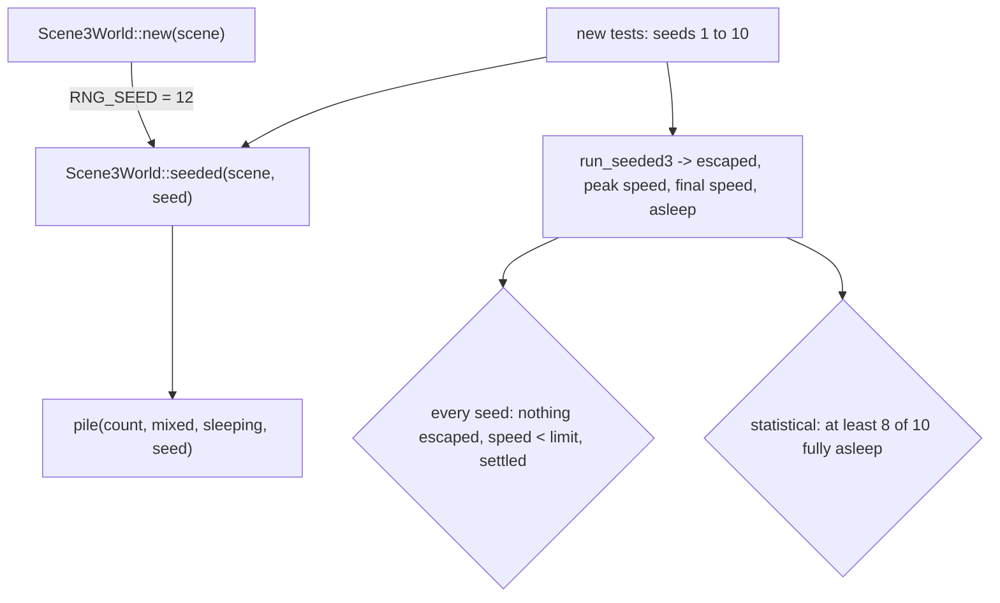

# Review 9-8: the piles of the 3D catalogue are tested on ten seeds

Task: 9-8 (open point of 9-6). Class 1/2 (bench crate: `scene3d.rs`, `tests/scenes3d.rs`; no engine code). Outcome: **the scene takes a seed, and the sphere pile and the mixed pile are run on seeds 1 to 10: what must hold for every seed is checked for every seed, and a share of the piles must be asleep; the mixed-pile test is red with the narrowphase from before card 9-9 (4 of 10 asleep).** Owner go-ahead: "9-8 then 9-10" (2026-11-26).

## What changed

| item | result |
|---|---|
| scene | `RNG_SEED` is public; `Scene3World::seeded(scene, seed, execution, sleeping)` builds a scene with another seed (only the piles are random), and `new` is `seeded` with `RNG_SEED`; `run_seeded3` is `run_scene3` with a seed. The catalogue is unchanged: the same seed, the same hashes (the golden check was not needed: no engine code changed, and a test shows `new` and `seeded(RNG_SEED)` give the same hash) |
| tests | `the_sphere_piles_of_ten_seeds_stay_in_the_box_and_most_sleep` (1200 steps) and `the_mixed_piles_of_ten_seeds_stay_in_the_box_and_most_sleep` (2000 steps): for each of seeds 1 to 10 nothing escapes the box, the peak speed is under `SPEED_LIMIT`, the final speed is under `PILE_SETTLING_SPEED`; at least 8 of the 10 piles must be fully asleep. `a_seed_makes_another_pile_and_the_seed_of_the_catalogue_makes_the_catalogue_pile`. No existing test is changed or loosened |
| measured (Windows, debug) | sphere pile, 1200 steps: 9 of 10 fully asleep (seed 3: 34 of 60 at 1200 steps, all asleep at 2000); mixed pile, 2000 steps: 9 of 10 (seed 3 is the one awake, 5 of 90). Over seeds 1 to 20 the mixed pile has 18 asleep at 2000 steps and none escaped or above 8.2 m/s; the sphere pile has 20 of 20 at 2000 steps. Final speeds are 0.000 to 0.007 m/s |
| the bound 8 of 10 | between the measured 9 and the 4 of the narrowphase before 9-9. Red evidence: with `narrowphase.rs` of the commit before 9-9 the mixed test fails with "4 of 10 asleep" |
| time | in the debug profile the scene tests take 23 s (17 tests; the two new ones about 6 s and 12 s); the 20 seeds would be 15 s and 45 s, so ten were taken |
| checks | bench crate 86 tests pass; Clippy with warnings denied and rustfmt clean |

## Decisions

1. Ten seeds, not twenty: half the time, and the margin of 8 of 10 against the measured 9 covers one seed that moves with the platform (the last digits of the rotations differ on Linux, card 8-33). Twenty seeds would be a stronger test.
2. The statistical bound is a share, not "all": seed 3 is awake at 2000 steps by the mechanism of card 9-10, which stays open. When 9-10 is closed the bound can rise.
3. The hard checks (escape, speed, settling) are for every seed and are not statistical.

## Not verified

- Linux and ARM64: the share asleep and the final speeds were measured on Windows only; the bound of 8 of 10 leaves one seed of margin, not more. The `ci` run on the release PR will show it.
- The share for the sphere pile at 1200 steps rests on one seed (3) that is just under; a platform that moves another seed would still pass, two would not.
- Release-profile time of the tests (not needed) and the effect on the whole-workspace test time (the bench crate only was run).
- The local gates (card 8-88, not run). Mermaid read by the author, not rendered.

## R1 to R8

| phase | result |
|---|---|
| R1 self | the sphere bound was first taken at 2000 steps, where all 20 sleep; the existing sphere bound is 1200 steps, so that is used, and the one seed under it is written down |
| R2 automated | Clippy, rustfmt, the bench tests |
| R3 independent | one read-only review (Loops) |
| R4 QA | red evidence against the narrowphase of before 9-9; timings of 10 and 20 seeds |
| R5 to R7 | none |
| R8 product fit | the open point of 9-6 is answered: the catalogue no longer tests only the fast seed |

## Loops

| loop | finding | handling |
|---|---|---|
| 1 | filled after the independent review | see below |
