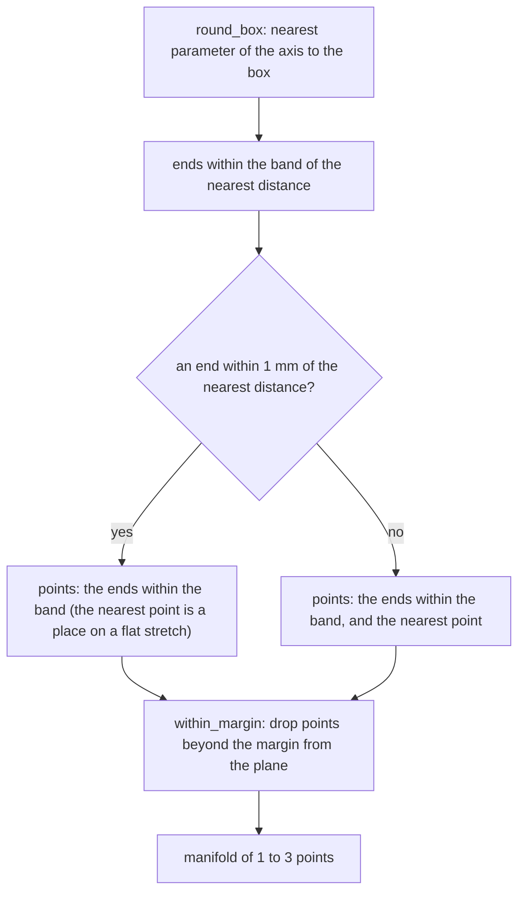

# Review 9-9: a capsule on a box keeps its nearest contact point next to an end inside the band

Task: 9-9 (open point of 9-7). Class 2 (physics narrowphase). Outcome: **the contact point of a capsule on a box no longer jumps along the capsule when an end crosses the 20 mm band; the mixed pile of the catalogue has 18 of 20 seeds asleep at 2000 steps instead of 12; the golden hash of "mixed pile 3d" changes, so the release PR needs a governance re-record first (card 9-11, to be declared by the owner).** Owner go-ahead: "9-9" (2026-11-26).

## What changed

| item | result |
|---|---|
| code | `contact_parameters` (`engine/physics/src/d3/narrowphase.rs`) returns up to three parameters: the ends within the band, plus the nearest point unless an end is within `NEAREST_REDUNDANT` (1 mm) of the nearest distance (then the distance is flat along the segment and the nearest point is no better a place than the end). Before, an end within the band replaced the nearest point, so at the band the point jumped along the capsule (0.43 m in the mixed pile, seed 3) and the warm start (match 2 cm) found nothing (`reviews/9-7.md`). `within_margin` and the point array of `round_box` hold three points |
| tests (red first) | `a_capsule_sliding_over_a_box_edge_keeps_a_contact_point_where_it_was_at_every_step`: a capsule over the edge of a box slides along its axis in 0.5 mm steps while its end passes from 42 mm to 5 mm above the nearest distance (across the 20 mm band); every manifold must share a point (within 2 cm) with the one before. Red before the change: at step 97 the point went from (0.999, 0.999) to (0.928, 1.071). `a_capsule_resting_on_an_edge_with_its_end_inside_the_band_gets_the_nearest_point_and_the_end`: two points with the end inside the band, one beyond it (red before: one point). `a_short_capsule_across_a_box_edge_with_both_ends_inside_the_band_gets_three_points`: the middle and both ends. All green after |
| the pile | probe (not in the repository: a seed read from an environment variable): the mixed pile with seeds 1 to 20, 2000 steps, asleep: 12 before, **18 after** (seeds 3 and 13 are still awake: card 9-10); times to sleep 370 to 1492 steps; the numbers are the same as those of the probe V1 of 9-7, as they should be (the same rule) |
| the existing checks | physics crate 1127 tests and the bench crate 83 tests pass (release profile, Windows); Clippy with warnings denied and rustfmt are clean on both crates |
| the golden hash | `golden_check verify` on `gates/golden/physics3d-replay.toml`: only "mixed pile 3d" differs, from step 80 (got `a3d4086ec93d8dcd`, golden `4243f6f1b082bf30`); the other scenes match. The file is a protected path and is not touched here |

## Decisions

1. The 1 mm (`NEAREST_REDUNDANT`) is a choice, not tuned: it is the size under which two distances along a capsule are the same for the solver (the solver default slop, `core/solver.rs`, is 1 mm). It is a named constant with its reason; 0.5 and 2 mm were not tried.
2. Up to three points per capsule-box manifold. The solver takes up to four (`MAX_MANIFOLD_POINTS`), so no limit moves.
3. The choice of the ends by plane distance (20 of 20 seeds asleep, probe V2 of 9-7) is not made: it held a capsule 0.45 m past a box edge in the air.
4. The golden is not re-recorded here (a protected path, and the owner chose no governance task until now): card 9-11. The `ci` job `d2_determinism` will be red for "mixed pile 3d" on `main` until it is done, so the release PR must wait for 9-11. `develop` has no CI.

## Not verified

- The sphere-box and capsule-hull contacts for the same jump (the sphere has one point and cannot flip; the hull path is another function, not read for this).
- The 1 mm boundary: when an end comes within 1 mm of the nearest distance the nearest point is dropped with its warm-start impulse (the end stays, so a point is still matched); no test crosses it (the slide stops at 5 mm), and the 1 mm itself has no test.
- The boundary of `round_box` and `deep_contact` (a segment that goes through the box) for the same kind of jump.
- Cost: the number of points of a capsule-box manifold is now up to three instead of two, so a contact solves a point more at times; no benchmark was run (the instruction-count benchmark, card 8-13, would show it).
- Linux and ARM64 (nothing in the change depends on the platform, but the new tests were run on Windows only).
- Seeds 3 and 13 (card 9-10) and the effect for a capsule on a hull or a sphere.
- That no contact is built where the box is not: the existing overhang test (`a_capsule_hanging_over_the_edge_of_a_box_has_a_point_only_where_the_box_is`) passes and a world-level run of a capsule with its centre 0.45 m past an edge, in 9-7, fell with the same rule (probe, not kept as a test).
- Coverage and the mutation run (the local gates are not run, card 8-88).
- Mermaid read by the author, not rendered.

## R1 to R8

| phase | result |
|---|---|
| R1 self | the first geometry of the test used the 0.1 m margin of the other tests, where the band is 0.1 m, and never crossed the 20 mm band; the test now takes the engine's default margin |
| R2 automated | Clippy (one cast, fixed), rustfmt (one line, fixed), the physics and bench tests |
| R3 independent | one read-only review, no blocker or major (Loops) |
| R4 QA | red evidence of both tests; 20 seeds; golden check |
| R5 to R7 | none beyond the above |
| R8 product fit | the mixed pile of every seed but two sleeps in time; the golden consequence is stated for the owner |

## Loops

| loop | finding | handling |
|---|---|---|
| 1 | minor: `band.max(..)` inside the loop; comment of the constant; 43 mm is 42 mm; no test of the three-point case; Loops left empty; 1 mm and slop source; Not verified missing the 1 mm boundary and deep_contact | hoisted; reworded; corrected; test added (red check: it needs the middle and both ends); filled; the two items added to Not verified |
