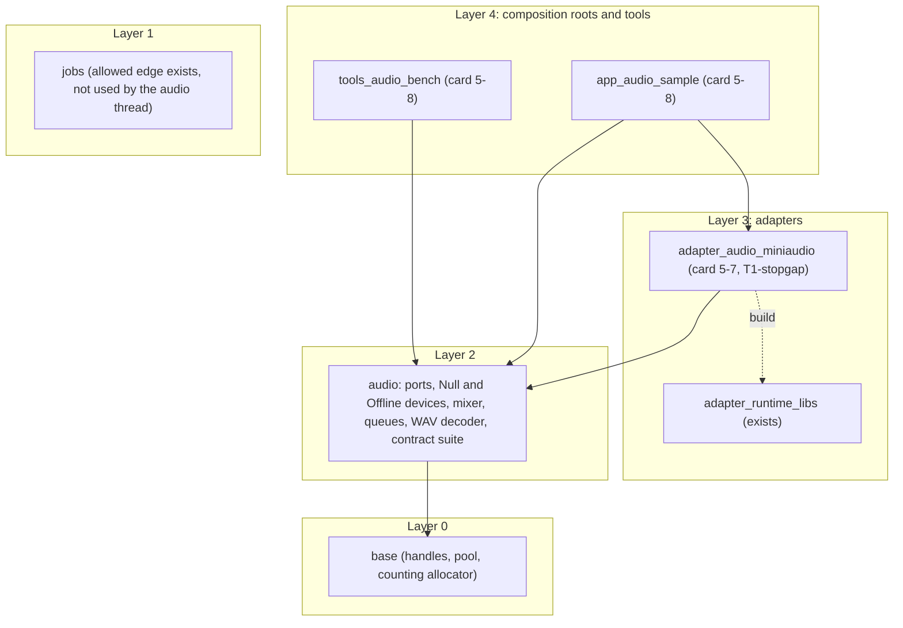
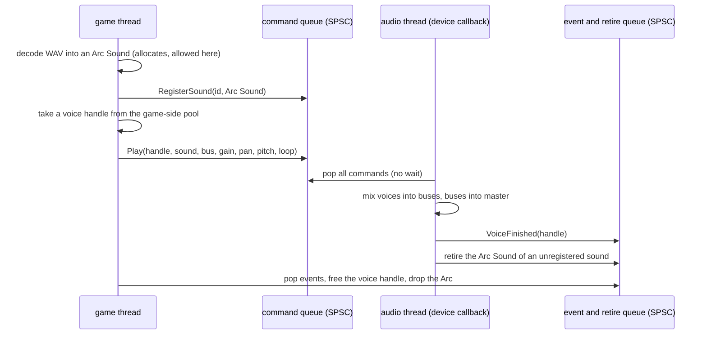
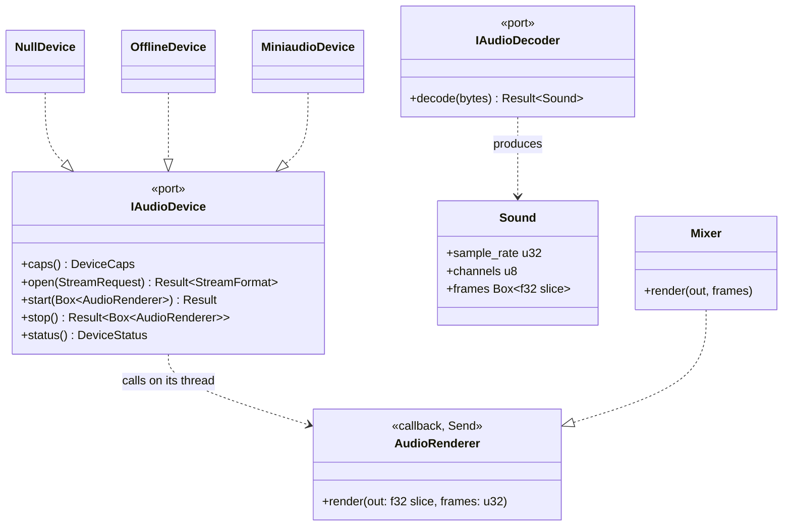
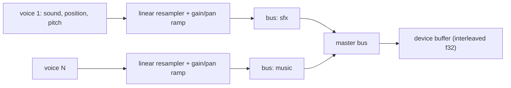
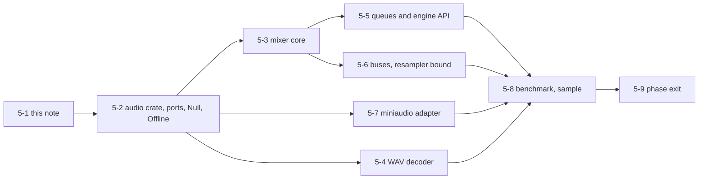
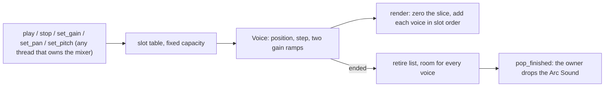
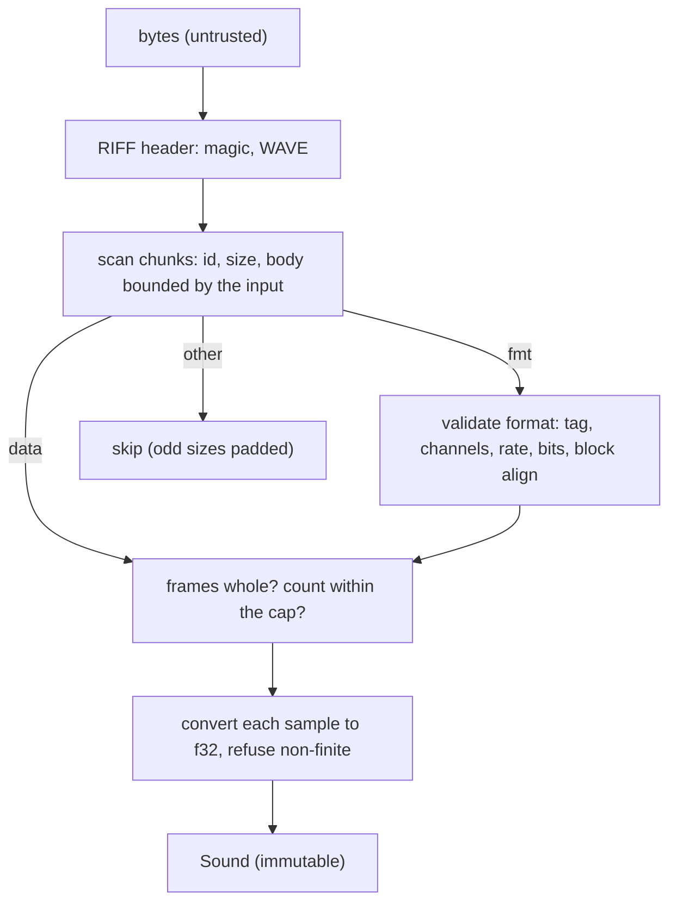
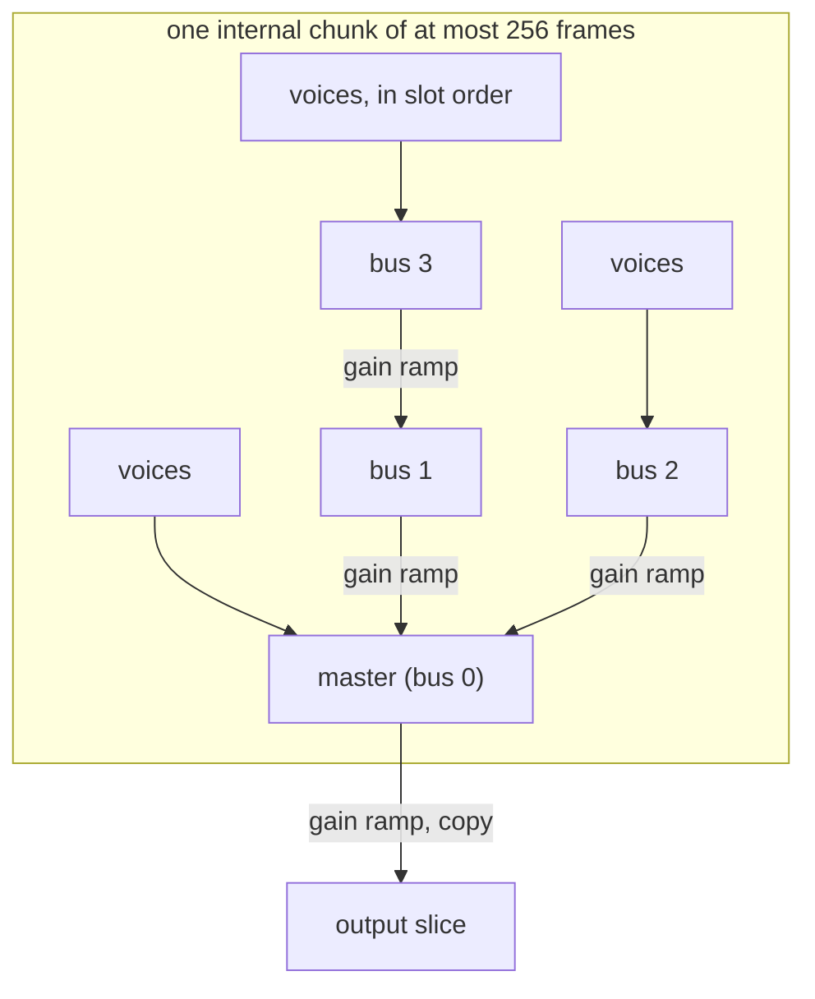
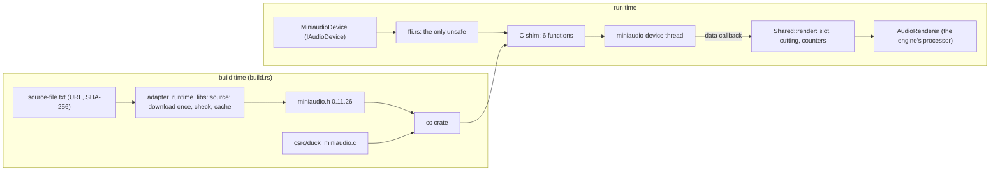
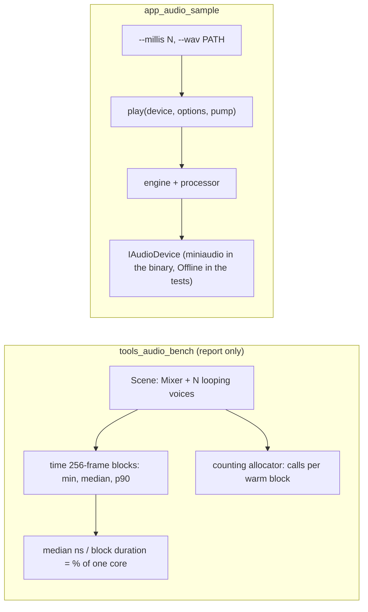

# Audio port v0 and the phase 5 mixer: design note `[P]` (card 5-1)

Design note for phase 5, written before any code. It turns the phase 5 row of the [roadmap](../workflow/roadmap.md) and the first sketch in [audio](audio.md) into a buildable shape: the device port `IAudioDevice`, the decoder port `IAudioDecoder`, the thread model between the game and the audio thread, the mixer, the Null, Offline and miniaudio adapters, and the tests.

Fixed inputs, not reopened here: the pull model and the rule that the audio thread is not a job-system worker ([ADR-0013](../decisions/README.md)); every port has a Null adapter and a contract suite and stays `experimental` until two real adapters pass it ([ports-and-adapters §4](ports-and-adapters.md)); miniaudio is allowed as a T1-stopgap with an exit plan ([THIRD_PARTY.md](../../THIRD_PARTY.md)); conventions f32, SI units ([conventions](conventions.md)); zero allocation on the hot path and no `unwrap` in engine code ([rules digest](../rules-digest.md) section 4).

**Scope in one line:** a WAV file is decoded, played through a mixer with gain, pan and buses, and the same mixer code is proven correct offline, proven free of allocation and locks in the callback, measured per voice, and then heard through a real device.

## 1. Evidence and what is still unverified

The research pass for this note read the primary sources that could be reached. Findings are tagged **[K]** (known from a source below) or **[U]** (unverified, to be checked in the card named).

| Fact | Tag | Source and consequence |
|---|---|---|
| The miniaudio data callback is `void data_callback(ma_device*, void* pOutput, const void* pInput, ma_uint32 frameCount)`; the output is interleaved; `frameCount` is the most the buffer holds ("never process more than frameCount frames") | K | [miniaudio manual](https://miniaud.io/docs/manual/). The port hands the renderer one interleaved `f32` buffer and a frame count. |
| `ma_device_init` leaves the device stopped; `ma_device_start` and `ma_device_stop` must never be called from inside the callback (deadlock) | K | same. The port has `open`, `start`, `stop` as separate calls made from the game thread only. |
| Format, channels and sample rate can be left at 0 or unknown to take the device's native values; miniaudio converts internally between the requested and the native format | K | same. The port negotiates: the caller proposes, the adapter reports what it got. |
| Backends: WASAPI, DirectSound, WinMM on Windows; ALSA, PulseAudio, JACK on Linux; tried in a fixed priority order | K | same. The adapter takes whatever miniaudio picks; the native WASAPI adapter is the exit plan. |
| Compile switches `MA_NO_DECODING`, `MA_NO_ENCODING`, `MA_NO_ENGINE`, `MA_NO_RESOURCE_MANAGER` | K | same. The adapter compiles the device layer only: our decoder and mixer are our own. |
| Whether the callback size is fixed or varies, the notification callback (device lost, stopped), the xrun report | U | The manual pages read do not say. Secondary sources mention a `noFixedSizedCallback` option. **Design rule: the port promises only "at most `max_block_frames`, may vary"**, which holds either way. Checked against the pinned header in card 5-7. |
| SoLoud: sources are separate from instances (playheads), 16 voices by default and 4095 at most, when all voices are busy the oldest is killed, the most audible voices are mixed first (virtual voices), buses group voices for volume and filters, default resampler is linear interpolation | K | [SoLoud concepts](https://solhsa.com/soloud/concepts.html). Used as the reference for voice policy and the resampler default; the thread model is not described there. |
| Command queue from a control thread to a real-time thread, the real-time thread pops commands and renders; queues of this kind are single producer, single consumer | K (practice) | engineering write-ups found by search, not authoritative. The design follows the same pattern and is justified by its own tests (section 8), not by the sources. |
| FMOD and Wwise internal threading; Ross Bencina's rules for the audio thread | U | No documentation retrievable (the page refused the connection). The rules in section 3 are the general real-time rules already in [audio §2](audio.md) and are enforced by tests, not by citation. |

The unverified rows do not block the design: each has a fallback in the table and a card that settles it.

## 2. Where the code lives



- **`audio` (layer 2, new crate, card 5-2)** declares both ports, the handle types, the mixer, the two queues, the Null and Offline devices, the WAV decoder and the contract suite (feature `contract-tests`, like `platform` and `render`). It depends on `base` only. Null and Offline live here for the same reason Headless lives in `platform`: no external code, usable by every test.
- **`adapter_audio_miniaudio` (layer 3, card 5-7)** is the only code that knows miniaudio. Only layer 4 depends on it.
- `gates/architecture.toml` already has `audio = 2`, the `adapter_*` glob and the edge `audio -> jobs`; no row is needed for the crates above. The `audio -> jobs` edge is not used: the audio thread is not a worker (ADR-0013). Whether `jobs` is used at all (for example to decode on a worker) is decided when a card needs it.

## 3. The thread model and the real-time rule



The rule for everything reachable from the callback: **no allocation, no lock, no I/O, no blocking system call, no unbounded loop, and no drop of anything that frees memory.** Consequences that shape the design:

1. **The audio thread owns the mixer.** The mixer, with fixed capacities for voices, buses and sounds, is built before the device starts and moved into the callback. The game thread never touches it; it sends commands. There is no shared mutable graph and so no snapshot to publish and nothing to reclaim. (O1.)
2. **Handles are made on the game side.** The game thread owns a pool of voice handles (index plus generation, from `base`), so `play` returns at once without a round trip. A handle becomes free again only when the audio thread's `VoiceFinished` event has been read; the audio thread validates the generation and ignores a stale command.
3. **Sound data is immutable and shared as `Arc<Sound>`.** The `Arc` is moved to the audio thread inside a command and moved back inside a retire message when the sound is unregistered, so the last reference is always dropped on the game thread. This is the real-time-safe reclamation that [audio §3](audio.md) left open.
4. **The queues cannot overflow where it would hurt.** Events from the audio thread are bounded by construction: a voice slot produces one `VoiceFinished` and is reused only after the game thread has read it, so a queue with room for every voice cannot be full. The command queue can be full (the game sends faster than the audio thread consumes); `play` then returns an error value and the caller decides. Nothing is dropped silently.
5. **Smoothing instead of locks.** A parameter command sets a target; the audio thread moves to it by a linear ramp across the next block, sample by sample, so changes do not click and the result does not depend on how the callback is chunked (section 6).
6. **The pan gains are computed on the game side** (a sine and a cosine), so the audio thread only multiplies. No transcendental function runs in the callback in v0.

The queue is a bounded power-of-two ring with one producer and one consumer, a release store on the writer's index and an acquire load on the reader's. It needs a small `unsafe` block (an `UnsafeCell` slot array) with a `// SAFETY:` comment and a share of the `unsafe` budget; Miri and the ThreadSanitizer job are its evidence (card 5-5). The module needs a row in `gates/unsafe-budget.toml` (a protected path, so 5-5 has a governance step the owner declares). Placement: `base` (layer 0, next to `ring.rs`, where the other unsafe modules already live and where `jobs` could reuse it) is recommended over `audio`. A safe variant that stores commands as packed atomic words was considered; it cannot carry an `Arc`, so it would force a second mechanism for sounds. Rejected.

## 4. The ports



- **Negotiation.** `StreamRequest` is the proposal: sample rate (0 = the device's native rate), channel layout (mono, stereo, 5.1), a block-size hint. `open` returns the `StreamFormat` the device really gives: rate, layout and `max_block_frames`. The mixer is then built for that format; it is the renderer passed to `start`. This order avoids a renderer that has to guess the format. (O2: the engine rate follows the device.)
- **The callback contract.** `render` receives one interleaved `f32` slice of exactly `frames * channels` samples with `frames <= max_block_frames`, may be called with a different `frames` each time, and must fill the whole slice (silence when nothing plays). It runs on a thread the adapter owns; the engine neither creates nor joins it.
- **`stop` gives the renderer back**, so the mixer is dropped on the game thread, never in the callback. `start` and `stop` are never called from the callback (the miniaudio deadlock rule is the port's rule).
- **Failures are values** (`AudioError`): no device, format refused, already started, device lost. `status()` returns counters the adapter keeps (callbacks run, frames rendered, underruns it could see, device lost); it is polled by the game thread, so no callback into game code exists.
- **The decoder** turns bytes into an immutable `Sound` in memory. It runs on a loader thread or the game thread, where allocation is allowed. Streaming (a ring filled by an I/O worker) is not in v0 (O3).
- **Dispatch.** `Box<dyn IAudioDevice>` in the composition root, one virtual call per start or stop; `dyn AudioRenderer` is called once per callback, which is a coarse boundary (ADR-0005). Voices are not virtual.

## 5. The adapters

| Adapter | What it does | Why it exists |
|---|---|---|
| **Null** | accepts `open` and `start`, never calls the renderer, reports zero counters | the headless build: the engine runs with no sound service |
| **Offline** | `open` returns exactly the requested format; `render_blocks(n)` and `render_frames(n)` pull the renderer on the calling thread and keep the output in a buffer; callable with any chunk sizes | tests, golden audio, the benchmark: deterministic and fast, no clock |
| **Miniaudio** (card 5-7) | opens the default playback device with `f32` output, forwards the callback to the renderer, reports status | the first sound out of a real device on Windows; Linux through ALSA or PulseAudio, picked by miniaudio |

### The miniaudio build, a finding the owner should know now

GLFW could be a downloaded, hash-checked DLL placed next to the program (card 4-35). **miniaudio has no official binary**: it is a single C header that must be compiled. The adapter therefore needs a C compiler at build time. A thin C file (about 60 lines) wraps miniaudio behind four opaque functions (open, start, stop, status), so Rust declares four functions and never the large, version-dependent `ma_device_config` struct. Routes (O5):

- (a) compile the pinned, hash-checked `miniaudio.h` and the shim with the `cc` crate in `build.rs` (a pinned build-time dependency, listed in `THIRD_PARTY.md`; the MSVC build tools are already needed by Rust on Windows);
- (b) the same without a crate: `build.rs` finds and runs the compiler itself (more code, fragile on Windows);
- (c) skip miniaudio and write the native WASAPI adapter first (no C, but hand-declared COM interfaces, the largest piece of work in the phase; the roadmap puts this later).

Recommendation: (a). The exit plan stays: removing the adapter and the entry once the native adapter passes the same contract suite.

## 6. The mixer



- **Fixed capacity.** `MixerConfig` gives the number of voices, sounds, buses and the queue sizes; everything is allocated in `Mixer::new`. The bus tree is fixed at construction in v0 (a table in an order that puts children before parents); a command changes a bus's volume and mute only. Creating buses at run time is out of scope.
- **Processing.** The callback may ask for any number of frames; the mixer works through them in internal chunks of a constant size (256 frames) held in preallocated scratch buffers. All state that crosses a chunk (resampler position, gain ramp) is carried per voice, so **the output does not depend on how the frames are split between calls.** That is a testable property (section 8).
- **Voices.** One-shot and looping, mono or stereo sources, pitch as a resampling ratio, gain, pan (constant-power, -3 dB at the centre, O7). Source rate to device rate conversion is the same linear resampler used for pitch (one mechanism, O2, O8).
- **Policy when full.** `play` returns `VoicesExhausted` as a value (O4). Stealing the oldest voice and virtual voices (mix only the most audible) are later features; the voice table is shaped so they can be added without changing the commands.
- **Order and determinism.** Voices are mixed in slot order and buses in table order, f32 adds in a fixed order, no `HashMap`, no clock: the same commands and the same chunks give the same bits on the same binary, and the same bits for any chunking. Bit equality across machines is not claimed (no D2 for audio).
- **Hot-path speed.** Scalar first. The `simd` abstraction is used only where the voice benchmark shows a win (card 5-8), with the scalar result as reference ([digest](../rules-digest.md) section 5).

## 7. The WAV decoder

PCM at 8, 16, 24 and 32 bits and float 32, mono or multichannel up to 8 channels, plain `fmt ` chunk and the extensible form; unknown chunks are skipped; everything else (ADPCM, compression) is refused with a named error. The input is untrusted: every size field is checked against the bytes that exist before use, arithmetic is checked, the decoded size has a hard cap (a parameter with a default), and there is no `unsafe`. The tests include truncated files, a `data` size larger than the file, a zero channel count, a zero sample rate and a size field that would overflow. Ogg Vorbis, Opus and FLAC are later plug-ins of the same port (audio §5).

## 8. Testing (the exit criteria, one by one)

| Level | What | Needs a device |
|---|---|---|
| Offline fidelity | the Offline device renders: a sine voice equals the analytic sine within a stated tolerance; two voices sum; gain, pan law and mute match closed forms; a looped voice repeats at the loop point; pitch 2.0 doubles the frequency; a resampled tone has aliasing below a stated bound | no |
| Chunk independence | the same commands rendered as one call and as irregular chunks (1, 7, 255, 256, 257 frames) give identical bits | no |
| Real-time safety | the counting allocator with per-thread counters wraps `render`: zero allocations, reallocations and deallocations over thousands of blocks, including blocks that start, stop and finish voices; a Clippy `disallowed-types` list for the crate (`Mutex`, `RwLock`, `Condvar`, `mpsc`) is the second line, as for `physics` (card 4-19); the mixer type has no lock by construction | no |
| Queue concurrency | one producer thread and one consumer thread on 10 million messages in order, no loss, no duplicates; Miri on the unsafe block; the ThreadSanitizer job | no |
| Port contract | one suite for `IAudioDevice`: `open` before `start`, second `start` refused, `stop` returns the renderer, `frames <= max_block_frames`, the whole slice is written, status counts grow; run on Null (the parts that apply), Offline, and Miniaudio where a device exists | Null and Offline never; Miniaudio yes |
| Decoder | known-good files (generated in the test from bytes) decode to the expected samples; the malformed list in section 7; a fuzz-style loop of mutated headers must return errors, never panic | no |
| Voice benchmark | CPU time and instruction counts per block for 64, 256, 1024 voices (stereo output, 256-frame blocks); the first measurement sets the budget "1,000 voices below X percent of one core" (X from the measurement, then ratcheted); registering a gate for it in `gates/benchmarks.toml` is a governance step the owner declares | no |
| Headless | the workspace builds and tests with Null and Offline only | no |

"Not run: no audio device on this machine" is reported as not run, never as green ([github-plan-findings](../workflow/github-plan-findings.md)). A red contract result on a real device is a stop.

## 9. How the cards follow from this

The cards exist on the board (created at the start of the phase); this note adjusts nothing in their order but adds what each carries.

| Card | Delivers | Class |
|---|---|---|
| 5-2 | `audio` crate, `AudioError`, `StreamRequest/Format`, both ports as traits, Null and Offline devices, contract suite, Clippy `disallowed-types` for the crate | 2 (new port) |
| 5-3 | `Mixer`: voices, linear resampler, gain and pan ramps, fixed buses (master only), chunk independence test, the real-time-safety harness | 2 |
| 5-4 | WAV decoder and `Sound` | 2 |
| 5-5 | SPSC queue (in `base`), `Command` and `Event` types, game-side `AudioEngine` handle API (`play`, `stop`, `set_*`, `register_sound`), retire path | 2 (unsafe, concurrency), governance step for the `unsafe-budget.toml` row |
| 5-6 | bus tree, bus gain and mute, the resampler quality bound test | 2 |
| 5-7 | `adapter_audio_miniaudio`: shim, build, contract run, `THIRD_PARTY.md` pin | 2, governance step likely for `THIRD_PARTY.md` and the build dependency |
| 5-8 | `tools_audio_bench`, `app_audio_sample` (plays a generated tone and a WAV), budget | 2 |
| 5-9 | phase 5 exit record and milestone review | 1 (docs) |



5-3 as listed on the board is the mixer on the audio thread; 5-5 wires it to the game thread. The two can be built in that order because the mixer takes its commands from a plain function call in the tests of 5-3.

## 10. Choices for the owner

| # | Choice | Options | Recommendation |
|---|---|---|---|
| O1 | Who owns the mixer | the audio thread owns it and the game sends commands (recommended) · the game builds an immutable graph snapshot and swaps it in | commands: nothing to reclaim, no rebuild per change, matches ADR-0013; snapshots (triple buffer, epoch) are only worth their cost for a large dynamic graph, which v0 does not have |
| O2 | Engine sample rate | follows the device, sources resampled to it (recommended) · fixed 48 kHz and miniaudio converts to the device | follow the device: one resampler for pitch and rate, no hidden second conversion; the Offline device makes any rate testable |
| O3 | Streaming music in phase 5 | not in v0, sounds are decoded in memory (recommended) · included (an I/O worker, a ring, one more card) | defer: the roadmap row does not list it; the mixer reads a `Sound` through one small trait so a streaming source can be added later; recorded as an open item |
| O4 | What `play` does when every voice is busy | refuse with an error value (recommended) · stop the oldest · virtual voices | refuse: predictable and testable; stealing and virtual voices are a later feature with their own tests |
| O5 | How miniaudio is compiled | (a) `cc` crate in `build.rs` (recommended) · (b) own compiler lookup · (c) native WASAPI first | (a), decided at the start of card 5-7 with the owner because it adds a build dependency and touches `THIRD_PARTY.md` |
| O6 | Where Null and Offline live | in `audio` (recommended) · separate adapter crates | in `audio`: no external code, same choice as `platform` and `render` |
| O7 | Pan law | constant power, -3 dB at the centre (recommended) · linear | constant power: no loudness dip at the centre; computed on the game side |
| O8 | Resampler in v0 | linear interpolation (recommended) · higher-order | linear: SoLoud's default too; the test states an aliasing bound and a better kernel replaces it behind the same function |

## 11. Risks and what this note does not settle

- **Callback size and device events are unverified for miniaudio.** The port promises only "at most `max_block_frames`, may vary" and polls status, so it holds either way; card 5-7 reads the pinned header.
- **No audio device on hosted CI runners.** The real-device contract run happens on the owner's machine; the Offline device carries the recurring tests. The Windows runner may offer a null audio backend; checked in 5-7.
- **A C compiler in the build (O5).** The first C code in the repository. Mitigation: the shim is tiny, the library file is hash-checked like the GLFW archive, and the exit plan is a native adapter.
- **Latency is not measured.** No claim is made about round-trip latency; the port exposes the block size and the benchmark reports CPU time only.
- **A runtime sound format and offline converter (D-6)** are not part of phase 5: WAV is the source format. Whether a runtime format is needed is decided when the asset pipeline phase starts.
- **Not settled here:** reverb, EQ and compressor on buses, spatialisation beyond pan, 5.1 down-mix rules, HRTF, Ogg and Opus, recording input, the native WASAPI adapter. Each is a later card.

## 12. As built in card 5-2

The crate `engine/audio` exists with the two ports as traits and the two devices; nothing in sections 1 to 11 changed. Details the note left open:

- **State machine.** closed, open, started. `open` is allowed whenever the device is not started (so the format can be negotiated again), `start` only when open, `stop` only when started and it returns the device to open. Every other call is `WrongState`; a refused `start` drops the renderer it was given.
- **Limits of the port**, as constants in `format`: sample rate 8 000 to 384 000 (0 means the device's own), block hint up to 16 384 frames (0 means the device's own), sounds with 1 to 8 channels. The defaults for a device with no preference are 48 000 Hz and 512 frames. `StreamRequest::validate` is public so every adapter refuses the same requests.
- **Caps and status.** `DeviceCaps` holds the channel maximum and the native rate (0 when unknown before opening); `DeviceStatus` holds callbacks, frames, underruns and a lost flag, and survives `stop`.
- **Offline device.** `render_into` and `render_in_chunks` pull the renderer on the calling thread; before every callback the slice is filled with NaN, so a renderer that does not write the whole slice is visible in the output.
- **Contract suite.** `audio::contract::device_contract(device, expect_callbacks, pump)` (feature `contract-tests`) checks start before open, an out-of-range request, a second start, open while started, the slice length and the block limit in each callback, no callback after `stop`, status counts, and a restart. It also checks that `stop` gives back the very renderer that was started, that a refused start drops its renderer, that the status counts equal what the renderer saw, an open table (mono, 44 100 Hz, stereo with a block hint, 5.1 against the device's channel maximum), and `open` after `stop`. The suite has tests of its own: ten devices with one deliberate fault each (and a silent device) must fail it.
- **Decoder port.** `IAudioDecoder`, `DecodeError` (truncated, not this format, unsupported, invalid, too large) and the immutable `Sound` exist; the WAV decoder is card 5-4.
- **Not done here, on purpose.** The Clippy `disallowed-types` list for the crate (a `clippy.toml` is a protected path, so it is a governance step, card 5-10); the mixer and the real-time harness (5-3).

## 13. As built in card 5-3

`audio::mixer::Mixer` (with the private `voice` module) is the mixer of section 6, driven by plain method calls; card 5-5 puts the queues in front of it. Where the code is more specific than the note, or differs:



- **Stereo output only.** `Mixer::new(format, max_voices)` refuses any other layout (`UnsupportedFormat`); sources may be mono or stereo (`UnsupportedSound` for more channels or no frames). A mono source feeds both channels. A stereo source gets the left gain on its left channel and the right gain on its right channel, so the pan acts as a balance control and the centre is 3 dB down; an unattenuated centre for stereo sources is a later choice.
- **Handles and slots.** `VoiceHandle` is a `base` handle (index plus generation) over a fixed slot table; the generation increases when the voice ends, so every call with a stale handle returns `StaleHandle`. In 5-5 the game side will mint handles itself; the mixer already validates them the same way.
- **Retire list.** A voice that ends moves its `Arc<Sound>` to a list whose room is reserved at construction. `play` counts playing plus waiting voices against the capacity and returns `VoicesExhausted` when they fill it, so the list never grows and nothing is dropped inside `render`. Until `pop_finished` takes a voice, its slot's capacity stays counted.
- **Ramps.** Gain and pan changes are linear ramps of 256 frames (`RAMP_FRAMES`, 5.3 ms at 48 kHz) stepped once per output frame and kept in the voice, so they do not depend on the call size. `stop` is a ramp to zero followed by the end of the voice. Pitch changes take effect at the next frame without a ramp. The pan law is constant power (`pan_gains`), computed when a command is applied, never in the sample loop. The ramp moves the two channel gains linearly, not the pan angle, so in the middle of a large pan sweep the power dips by up to about 3 dB; ramping the angle is a later refinement. A second `stop` changes nothing.
- **No internal chunks yet.** The note planned 256-frame chunks in scratch buffers; with a single master bus no scratch is needed, so each voice is added over the whole slice. The chunk-independence property is tested directly (the same commands rendered in calls of 1, 7, 255, 256, 257 and 1 000 frames give identical bits). The scratch buffers come with the bus tree in 5-6.
- **Resampler.** Linear interpolation with an `f64` read position carried per voice; the step is `pitch * source rate / engine rate`; a looping voice wraps with `%` and interpolates across the loop point. Pitch is limited to (0, 16]. A one-shot ends at its last frame: the interpolation after the last source frame runs towards silence, so a resampled sound with a non-zero last sample has a tail of up to one source frame.
- **Retire order and `play` errors.** `pop_finished` returns the last ended voice first (a stack); 5-5 turns it into events. `play` drops the sound it was given when it refuses, so a caller on the audio thread must hold another reference; the game side does in 5-5.
- **Real-time harness.** `tests/realtime_safety.rs` installs the counting allocator and runs 5 000 blocks of varying size with a 4-voice mixer that starts, retargets, stops and finishes voices and hits the capacity limit: zero allocations, reallocations and deallocations. A third test gives the mixer the only reference to a sound, renders until the voice ends and shows that `render` frees nothing; the free happens only when the caller drops the sound taken from `pop_finished`. A second test shows the harness does count the construction of a mixer.
- **Fidelity tests.** `tests/mixer.rs` covers the closed forms of section 8: a sine voice equals the analytic sine, two voices sum, gain and pan match the law, a loop repeats at its point, pitch 2 doubles the speed, a rate conversion keeps the tone within the stated interpolation error (at most 1.7e-3 for 440 Hz at 24 kHz), ramps are linear and never jump.
- **Not done here, on purpose.** The Clippy `disallowed-types` list (card 5-10, governance); buses, bus gain and mute (5-6); queues and the game-side handle API (5-5); the voice benchmark and its gate (5-8, governance for the gate).

## 14. As built in card 5-4

`audio::wav::WavDecoder` implements `IAudioDecoder` as section 7 describes; nothing in sections 1 to 13 changed. What the code settled:



- **Formats.** PCM 8 (unsigned), 16, 24 and 32 bits and float 32, 1 to 8 channels, the plain `fmt ` chunk and the extensible form (40 bytes; the sub-format GUID must be the standard one with a PCM or float tag; the valid bits may not exceed the container bits, and the container size decides the decoding). A tag or bit depth outside this list, a non-standard GUID or more than eight channels is `Unsupported`.
- **Scaling.** 8-bit: `(b - 128) / 128`; 16, 24 and 32 bit: signed value divided by 2^15, 2^23 and 2^31, so the most negative value is exactly -1 and the most positive is just below 1. The 24-bit value is sign-extended by placing it in the top three bytes of an `i32` and shifting back.
- **Errors by name.** Fewer than 12 bytes of a RIFF file, a chunk that announces more bytes than exist (a `data` size larger than the file included), and a file with a format but no `data`: `Truncated`. Wrong magic or not `WAVE`: `NotThisFormat`. Zero channels, zero rate, zero bits, a block align that does not match, a data size that is not a whole number of frames, a `fmt ` shorter than 16 bytes, two `fmt ` chunks, `data` before `fmt `, no `fmt `, a float sample that is NaN, infinite or above 1e6 in magnitude (`MAX_FLOAT_MAGNITUDE`; real headroom is far smaller, and a sum of such values could overflow in the mixer): `Invalid`. When a file has several faults the first check that fails names the error (the format tag is checked before the channel count, the channel count before the bit depth). A caller that tries several decoders in turn cannot tell a short non-WAV from a damaged WAV: both are `Truncated` below 12 bytes. More than `cap` samples: `TooLarge`.
- **What is not trusted.** The RIFF size field is ignored (files with a wrong one load). Chunk sizes are trusted only up to the end of the input. Nothing is indexed without `get`, sizes and offsets use checked arithmetic, and the number of samples is compared with the cap before the output vector is reserved (with `try_reserve_exact`, so a failed reservation is `TooLarge`, not an abort; a test shows that an over-cap file allocates nothing); the cap defaults to 64 Mi samples (256 MiB) and `WavDecoder::with_max_samples` changes it. Each round of the chunk loop moves at least eight bytes forward. There is no `unsafe`.
- **Tests.** `tests/wav.rs` (33 tests) and `tests/wav_allocation.rs` (2) build files from bytes: known samples at each depth, interleaving, the extensible form, unknown and odd-sized chunks, a wrong RIFF size, every truncation of a good file, the error list above, the cap, and a deterministic mutation loop (every byte of four seed files set to five extreme values, plus 12 000 random multi-byte mutations with truncation) that must never panic and never yield a non-finite sample. A last test plays a decoded sound in the mixer.
- **Not done on purpose.** Streaming and other formats (Ogg Vorbis, Opus, FLAC) stay later plug-ins of the same port; a trailing partial frame is refused, not cut; `RIFF` size 0xFFFFFFFF streaming files (data size unknown) are refused as truncated; a `cargo fuzz` target is not added (a new tool and dependency; the in-test loop is the v0 substitute).

## 15. As built in card 5-5

Two parts: `base::spsc` (the queue) and `audio::engine` (the game-side `AudioEngine`, the audio-side `AudioProcessor`, built together by `engine(format, config)`). Sections 1 to 14 did not change, with one exception noted below (the mixer's handles are not what the game side holds).

```mermaid
sequenceDiagram
  participant G as game thread (AudioEngine)
  participant C as command queue (SPSC)
  participant A as audio thread (AudioProcessor + Mixer)
  participant E as event queue (SPSC)
  G->>G: play: check sound, params; make VoiceId from the voice pool
  G->>C: Command::Play { id, Arc Sound, params }
  A->>C: render: pop all commands (at most the queue size)
  A->>A: Mixer::play, remember id and mixer voice
  A->>A: Mixer::render
  A->>E: voice ended: Event::VoiceEnded { id, Arc Sound }
  G->>E: poll_finished: free the id, drop the Arc here
```

- **Queue (`base::spsc`).** `channel(capacity)` returns a `Producer` and a `Consumer`; the capacity is rounded up to a power of two (limit 2^30); neither end is `Clone`, and both are `Send` when the value is. `push` hands the value back when the queue is full, `pop` returns `None` when it is empty; neither allocates, locks or waits. Counters run freely and wrap; the producer owns `tail`, the consumer owns `head`, each reads the other's with acquire and publishes its own with release. Remaining values are dropped when both ends are gone.
- **Unsafe.** One module, `engine/base/src/spsc.rs`, with the `Sync` implementation, the slot write, the slot read and the drop of left-over slots, each with a `// SAFETY:` comment. The budget row from card 5-11 allows 30 lines; the tool counts 4 (the total went from 84 to 88 lines). Card 5-14 lowered the row to that number.
- **Handles are made on the game side.** `VoiceId` is a `base` handle from a pool of `max_voices` places. `play` returns at once. A place comes back only when `poll_finished` has read the voice's end event, so the mixer, which has the same number of voices, can never be asked for more than it has, and the event queue (sized for `max_voices`) can never be full. The audio side keeps two small tables, one from the game handle to the mixer voice and one back, both sized once at construction. The mixer's own handles never leave the audio side, which refines section 4 point 2: the game handle has its own generation, the mixer's handle its own.
- **Stale and late commands.** A command for a voice that has already ended (its event not yet read) finds an empty table entry and is ignored. After `poll_finished` the handle is stale on the game side: `stop`, `set_*` return `StaleHandle` without sending anything. A command for an old voice always comes before the `Play` of a voice that reuses its place in the queue, so no command can reach the wrong voice.
- **Sounds and the last reference.** `register_sound` wraps the sound in an `Arc` kept in a table of `max_sounds` places; `play` sends a clone. The audio side clones once more around `Mixer::play` so that a refused play (which drops its argument) still has the sound to send back. The audio side therefore never holds the last reference: the game table holds one until `unregister_sound`, and each voice returns its own in its end event. A test with the counting allocator shows zero allocations, reallocations and deallocations inside `render` over 4 000 blocks, including blocks after a sound was unregistered while its voices played.
- **Full queue.** `play` and the `set_*` calls return `QueueFull` and change nothing: the voice place is taken only after the queue was seen to have room (and given back if the push fails anyway). The game decides what to do; nothing is dropped silently. Parameters are validated on the game side (`InvalidParameter`), so the audio side can ignore a mixer refusal.
- **Bounded work per block.** `render` applies at most as many commands as the queue holds, then renders, then turns every ended voice into an event. A producer that never stops cannot keep the audio thread in the loop.
- **Unreachable branches, on purpose.** If an event could not be pushed, or a mixer voice had no game handle, the sound is leaked (`mem::forget`) rather than freed on the audio thread. Both are impossible by the invariants above; they are the only lines of `engine.rs` that tests do not reach.
- **Tests.** `base/tests/spsc.rs` (13, plus a `compile_fail` doctest that a non-`Send` value is refused): rounding, limits, the largest capacity, order, full and empty, wrap-around, values that need dropping, drops of left-over values, either end dropped first, `Send`, ten million messages across two threads, 100 000 `Arc` messages across two threads. `audio/tests/engine.rs` (18), one test inside `engine.rs` (a refusing mixer, the only way to reach the refusal path) and `audio/tests/engine_threads.rs` (3): configuration, equality with the mixer played directly, validation, table limits, finish and stale handles, stop and set commands, full queue, voice limit, late commands, unregister while playing, chunk independence, error messages, the real-time rule, a two-thread run that starts 20 000 voices and checks that each is reported exactly once, and voices free again after rounds of use.
- **Not done here, on purpose.** The ThreadSanitizer job (`ci.yml`, `tsan`) covers the `jobs` crate; adding `base` and `audio` tests to it is a workflow change and so a governance card (proposed as 5-12). Buses and a bus-level API (5-6), the device adapter (5-7), the voice benchmark gate (5-8), and the Clippy `disallowed-types` list (5-10) are unchanged.

## 16. As built in card 5-6

Buses are in the mixer (`audio::bus`, `Mixer::with_buses`) and reachable from the game side (`engine_with_buses`, `AudioEngine::set_bus_gain` and `set_bus_muted`). Sections 1 to 15 did not change except where noted. The resampler already existed (card 5-3); this card adds its stated quality bound as tests.



- **A fixed tree.** `Mixer::new` still builds the master only. `Mixer::with_buses(format, voices, parents)` adds buses: bus `i + 1` has the parent `parents[i]`, and a parent must have a lower index than its child (so a forward reference, a cycle and an unknown parent are all `InvalidParameter`). At most 16 buses (`MAX_BUSES`), the master included. Each bus owns one stereo chunk buffer of 256 frames, allocated at construction. `BusId` is a small index (`MASTER`, `from_index`, `index`).
- **Mixing order.** The mixer works through the output in chunks of at most 256 frames (`CHUNK_FRAMES`, the chunk size the note planned). Per chunk: clear every bus buffer; add each voice to the buffer of its bus, in slot order; then from the last bus to the first add every bus into its parent scaled by its gain ramp; the master is written over the output scaled by its own ramp. Because children always have higher indices than their parents, one backward pass completes every child before its parent takes it. The order is fixed, so the same commands give the same bits, and the voice state that crosses chunks is unchanged, so the output still does not depend on how the frames are split between calls (tested with bus changes in the middle).
- **Gain and mute.** `set_bus_gain` and `set_bus_muted` move a bus by a linear ramp of 256 frames, like the voice gains. A mute is a ramp to 0; an unmute is a ramp back to the bus's own gain, and a gain set while muted is remembered. The master has the same two controls, which is how an application mutes everything.
- **Repeated changes.** Like the voice gains, every `set_bus_gain` or `set_bus_muted` restarts the ramp from the current value with a full 256 frames left, so a command repeated at least once per 256 frames keeps a fade from ever finishing. An application sets a bus when its value changes, not every frame.
- **Routing.** `PlayParams` has a new field `bus` (default `BusId::MASTER`). A bus the mixer does not have is `InvalidParameter` and starts no voice. A voice cannot change its bus; routing is chosen at `play`.
- **Game side.** `engine_with_buses` takes the same table; `play`, `set_bus_gain` and `set_bus_muted` check the bus and the gain on the game side (`InvalidParameter`) and send commands (`QueueFull` when the queue is full). `engine` is the master-only case.
- **No change for existing users.** With the master only and gain 1 the output is bit for bit what it was before this card: the 43 mixer tests, the chunk-independence tests and the real-time test of card 5-3 ran unchanged (the three places that built `PlayParams` field by field use `..PlayParams::default()` now).
- **The resampler bound, stated.** The resampler is linear interpolation (section 13); its error is about (omega h)^2 / 8 of the amplitude, with h the source sample period. `tests/buses.rs` fits a sine of the known output frequency to the output and measures the signal-to-error ratio: a 1 kHz tone at 48 kHz played at pitch 1.1 gives 55.6 dB (bound 55 dB); an 8 kHz tone, which has about six samples per period, gives 26.3 dB (bounds 25 to 30 dB: the upper bound makes the test fail when a better resampler arrives, so the number is updated on purpose). Downward pitch changes of high tones alias without a filter; a band-limited resampler is a later card.
- **Real-time.** `tests/bus_allocation.rs`: 3 000 blocks that start voices on four buses and change bus gain and mute make zero allocations, reallocations and frees.
- **Tests.** `tests/buses.rs` (18): table checks, master and child routing, gains multiplying down a chain, siblings adding, linear ramp without jumps, mute and unmute with a remembered gain, mute of a parent, master controls, bad arguments, chunk independence with changes, a long call over several internal chunks, a short slice, and the two resampler bounds; five more engine tests; one allocation test.
- **Not done here, on purpose.** Effects on buses (EQ, reverb, compression), sends, ducking, creating buses at run time, and a per-bus meter. A bus-to-bus move of a playing voice is not planned.

## 17. As built in card 5-7

The first real device: `adapter_audio_miniaudio` (layer 3, tier T1-stopgap) implements `IAudioDevice` on the machine's default playback device. Sections 1 to 16 did not change. Owner decisions of 2026-11-09: O5 route (a), compile with the `cc` crate; fetch the header and treat the card as a governance task (the `architecture.toml` edge and the `THIRD_PARTY.md` row went to `main` first, pull request 21).



- **The build.** `build.rs` reads `source-file.txt`, downloads `miniaudio.h` over https with the card 4-35 helper (new module `adapter_runtime_libs::source`: a single pinned file, no archive), checks its SHA-256, keeps it in the per-user cache and compiles it together with the shim through `cc`. The header is never stored in git. A header of the user's own (`DUCK_MINIAUDIO_HEADER`) is checked against the same hash. Offline or any failure is a build warning, not a failed build: the shim is then compiled without miniaudio, `is_compiled_in()` is false and every `open` reports `NoDevice`, so a program falls back to the Null device. A test keeps the manifest and the `THIRD_PARTY.md` row in step. miniaudio is built without decoding, encoding, generation, resource manager, node graph and engine (device I/O only).
- **The shim.** About 150 lines of C, the only file that includes the header: `open`, `start`, `stop`, `lost`, `close`, `available`. Rust declares these six functions and never miniaudio's large structs. The data callback only calls a Rust function. A stop nobody asked for (the shim's "stopping" flag is not set) marks the device lost.
- **The device logic.** `MiniaudioDevice` follows the state rules of the port (`open` when not started, `start` when open, `stop` when started) and holds a `Backend` (the shim, or a fake in the tests). `open` checks the request, refuses wider than stereo with `FormatRefused` (`caps` says 2 channels; the sample rate is not known before opening), closes an earlier stream, asks the backend for the format and returns the sample rate the device really has. The block size is a hint: the renderer is always called with at most `max_block_frames` frames, because `Shared::render` cuts any callback larger than that.
- **The callback.** `Shared::render` takes the renderer from a mutex with `try_lock` (never blocks; the game thread takes the mutex only while the device is stopped, and `ma_device_stop` returns only after the last callback), calls it in pieces, counts callbacks and frames, and writes silence when there is no renderer or the buffer has the wrong length. No allocation (tested with the counting allocator). `stop` hands the renderer back to the game thread, so the engine's mixer is dropped there, never in the callback.
- **Unsafe.** One module, `ffi.rs`: the six extern declarations, the callback that turns miniaudio's pointer into a slice, the owner of the handle (closed before the callback's data is released) and the `Send` impl; every block has a `SAFETY:` comment. The adapter is layer 3, outside the unsafe budget of layers 0 to 2.
- **Tests.** 10 callback tests (cutting, counters, silence, wrong length, take, no allocation), 12 device tests with a fake backend (they run on any machine, the contract suite among them), 3 tests on the real device (the contract suite, counters, and the engine playing a 200 ms sound to its end; on a machine without a device they report "not run: device not set up" and pass, unless `DUCK_REQUIRE_AUDIO` is set), 1 manifest test, 11 tests of the new fetch module.
- **Not done here, on purpose.** Choosing a device other than the default; enumerating devices; more than two channels; a native WASAPI adapter (the exit plan); a Linux run (no CI on `develop`; the release pull request runs the ubuntu jobs, where the contract test reports "not run" because a runner has no sound card).

## 18. The voice benchmark and the audio sample (card 5-8)



- **The benchmark.** `engine/tools_audio_bench` builds a mixer with 64, 256 and 1024 looping voices (stereo, 48 kHz, 256-frame blocks, eight pan and pitch variants so the resampler path is the common one) and prints, per voice count, the minimum, median and 90th percentile of nanoseconds per block, the median as a share of one core (a block lasts 5.33 ms) and the allocator calls one warm block makes (0 is the requirement of section 8, real-time safety). It uses the mixer directly: the command queue and the retire path are not in the loop, and latency is not measured. Run `cargo run --release -p tools_audio_bench`; a debug build says so in the report.
- **First measurement** (Windows x86-64, Intel Family 6 Model 154 CPU, rustc 1.94.1, release, one run, scalar code): 64 voices 54.8 us per block (1.03 % of a core), 256 voices 217.8 us (4.08 %), 1024 voices 870.6 us (16.32 %); allocator calls per block: 0 in all three. The cost is linear in the voice count (about 0.85 us per voice and block). All voices read one shared sound of 1.9 MB, so this is a best case for the cache; a scene of many different sounds will cost more.
- **The budget line, "1,000 voices take less than a quarter of one core".** It stays a documented, report-only figure (the wall-time report of `tools_audio_bench`; 16.3 % of a core on the development machine). It is not a gate, for the reason in the next bullet. What is gated is a regression: the instruction count of the voice scene, head against base (card 5-15).
- **Why the budget cannot be a wall-time gate on the hosted runners (card 5-15a).** A hosted-runner sample of six Ubuntu jobs ran the same benchmark on three CPU types: about 19.3 % of a core for 1024 voices on an AMD EPYC 9V45 (1 job), about 37.1 % on an EPYC 7763 (3 jobs) and about 37.4 % on an EPYC 9V74 (2 jobs); inside one CPU type the three runs of a job agree within 2 %. A fixed share-of-a-core threshold would therefore turn red or green with the runner lottery, not with the code (Actions run 42694570079). The benchmark gets a second mode, `tools_audio_bench icount-workload [--voices N] [--blocks N]` (defaults 1024 voices, 200 blocks): it renders without timing and prints one line with a checksum of every output sample, so an instruction counter (valgrind, as the physics gate of card 4-23) can compare the base tree with the pushed commit on the same runner. The gate is governance card 5-15, the `audio_icount` job of `ci`: the same tool as the physics gate (`tools/icount-gate`, profile `audio`, table `[audio_icount]` of `gates/benchmarks.toml`: 1024 voices, 200 blocks, 2 runs), the same bands from `gates/gates.toml` (warn 5 %, fail 10 %), run from a checkout of `main`. It judges a change, not an absolute speed: a slow commit is seen against its own base on the same runner, whatever CPU type that runner has. It does not say whether the engine meets a quarter of a core on a given machine.
- **SIMD.** The measurement does not call for it: the rule of this note (section 6, scalar first) stands. A SIMD mixer is a later card if the budget is tightened or a slower target needs it.
- **The sample.** `engine/app_audio_sample` (layer 4) plays a generated 440 Hz tone and, with `--wav PATH`, a WAV file through the engine on the default device and returns when every voice has been reported finished. The session logic is a library function over any `IAudioDevice` with a `pump` callback, so the tests run it on the Offline device with no hardware (tone alone, tone and WAV, a bad WAV before anything is opened, a session that never ends stops the device and gives up after twice the longest sound plus ten seconds, argument parsing); everything that can fail is done before the device starts, and the binary refuses a WAV file above 64 MiB. The binary exits with 3 when the machine has no sound device and says so.
- **Not done here, on purpose.** The gate for the benchmark (governance); a Linux measurement (no CI on `develop`); a benchmark of the full engine path with the queue; latency; playing sound in the existing graphical samples.

## 19. Phase 5 exit (card 5-9)

The exit record is [spikes/phase5-milestone-review](../spikes/phase5-milestone-review.md) and its evidence file is [reviews/5-9](../../reviews/5-9.md); documentation only. It recommends the phase as done with named exceptions (the Clippy bans and ThreadSanitizer cards, the budget gate, nothing run on Linux) and leaves the decision to the owner.

## 20. The second lines of the real-time rule (cards 5-10, 5-10a, 5-12)

The first line of the rule in section 3 is the design: the mixer takes no lock, and the game thread talks to it only through the lock-free queue. Two tool lines now back it, both governance steps that went to `main` first.

- **Clippy bans (5-10).** `engine/audio/clippy.toml` repeats the four clean-code thresholds and forbids `Mutex`, `RwLock`, `Condvar`, the `mpsc` channel types, `mpsc::channel`, `mpsc::sync_channel` and `thread::sleep` in the audio crate, each with the reason. Atomics and `Arc` are allowed, so the queue is not affected. The one place the crate used a lock, a test of the offline device, now records frame counts in a lock-free log (5-10a). The miniaudio adapter is another crate and keeps its `try_lock` by design (section 17).
- **ThreadSanitizer (5-12).** The `tsan` job also runs the queue tests of `base` and the `engine` and `engine_threads` tests of the audio crate, where the game thread and the audio thread really run together. It proves the three test binaries link the sanitizer runtime, and it is skipped, and says so in the job summary, only when neither `main` nor the pushed commit has the audio crate.

Not covered: `Barrier`, `thread::park`, `OnceLock` and `LazyLock` are not banned; the other threaded tests of `base` and the miniaudio device thread are not in the ThreadSanitizer job. Both are listed in [reviews/5-10](../../reviews/5-10.md) and [reviews/5-12](../../reviews/5-12.md). Views: [ci-diagrams](../workflow/ci-diagrams.md) (the `tsan` job) and [ports-and-adapters](ports-and-adapters.md) (the bans), plus the one in [the milestone review](../spikes/phase5-milestone-review.md#10-status-after-the-review-card-5-13).
