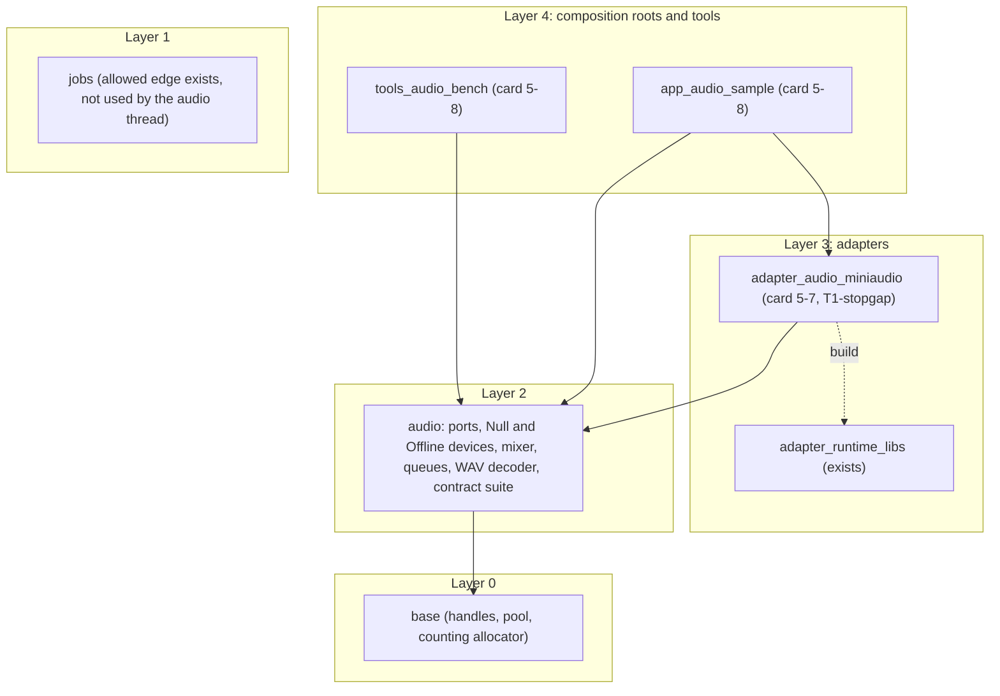
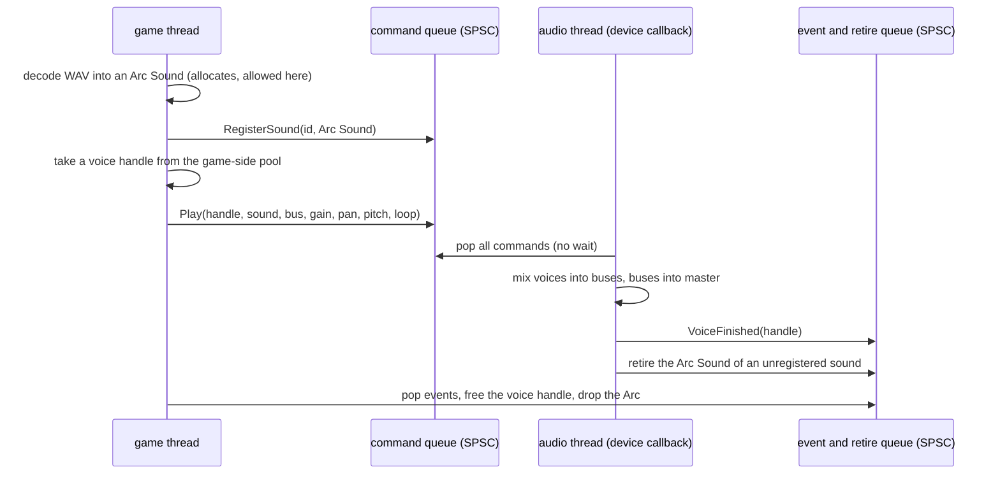
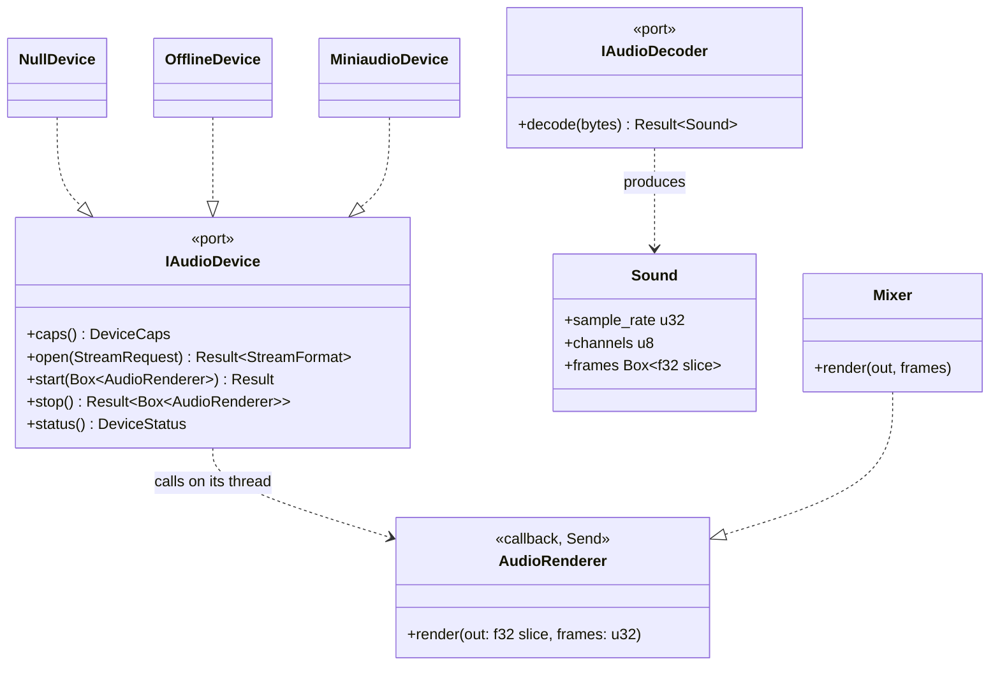
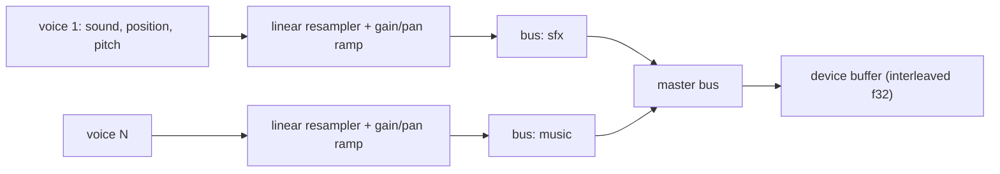
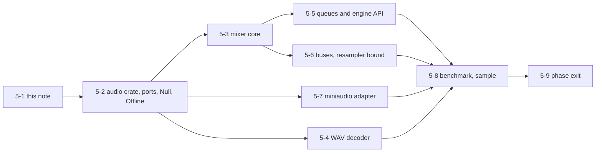

# Audio port v0 and the phase 5 mixer: design note `[P]` (card 5-1)

Design note for phase 5, written before any code. It turns the phase 5 row of the [roadmap](../workflow/roadmap.md) and the first sketch in [audio](audio.md) into a buildable shape: the device port `IAudioDevice`, the decoder port `IAudioDecoder`, the thread model between the game and the audio thread, the mixer, the Null, Offline and miniaudio adapters, and the tests.

Fixed inputs, not reopened here: the pull model and the rule that the audio thread is not a job-system worker ([ADR-0013](../decisions/README.md)); every port has a Null adapter and a contract suite and stays `experimental` until two real adapters pass it ([ports-and-adapters §4](ports-and-adapters.md)); miniaudio is allowed as a T1-stopgap with an exit plan ([THIRD_PARTY.md](../../THIRD_PARTY.md)); conventions f32, SI units ([conventions](conventions.md)); zero allocation on the hot path and no `unwrap` in engine code ([rules digest](../rules-digest.md) section 4).

**Scope in one line:** a WAV file is decoded, played through a mixer with gain, pan and buses, and the same mixer code is proven correct offline, proven free of allocation and locks in the callback, measured per voice, and then heard through a real device.

## 1. Evidence and what is still unverified

The research pass for this note read the primary sources that could be reached. Findings are tagged **[K]** (known from a source below) or **[U]** (unverified, to be checked in the card named).

| Fact | Tag | Source and consequence |
|---|---|---|
| The miniaudio data callback is `void data_callback(ma_device*, void* pOutput, const void* pInput, ma_uint32 frameCount)`; the output is interleaved; `frameCount` is the most the buffer holds ("never process more than frameCount frames") | K | [miniaudio manual](https://miniaud.io/docs/manual/). The port hands the renderer one interleaved `f32` buffer and a frame count. |
| `ma_device_init` leaves the device stopped; `ma_device_start` and `ma_device_stop` must never be called from inside the callback (deadlock) | K | same. The port has `open`, `start`, `stop` as separate calls made from the game thread only. |
| Format, channels and sample rate can be left at 0 or unknown to take the device's native values; miniaudio converts internally between the requested and the native format | K | same. The port negotiates: the caller proposes, the adapter reports what it got. |
| Backends: WASAPI, DirectSound, WinMM on Windows; ALSA, PulseAudio, JACK on Linux; tried in a fixed priority order | K | same. The adapter takes whatever miniaudio picks; the native WASAPI adapter is the exit plan. |
| Compile switches `MA_NO_DECODING`, `MA_NO_ENCODING`, `MA_NO_ENGINE`, `MA_NO_RESOURCE_MANAGER` | K | same. The adapter compiles the device layer only: our decoder and mixer are our own. |
| Whether the callback size is fixed or varies, the notification callback (device lost, stopped), the xrun report | U | The manual pages read do not say. Secondary sources mention a `noFixedSizedCallback` option. **Design rule: the port promises only "at most `max_block_frames`, may vary"**, which holds either way. Checked against the pinned header in card 5-7. |
| SoLoud: sources are separate from instances (playheads), 16 voices by default and 4095 at most, when all voices are busy the oldest is killed, the most audible voices are mixed first (virtual voices), buses group voices for volume and filters, default resampler is linear interpolation | K | [SoLoud concepts](https://solhsa.com/soloud/concepts.html). Used as the reference for voice policy and the resampler default; the thread model is not described there. |
| Command queue from a control thread to a real-time thread, the real-time thread pops commands and renders; queues of this kind are single producer, single consumer | K (practice) | engineering write-ups found by search, not authoritative. The design follows the same pattern and is justified by its own tests (section 8), not by the sources. |
| FMOD and Wwise internal threading; Ross Bencina's rules for the audio thread | U | No documentation retrievable (the page refused the connection). The rules in section 3 are the general real-time rules already in [audio §2](audio.md) and are enforced by tests, not by citation. |

The unverified rows do not block the design: each has a fallback in the table and a card that settles it.

## 2. Where the code lives

- **`audio` (layer 2, new crate, card 5-2)** declares both ports, the handle types, the mixer, the two queues, the Null and Offline devices, the WAV decoder and the contract suite (feature `contract-tests`, like `platform` and `render`). It depends on `base` only. Null and Offline live here for the same reason Headless lives in `platform`: no external code, usable by every test.
- **`adapter_audio_miniaudio` (layer 3, card 5-7)** is the only code that knows miniaudio. Only layer 4 depends on it.
- `gates/architecture.toml` already has `audio = 2`, the `adapter_*` glob and the edge `audio -> jobs`; no row is needed for the crates above. The `audio -> jobs` edge is not used: the audio thread is not a worker (ADR-0013). Whether `jobs` is used at all (for example to decode on a worker) is decided when a card needs it.

## 3. The thread model and the real-time rule

The rule for everything reachable from the callback: **no allocation, no lock, no I/O, no blocking system call, no unbounded loop, and no drop of anything that frees memory.** Consequences that shape the design:

1. **The audio thread owns the mixer.** The mixer, with fixed capacities for voices, buses and sounds, is built before the device starts and moved into the callback. The game thread never touches it; it sends commands. There is no shared mutable graph and so no snapshot to publish and nothing to reclaim. (O1.)
2. **Handles are made on the game side.** The game thread owns a pool of voice handles (index plus generation, from `base`), so `play` returns at once without a round trip. A handle becomes free again only when the audio thread's `VoiceFinished` event has been read; the audio thread validates the generation and ignores a stale command.
3. **Sound data is immutable and shared as `Arc<Sound>`.** The `Arc` is moved to the audio thread inside a command and moved back inside a retire message when the sound is unregistered, so the last reference is always dropped on the game thread. This is the real-time-safe reclamation that [audio §3](audio.md) left open.
4. **The queues cannot overflow where it would hurt.** Events from the audio thread are bounded by construction: a voice slot produces one `VoiceFinished` and is reused only after the game thread has read it, so a queue with room for every voice cannot be full. The command queue can be full (the game sends faster than the audio thread consumes); `play` then returns an error value and the caller decides. Nothing is dropped silently.
5. **Smoothing instead of locks.** A parameter command sets a target; the audio thread moves to it by a linear ramp across the next block, sample by sample, so changes do not click and the result does not depend on how the callback is chunked (section 6).
6. **The pan gains are computed on the game side** (a sine and a cosine), so the audio thread only multiplies. No transcendental function runs in the callback in v0.

The queue is a bounded power-of-two ring with one producer and one consumer, a release store on the writer's index and an acquire load on the reader's. It needs a small `unsafe` block (an `UnsafeCell` slot array) with a `// SAFETY:` comment and a share of the `unsafe` budget; Miri and the ThreadSanitizer job are its evidence (card 5-5). The module needs a row in `gates/unsafe-budget.toml` (a protected path, so 5-5 has a governance step the owner declares). Placement: `base` (layer 0, next to `ring.rs`, where the other unsafe modules already live and where `jobs` could reuse it) is recommended over `audio`. A safe variant that stores commands as packed atomic words was considered; it cannot carry an `Arc`, so it would force a second mechanism for sounds. Rejected.

## 4. The ports

- **Negotiation.** `StreamRequest` is the proposal: sample rate (0 = the device's native rate), channel layout (mono, stereo, 5.1), a block-size hint. `open` returns the `StreamFormat` the device really gives: rate, layout and `max_block_frames`. The mixer is then built for that format; it is the renderer passed to `start`. This order avoids a renderer that has to guess the format. (O2: the engine rate follows the device.)
- **The callback contract.** `render` receives one interleaved `f32` slice of exactly `frames * channels` samples with `frames <= max_block_frames`, may be called with a different `frames` each time, and must fill the whole slice (silence when nothing plays). It runs on a thread the adapter owns; the engine neither creates nor joins it.
- **`stop` gives the renderer back**, so the mixer is dropped on the game thread, never in the callback. `start` and `stop` are never called from the callback (the miniaudio deadlock rule is the port's rule).
- **Failures are values** (`AudioError`): no device, format refused, already started, device lost. `status()` returns counters the adapter keeps (callbacks run, frames rendered, underruns it could see, device lost); it is polled by the game thread, so no callback into game code exists.
- **The decoder** turns bytes into an immutable `Sound` in memory. It runs on a loader thread or the game thread, where allocation is allowed. Streaming (a ring filled by an I/O worker) is not in v0 (O3).
- **Dispatch.** `Box<dyn IAudioDevice>` in the composition root, one virtual call per start or stop; `dyn AudioRenderer` is called once per callback, which is a coarse boundary (ADR-0005). Voices are not virtual.

## 5. The adapters

| Adapter | What it does | Why it exists |
|---|---|---|
| **Null** | accepts `open` and `start`, never calls the renderer, reports zero counters | the headless build: the engine runs with no sound service |
| **Offline** | `open` returns exactly the requested format; `render_blocks(n)` and `render_frames(n)` pull the renderer on the calling thread and keep the output in a buffer; callable with any chunk sizes | tests, golden audio, the benchmark: deterministic and fast, no clock |
| **Miniaudio** (card 5-7) | opens the default playback device with `f32` output, forwards the callback to the renderer, reports status | the first sound out of a real device on Windows; Linux through ALSA or PulseAudio, picked by miniaudio |

### The miniaudio build, a finding the owner should know now

GLFW could be a downloaded, hash-checked DLL placed next to the program (card 4-35). **miniaudio has no official binary**: it is a single C header that must be compiled. The adapter therefore needs a C compiler at build time. A thin C file (about 60 lines) wraps miniaudio behind four opaque functions (open, start, stop, status), so Rust declares four functions and never the large, version-dependent `ma_device_config` struct. Routes (O5):

- (a) compile the pinned, hash-checked `miniaudio.h` and the shim with the `cc` crate in `build.rs` (a pinned build-time dependency, listed in `THIRD_PARTY.md`; the MSVC build tools are already needed by Rust on Windows);
- (b) the same without a crate: `build.rs` finds and runs the compiler itself (more code, fragile on Windows);
- (c) skip miniaudio and write the native WASAPI adapter first (no C, but hand-declared COM interfaces, the largest piece of work in the phase; the roadmap puts this later).

Recommendation: (a). The exit plan stays: removing the adapter and the entry once the native adapter passes the same contract suite.

## 6. The mixer

- **Fixed capacity.** `MixerConfig` gives the number of voices, sounds, buses and the queue sizes; everything is allocated in `Mixer::new`. The bus tree is fixed at construction in v0 (a table in an order that puts children before parents); a command changes a bus's volume and mute only. Creating buses at run time is out of scope.
- **Processing.** The callback may ask for any number of frames; the mixer works through them in internal chunks of a constant size (256 frames) held in preallocated scratch buffers. All state that crosses a chunk (resampler position, gain ramp) is carried per voice, so **the output does not depend on how the frames are split between calls.** That is a testable property (section 8).
- **Voices.** One-shot and looping, mono or stereo sources, pitch as a resampling ratio, gain, pan (constant-power, -3 dB at the centre, O7). Source rate to device rate conversion is the same linear resampler used for pitch (one mechanism, O2, O8).
- **Policy when full.** `play` returns `VoicesExhausted` as a value (O4). Stealing the oldest voice and virtual voices (mix only the most audible) are later features; the voice table is shaped so they can be added without changing the commands.
- **Order and determinism.** Voices are mixed in slot order and buses in table order, f32 adds in a fixed order, no `HashMap`, no clock: the same commands and the same chunks give the same bits on the same binary, and the same bits for any chunking. Bit equality across machines is not claimed (no D2 for audio).
- **Hot-path speed.** Scalar first. The `simd` abstraction is used only where the voice benchmark shows a win (card 5-8), with the scalar result as reference ([digest](../rules-digest.md) section 5).

## 7. The WAV decoder

PCM at 8, 16, 24 and 32 bits and float 32, mono or multichannel up to 8 channels, plain `fmt ` chunk and the extensible form; unknown chunks are skipped; everything else (ADPCM, compression) is refused with a named error. The input is untrusted: every size field is checked against the bytes that exist before use, arithmetic is checked, the decoded size has a hard cap (a parameter with a default), and there is no `unsafe`. The tests include truncated files, a `data` size larger than the file, a zero channel count, a zero sample rate and a size field that would overflow. Ogg Vorbis, Opus and FLAC are later plug-ins of the same port (audio §5).

## 8. Testing (the exit criteria, one by one)

| Level | What | Needs a device |
|---|---|---|
| Offline fidelity | the Offline device renders: a sine voice equals the analytic sine within a stated tolerance; two voices sum; gain, pan law and mute match closed forms; a looped voice repeats at the loop point; pitch 2.0 doubles the frequency; a resampled tone has aliasing below a stated bound | no |
| Chunk independence | the same commands rendered as one call and as irregular chunks (1, 7, 255, 256, 257 frames) give identical bits | no |
| Real-time safety | the counting allocator with per-thread counters wraps `render`: zero allocations, reallocations and deallocations over thousands of blocks, including blocks that start, stop and finish voices; a Clippy `disallowed-types` list for the crate (`Mutex`, `RwLock`, `Condvar`, `mpsc`) is the second line, as for `physics` (card 4-19); the mixer type has no lock by construction | no |
| Queue concurrency | one producer thread and one consumer thread on 10 million messages in order, no loss, no duplicates; Miri on the unsafe block; the ThreadSanitizer job | no |
| Port contract | one suite for `IAudioDevice`: `open` before `start`, second `start` refused, `stop` returns the renderer, `frames <= max_block_frames`, the whole slice is written, status counts grow; run on Null (the parts that apply), Offline, and Miniaudio where a device exists | Null and Offline never; Miniaudio yes |
| Decoder | known-good files (generated in the test from bytes) decode to the expected samples; the malformed list in section 7; a fuzz-style loop of mutated headers must return errors, never panic | no |
| Voice benchmark | CPU time and instruction counts per block for 64, 256, 1024 voices (stereo output, 256-frame blocks); the first measurement sets the budget "1,000 voices below X percent of one core" (X from the measurement, then ratcheted); registering a gate for it in `gates/benchmarks.toml` is a governance step the owner declares | no |
| Headless | the workspace builds and tests with Null and Offline only | no |

"Not run: no audio device on this machine" is reported as not run, never as green ([github-plan-findings](../workflow/github-plan-findings.md)). A red contract result on a real device is a stop.

## 9. How the cards follow from this

The cards exist on the board (created at the start of the phase); this note adjusts nothing in their order but adds what each carries.

| Card | Delivers | Class |
|---|---|---|
| 5-2 | `audio` crate, `AudioError`, `StreamRequest/Format`, both ports as traits, Null and Offline devices, contract suite, Clippy `disallowed-types` for the crate | 2 (new port) |
| 5-3 | `Mixer`: voices, linear resampler, gain and pan ramps, fixed buses (master only), chunk independence test, the real-time-safety harness | 2 |
| 5-4 | WAV decoder and `Sound` | 2 |
| 5-5 | SPSC queue (in `base`), `Command` and `Event` types, game-side `AudioEngine` handle API (`play`, `stop`, `set_*`, `register_sound`), retire path | 2 (unsafe, concurrency), governance step for the `unsafe-budget.toml` row |
| 5-6 | bus tree, bus gain and mute, the resampler quality bound test | 2 |
| 5-7 | `adapter_audio_miniaudio`: shim, build, contract run, `THIRD_PARTY.md` pin | 2, governance step likely for `THIRD_PARTY.md` and the build dependency |
| 5-8 | `tools_audio_bench`, `app_audio_sample` (plays a generated tone and a WAV), budget | 2 |
| 5-9 | phase 5 exit record and milestone review | 1 (docs) |

5-3 as listed on the board is the mixer on the audio thread; 5-5 wires it to the game thread. The two can be built in that order because the mixer takes its commands from a plain function call in the tests of 5-3.

## 10. Choices for the owner

| # | Choice | Options | Recommendation |
|---|---|---|---|
| O1 | Who owns the mixer | the audio thread owns it and the game sends commands (recommended) · the game builds an immutable graph snapshot and swaps it in | commands: nothing to reclaim, no rebuild per change, matches ADR-0013; snapshots (triple buffer, epoch) are only worth their cost for a large dynamic graph, which v0 does not have |
| O2 | Engine sample rate | follows the device, sources resampled to it (recommended) · fixed 48 kHz and miniaudio converts to the device | follow the device: one resampler for pitch and rate, no hidden second conversion; the Offline device makes any rate testable |
| O3 | Streaming music in phase 5 | not in v0, sounds are decoded in memory (recommended) · included (an I/O worker, a ring, one more card) | defer: the roadmap row does not list it; the mixer reads a `Sound` through one small trait so a streaming source can be added later; recorded as an open item |
| O4 | What `play` does when every voice is busy | refuse with an error value (recommended) · stop the oldest · virtual voices | refuse: predictable and testable; stealing and virtual voices are a later feature with their own tests |
| O5 | How miniaudio is compiled | (a) `cc` crate in `build.rs` (recommended) · (b) own compiler lookup · (c) native WASAPI first | (a), decided at the start of card 5-7 with the owner because it adds a build dependency and touches `THIRD_PARTY.md` |
| O6 | Where Null and Offline live | in `audio` (recommended) · separate adapter crates | in `audio`: no external code, same choice as `platform` and `render` |
| O7 | Pan law | constant power, -3 dB at the centre (recommended) · linear | constant power: no loudness dip at the centre; computed on the game side |
| O8 | Resampler in v0 | linear interpolation (recommended) · higher-order | linear: SoLoud's default too; the test states an aliasing bound and a better kernel replaces it behind the same function |

## 11. Risks and what this note does not settle

- **Callback size and device events are unverified for miniaudio.** The port promises only "at most `max_block_frames`, may vary" and polls status, so it holds either way; card 5-7 reads the pinned header.
- **No audio device on hosted CI runners.** The real-device contract run happens on the owner's machine; the Offline device carries the recurring tests. The Windows runner may offer a null audio backend; checked in 5-7.
- **A C compiler in the build (O5).** The first C code in the repository. Mitigation: the shim is tiny, the library file is hash-checked like the GLFW archive, and the exit plan is a native adapter.
- **Latency is not measured.** No claim is made about round-trip latency; the port exposes the block size and the benchmark reports CPU time only.
- **A runtime sound format and offline converter (D-6)** are not part of phase 5: WAV is the source format. Whether a runtime format is needed is decided when the asset pipeline phase starts.
- **Not settled here:** reverb, EQ and compressor on buses, spatialisation beyond pan, 5.1 down-mix rules, HRTF, Ogg and Opus, recording input, the native WASAPI adapter. Each is a later card.

## 12. As built in card 5-2

The crate `engine/audio` exists with the two ports as traits and the two devices; nothing in sections 1 to 11 changed. Details the note left open:

- **State machine.** closed, open, started. `open` is allowed whenever the device is not started (so the format can be negotiated again), `start` only when open, `stop` only when started and it returns the device to open. Every other call is `WrongState`; a refused `start` drops the renderer it was given.
- **Limits of the port**, as constants in `format`: sample rate 8 000 to 384 000 (0 means the device's own), block hint up to 16 384 frames (0 means the device's own), sounds with 1 to 8 channels. The defaults for a device with no preference are 48 000 Hz and 512 frames. `StreamRequest::validate` is public so every adapter refuses the same requests.
- **Caps and status.** `DeviceCaps` holds the channel maximum and the native rate (0 when unknown before opening); `DeviceStatus` holds callbacks, frames, underruns and a lost flag, and survives `stop`.
- **Offline device.** `render_into` and `render_in_chunks` pull the renderer on the calling thread; before every callback the slice is filled with NaN, so a renderer that does not write the whole slice is visible in the output.
- **Contract suite.** `audio::contract::device_contract(device, expect_callbacks, pump)` (feature `contract-tests`) checks start before open, an out-of-range request, a second start, open while started, the slice length and the block limit in each callback, no callback after `stop`, status counts, and a restart. It also checks that `stop` gives back the very renderer that was started, that a refused start drops its renderer, that the status counts equal what the renderer saw, an open table (mono, 44 100 Hz, stereo with a block hint, 5.1 against the device's channel maximum), and `open` after `stop`. The suite has tests of its own: ten devices with one deliberate fault each (and a silent device) must fail it.
- **Decoder port.** `IAudioDecoder`, `DecodeError` (truncated, not this format, unsupported, invalid, too large) and the immutable `Sound` exist; the WAV decoder is card 5-4.
- **Not done here, on purpose.** The Clippy `disallowed-types` list for the crate (a `clippy.toml` is a protected path, so it is a governance step, card 5-10); the mixer and the real-time harness (5-3).
