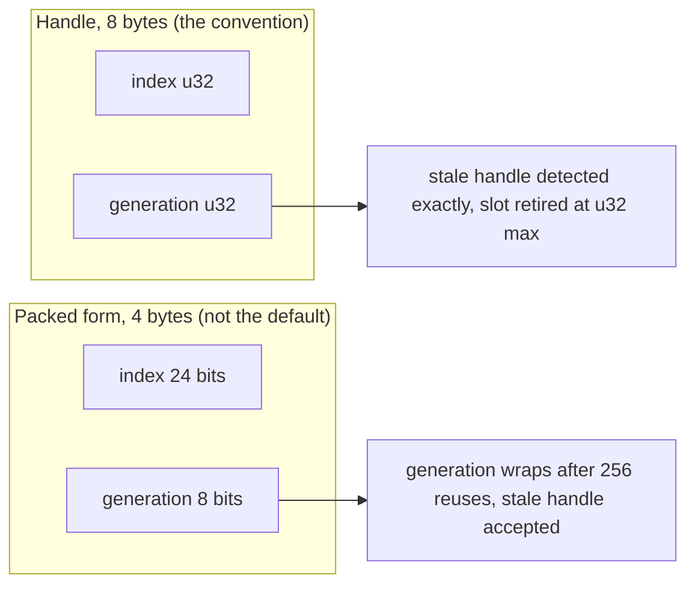

# Engine conventions (decided before phase 1, N-9) `[P]`

These are defaults proposed by the agent and accepted by the owner in one block (v0.14). They are cheap to state now and expensive to change after phase 1. Changing one is a Class 3 change.

## 1. Numbers and units

| Topic | Convention |
|---|---|
| Scalar type | `f32` for world, physics and rendering; `f64` only inside explicitly named high-precision code (large-world offsets, offline tools). The scalar type is a type alias in `base/math` so a later switch is mechanical. |
| Transcendental functions | Code whose results must agree across platforms (physics, lockstep or rollback code) calls `base::dmath` (`sin`, `cos`, `tan`, `atan2`, `asin`, `acos`, `exp`, `log`, `pow`, `powi`, `madd`) and never the `std` method. With the feature `cross-platform-determinism` the facade uses own functions with identical bits on every IEEE-754 platform; without it, the platform `std` ([physics](physics.md) section 3 rule 7). |
| Units | SI: metres, kilograms, seconds, radians. No hidden unit conversions; names carry units where ambiguous (`dt_seconds`). |
| Coordinate system | Right-handed, **Y up**, forward **-Z** for cameras. 2D: X right, Y up, rotation counter-clockwise in radians. |
| Matrices | Column-major storage, column vectors, `M * v`. |
| Clip-space depth | **0..1** (Vulkan/D3D range). The OpenGL adapter sets `glClipControl` (4.5) so engine code never sees -1..1. Reverse-Z is decided in phase 3. |
| Winding | Counter-clockwise front faces. |
| Time | Fixed simulation step in seconds (`dt = 1/N`); no hidden clocks in simulation (injected `IClock`). |
| Handles | **8 bytes: a 32-bit slot index plus a 32-bit generation** (`Handle<T>` in `base`). A stale handle is detected exactly: a slot whose generation reaches `u32::MAX` is retired and never reused. A packed 4-byte form is not the default (see below). |

A packed 4-byte form (for example 24-bit index + 8-bit generation) wraps after 256 reuses of one slot and would then accept a stale handle. It can be added when a profile shows the size matters ([core-runtime](core-runtime.md) section 8). Decided in card 1-9, written here in card 1-15.

## 2. Public API shape

- The engine is a **library**: no engine-owned `main` and no global singletons. The **application owns the main loop** and calls explicit instances (world, renderer, audio, physics) created by the composition root (L4).
- Module-to-module APIs are ordinary Rust (generics, traits). A **C ABI exists only at plug-in boundaries** (N-11): `#[repr(C)]` plain data, free functions, versioned.
- Errors are values (`Result`); no panics across module boundaries.

## 3. Glue modules (integration code that belongs to no domain module)

Domain modules do not know each other (physics does not know the ECS; render does not know the ECS). The code that connects them lives in small **glue crates** at the top of L2, allowed to depend on several domain modules:

| Glue crate | Job | Depends on |
|---|---|---|
| `frame` | frame loop: fixed-step accumulator, variable-step phases, ordering of the glue systems | base, jobs |
| `sync_physics` | copies kinematic targets/forces into physics, transforms back into ECS components (`physics_sync`) | ecs, scene, physics |
| `sync_render` | extracts a plain `RenderScene` snapshot from the ECS/scene for the renderer (the renderer consumes only that data type) | ecs, scene, render |
| `sync_audio` | translates game events into audio commands | ecs, audio |

Phase 7 builds the ECS and these crates; before that, samples feed `physics` and `render` plain structs directly.
