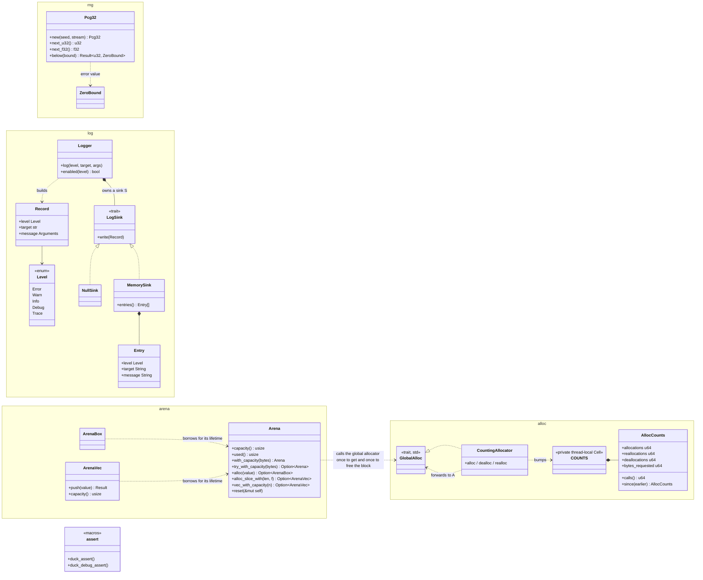

# Core Runtime: the Performance Mechanism `[P]`

## 1. Language and style (ADR-0001)

**Language: Rust (decided by owner, Q1; see [evaluation](../decisions/adr-0001-language-evaluation.md)).** Rules: the standard library may be used in L0-L2 (v0.6); `unsafe` only in allowlisted modules, each block with a `// SAFETY:` comment, counted as a metric; `panic = abort` in the runtime, no panics across module boundaries, no `unwrap`/`expect` in engine code (errors are values); traits and generics for compile-time polymorphism, trait objects only at coarse port boundaries; plain `#[repr(C)]` data and a C ABI at plug-in boundaries. OS-specific services go through platform ports.

## 2. Memory

- **Memory (v0.6):** allocation uses the standard allocator by default (`malloc`/`new`, Rust global allocator) behind a small `IAllocator` interface so counting, tracking and arenas can be layered on top. `IVirtualMemory` stays an optional platform port for page-level reserve/commit where needed (arenas, strict memory budgets); it is no longer the mandatory root.
- Allocator interface + concrete allocators: **linear/arena** (per-frame, per-job), **pool** (fixed-size objects), **stack**, **general-purpose** fallback, plus debug allocators (tracking, guard pages, poisoning).
- **Per-frame arena** reset each frame; scratch arenas per job.
- **Steady state = zero heap allocations per frame** in hot systems; enforced by a counting allocator in tests ([R1](../00-vision-and-requirements.md)). The counting allocator uses **per-thread counters** and the assertion is per thread or per job ("this job made 0 allocator calls"): in the spike a shared atomic counter cost +29% single-threaded and made 8 threads 5.9x slower, per-thread counters cost +4% and +2% ([allocator spike](../spikes/allocator-spike.md) S7).
- **Containers:** use `std` containers by default. Write own containers (`SparseSet`, `RingBuffer`, handle pools, fixed-capacity variants) where the standard ones do not fit or a benchmark shows a win. **Arena-backed containers are own code:** stable Rust `Vec`/`HashMap` use only the global allocator `[K, verify]`, so per-frame/per-job arenas need small own containers (default: own small arena containers; a pinned third-party arena crate behind a facade is the alternative; chosen in phase 1 by benchmark, D-9). `#[global_allocator]` counting is used for the zero-allocation tests.
- **Allocation tools, in this order of preference (allocator spike, v0.18):** (1) *design the allocation away* (flat arrays plus offsets, a `Vec` of nodes with `u32` indices); (2) *reuse capacity* (`clear()`, `with_capacity` once; a fresh `Vec::new()` every frame is the expensive form: 5-13 allocations per frame for one list, a realloc counting as an allocation in the spike; the 1-2 allocator counts `reallocations` separately); (3) an *arena* for heterogeneous per-frame or per-job scratch data; (4) a *pool with generational handles* for long-lived handle-addressed objects with churn, while the data a hot loop iterates stays dense (a pool with holes is not an iteration structure); (5) the *general allocator* for everything else. Measured on Windows (default allocator = `HeapAlloc`): 25-38 ns per small allocate + free, 1-2 ns in an arena, 4-7 ns with mimalloc. At about 28 ns each the default allocator costs 0.28 ms per 10,000 allocations per frame (1.7% of a 16.7 ms frame), so below roughly 10^4 allocations per frame the policy "std by default" stands, and at about 10^5 allocations per frame it is a sixth of the frame. Evidence: [allocator spike](../spikes/allocator-spike.md).
- **Arena scope (phase 1, written test-first, own code):** `Arena` with fixed capacity; only types without drop glue (checked at compile time by a `const` assertion on `needs_drop::<T>()`, as in the spike); `reset(&mut self)`, so the borrow checker proves no reference into it is alive; failure is a value (`Option`/`Result`), never a panic; not `Sync` (one arena per thread or job); plus a push-only fixed-capacity `ArenaVec` and slices. Every `unsafe` block carries a `// SAFETY:` comment, counts against the module's `unsafe` budget and is Miri clean (the digest gate for changed `unsafe`). The spike's version (about 150 lines) shows the size needed; it is evidence, not code to copy. Acceptance tests to write first: overflow returns `None`; alignment, including over-aligned types; `reset` reuses the same memory; a nested allocation inside `alloc_slice_with`; `compile_fail` doc tests for a type with drop glue and for a reference used after `reset`. The spike used about 8 `unsafe` blocks; the module budget is set by the card.
- **Counting allocator, open points for card 1-2 (decided in 1-2, see section 8):** counters are per thread and readable on the calling thread; a job-level assertion reads them before and after inside the job itself, on the worker thread that runs it; the relation to the `IAllocator` interface (arenas are concrete types used directly on hot paths, `IAllocator` is the seam for counting and tracking) is decided in that card.
- **Global allocator:** chosen once, by benchmark, in the application (L4) as a single `#[global_allocator]` line; engine crates never name it. A phase-1 task compares the default allocator and one third-party candidate (the spike used mimalloc) on Windows **and** Linux x86-64 (ARM64 when its CI exists) and records the result in ADR-0022. Adopting a third-party allocator needs a `THIRD_PARTY.md` entry and an owner decision that defines its tier: no existing tier fits a `#[global_allocator]` (`T1-stopgap` is limited to adapters), so ADR-0022 defines it as L4 composition root, no port, exit plan = the default allocator; until then the default allocator is used. A C-built allocator such as mimalloc needs a C compiler in CI. Proposed pass criterion (a hypothesis, calibrated in the task): adopt a third-party allocator only if it is at least 2x faster than the default on small-object churn (64 B) and on 8-thread scaling on both OSes, regresses nothing else beyond the benchmark-gate tolerance, and switching back to the default compiles and passes every test; otherwise the default stays. Windows numbers alone are not enough: the Linux system allocator may be close to mimalloc ([R-22](../open-questions-and-risks.md)).
- **Math:** own vector/matrix/quaternion types, **generic over dimension** (`Vec2/Vec3/Vec4`, `Mat3/Mat4`, scalar-angle rotation for 2D, quaternion for 3D) so physics, scene and rendering share a skeleton for 2D and 3D (Q3, [physics §4](physics.md)). **Own deterministic transcendental functions** (`sin`, `cos`, `exp`, ...) in `base/math` because cross-platform identical results are a goal (Q16, v0.7); `std` math is allowed outside simulation code. The D2 cost (no FMA, own libm) is measured in phase 1; a compile-time deterministic profile may let non-simulation code use FMA (D-10). Details in [physics §3](physics.md).
- **SIMD:** a `simd` abstraction in L0 (scalar reference + SSE/AVX/NEON adapters); engine code never touches intrinsics.
- **Threads/atomics:** use `std` threads and atomics; the job system is still injectable (`IScheduler`) so tests can run a deterministic single-thread scheduler. Memory-ordering rules documented once, in L0.
- **Handles** (index + generation, 32 or 64 bit) address all long-lived resources.

## 3. Job system (ADR-0004)

- Interface `IScheduler` (submit job, parallel-for, dependency/counter, wait-help) so the implementation is replaceable and tests can use a deterministic single-thread scheduler.
- Candidate implementations: (a) **work-stealing thread pool** with task counters (proposed first), (b) **fibers** as in Naughty Dog's engine [S listing](https://www.gdcvault.com/play/1022186). A spike compares them on real workloads (ECS iteration, physics solve, mixer) before committing.
- Frame structured as a **task graph**: systems declare read/write component sets, the scheduler derives ordering and runs independent systems in parallel.
- `Caps.hasThreads` may be false (the headless/test configuration); the scheduler then runs jobs inline in dependency order - the same deterministic scheduler used in tests.
- Rules: no blocking I/O or locks inside jobs; blocking work goes to an I/O pool; audio thread is *outside* the job system (hard real-time).

## 4. ECS (ADR-0003)

- **Proposal: hybrid storage like Bevy** (dense tables/archetypes by default for iteration speed, opt-in sparse sets for frequently toggled "tag" components) [S](https://bevy.org/news/bevy-0-5/). Decision is **data-driven**: a benchmark spike implements both minimal storages and measures iteration vs structural-change cost on our workloads. Published evidence says archetypes win iteration, sparse sets win mutation [S](https://diglib.eg.org/handle/10.2312/cgvc20251224).
- Queries are cached and typed; systems are plain functions over query views; parallel safety is derived from declared access.
- **Relationships** (parent/child, "targets"): start with an explicit hierarchy in `scene`; general relationships (Flecs-style) deferred because they interact badly with archetype layouts [S](https://blog.innogames.com/entity-relationships-in-unity-dots-ecs/).
- **ECS is not the universal container.** Physics and audio keep their own optimised internal storage; ECS holds *references (handles)* and synced state. This prevents the ECS from constraining the hot loops of the other subsystems.

## 5. Frame loop and time

```
fixed-step simulation (accumulator, dt = 1/N) --> physics, gameplay, deterministic
variable-step per frame                       --> render extraction, interpolation, UI
audio thread (callback driven, decoupled)     --> mixes from a lock-free command queue
```

- Fixed timestep for simulation (determinism, networking-ready), interpolation for rendering.
- **Render extraction:** simulation world is snapshot/copied into a render-owned structure so rendering of frame N overlaps simulation of frame N+1 (pipelined frame), as is standard [K].

## 6. Module system

- Modules registered in the composition root; **static linking by default** (best performance, simplest).
- Optional **dynamic modules + hot reload** in dev builds only, with a C-ABI boundary (inspired by The Machinery's plugin model [S](https://www.gamedeveloper.com/programming/the-machinery-goes-open-beta)). Deferred until after the walking skeleton.

## 7. Performance engineering practice

- Every hot-path module ships with a **benchmark** next to its tests.
- Instrumentation via profiling macros -> hook; Tracy (T2) wired as a dev adapter [K].
- **Budgets** per system per frame recorded in `docs/budgets` (to be created) and asserted in nightly benchmark scenes.
- SIMD: write scalar reference first (tested), then the SIMD version tested against it: **bit-identical** for simulation code (D2, Q16); a tolerance is allowed only outside simulation code (rendering, audio DSP). Box2D v3 reports a large win from layout + SIMD [S](https://box2d.org/posts/2024/08/releasing-box2d-3.0).

## 8. Implemented: crate `base` (design note, card 1-1)

`engine/base` is the first L0 crate. std only, `unsafe` forbidden by the workspace lint, no OS access. It grows with each phase 1 card; this section records what exists and why.

| Module | What | Invariants and notes |
|---|---|---|
| `rng` | `Pcg32` (XSH RR 64/32), seeded by `(seed, stream)` | Integer arithmetic only, so the sequence is the same on every platform (D2). Checked against the published reference vector and an independent implementation. `next_f32` builds the float from mantissa bits (no casts, 23 random bits, range `[0, 1)`). `below(bound)` is unbiased (rejection sampling); a zero bound is an error value, never a panic. |
| `log` | `Level`, `Record`, `LogSink`, `Logger<S>`, `NullSink`, `MemorySink` | No global logger: the caller owns the `Logger`, so tests inject a `MemorySink` and a platform adapter supplies the sink that reaches a file or console. The message travels as `fmt::Arguments`, so a filtered record or a `NullSink` never formats it (the call site still evaluates the argument expressions; a skipping macro and a `Level::Off` are left for a later card). A sink has a single owner; sharing one across threads is not supported yet. |
| `alloc` | `CountingAllocator<A: GlobalAlloc>`, `AllocCounts`, `count_allocations`, `current_counts` | Counters are per thread, in a `const`-initialised thread-local `Cell` without a destructor: reading them never allocates and registers no thread-exit hook, so they are safe inside the allocator. `alloc` and `alloc_zeroed` count as allocations, `realloc` as a reallocation (a growing `Vec` makes these), `dealloc` as a deallocation; `calls()` adds the three. `count_allocations(f)` returns the calling thread's delta, so another thread's allocations are not counted by construction (a thread-local), and a job asserts on its own worker thread. Install the allocator with `#[global_allocator]` in a test binary or the application (L4). |
| `arena` | `Arena`, `ArenaBox<'a, T>`, `ArenaVec<'a, T>` | Fixed-capacity bump arena: one heap allocation in `with_capacity` (or `try_with_capacity`, which returns `None` instead of aborting), one free in `Drop`, and every allocation in between is a pointer bump with no allocator call (integration test `arena_allocations`). `alloc`, `alloc_slice_with` and `vec_with_capacity` return `Option`; `ArenaVec::push` hands the value back as `Err(value)` when full. `reset(&mut self)` makes the block reusable and the borrow checker proves no reference survives (compile_fail doc test). Types with drop glue are rejected at compile time (`const` assertion on `needs_drop`; compile_fail doc test). The block is 64-byte aligned and padding is computed from the offset with checked arithmetic, so what fits and what `used()` reports never depend on where the allocator put the block (determinism); types aligned above 64 are rejected at compile time, and huge lengths return `None` instead of overflowing. Zero-sized values and empty slices take no space. The closure of `alloc_slice_with` may allocate from the same arena (space is reserved first). Not `Sync` (a `Cell` offset) and not `Send` (raw block; handing arenas to workers is for the job-system card). |
| `assert` | `duck_assert!`, `duck_debug_assert!` | Always-on and debug-only assertion. A failure panics with the condition or message; under `panic = "abort"` that ends the process, so nothing unwinds across a module boundary. |

UML view of crate `base` as implemented (cards 1-1 to 1-3). It is a view of the table above and of `engine/base/src`; if they disagree, the code and the table win and the diagram is fixed. Arrows: `*--` owns, `..>` uses or borrows, `..|>` implements. Main operations only: constructors, accessors and the free functions `current_counts` and `count_allocations` are left out. `Logger` and `CountingAllocator` are generic over `S: LogSink` and `A: GlobalAlloc`; `Record`, `ArenaBox` and `ArenaVec` carry a lifetime.



Reading the diagram: nothing in `base` knows the OS; the outward seams are `LogSink` (supplied by the caller) and `GlobalAlloc` (std). `assert` is standalone. `ArenaBox` and `ArenaVec` borrow the arena, so `reset(&mut self)` cannot run while one is alive.

Complexity: `next_u32` is O(1); `below` is O(1) expected (fewer than 2 draws on average, worst case unbounded but with probability halving each draw). Logging cost is one level comparison when the record is filtered out.

Not yet covered, by design: a counting proof that `NullSink` logging allocates nothing (needs the counting allocator of card 1-2); the profiling hook; `simd`, math functions, containers (later phase 1 cards).

Decisions of card 1-2 (counting allocator):

- **No `IAllocator` trait yet.** Stable Rust has no allocator trait other than `GlobalAlloc`, which is the seam: the counting allocator wraps any `GlobalAlloc`, and arenas stay concrete types used directly (card 1-3). A trait is added when a second consumer needs one.
- **`unsafe` budget.** `base` leaves the workspace lint table (which forbids `unsafe`) and repeats it with `unsafe_code = "deny"` and `undocumented_unsafe_blocks = "deny"`, the pattern of `skeleton-unsafe`; the only module that allows `unsafe` is `alloc`. Count: one `unsafe impl` and four `unsafe` blocks (the four forwarding calls), each with a `// SAFETY:` comment, plus one `unsafe` block in a unit test. Counters saturate and the allocator never panics (unwinding out of a global allocator is undefined behaviour). No mechanism checks the per-module budget yet (`docs/gates/phase-0a-toolchain-gates.md`); the lint-profile check covers only `skeleton-unsafe`, so the repeated table in `base/Cargo.toml` is not compared with the workspace one. Both gaps are for a governance task.
- **Miri.** Clean on `x86_64-unknown-linux-gnu` (nightly, `cargo miri test -p base`). On the Windows host target Miri reports undefined behaviour inside the standard library's own Windows allocator (`sys/alloc/windows.rs`, header read for over-aligned blocks, hit by the test harness's cache-padded channel), under both Stacked and Tree Borrows. The wrapper forwards the pointer unchanged and the unit tests that allocate with 8-byte alignment are Miri clean on the host; the integration test binary is not run under Miri on Windows. Command for the clean run: `RUSTUP_TOOLCHAIN=nightly cargo miri test -p base --target x86_64-unknown-linux-gnu`.
- **Zero-allocation proof for logging.** `Logger<NullSink>` logging makes no allocator call; `Logger<MemorySink>` does (integration test `alloc_counting`). This closes the item left open in card 1-1.
- **Cross-thread isolation is tested (card 1-6).** At the time of card 1-1 the architecture rules forbade creating threads anywhere in `base`, so the test could not live here and no waiver was added. Card 1-4 let test-only code create threads (`allow_in_tests` in `gates/architecture.toml`); card 1-6 added two integration tests in `tests/alloc_counting.rs`: two threads inside a measurement at the same time (held together by a barrier) each see exactly their own allocations, and a new thread starts from zero. The first test compares all four counters of each thread, including one reallocation. Checked by mutation: sharing any one of `allocations`, `reallocations`, `deallocations` or `bytes_requested` across threads makes it fail; sharing `allocations` or `bytes_requested` also fails the second test (the second does not look at deallocations, because std makes the new thread free blocks its parent allocated).

Decisions of card 1-3 (arena):

- **Wrapper types instead of `&mut T`.** `alloc(&self, ..)` cannot return `&mut T` without tripping `clippy::mut_from_ref`, and silencing it would be a counted waiver. `ArenaBox` and `ArenaVec` hold a `NonNull` plus `PhantomData<&'a mut _>`, so the lifetime still ties them to the arena and no lint fires. `ArenaBox` and `ArenaVec` dereference to `T` and `[T]`.
- **`unsafe` budget.** Module `arena` allows `unsafe` through `#![expect(unsafe_code, reason = ..)]`: 10 `unsafe` blocks, each with a `// SAFETY:` comment (block creation and free 2, reservation 2, writes 2, shared and exclusive views of box and vec 4). Together with `alloc` the crate has two allowed modules; the budget is still unchecked by tooling (see card 1-2).
- **The block is allocated with a fixed 64-byte alignment** (`std::alloc::alloc` with an explicit `Layout`), found by the independent review (F1): with an alignment-1 block, whether an over-aligned value fit depended on the address the allocator returned, which would make `None`/`Some` and `used()` differ between allocators and runs. Now padding depends only on the sequence of allocations. `used()` includes padding.
- **Construction.** `with_capacity` aborts (`handle_alloc_error`) when the block cannot be provided, like `Vec::with_capacity`; `try_with_capacity` returns `None` (also for sizes above `isize::MAX`). Every later operation reports failure as a value.
- **Known limits.** The drop-glue check is evaluated when the code is built (post-monomorphisation), so `cargo check` alone does not report it; `ManuallyDrop` values pass it and are leaked on `reset`. `alloc_slice_with` runs the closure `len` times even for zero-sized elements, so a huge `len` of them takes that long.
- **Miri.** Clean on `x86_64-unknown-linux-gnu`, including the arena unit tests and the integration test.
- **Out of scope here:** growable arenas, drop-glue types, pools and handle containers.
