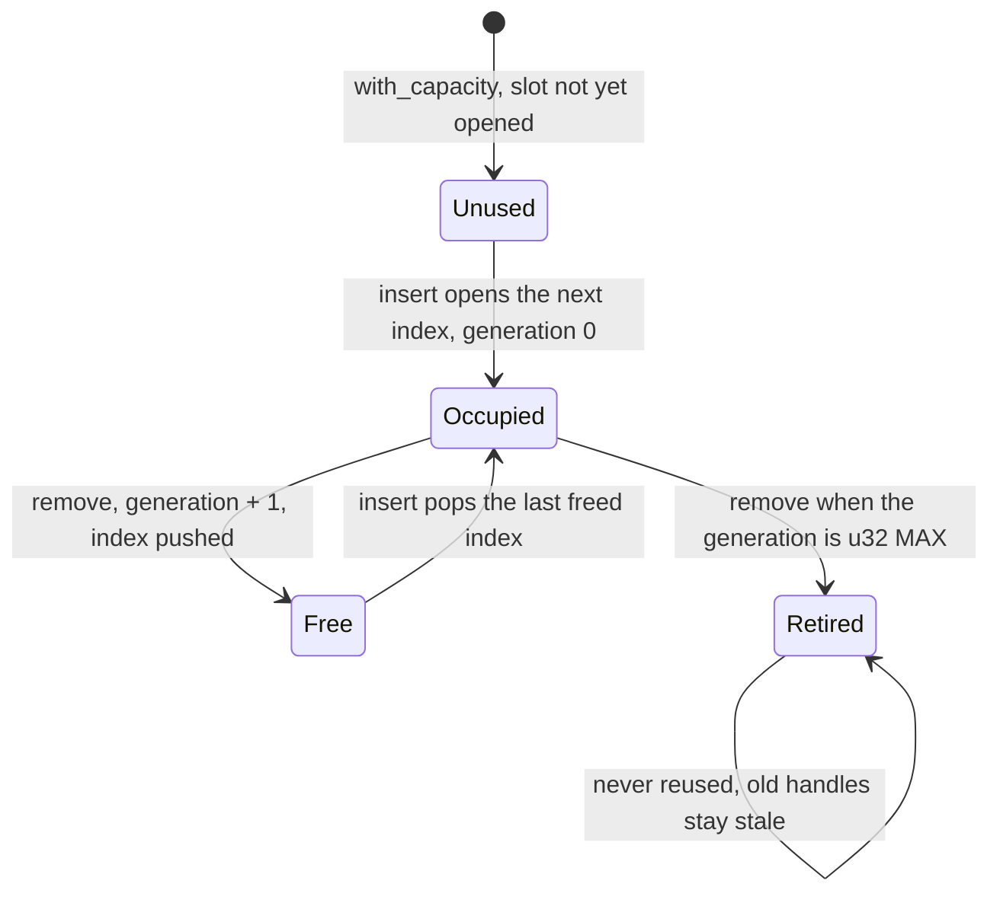
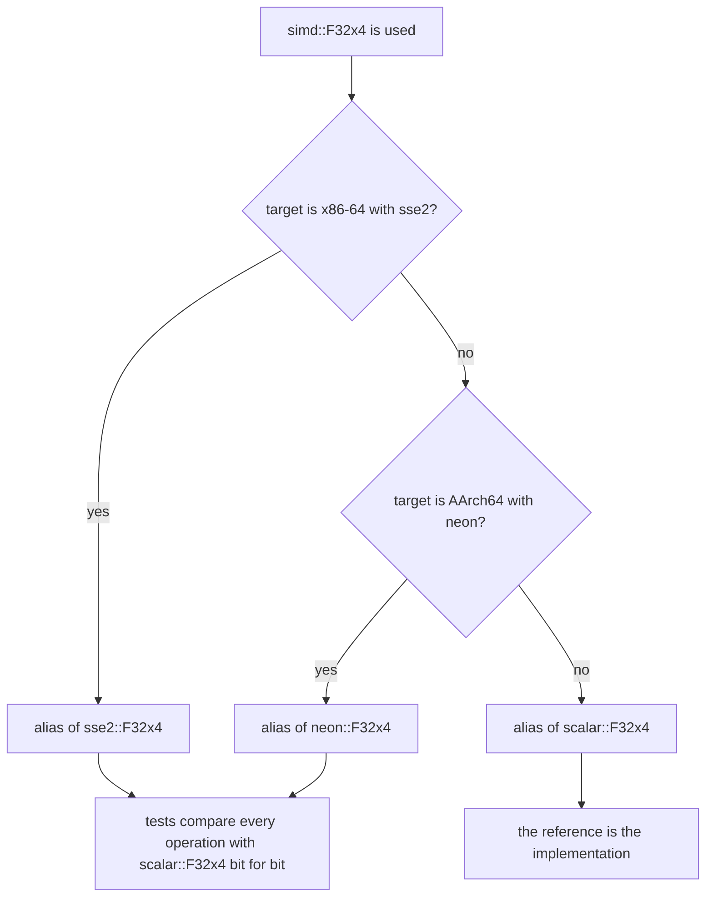
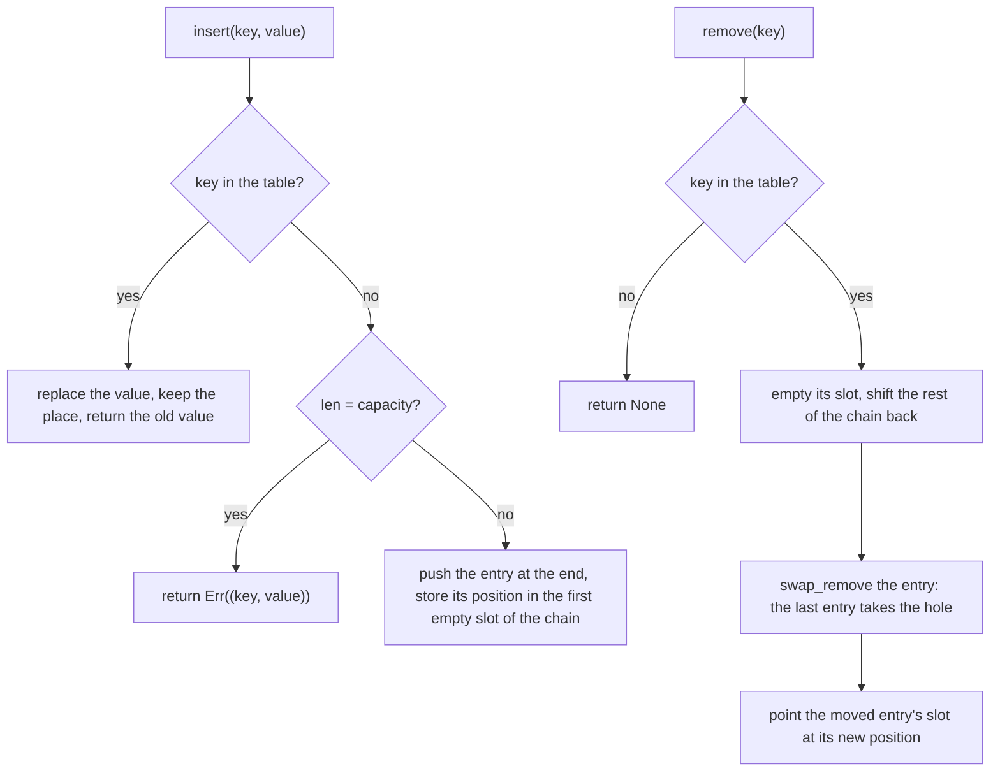
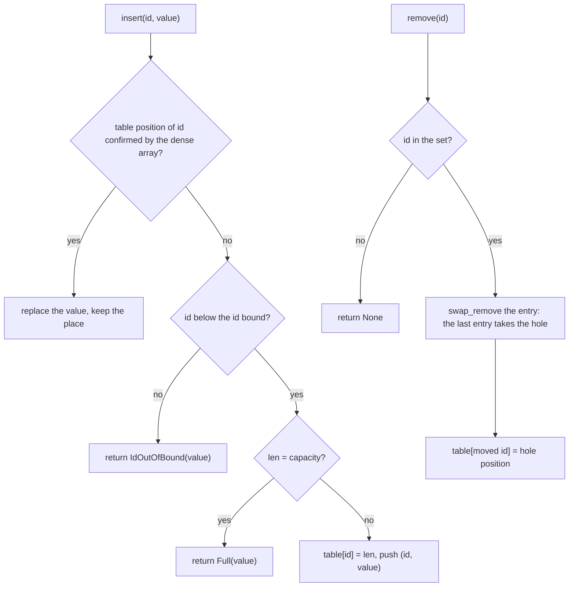
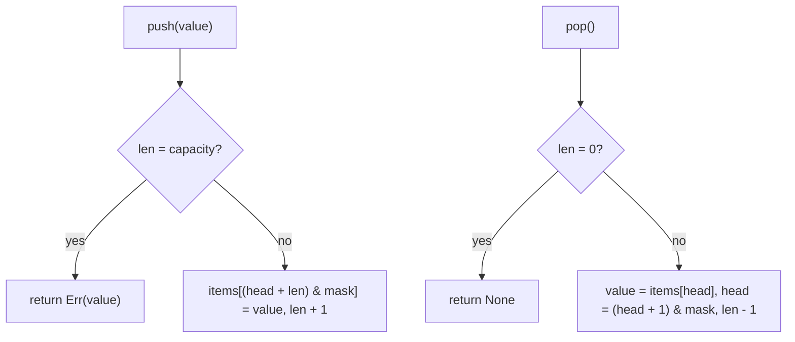
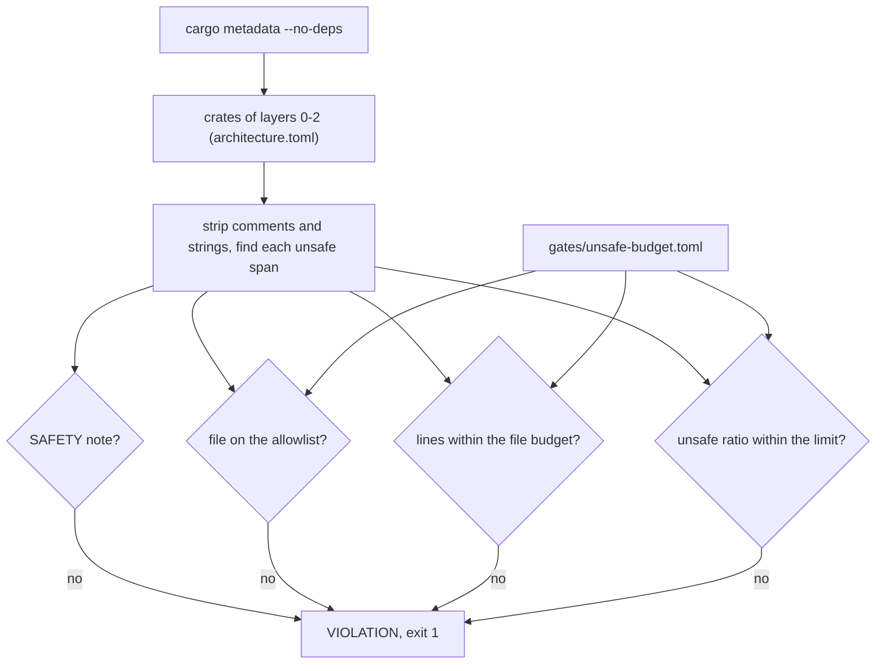
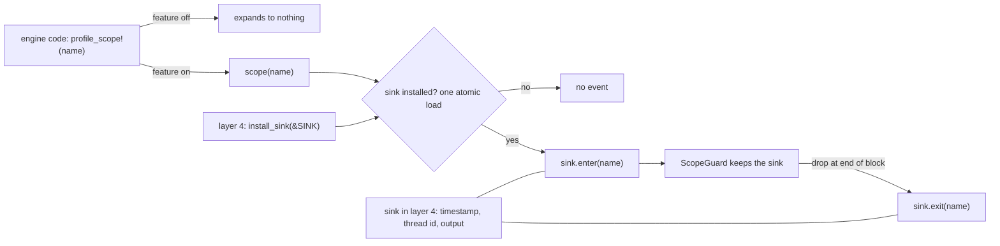
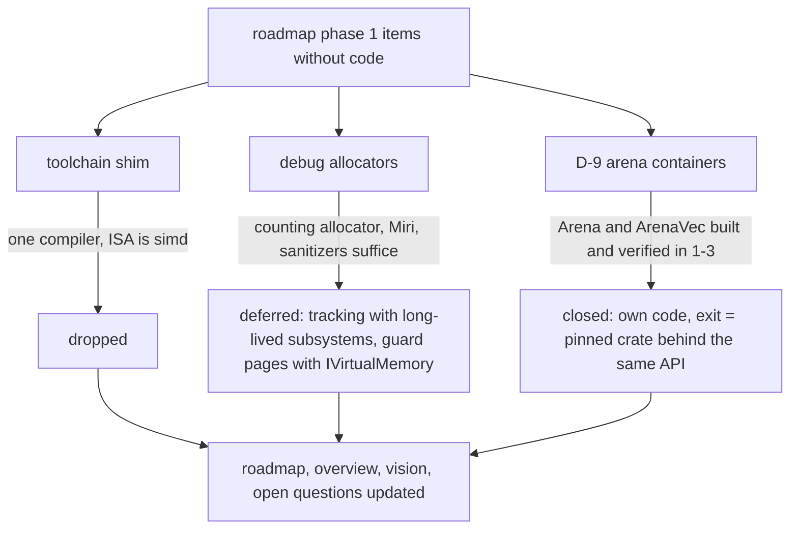
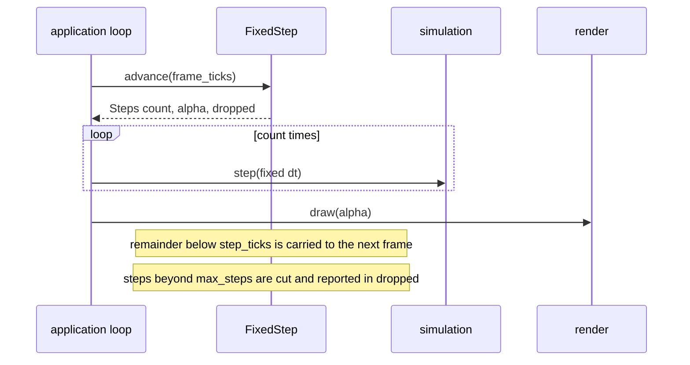

# Core Runtime: the Performance Mechanism `[P]`

## 1. Language and style (ADR-0001)

**Language: Rust (decided by owner, Q1; see [evaluation](../decisions/adr-0001-language-evaluation.md)).** Rules: the standard library may be used in L0-L2 (v0.6); `unsafe` only in allowlisted modules, each block with a `// SAFETY:` comment, counted as a metric; `panic = abort` in the runtime, no panics across module boundaries, no `unwrap`/`expect` in engine code (errors are values); traits and generics for compile-time polymorphism, trait objects only at coarse port boundaries; plain `#[repr(C)]` data and a C ABI at plug-in boundaries. OS-specific services go through platform ports.

## 2. Memory

- **Memory (v0.6):** allocation uses the standard allocator by default (`malloc`/`new`, Rust global allocator) behind a small `IAllocator` interface so counting, tracking and arenas can be layered on top. `IVirtualMemory` stays an optional platform port for page-level reserve/commit where needed (arenas, strict memory budgets); it is no longer the mandatory root.
- Allocator interface + concrete allocators: **linear/arena** (per-frame, per-job), **pool** (fixed-size objects), **stack**, **general-purpose** fallback, plus debug allocators (tracking, guard pages, poisoning), deferred (see Phase 1 scope decisions, card 1-37).
- **Per-frame arena** reset each frame; scratch arenas per job.
- **Steady state = zero heap allocations per frame** in hot systems; enforced by a counting allocator in tests ([R1](../00-vision-and-requirements.md)). The counting allocator uses **per-thread counters** and the assertion is per thread or per job ("this job made 0 allocator calls"): in the spike a shared atomic counter cost +29% single-threaded and made 8 threads 5.9x slower, per-thread counters cost +4% and +2% ([allocator spike](../spikes/allocator-spike.md) S7).
- **Containers:** use `std` containers by default. Write own containers (`SparseSet`, `RingBuffer`, handle pools, fixed-capacity variants) where the standard ones do not fit or a benchmark shows a win. **Arena-backed containers are own code:** stable Rust `Vec`/`HashMap` use only the global allocator `[K, verify]`, so per-frame/per-job arenas need small own containers (default: own small arena containers; a pinned third-party arena crate behind a facade is the alternative; chosen in phase 1 by benchmark, D-9). `#[global_allocator]` counting is used for the zero-allocation tests.
- **Allocation tools, in this order of preference (allocator spike, v0.18):** (1) *design the allocation away* (flat arrays plus offsets, a `Vec` of nodes with `u32` indices); (2) *reuse capacity* (`clear()`, `with_capacity` once; a fresh `Vec::new()` every frame is the expensive form: 5-13 allocations per frame for one list, a realloc counting as an allocation in the spike; the 1-2 allocator counts `reallocations` separately); (3) an *arena* for heterogeneous per-frame or per-job scratch data; (4) a *pool with generational handles* for long-lived handle-addressed objects with churn, while the data a hot loop iterates stays dense (a pool with holes is not an iteration structure); (5) the *general allocator* for everything else. Measured on Windows (default allocator = `HeapAlloc`): 25-38 ns per small allocate + free, 1-2 ns in an arena, 4-7 ns with mimalloc. At about 28 ns each the default allocator costs 0.28 ms per 10,000 allocations per frame (1.7% of a 16.7 ms frame), so below roughly 10^4 allocations per frame the policy "std by default" stands, and at about 10^5 allocations per frame it is a sixth of the frame. Evidence: [allocator spike](../spikes/allocator-spike.md).
- **Arena scope (phase 1, written test-first, own code):** `Arena` with fixed capacity; only types without drop glue (checked at compile time by a `const` assertion on `needs_drop::<T>()`, as in the spike); `reset(&mut self)`, so the borrow checker proves no reference into it is alive; failure is a value (`Option`/`Result`), never a panic; not `Sync` (one arena per thread or job); plus a push-only fixed-capacity `ArenaVec` and slices. Every `unsafe` block carries a `// SAFETY:` comment, counts against the module's `unsafe` budget and is Miri clean (the digest gate for changed `unsafe`). The spike's version (about 150 lines) shows the size needed; it is evidence, not code to copy. Acceptance tests to write first: overflow returns `None`; alignment, including over-aligned types; `reset` reuses the same memory; a nested allocation inside `alloc_slice_with`; `compile_fail` doc tests for a type with drop glue and for a reference used after `reset`. The spike used about 8 `unsafe` blocks; the module budget is set by the card.
- **Counting allocator, open points for card 1-2 (decided in 1-2, see section 8):** counters are per thread and readable on the calling thread; a job-level assertion reads them before and after inside the job itself, on the worker thread that runs it; the relation to the `IAllocator` interface (arenas are concrete types used directly on hot paths, `IAllocator` is the seam for counting and tracking) is decided in that card.
- **Global allocator:** chosen once, by benchmark, in the application (L4) as a single `#[global_allocator]` line; engine crates never name it. A phase-1 task compares the default allocator and one third-party candidate (the spike used mimalloc) on Windows **and** Linux x86-64 (ARM64 when its CI exists) and records the result in ADR-0022. Adopting a third-party allocator needs a `THIRD_PARTY.md` entry and an owner decision that defines its tier: no existing tier fits a `#[global_allocator]` (`T1-stopgap` is limited to adapters), so ADR-0022 defines it as L4 composition root, no port, exit plan = the default allocator; **decided (ADR-0022, owner, 2026-10-27): mimalloc, see [adr-0022-global-allocator](../decisions/adr-0022-global-allocator.md); the line lives in `engine/app_runtime` behind the Cargo feature `mimalloc` (default on; `--no-default-features` gives the default allocator, and CI tests both).** A C-built allocator such as mimalloc needs a C compiler in CI. Pass criterion (as applied in card 1-27; the "nothing slower" part failed on one Linux case and the owner accepted it): adopt a third-party allocator only if it is at least 2x faster than the default on small-object churn (64 B) and on 8-thread scaling on both OSes, regresses nothing else beyond the benchmark-gate tolerance, and switching back to the default compiles and passes every test; otherwise the default stays. Windows numbers alone are not enough: the Linux system allocator may be close to mimalloc ([R-22](../open-questions-and-risks.md)).
- **Math:** own vector/matrix/quaternion types, **generic over dimension** (`Vec2/Vec3/Vec4`, `Mat3/Mat4`, scalar-angle rotation for 2D, quaternion for 3D) so physics, scene and rendering share a skeleton for 2D and 3D (Q3, [physics §4](physics.md)). **Transcendental functions** (`sin`, `cos`, `exp`, ...) come from `std`: own deterministic versions were planned for D2 (Q16, v0.7) and are withdrawn because cross-platform identical results are not pursued (v0.25). Details in [physics §3](physics.md).
- **SIMD:** a `simd` abstraction in L0 (scalar reference + SSE/AVX/NEON adapters); engine code never touches intrinsics.
- **Threads/atomics:** use `std` threads and atomics; the job system is still injectable (`IScheduler`) so tests can run a deterministic single-thread scheduler. Memory-ordering rules documented once, in L0.
- **Handles** (a `u32` index plus a `u32` generation, 8 bytes; [conventions](conventions.md)) address all long-lived resources.

## 3. Job system (ADR-0004)

- Interface `IScheduler` (submit job, parallel-for, dependency/counter, wait-help) so the implementation is replaceable and tests can use a deterministic single-thread scheduler.
- Candidate implementations: (a) **work-stealing thread pool** with task counters (proposed first), (b) **fibers** as in Naughty Dog's engine [S listing](https://www.gdcvault.com/play/1022186). A spike compares them on real workloads (ECS iteration, physics solve, mixer) before committing.
- Frame structured as a **task graph**: systems declare read/write component sets, the scheduler derives ordering and runs independent systems in parallel.
- `Caps.hasThreads` may be false (the headless/test configuration); the scheduler then runs jobs inline in dependency order - the same deterministic scheduler used in tests.
- Rules: no blocking I/O or locks inside jobs; blocking work goes to an I/O pool; audio thread is *outside* the job system (hard real-time).

## 4. ECS (ADR-0003)

- **Proposal: hybrid storage like Bevy** (dense tables/archetypes by default for iteration speed, opt-in sparse sets for frequently toggled "tag" components) [S](https://bevy.org/news/bevy-0-5/). Decision is **data-driven**: a benchmark spike implements both minimal storages and measures iteration vs structural-change cost on our workloads. Published evidence says archetypes win iteration, sparse sets win mutation [S](https://diglib.eg.org/handle/10.2312/cgvc20251224).
- Queries are cached and typed; systems are plain functions over query views; parallel safety is derived from declared access.
- **Relationships** (parent/child, "targets"): start with an explicit hierarchy in `scene`; general relationships (Flecs-style) deferred because they interact badly with archetype layouts [S](https://blog.innogames.com/entity-relationships-in-unity-dots-ecs/).
- **ECS is not the universal container.** Physics and audio keep their own optimised internal storage; ECS holds *references (handles)* and synced state. This prevents the ECS from constraining the hot loops of the other subsystems.

## 5. Frame loop and time

```
fixed-step simulation (accumulator, dt = 1/N) --> physics, gameplay, deterministic
variable-step per frame                       --> render extraction, interpolation, UI
audio thread (callback driven, decoupled)     --> mixes from a lock-free command queue
```

- Fixed timestep for simulation (determinism, networking-ready), interpolation for rendering.
- **Render extraction:** simulation world is snapshot/copied into a render-owned structure so rendering of frame N overlaps simulation of frame N+1 (pipelined frame), as is standard [K].

## 6. Module system

- Modules registered in the composition root; **static linking by default** (best performance, simplest).
- Optional **dynamic modules + hot reload** in dev builds only, with a C-ABI boundary (inspired by The Machinery's plugin model [S](https://www.gamedeveloper.com/programming/the-machinery-goes-open-beta)). Deferred until after the walking skeleton.

## 7. Performance engineering practice

- Every hot-path module ships with a **benchmark** next to its tests.
- Instrumentation via profiling macros -> hook; Tracy (T2) wired as a dev adapter [K].
- **Budgets** per system per frame recorded in `docs/budgets` (to be created) and asserted in nightly benchmark scenes.
- SIMD: write scalar reference first (tested), then the SIMD version tested against it: **bit-identical to scalar on the same platform** for simulation code (this keeps D0/D1 testable; the abstraction offers no fused or estimate operation, so the backends also agree across ISAs, which D2 for physics needs, v0.36); a tolerance is allowed only outside simulation code (rendering, audio DSP). Box2D v3 reports a large win from layout + SIMD [S](https://box2d.org/posts/2024/08/releasing-box2d-3.0).

## 8. Implemented: crate `base` (design note, card 1-1)

`engine/base` is the first L0 crate. std only, `unsafe` forbidden by the workspace lint, no OS access. It grows with each phase 1 card; this section records what exists and why.

| Module | What | Invariants and notes |
|---|---|---|
| `rng` | `Pcg32` (XSH RR 64/32), seeded by `(seed, stream)` | Integer arithmetic only, so the sequence is the same on every platform (free, and it keeps replays portable, which D2 for physics needs). Checked against the published reference vector and an independent implementation. `next_f32` builds the float from mantissa bits (no casts, 23 random bits, range `[0, 1)`). `below(bound)` is unbiased (rejection sampling); a zero bound is an error value, never a panic. |
| `log` | `Level`, `Record`, `LogSink`, `Logger<S>`, `NullSink`, `MemorySink` | No global logger: the caller owns the `Logger`, so tests inject a `MemorySink` and a platform adapter supplies the sink that reaches a file or console. The message travels as `fmt::Arguments`, so a filtered record or a `NullSink` never formats it (the call site still evaluates the argument expressions; a skipping macro and a `Level::Off` are left for a later card). A sink has a single owner; sharing one across threads is not supported yet. |
| `alloc` | `CountingAllocator<A: GlobalAlloc>`, `AllocCounts`, `count_allocations`, `current_counts` | Counters are per thread, in a `const`-initialised thread-local `Cell` without a destructor: reading them never allocates and registers no thread-exit hook, so they are safe inside the allocator. `alloc` and `alloc_zeroed` count as allocations, `realloc` as a reallocation (a growing `Vec` makes these), `dealloc` as a deallocation; `calls()` adds the three. `count_allocations(f)` returns the calling thread's delta, so another thread's allocations are not counted by construction (a thread-local), and a job asserts on its own worker thread. Install the allocator with `#[global_allocator]` in a test binary or the application (L4). |
| `arena` | `Arena`, `ArenaBox<'a, T>`, `ArenaVec<'a, T>` | Fixed-capacity bump arena: one heap allocation in `with_capacity` (or `try_with_capacity`, which returns `None` instead of aborting), one free in `Drop`, and every allocation in between is a pointer bump with no allocator call (integration test `arena_allocations`). `alloc`, `alloc_slice_with` and `vec_with_capacity` return `Option`; `ArenaVec::push` hands the value back as `Err(value)` when full. `reset(&mut self)` makes the block reusable and the borrow checker proves no reference survives (compile_fail doc test). Types with drop glue are rejected at compile time (`const` assertion on `needs_drop`; compile_fail doc test). The block is 64-byte aligned and padding is computed from the offset with checked arithmetic, so what fits and what `used()` reports never depend on where the allocator put the block (determinism); types aligned above 64 are rejected at compile time, and huge lengths return `None` instead of overflowing. Zero-sized values and empty slices take no space. The closure of `alloc_slice_with` may allocate from the same arena (space is reserved first). Not `Sync` (a `Cell` offset) and not `Send` (raw block; handing arenas to workers is for the job-system card). |
| `pool` | `Handle<T>`, `Pool<T>` | Generational handles and a fixed-capacity pool, safe code only. `Handle<T>` is a slot index plus a generation (two `u32`, 8 bytes), `Copy`, `Eq`, `Hash` for every `T`, and typed: a `Handle<A>` does not compile where a `Pool<B>` is expected (`compile_fail` doc test). `Pool::with_capacity` makes two heap allocations (slots and free list); `insert`, `remove`, `get`, `get_mut` and `contains` make none (integration test `pool_allocations`). `insert` hands the value back as `Err(value)` when full. `remove` bumps the slot generation, so every older handle to the slot is stale and answers `None` (a slot whose generation is already `u32::MAX` is retired instead). Free slots are reused last freed first and new slots are issued in index order, so the handles a sequence of operations produces are the same on every run. |
| `map` | `DenseMap<K, V>`, `MapKey`, `hash64` | Fixed-capacity hash map whose iteration order depends only on the operations done (entries in a dense array in insertion order, remove swaps the last entry into the hole). Safe code, `u32` positions in a linear-probing table with at least twice the capacity in slots and no tombstones. The hash is the `MurmurHash3` 64-bit finalizer (integer arithmetic only). `MapKey` is implemented for `u32`, `u64` and `Handle<T>`. Built for simulation code, where the standard maps are banned (card 1-24) |
| `sparse` | `SparseSet<V>`, `InsertError<V>` | Fixed-capacity map from a small integer id (below an id bound) to a value, with the same iteration order rule as `map`: dense array in insertion order, remove swaps the last entry into the hole. A table with one `u32` position per possible id finds an entry; the dense array confirms it, so the table is never cleared. Safe code. Built for data keyed by a bounded id (component-style data), where iteration dominates (card 1-25) |
| `ring` | `Ring<T>` | Fixed-capacity FIFO queue of `Copy + Default` values: one array allocated at construction (length a power of two, so an index wraps with a mask), `push` at the back returns the value when the ring is full, `pop` and `peek` at the front, `get` and `iter` in FIFO order. Safe code, no drop glue to run. Built for queues on hot paths where the no-allocation rule applies (card 1-26) |
| `simd` | `scalar::F32x4`, `sse2::F32x4`, `neon::F32x4`, `F32x4` (the build target's backend) | Four `f32` lanes with `splat`, `from_array`, `to_array`, `+ - * /`, unary `-`, `sqrt`, `min`, `max`, `abs` and `horizontal_sum`. `scalar` is the reference and is always built; `sse2` (x86-64) and `neon` (AArch64, card 2-7) give the same bits for every operation, checked by property tests over 20,000 random and special-value cases per operation (D2). Each operation is one IEEE-754 operation per lane (or a sign-bit mask, or the fixed add sequence of `horizontal_sum`): no FMA, no `rcpps` or `rsqrtps`, and on NEON no `vfmaq`, `vmlaq`, `vrecpe`, `vrsqrte`. `min` and `max` are defined as `a < b ? a : b` and `a > b ? a : b` (the x86 rule: `other` when equal or unordered), `horizontal_sum` as `(l0 + l1) + (l2 + l3)`. NaN payloads are unspecified; simulation code must not produce NaN. 13 `unsafe` blocks in `sse2` and 13 in `neon`, all single intrinsic calls with a `// SAFETY:` comment. On NEON `min` and `max` are a compare and a select (`vcltq`/`vcgtq` + `vbslq`), because `fmin`/`fmax` return NaN for a NaN operand and order the zeros; `abs`, `neg` and `sqrt` are `vabsq`, `vnegq` and `vsqrtq`; `horizontal_sum` is `vpaddq` then one `f32` add. |
| `math` | `Scalar`, `Vec2`, `Vec3`, `Vec4`, `Mat3`, `Mat4`, `Quat` | `Scalar` is `f32` (one alias, [conventions](conventions.md)). The vectors are `repr(C)` plain data with fields `x`, `y`, `z`, `w`, alignment of one scalar. Constants `ZERO`, `ONE` and the axes, `splat`, `from_array`, `to_array`, operators `+ - neg`, scalar `*` and `/`, `dot`, `length_squared`, `length`, `distance`, `normalized` (an `Option`), `min`, `max`, `abs`, `lerp`; `Vec2::perp` and `cross`, `Vec3::cross`, `extend` and `truncate`. The order of every operation is fixed and nothing is fused, so results repeat bit for bit. Safe code only. `Mat3` and `Mat4` are column-major `repr(C)` plain data holding their columns (`cols`), column vectors, `M * v` ([conventions](conventions.md)). `IDENTITY`, `ZERO`, `from_cols`, `from_cols_array`, `to_cols_array`, `transpose`, `determinant`, `inverse` (an `Option`), `is_finite`, the operators `Mat * Vec` and `Mat * Mat`, `from_scale` and `from_rotation_x`, `_y`, `_z` (radians, counter-clockwise); `Mat4` adds `from_translation`, `from_mat3`, `transform_point3` and `transform_vector3`. `Quat` is a `repr(C)` quaternion `x, y, z, w` (Hamilton, `w` last, identity `(0, 0, 0, 1)`), a rotation when it has unit length: `IDENTITY`, `from_axis_angle` (an `Option`), `*` (the Hamilton product, the right factor applies first), `conjugate`, `inverse` and `normalized` (both `Option`), `dot`, `length`, `rotate`, `to_mat3`, `to_mat4`, `nlerp` and `slerp` (both `Option`, shorter arc). |
| `assert` | `duck_assert!`, `duck_debug_assert!` | Always-on and debug-only assertion. A failure panics with the condition or message; under `panic = "abort"` that ends the process, so nothing unwinds across a module boundary. |

UML view of crate `base` as implemented (cards 1-1 to 1-3, 1-9, 1-11, 1-18, 1-19, 1-20, 1-24, 1-25 and 1-26). It is a view of the table above and of `engine/base/src`; if they disagree, the code and the table win and the diagram is fixed. Arrows: `*--` owns, `..>` uses or borrows, `..|>` implements. Main operations only: constructors, accessors and the free functions `current_counts` and `count_allocations` are left out. `Logger` and `CountingAllocator` are generic over `S: LogSink` and `A: GlobalAlloc`; `Record`, `ArenaBox` and `ArenaVec` carry a lifetime.

```mermaid
classDiagram
  direction LR

  namespace rng {
    class Pcg32 {
      +new(seed, stream) Pcg32
      +next_u32() u32
      +next_f32() f32
      +below(bound) Result~u32, ZeroBound~
    }
    class ZeroBound
  }

  namespace log {
    class LogSink {
      <<trait>>
      +write(Record)
    }
    class NullSink
    class MemorySink {
      +entries() Entry[]
    }
    class Entry {
      +level Level
      +target String
      +message String
    }
    class Record {
      +level Level
      +target str
      +message Arguments
    }
    class Level {
      <<enum>>
      Error
      Warn
      Info
      Debug
      Trace
    }
    class Logger {
      +log(level, target, args)
      +enabled(level) bool
    }
  }

  namespace alloc {
    class GlobalAlloc {
      <<trait, std>>
    }
    class CountingAllocator {
      +alloc / dealloc / realloc
    }
    class AllocCounts {
      +allocations u64
      +reallocations u64
      +deallocations u64
      +bytes_requested u64
      +calls() u64
      +since(earlier) AllocCounts
    }
    class COUNTS {
      <<private thread-local Cell>>
    }
  }

  namespace arena {
    class Arena {
      +capacity() usize
      +used() usize
      +with_capacity(bytes) Arena
      +try_with_capacity(bytes) Option~Arena~
      +alloc(value) Option~ArenaBox~
      +alloc_slice_with(len, f) Option~ArenaVec~
      +vec_with_capacity(n) Option~ArenaVec~
      +reset(&mut self)
    }
    class ArenaBox
    class ArenaVec {
      +push(value) Result
      +capacity() usize
    }
  }

  namespace pool {
    class Handle {
      +index() u32
      +generation() u32
    }
    class Pool {
      +with_capacity(capacity) Pool
      +insert(value) Result~Handle, T~
      +remove(handle) Option~T~
      +get(handle) Option~ref T~
      +get_mut(handle) Option~mut ref T~
      +contains(handle) bool
      +len() usize
      +capacity() usize
    }
    class Slot {
      generation u32
      value Option~T~
    }
  }

  namespace map {
    class MapKey {
      <<trait>>
      +hash_key() u64
    }
    class DenseMap {
      +with_capacity(capacity) DenseMap
      +insert(key, value) Result
      +get(key) Option~ref V~
      +get_mut(key) Option~mut ref V~
      +contains_key(key) bool
      +remove(key) Option~V~
      +clear()
      +iter() pairs in dense order
      +iter_mut()
      +len() usize
      +capacity() usize
    }
    class hash64 {
      <<function>>
      MurmurHash3 finalizer
    }
  }

  namespace sparse {
    class SparseSet {
      +with_capacity(id_bound, capacity) SparseSet
      +insert(id, value) Result
      +get(id) Option~ref V~
      +get_mut(id) Option~mut ref V~
      +contains(id) bool
      +remove(id) Option~V~
      +clear()
      +iter() pairs in dense order
      +iter_mut()
      +len() usize
      +capacity() usize
      +id_bound() u32
    }
    class InsertError {
      <<enum>>
      IdOutOfBound
      Full
    }
  }

  namespace ring {
    class Ring {
      +with_capacity(capacity) Ring
      +push(value) Result
      +pop() Option~T~
      +peek() Option~ref T~
      +get(index) Option~ref T~
      +iter() values front to back
      +clear()
      +len() usize
      +capacity() usize
      +is_empty() bool
      +is_full() bool
    }
  }

  namespace simd {
    class ScalarF32x4 {
      <<reference>>
      +splat(f32) F32x4
      +from_array / to_array
      +add sub mul div neg
      +sqrt min max abs
      +horizontal_sum() f32
    }
    class Sse2F32x4 {
      <<x86-64 backend>>
      +same operations
    }
    class NeonF32x4 {
      <<AArch64 backend>>
      +same operations
    }
    class F32x4 {
      <<alias of the target backend>>
    }
  }

  namespace math {
    class Scalar {
      <<alias of f32>>
    }
    class Vec2 {
      <<repr C>>
      +x y Scalar
      +add sub neg mul div
      +dot length normalized
      +min max abs lerp
      +perp() Vec2
      +cross(Vec2) Scalar
      +extend(z) Vec3
    }
    class Vec3 {
      <<repr C>>
      +x y z Scalar
      +same operations
      +cross(Vec3) Vec3
      +extend(w) Vec4
      +truncate() Vec2
    }
    class Vec4 {
      <<repr C>>
      +x y z w Scalar
      +same operations
      +truncate() Vec3
    }
    class Mat3 {
      <<repr C>>
      +cols Vec3 x3
      +transpose determinant
      +inverse() Option
      +mul Vec3 and Mat3
      +from_scale from_rotation_xyz
    }
    class Mat4 {
      <<repr C>>
      +cols Vec4 x4
      +transpose determinant
      +inverse() Option
      +mul Vec4 and Mat4
      +from_translation from_scale
      +from_mat3 from_rotation_xyz
      +transform_point3 transform_vector3
    }
    class Quat {
      <<repr C>>
      +x y z w Scalar
      +from_axis_angle() Option
      +mul conjugate inverse normalized
      +rotate(Vec3) Vec3
      +to_mat3() Mat3
      +to_mat4() Mat4
      +nlerp slerp Option
    }
  }

  class assert {
    <<macros>>
    +duck_assert()
    +duck_debug_assert()
  }

  Pcg32 ..> ZeroBound : error value
  Logger *-- LogSink : owns a sink S
  Logger ..> Record : builds
  Record --> Level
  LogSink <|.. NullSink
  LogSink <|.. MemorySink
  MemorySink *-- Entry
  GlobalAlloc <|.. CountingAllocator
  CountingAllocator ..> GlobalAlloc : forwards to A
  CountingAllocator ..> COUNTS : bumps
  COUNTS *-- AllocCounts
  ArenaBox ..> Arena : borrows for its lifetime
  ArenaVec ..> Arena : borrows for its lifetime
  Arena ..> GlobalAlloc : calls the global allocator once to get and once to free the block
  Pool *-- Slot : fixed number, allocated once
  Pool ..> Handle : issues and checks
  DenseMap ..> MapKey : hashes keys with
  SparseSet ..> InsertError : refuses with
  MapKey ..> hash64 : u32 and u64 call
  Handle ..|> MapKey : implements
  Sse2F32x4 ..> ScalarF32x4 : must match bit for bit
  NeonF32x4 ..> ScalarF32x4 : must match bit for bit
  F32x4 ..> Sse2F32x4 : x86-64 with sse2
  F32x4 ..> NeonF32x4 : AArch64 with neon
  F32x4 ..> ScalarF32x4 : any other target
  Vec2 --> Scalar : components
  Vec3 --> Scalar : components
  Vec4 --> Scalar : components
  Vec2 ..> Vec3 : extend
  Vec3 ..> Vec4 : extend
  Vec3 ..> Vec2 : truncate
  Vec4 ..> Vec3 : truncate
  Mat3 *-- Vec3 : three columns
  Mat4 *-- Vec4 : four columns
  Mat4 ..> Mat3 : from_mat3
  Mat4 ..> Vec3 : transform_point3
  Quat ..> Vec3 : axis and rotate
  Quat ..> Mat3 : to_mat3
  Quat ..> Mat4 : to_mat4
```



Reading the diagram: nothing in `base` knows the OS; the outward seams are `LogSink` (supplied by the caller) and `GlobalAlloc` (std). `assert` is standalone. `Pool` owns its slots and a free list of slot indices (not drawn); a `Handle` holds no reference to the pool. `ArenaBox` and `ArenaVec` borrow the arena, so `reset(&mut self)` cannot run while one is alive.

Complexity: `next_u32` is O(1); `below` is O(1) expected (fewer than 2 draws on average, worst case unbounded but with probability halving each draw). Logging cost is one level comparison when the record is filtered out.

Not yet covered, by design: more `simd` types and ISAs, vectors backed by SIMD, further containers (later phase 1 cards).

Decisions of card 1-2 (counting allocator):

- **No `IAllocator` trait yet.** Stable Rust has no allocator trait other than `GlobalAlloc`, which is the seam: the counting allocator wraps any `GlobalAlloc`, and arenas stay concrete types used directly (card 1-3). A trait is added when a second consumer needs one.
- **`unsafe` budget.** `base` leaves the workspace lint table (which forbids `unsafe`) and repeats it with `unsafe_code = "deny"` and `undocumented_unsafe_blocks = "deny"`, the pattern of `skeleton-unsafe`; the only module that allows `unsafe` is `alloc`. Count: one `unsafe impl` and four `unsafe` blocks (the four forwarding calls), each with a `// SAFETY:` comment, plus one `unsafe` block in a unit test. Counters saturate and the allocator never panics (unwinding out of a global allocator is undefined behaviour). The per-module budget is checked by `tools/unsafe-budget` (card 1-31, see the section at the end of this page); the lint-profile check covers only `skeleton-unsafe`, so the repeated table in `base/Cargo.toml` is not compared with the workspace one. The lint-profile gap is for a governance task.
- **Miri.** Clean on `x86_64-unknown-linux-gnu` (nightly, `cargo miri test -p base`). On the Windows host target Miri reports undefined behaviour inside the standard library's own Windows allocator (`sys/alloc/windows.rs`, header read for over-aligned blocks, hit by the test harness's cache-padded channel), under both Stacked and Tree Borrows. The wrapper forwards the pointer unchanged and the unit tests that allocate with 8-byte alignment are Miri clean on the host; the integration test binary is not run under Miri on Windows. Command for the clean run: `RUSTUP_TOOLCHAIN=nightly cargo miri test -p base --target x86_64-unknown-linux-gnu`.
- **Zero-allocation proof for logging.** `Logger<NullSink>` logging makes no allocator call; `Logger<MemorySink>` does (integration test `alloc_counting`). This closes the item left open in card 1-1.
- **Cross-thread isolation is tested (card 1-6).** At the time of card 1-1 the architecture rules forbade creating threads anywhere in `base`, so the test could not live here and no waiver was added. Card 1-4 let test-only code create threads (`allow_in_tests` in `gates/architecture.toml`); card 1-6 added two integration tests in `tests/alloc_counting.rs`: two threads inside a measurement at the same time (held together by a barrier) each see exactly their own allocations, and a new thread starts from zero. The first test compares all four counters of each thread, including one reallocation. Checked by mutation: sharing any one of `allocations`, `reallocations`, `deallocations` or `bytes_requested` across threads makes it fail; sharing `allocations` or `bytes_requested` also fails the second test (the second does not look at deallocations, because std makes the new thread free blocks its parent allocated).

Decisions of card 1-3 (arena):

- **Wrapper types instead of `&mut T`.** `alloc(&self, ..)` cannot return `&mut T` without tripping `clippy::mut_from_ref`, and silencing it would be a counted waiver. `ArenaBox` and `ArenaVec` hold a `NonNull` plus `PhantomData<&'a mut _>`, so the lifetime still ties them to the arena and no lint fires. `ArenaBox` and `ArenaVec` dereference to `T` and `[T]`.
- **`unsafe` budget.** Module `arena` allows `unsafe` through `#![expect(unsafe_code, reason = ..)]`: 10 `unsafe` blocks, each with a `// SAFETY:` comment (block creation and free 2, reservation 2, writes 2, shared and exclusive views of box and vec 4). Together with `alloc` the crate has two allowed modules; the budget is checked by `tools/unsafe-budget` (card 1-31).
- **The block is allocated with a fixed 64-byte alignment** (`std::alloc::alloc` with an explicit `Layout`), found by the independent review (F1): with an alignment-1 block, whether an over-aligned value fit depended on the address the allocator returned, which would make `None`/`Some` and `used()` differ between allocators and runs. Now padding depends only on the sequence of allocations. `used()` includes padding.
- **Construction.** `with_capacity` aborts (`handle_alloc_error`) when the block cannot be provided, like `Vec::with_capacity`; `try_with_capacity` returns `None` (also for sizes above `isize::MAX`). Every later operation reports failure as a value.
- **Known limits.** The drop-glue check is evaluated when the code is built (post-monomorphisation), so `cargo check` alone does not report it; `ManuallyDrop` values pass it and are leaked on `reset`. `alloc_slice_with` runs the closure `len` times even for zero-sized elements, so a huge `len` of them takes that long.
- **Miri.** Clean on `x86_64-unknown-linux-gnu`, including the arena unit tests and the integration test.
- **Out of scope here:** growable arenas and drop-glue types.

Decisions of card 1-9 (handles and pool):

- **Handle size: 8 bytes, not 4.** [conventions](conventions.md) records this size. A 4-byte handle would leave 8 bits of generation, which wraps after 256 reuses of one slot and then accepts a stale handle; for a pool with churn that is a silent wrong object, not a rare edge. So `Handle` is a `u32` index plus a `u32` generation. A packed 4-byte variant can be added when a profile shows the size matters. The owner confirmed the 8-byte size (card 1-15).
- **Stale handles are detected exactly.** A slot whose generation cannot advance (`u32::MAX` reached) is retired: it is never put back on the free list, so no handle can ever match it again. Cost: one slot of capacity per 2^32 reuses of that slot.
- **Fixed capacity, failure as a value.** The capacity is a `u32` given to `with_capacity`; there is no growth, so there is no hidden allocation or move of live objects. A full pool returns `Err(value)` from `insert`, and the value is not lost.
- **Deterministic reuse.** Fresh slots are issued in index order; freed slots go on a stack and the last freed is reused first. No hash map, no iteration over holes.
- **No iteration.** A pool with holes is not an iteration structure (allocation policy, [section 2](#2-memory)); code that loops over many objects keeps them in a dense array and holds handles to them. A deterministic `iter` can be added when a card needs it.
- **No `unsafe`.** The module is safe code (`Vec<Slot<T>>` with `Option<T>`), so it adds nothing to the `unsafe` budget and needs no Miri run.
- **Known limits.** A handle carries no pool identity: a `Handle<T>` from one `Pool<T>` handed to another pool of the same `T` may name an object there (the type system separates element types, not pools). Pool identity can be added if a module needs it. A pool of a type with a large size pays `Option<T>` padding per slot.

Slot life cycle (what `insert` and `remove` do to one slot):



Decisions of card 1-11 (`simd` v0, and the N-6 spike):

- **N-6 spike result: ISA backends live inside `base`, selected at compile time by `cfg`.** Alternatives considered: (a) a generic top-down design (a `Simd` trait implemented by separate crates), (b) backends inside `base` behind `cfg`. (a) adds a crate boundary and trait-generic code everywhere for no gain while there is one ISA; (b) keeps `core::arch` in one crate, which the architecture check already allows only in `base`. The scalar reference is always built, so the oracle is available on every target. Reversible: a backend is one file with the same operations.
- **One type, `F32x4`, four lanes.** It is the width every ISA targeted here (SSE2, NEON) has natively. Wider types (`F32x8` for AVX2) and integer lanes come with the first consumer that needs them, and only where a benchmark justifies them.
- **Bit-identical by definition, not by tolerance.** Every operation is a single IEEE-754 instruction per lane. Where the ISA instruction and a natural scalar expression could differ, the scalar reference is written to the instruction: `min` and `max` return the second operand on equal or unordered lanes, and the lane sum has a fixed pair order. Excluded on purpose: FMA, `rcpps` and `rsqrtps` (contraction and the estimate instructions differ between x86 and ARM; since v0.25 this keeps scalar and SIMD testable against each other, it is no longer a D2 requirement). Adding a fused lane operation later needs the same fused form in the scalar reference ([physics](physics.md) section 3, rule 1).
- **NaN payloads are not part of the contract.** The tests treat any two NaN results as equal, except for `abs` and `neg`, which are compared strictly. Simulation code must not produce NaN.
- **Subnormals.** Equivalence is tested under the default floating-point control state. Simulation jobs set and assert the control registers (digest section 5); the NEON backend must use the same flush-to-zero setting.
- **Inlining.** The small methods carry `#[inline]`; whether they inline across crates without LTO is for the first benchmark to show.
- **`unsafe`.** `std::arch` intrinsics are `unsafe fn` to call, even for SSE2 which is in the x86-64 baseline, so `sse2` carries `#![expect(unsafe_code, ..)]`: 13 blocks, each one intrinsic call with a `// SAFETY:` comment. The module is compiled only when the target has `sse2`, which makes the comment true by construction. Third allowed module (with `alloc` and `arena`); `neon` (card 2-7) is the fourth, the same way (13 blocks, `cfg` on `aarch64` with `neon`, budget 16); the per-module budget is checked by `tools/unsafe-budget` (card 1-31).
- **Miri** is clean on the host target for all `simd` tests (case count reduced under Miri).
- **Speedup (card 1-33, [simd-benchmark](../spikes/simd-benchmark.md)).** The 8-lane kernel equals the compiler's own vectorised plain loop (ratio 0.92 to 1.21) and is 3.3 to 11 times faster than a loop the compiler cannot vectorise; what G4 should compare is an open owner decision. A consumer does not exist yet. The D2 cost report (feature on versus off) is measured with the physics crate in phase 4 (v0.36). This card proves equivalence, not speed.
- **On x86-64 the scalar and SSE2 code both compile to SSE instructions**, so the equivalence tests cannot fail by an ISA difference here; they pin the contract for the NEON backend (card 2-7), which is where scalar and vector code can differ. The NEON tests are cross-compiled and linted for `aarch64-unknown-linux-gnu`, and since card 2-10 they run natively on a hosted AArch64 runner (job `arm64` of `ci`): the 14 `simd::neon` tests and the rest of `base` passed on a probe run (2026-11-01). That covers unit tests and clippy only; Miri, mutation and determinism of ARM64 are not gated.

How the backend is chosen (compile time):



Decisions of card 1-18 (`math`, part 1: `Scalar`, `Vec2`, `Vec3`, `Vec4`):

- **Three concrete types, not one `Vec<N>`.** Named fields (`v.x`, `v.y`) read better at call sites than indexing, and the physics skeleton that is generic over the dimension (physics section 4) will use a trait over these types, not a const generic. A `macro_rules` block writes the operations they share once, so the code is not triplicated.
- **`Scalar` is a type alias of `f32`** ([conventions](conventions.md) asks for one alias so a later switch is mechanical). The f32 versus f64 analysis found f32 the right default; only world positions might need more, and that is a separate type if it ever happens.
- **Plain `repr(C)` data, alignment 4.** `Vec4` is not 16-byte aligned. A SIMD path converts with `to_array` and `F32x4::from_array`; whether a SIMD-backed `Vec4` pays is for a benchmark to show, and it would be a separate type.
- **Fixed order, no FMA.** `dot` adds the products left to right (tested with `2^24, 1, 1`, where another order gives a different bit pattern), `lerp` is `a * (1 - t) + b * t` (it gives both ends bit for bit for finite operands, except that a zero may come out as `+0.0`), `length` is the correctly rounded square root of `dot(self, self)`, `min` and `max` use the x86 tie rule of `simd`. This keeps D0 and D1 and lets a SIMD path match bit for bit.
- **Errors are values, nothing panics.** `normalized` returns `None` for a zero, NaN or infinite length. The length comes from the squared length, so the useful range is components of about `1e-19` to `1e19`: above it the square overflows, far below it the square underflows to zero (both give `None`), and in between the square is subnormal and the result less accurate. Division by zero follows IEEE (infinity or NaN). There is no `Index` operator because it would panic out of range; use the fields or `to_array`.
- **No vector-times-vector operator yet.** It is ambiguous between the componentwise, dot and cross products; it is added when a consumer needs it, under an explicit name.
- **`PartialEq` only, no `Eq` or `Hash`.** `-0.0 == 0.0` and `NaN != NaN`, as for `f32`. Tests compare bit patterns (`to_bits`) where the sign of zero matters.
- **A SIMD `Vec4` has to follow the same add order.** `Vec4::dot` is `((x*x + y*y) + z*z) + w*w`, but `simd::F32x4::horizontal_sum` adds `(l0 + l1) + (l2 + l3)`. A SIMD `dot` built on `horizontal_sum` would not match the scalar bits, so the SIMD card either adds a left-to-right reduction or changes the scalar order first.
- **Checks.** 112 tests (a shared suite per dimension plus per-type tests; the properties use the seeded `Pcg32`), mutation 28 caught, 0 missed, 4 unviable, line coverage of `vector.rs` 99.90%, Miri clean (case count reduced), release profile green. Safe code only.
- **Not measured: speed.** No benchmark and no consumer exist yet; the methods carry `#[inline]`.

Decisions of card 1-19 (`math`, part 2: `Mat3`, `Mat4`):

- **A matrix holds its columns.** `Mat3 { cols: [Vec3; 3] }` and `Mat4 { cols: [Vec4; 4] }` are `repr(C)`, so the memory is the column-major flat array that `to_cols_array` returns and a graphics API can take the bytes as they are. `cols` is a public field: indexing a fixed array is the caller's choice, and no `Index` operator is offered (it would panic out of range).
- **`PartialEq` only, as for the vectors.** `-0.0 == 0.0` and `NaN != NaN`; tests that need the sign of zero compare bit patterns. The determinant and the inverse are tested against an `f64` reference with a tolerance, not bit for bit; only the products and the matrix-vector sums have their order pinned bitwise.
- **Operators only for the products.** `Mat * Vec` and `Mat * Mat` are `Mul` impls; `(a * b) * v` applies `b` first. Each result element is a row times a column with the products added left to right (tested with `2^24, 1, 1`, and bit for bit against a plain loop), and `(A*B)^T` equals `B^T * A^T` bit for bit because the same products are added in the same order. No FMA, so a SIMD path can be checked against these.
- **`inverse` is an `Option`.** `Mat3` uses the cross products of the columns and `Mat4` the 2x2 minors of the first two and the last two rows (the determinant is the Laplace expansion over the same minors). `None` when the determinant is infinite or NaN, or when any element of the result is not finite. A zero determinant gives infinite or NaN quotients, so the finiteness check refuses it too, which keeps one rule instead of two. The determinant of a matrix with tiny columns (a scale of about `1e-15` or less for `Mat3`, `1e-11` for `Mat4`) underflows to zero, so such a matrix is refused although it is invertible. A matrix that is nearly singular but has a finite, non-zero determinant is inverted without a warning: there is no condition-number test, no pivoting, and the caller decides what precision it needs.
- **Rotations use `std` `sin_cos`.** Right-handed, counter-clockwise: `rotation_z` takes +X to +Y, `rotation_x` takes +Y to +Z, `rotation_y` takes +Z to +X, and a zero angle is exactly the identity. `sin` and `cos` are the platform libm: the same on one machine and build (D0, D1), not identical across platforms. D2 is opt-in for physics only (v0.36): with that feature on, these constructors must route through the math facade of [physics section 3](physics.md) rule 7 (a follow-up card). Miri changes the last bits of `sin` and `cos` on purpose, so the one test that compares two evaluations uses a tolerance.
- **Points and directions are separate calls.** `transform_point3` uses `w = 1` and `transform_vector3` uses `w = 0`; neither divides by `w`, so both are for affine transforms. Projection matrices (depth 0..1, right-handed) are not in this card; they belong with the camera and render work, where a consumer exists.
- **`Default` is the identity.** A default transform leaves things where they are (unlike the vectors, where the default is zero, as for numbers). `ZERO` is there for the other meaning.
- **Checks.** 71 tests (a shared suite per size plus per-type tests; the properties use the seeded `Pcg32`, the determinant is compared with an `f64` Laplace expansion, the inverse with the identity on both sides). Mutation on `matrix.rs`: the first full run had 307 mutants, 294 caught, 10 unviable and 3 missed in a guard that the finiteness check made redundant; the guard was simplified, an overflow test added, and the rerun of the 178 mutants in the two `inverse` functions caught all. Line coverage of `matrix.rs` 99.91%, Miri clean, release profile green. Safe code only.
- **Not measured: speed.** No benchmark and no consumer exist yet. The implementation converts through flat arrays and relies on the compiler to unroll them; whether a hand-written `Mat4 * Vec4` or a SIMD one pays is for a benchmark to show.

Decisions of card 1-20 (`math`, part 3: `Quat`):

- **Hamilton convention, `w` last.** Fields `x, y, z, w`, identity `(0, 0, 0, 1)`, the same order as the vectors and as most engines and file formats. Rotation is counter-clockwise about the axis in a right-handed system, so `from_axis_angle(Z, quarter turn)` takes +X to +Y, like `Mat3::from_rotation_z`.
- **A quaternion is a rotation only when it has unit length, and the type does not enforce it.** `rotate`, `to_mat3`, `to_mat4` and `slerp` document that they expect a unit quaternion and do not check (checking would cost on every call in a hot path). `from_axis_angle`, `normalized`, `nlerp` and `slerp` return results of unit length within rounding (about `1e-5` in the tests). A wrapper type that guarantees it is possible later if misuse shows up.
- **Errors are values.** `from_axis_angle` normalises the axis and returns `None` for a zero, NaN, infinite or underflowing one, and for a NaN or infinite angle. `normalized` and `inverse` return `None` when there is no usable length (zero, NaN, infinite, or a squared length that overflows or underflows). `nlerp` and `slerp` return `None` when the blend cannot be normalised, which unit inputs and a finite `t` of moderate size never cause (a NaN `t` does). `t` is not clamped: `slerp` keeps turning at the same speed outside `0..=1` (tested), `nlerp` extrapolates its blend. Nothing panics.
- **Product order.** `*` is the Hamilton product with a fixed order of additions (bit for bit against the written-out formula); `(a * b).rotate(v)` equals `a.rotate(b.rotate(v))`, so the right factor applies first, as for `Mat3` and `Mat4`. `rotate` uses `v + w*t + u x t` with `t = 2 (u x v)`, which needs no matrix and no second product. It is tested against the matrix and against `q v q*`, with a tolerance.
- **`nlerp` and `slerp` take the shorter arc.** If `dot(self, other)` is negative, `other` is negated (`q` and `-q` are the same rotation). `slerp` has constant angular speed (tested: a third of a quarter turn is 30 degrees, where `nlerp` gives about 29.3); when the dot product is above `0.9995` (less than 3.6 degrees of rotation apart) it uses `nlerp`, because the sine formula divides by a tiny sine there. At a dot product of exactly zero the second quaternion is used as given.
- **`sin`, `cos` and `acos` come from `std`.** Only `from_axis_angle` and `slerp` use them; the platform libm is the same on one machine and build (D0, D1), not across platforms. When the D2 feature is on, they must route through the math facade of [physics section 3](physics.md) rule 7 (a follow-up card). Miri changes the last bits of these functions on purpose, so the tests that compare two evaluations use a tolerance.
- **Not in this card.** Conversion from a matrix to a quaternion, Euler angles, and `Mul<Vec3>` (use `rotate`, so the cost is visible). Add them when a consumer needs them.
- **`PartialEq` only, no `Eq` or `Hash`, as for the vectors.** `q` and `-q` are the same rotation but not equal; compare rotations through `rotate` or `to_mat3`.
- **Checks.** 49 tests (the properties use the seeded `Pcg32`), mutation 213 caught, 0 missed, 6 unviable (219 mutants), line coverage of `quaternion.rs` 100%, Miri clean, release profile green. Safe code only.
- **Not measured: speed.** No benchmark and no consumer exist yet.

Decisions of card 1-24 (deterministic map; owner decisions of 2026-10-27 after the spikes [container-spike](../spikes/container-spike.md) and [container-competitors](../spikes/container-competitors.md)):

- **Own dense-ordered map, not a standard map with a fixed hasher.** The `physics` crate's arch-check scan rejects `HashMap`/`HashSet`, and a standard map's order depends on the capacity hint. `DenseMap` keeps entries in a dense array, so iteration order is a function of the operation sequence only. It is not insertion order after a removal: `remove` swaps the last entry into the hole (container-spike section 8, decided 2026-10-27; Godot's map keeps order across an erase, this one does not), and the order is still independent of the capacity.
- **Fixed capacity, failure as a value** (assumption, same as `Pool`: no growth, no hidden allocation). `insert` of a new key into a full map returns `Err((key, value))`; replacing the value of an existing key always works and keeps the key's place. The map and its table are two allocations in `with_capacity` (one when the capacity is 0) and none afterwards (integration test `map_allocations`, capacity 128 and 64, the same method as for the pool; these tests were written after the code, not red first). Capacity is a `u32` and is cut to `u32::MAX - 1` (conservative: `u32::MAX` would also fit; the cut is not testable, it would need 32 GB). `clear` costs one pass over the table.
- **Table.** Linear probing over `u32` positions, at least twice the capacity in slots (a power of two, so load is at most 0.5 and a probe always ends), removal by shifting the following chain back instead of tombstones. No `unsafe`.
- **Hash: the `MurmurHash3` 64-bit finalizer** (container-spike section 8, decided 2026-10-27, after the Box2D finding of the competitor survey). Tested against published vectors for 0, 1, 2 and `0xdeadbeef`. Skew tests, required for this map: 10,000 keys `i << 32` give a longest probe of 9 and 12,089 probes in total (mean 1.21) at load 0.3, with limits of 16 and 1.5; strides 1, 2^8, 2^16 and 2^32 on 4,096 keys at load 0.5 give a longest probe of 19 for stride 1 (about what random hashing gives), with a limit of 40. A mutant with an identity hash fails three tests (the vectors and both skew tests).
- **Order is checked against a model.** A random run of 20,000 inserts, replacements, removals and lookups (seeded `Pcg32`) is compared with a vector that uses `swap_remove`: same order, same values, same answers. The same operations at capacities 40, 64 and 1000 give the same order. There is no stored hash of the order: the hash is integer arithmetic only, so the order is the same on every platform by construction, and the vector model is the definition.
- **Determinism does not depend on the hash.** The order comes from the dense array only; the hash decides speed. `MapKey` requires equal keys to have equal hashes; a poor hash cannot change the order or loop forever (the table always has an empty slot).
- **Keys.** `MapKey` (`Copy + Eq`, a 64-bit hash) is implemented for `u32`, `u64` and `Handle<T>`. A stale handle is a different key from the new handle of the same slot. Other key types are added when a module needs them.
- **Not in this card.** `keys()`/`values()` iterators, lookup by borrowed key, removal while iterating, growth, a hasher parameter. The `Pool` still has no iteration.
- **Known limits.** Capacity is fixed. The order changes at a removal (the last entry moves). Memory is `(K, V)` per unit of capacity plus 8 to 16 bytes of table (2 to 4 slots of 4 bytes per unit of capacity; a half-full map has twice as many slots per entry).
- **Speed (measured, not a gate; one machine, Windows 11, i7-12700H, Rust 1.94.1, release, `u64` keys and values, best of 7, differences below about 20% are noise; the benchmark program is throwaway and outside the repository).** Against `std::HashMap` with the Fx hasher, ns per operation, ratio = std / `DenseMap` (above 1 means `DenseMap` is faster):

| keys | n | insert | get present | get absent | iterate | remove + insert |
|---|---|---|---|---|---|---|
| random | 1,000 | 1.7 vs 3.6 (2.11) | 1.5 vs 1.4 (0.96) | 1.5 vs 1.2 (0.77) | 0.1 vs 0.5 (4.44) | 12.2 vs 12.4 (1.02) |
| random | 10,000 | 7.2 vs 7.1 (0.98) | 2.7 vs 1.5 (0.57) | 2.8 vs 1.6 (0.56) | 0.2 vs 0.6 (2.85) | 16.0 vs 12.6 (0.78) |
| random | 100,000 | 10.7 vs 11.6 (1.09) | 6.2 vs 2.4 (0.38) | 8.4 vs 4.3 (0.52) | 0.3 vs 1.0 (3.78) | 33.1 vs 21.7 (0.65) |
| random | 1,000,000 | 17.1 vs 20.0 (1.17) | 12.1 vs 9.8 (0.81) | 18.2 vs 2.9 (0.16) | 0.3 vs 2.1 (6.97) | 76.6 vs 38.9 (0.51) |
| `i << 32` | 1,000 | 1.9 vs 47.6 (24.9) | 1.5 vs 33.8 (23.0) | 1.5 vs 0.9 (0.61) | 0.1 vs 0.5 (5.09) | 12.3 vs 137.8 (11.2) |
| `i << 32` | 10,000 | 3.0 vs 333.3 (110.4) | 2.8 vs 272.9 (99.0) | 3.5 vs 1.2 (0.35) | 0.2 vs 0.6 (2.90) | 16.5 vs 994.8 (60.3) |

  Reading: on random keys the map is on par for insert, 3 to 7 times faster to iterate, up to 2.6 times slower on present keys and up to 6 times slower on absent keys at 1,000,000 entries, and up to 2 times slower on churn. On keys that differ only in the high bits the Fx hasher collapses and the map is 11 to 110 times faster; absent-key lookups of that fixed hasher look fast only because the probes miss early. Same order of magnitude as the spike (present keys 1.2 to 2.6x slower here; absent keys 1.8 to 6x slower here against 2.5 to 8x there). The explanation that the fixed hasher's absent lookups are fast because probes miss early is an interpretation, not measured. Not measured: other key or value sizes, Linux, ARM64.



Decisions of card 1-25 (sparse set; owner decision of 2026-10-27 after the spike [container-spike](../spikes/container-spike.md)):

- **Keyed by a plain `u32` id below a fixed bound, not by `Handle`.** The caller passes `handle.index()` when the ids come from a `Pool`; the set does not store generations, so it cannot tell a stale handle from the new one in the same slot. A caller that needs that check asks the `Pool` first (`DenseMap<Handle<T>, V>` from card 1-24 does detect it, at the price of a hash). This reads the card's "stale handle detection if keyed by Handle" as conditional.
- **Same order rule as `DenseMap`.** Entries are dense in insertion order; `remove` swaps the last entry into the hole. The order is a function of the operation sequence only, the same whatever the id bound or capacity for the same accepted operations (tested at bounds 10 and 1,000,000 with no refusals; which operations are accepted does depend on them), and a 20,000-step random run is compared with a vector that uses `swap_remove`.
- **Fixed limits, failure as a value.** `insert` returns the value back as `InsertError::IdOutOfBound` (id at or above the bound) or `InsertError::Full` (capacity reached and the id is new); replacing the value of an existing id always works and keeps its place. Capacity and bound are set at construction; there is no growth. A capacity above the bound is cut to the bound, and an out-of-bound id is reported before a full set (both tested).
- **Allocation.** Two allocations in `with_capacity` (the dense entries and the table of `u32` positions), none afterwards, one deallocation each on drop (integration test `sparse_allocations`; written after the code, not red first). A zero-sized bound or capacity makes the corresponding vector empty, so the count can be lower there (not tested).
- **No table reset.** The table starts zeroed and is never cleared: a position is believed only if the dense array holds the same id at that position. `clear` is therefore just dropping the entries. Two hand-made mutants (believe the table without the check; do not relabel the moved entry) fail 12 and 4 of the 16 unit tests.
- **Memory.** `4 * id_bound` bytes of table plus `size_of::<(u32, V)>()` per unit of capacity. The id bound is the price: a bound of 1,000,000 is 4 MB per set, so the set fits bounded id spaces, not 64-bit keys (use `DenseMap`).
- **Not in this card.** `keys()`/`values()` iterators, removal while iterating, growth, a `Handle`-aware wrapper.
- **Speed (measured, not a gate; one machine, Windows 11, i7-12700H, Rust 1.94.1, release, `u32` ids drawn at random from 0..1,000,000, `u64` values, best of 7 for lookups and iteration, best of 5 for churn; the benchmark program is throwaway and outside the repository).** ns per operation. `std` is `HashMap<u32, u64>` with an Fx-style hasher. Ratios above 1 mean the set is faster:

| live ids | operation | `SparseSet` | `DenseMap` | std + Fx | std / set | `DenseMap` / set |
|---|---|---|---|---|---|---|
| 1,000 | get present | 0.73 | 1.32 | 1.33 | 1.82 | 1.81 |
| 1,000 | get absent | 0.62 | 1.39 | 1.05 | 1.69 | 2.25 |
| 1,000 | iterate (per entry) | 0.10 | 0.10 | 0.51 | 4.90 | 1.01 |
| 1,000 | remove + insert | 7.94 | 40.62 | 18.22 | 2.30 | 5.12 |
| 100,000 | get present | 1.24 | 5.81 | 2.43 | 1.95 | 4.67 |
| 100,000 | get absent | 1.10 | 8.00 | 3.93 | 3.56 | 7.25 |
| 100,000 | iterate (per entry) | 0.24 | 0.24 | 0.95 | 3.97 | 1.02 |
| 100,000 | remove + insert | 24.66 | 50.94 | 29.66 | 1.20 | 2.07 |

  Reading: lookups and iteration, the set is the fastest in every row here (lookups 1.7 to 3.6 times faster than std, 1.8 to 7 times faster than `DenseMap`; iteration 4 to 5 times faster than std and equal to `DenseMap`, which has the same dense array); churn is not distinguishable between the structures given the noise. The absent-key rows were measured on a set that had not been churned, where a zeroed table slot points at the hot first entry, so they are flattering. The churn rows are noisy: two runs of the same program gave 48 and 8 ns for the set at 1,000 live ids (the first run touched a cold table; the second warmed it), and the std column moved from 10 to 18 ns, so read churn as "same order of magnitude", not as a ratio. The spike found the opposite for lookups (sparse slower than the hash map at 100,000 live ids); this was not reproduced here and the cause is not known. Possible causes: this run takes the best of 7 rounds where the spike took the median, the spike's table was freshly mapped every round (cold pages), and the ids differ. Not measured: other value sizes, other id bounds, Linux, ARM64.



Decisions of card 1-26 (fixed ring; decided by the owner on 2026-10-27, see section 8 of the spike [container-spike](../spikes/container-spike.md)):

- **Only `Copy + Default` values.** A ring of plain values has no drop glue, which is the digest's rule for arena-style storage, and needs no `unsafe`: the array is filled once with `T::default()` and a slot is overwritten when it is reused. Commands and events of the render and input streams are expected to be of this kind (they do not exist yet). `Default` costs a dummy value per slot and excludes types with no natural default, such as `Handle<T>` (a wrapper would be needed). A ring of values with drop glue would need `unsafe` (`MaybeUninit`) or an `Option` per slot; neither is built here.
- **FIFO only.** `push` at the back, `pop` and `peek` at the front, `get` and `iter` from the front, `clear`. No push at the front, no pop at the back (it is not a deque; use `VecDeque` outside simulation code if that is wanted). The order is by construction first in, first out, and does not depend on the capacity.
- **Fixed capacity, failure as a value.** `push` into a full ring returns `Err(value)`; there is no growth and no panic. The ring holds exactly `capacity` values even when the array behind it is longer (the length is the next power of two, so a capacity of 1,000 uses 1,024 slots and 1,025 uses 2,048, up to twice as many; every slot is filled with `T::default()` at construction, so building is O(slots); capacity 0 holds nothing). Like `vec!`, building aborts or panics when the storage cannot be provided (a capacity near `u32::MAX` asks for 2^32 slots; not tested).
- **Allocation.** One allocation in `with_capacity`, none afterwards, one deallocation on drop (integration test `ring_allocations`; written after the code, not red first). Tests run on a `u32` ring (unit tests, including a 20,000-step random run against `VecDeque` at capacity 13) and a `u64` ring (allocation test); other value sizes are not tested.
- **Mutants.** Two hand-made mutants (the head never advances; the full check replaced by `len > capacity`) fail 6 and 4 of the 9 unit tests. Three more mutants are equivalent and survive: replacing the mask by a modulo of the capacity (the same ring, slower), dropping `head = 0` in `clear` (the ring works from any head) and `==` to `>=` in `is_full`.
- **Not in this card.** Values with drop glue, a deque, iteration with `iter_mut`, bulk push or pop, a growable ring.
- **Speed (measured, not a gate; one machine, Windows 11, i7-12700H, Rust 1.94.1, release, `u64` values, capacity 1,024, 20 million operations per run, best of 7; the benchmark program is throwaway and outside the repository).** ns per push+pop (iteration: per value). `VecDeque` is built with `with_capacity(1024)`:

| shape | `Ring` | `VecDeque` | `VecDeque` / `Ring` |
|---|---|---|---|
| steady, 1,023 live, one push and one pop per step | 0.61 | 0.99 | 1.63 |
| bursts, push 1,024 then pop 1,024 | 0.77 | 1.07 | 1.40 |
| iterate 1,024 values | 0.07 | 0.42 | 6.30 |

  The ratios come from unrounded timings. A second run gave 1.62, 1.25 and 6.33. **The spike's 3.3 to 3.8 times for push+pop was not reproduced**: here the ring is 1.3 to 1.6 times faster, and both are below one nanosecond per operation, so the gain is small and the reason to use the ring remains its contract (no allocation, a full queue is a value). The iteration gap is larger (about 6 times) and has not been investigated; a plausible cause (not checked) is that `VecDeque` iterates two slices. Not measured: other value sizes, other capacities, Linux, ARM64.



### Unsafe budget checker (gate G3, card 1-31)

`tools/unsafe-budget/unsafe_budget.py` enforces the `unsafe` rules of the digest (section 4) and gate G3 of ADR-0001 section 6. It reads `gates/unsafe-budget.toml` (a protected path: `max_percent = 5` and an allowlist of files, each with a line budget) and the layers of `gates/architecture.toml`, and scans every `.rs` file of the layer 0-2 crates (exempt crates and layers 3-4 are skipped; a crate with no layer is a finding). Comments and strings are blanked first, so `unsafe_code` and text in comments do not count.

- **Count.** An `unsafe` span runs from the keyword to the closing brace of its block (or the `;` of a declaration); the budget counts the non-blank lines of the union of spans. Ratio = unsafe lines / code lines of all checked crates.
- **Findings.** `unsafe-outside-allowlist` (a file with `unsafe` that is not listed), `missing-safety` (a block or impl without a `// SAFETY:` comment on its line or in the comment run directly above; an `unsafe fn` needs a `# Safety` doc section or a SAFETY comment, except inside an `unsafe impl`, where the trait states the contract), `module-budget` (more unsafe lines than the file's budget), `unsafe-ratio` (more than `max_percent`), `stale-allowlist` (a listed file is missing), `unmapped`.
- **Today:** 55 unsafe lines of 5,459 code lines (1.01%): `alloc.rs` 29, `arena.rs` 10, `simd/sse2.rs` 16 (the budgets); since card 2-7 `simd/neon.rs` 16 as well (71 unsafe lines of 8,695 code lines, 0.82%).
- **Where it runs.** The unit tests run in the `ci` build job (card 1-31). Since card 1-32 the tool also runs as a step of the trusted "gates from main" job, which takes the tool and `gates/unsafe-budget.toml` from `main` and the source from the push (like arch-check, it runs `cargo metadata` inside the push). A change to the budget file takes effect once merged. Miri on changed `unsafe` is a separate gate and is not part of this tool.
- **Scope of the count.** All `.rs` files of the crates, including `tests/`, `benches/` and `#[cfg(test)]` code, in both the numerator and the denominator; the budgets are line counts, not block counts (the blocks per module are in the module notes above).
- **Known gaps.** A `{` inside generics of an `unsafe fn` header ends the span early (undercount); a stray `)` such as an `unsafe fn(u8)` pointer type, or `#[unsafe(no_mangle)]`, makes the span swallow the next block (overcount, fails closed); a `/* */` SAFETY comment or one above a statement whose `unsafe` is on a later line is not seen (fails closed); a `SAFETY:` anywhere in the comment run is accepted. The scan is textual: `unsafe` produced by a macro, a file pulled in by `include!`, or a SAFETY comment that is present but wrong are not detected (the review phase R6 reads them).



## Profiling hook (card 1-35)

Decided by the owner (2026-10-27): a **feature-gated macro in front of one global sink**, name-only events.

- **API.** `base::profile`: trait `ProfileSink: Sync` with `enter(&self, name: &'static str)` and `exit(&self, name)`; `install_sink(&'static dyn ProfileSink)` sets the process-wide sink once (a second call returns `SinkAlreadyInstalled`, the first stays); `scope(name)` returns a `ScopeGuard` whose drop reports the exit; `profile_scope!("name")` opens a scope for the rest of the block.
- **Zero cost when off.** `profile_scope!` expands to nothing unless the `profiling` feature of `base` is on, so the name expression is not even evaluated (test `profile_off`). With the feature on and no sink installed a scope is one atomic load. `scope` itself is always compiled, so layer 4 code that installs a sink builds with or without the feature.
- **No clock in `base`.** The hook only says "entered / left `name`". The sink, written in layer 4 (or a dev adapter such as Tracy), takes the timestamp and the thread id. This keeps the clock ban of layers 0-2 and keeps simulation code deterministic.
- **No allocation per scope** (test `profile_allocations`: 100 nested scope pairs, 0 allocator calls, with and without a sink). The guard remembers the sink it entered, so an exit always pairs with its enter even if the sink is installed while the scope is open (test `profile_late_install`). The guard is `!Send`, so `enter` and `exit` come from one thread (compile-time test).
- **Global state, on purpose.** The log interface has no global; scopes sit in deep hot code where passing a profiler through every call is too heavy, and the wiki already says "profiling macros expanding to a hook" ([overview](overview.md)). The global is a safe `OnceLock`, no `unsafe`.
- **Known limits.** One sink per process; the sink must be thread-safe (`Sync`) and must itself not allocate or lock if it is to be used in a hot path; events carry the name only (a category can be added later, additive). CI builds, lints and tests `base` with the feature on (two steps of the `ci` build job, card 1-41), and `tools/local-gates` does too.
- **Usage.** `profile_scope!("name");` as a statement (it expands to a `let`, so not as a block tail or match arm); `let _ = scope("x")` drops the guard at once. A sink is observe-only, tolerates unbalanced events and opens no scope itself.
- **Checks.** 5 integration test files (each its own process, because the sink is global) and 2 unit tests plus a compile-time `!Send` check, run with and without the feature; line coverage of `profile.rs` 88% on the stable toolchain (the missed lines are a compile-time `Send` check and test-only lines; [phase1-exit-audit](../spikes/phase1-exit-audit.md)); Clippy clean in both modes; safe code only.



## Phase 1 scope decisions (card 1-37)

Three roadmap phase 1 items had no code and no explicit decision. Owner picks, 2026-10-27:

| Item | Decision | Why | Revisit when |
|---|---|---|---|
| Toolchain shim (compiler/ISA differences) | **Dropped** | There is one compiler, `rustc`, pinned by `rust-toolchain.toml`; ISA differences are already the `simd` module. A shim would be API without a user. | A second compiler or codegen backend is supported. |
| Debug allocators (tracking, guard pages, poisoning) | **Deferred**: tracking and poisoning with the first long-lived subsystems, guard pages with `IVirtualMemory` | The counting allocator, Miri and the sanitizers in CI cover phase 1. Guard pages need the virtual-memory port, which comes with the platform work. | The first subsystem with long-lived allocations, and the platform phase. |
| D-9 arena containers: own code vs a pinned crate | **Closed: own code** (`Arena`, `ArenaBox`, `ArenaVec`, card 1-3) | The allocator spike, Miri-clean `unsafe` inside its budget, no new dependency, and the zero-allocation and determinism rules. **No head-to-head benchmark against an arena crate was run**, although D-9 asked for one; this is the owner's call. | A benchmark or a defect shows a crate is better; the exit is a pinned crate behind the same API. |



## Fixed-step accumulator (card 2-5)

The `frame` crate (layer 2 glue, no dependencies of its own, its tests use `base`, reads no clock) holds `FixedStep`, the accumulator of the frame loop designed in [platform-ports](platform-ports.md) section 3. The application owns the loop and feeds the accumulator the ticks since the last frame; the accumulator answers how many fixed steps to run and how far into the next step the frame is.

- **Integer ticks.** `FixedStep::new(step_ticks, max_steps)` takes `u64` ticks (for example nanoseconds). A zero step or zero `max_steps` is an error value, not a panic.
- **`advance(frame_ticks) -> Steps { count, alpha, dropped }`.** `count` is at most `max_steps`. `alpha` is the leftover fraction of a step as a fixed-point `u32` (`remainder * 2^32 / step_ticks`, so `alpha / 2^32` is in `[0, 1)`), for render interpolation. `dropped` is the tick total of the whole steps the cap cut (`u128`, so even `u64::MAX` plus a remainder is exact).
- **Stall cap.** After a long stall the surplus steps are not run later and not lost silently: they are reported in `dropped`. The sub-step remainder is kept.
- **Conservation.** Per call, `old remainder + frame_ticks == count * step_ticks + dropped + new remainder`; the remainder stays below `step_ticks`. A property test over a seeded `Pcg32` checks this and the repeatability of the output; a test with a manual tick counter drives a headless loop; a counting-allocator test shows `advance` makes no allocator call.
- **Determinism.** `advance` is a pure function of the accumulator and its argument (no float, no clock), so D0 and D1 hold by construction.


