# Architecture diagrams (UML) `[P]`

All diagrams are Mermaid text, so they are versioned with the wiki and render on GitHub. They are views of the pages named in each caption; if a diagram and a page disagree, the page wins and the diagram is fixed. Lines marked `…` are deliberately abbreviated.

Index: 1 Component view · 2 Module dependencies · 3 Ports and adapters (class) · 4 Port maturity (state) · 5 Frame loop (sequence) · 6 Render pipeline · 7 Physics pipeline · 8 Audio pipeline · 9 Composition root (object) · 10 Delivery flow (sequence) · 11 Change classes (activity)

---

## 1. Component view: who may talk to whom

Source: [overview §2-3](overview.md). Arrows are compile-time dependencies. Dashed arrows are "implements port".

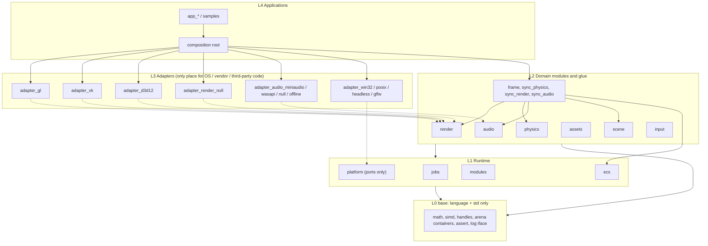

---

## 2. Module dependency graph (L1-L2)

Source: [overview §3](overview.md) module map. Domain modules never depend on each other; only glue crates do. `physics` has no dependency on `ecs`.

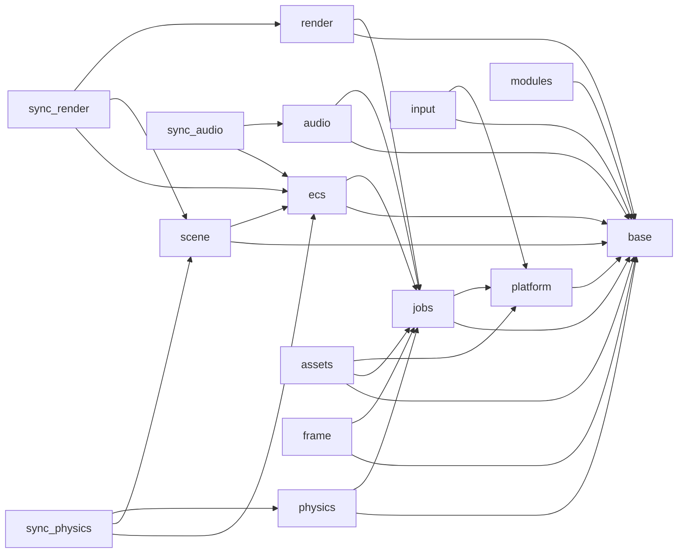

---

## 3. Ports and adapters (class diagram)

Source: [ports-and-adapters](ports-and-adapters.md), [rendering](rendering.md), [audio](audio.md). Each port is declared by the module that needs it. Every port has a Null adapter and a contract test suite that all adapters must pass.

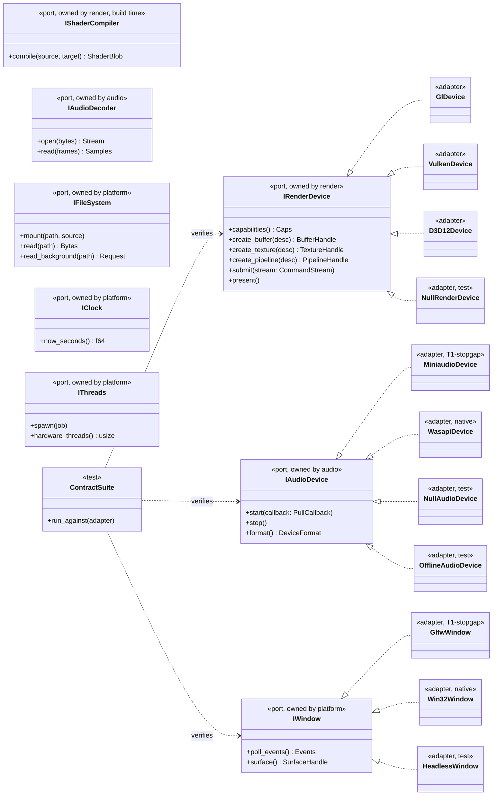

---

## 4. Port maturity (state machine)

Source: [ports-and-adapters §rule of two](ports-and-adapters.md). Window, input and audio ports can leave `experimental` only after a native adapter exists next to the stopgap.

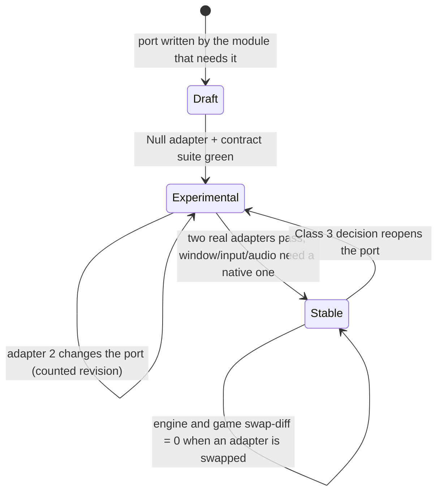

---

## 5. One frame (sequence diagram)

Source: [conventions §2-3](conventions.md), [core-runtime](core-runtime.md), [physics](physics.md). The application owns the loop. Glue crates are the only code that knows two domain modules. Fixed step for simulation, variable step for presentation.

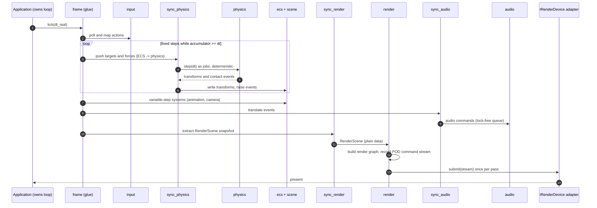

---

## 6. Render pipeline

Source: [rendering](rendering.md). The renderer consumes only a plain `RenderScene`. Backends decode a POD command stream in bulk, so virtual dispatch is per pass, not per draw.

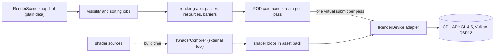

---

## 7. Physics pipeline (Soft Step shape)

Source: [physics](physics.md). Standalone and handle-based, with a dimension-generic core (2D is the D = 2 instance). Determinism rules D0/D1 required, D2 not pursued (v0.25).

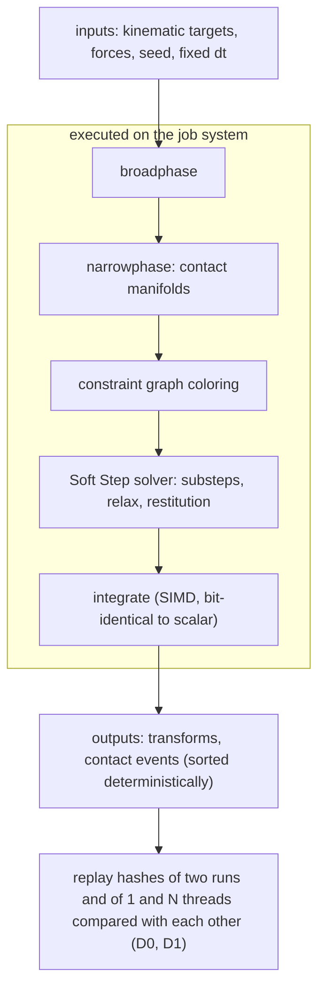

---

## 8. Audio pipeline

Source: [audio](audio.md). Pull model: the device thread asks the mixer for samples. The game thread never blocks the device thread; changes arrive as commands through a lock-free SPSC queue and a mixer-graph snapshot.

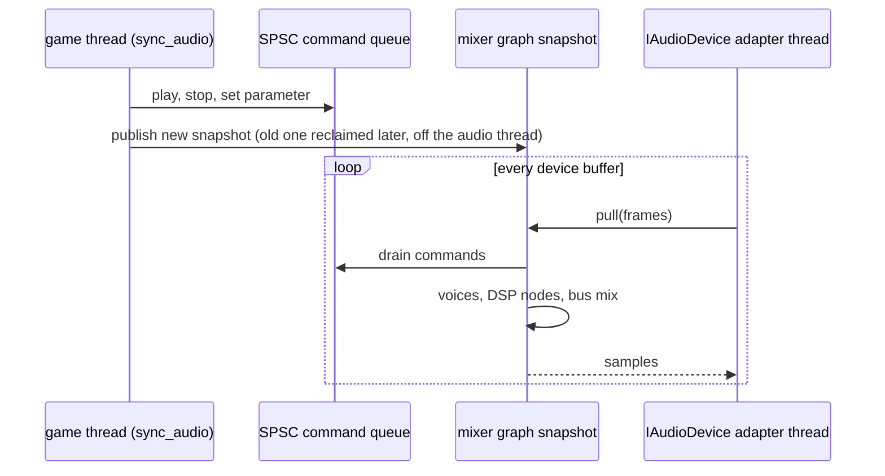

---

## 9. Composition root (object diagram)

Source: [overview §4](overview.md). Concrete adapters are named only here. Swapping one is a change in this one place.

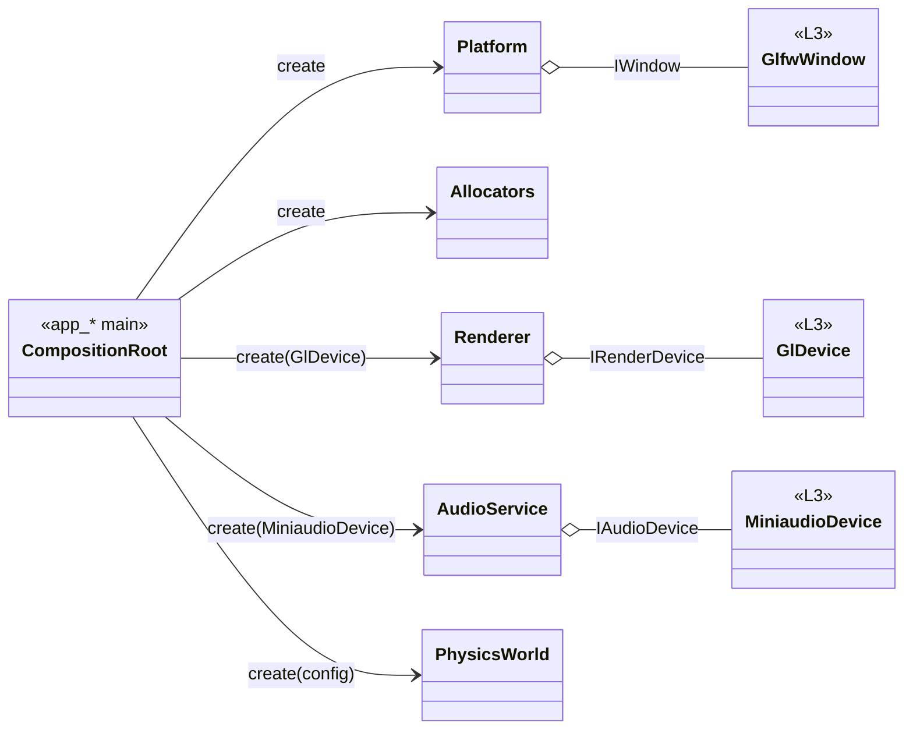

---

## 10. Delivery flow (sequence diagram)

Source: [delivery-pipeline](../workflow/delivery-pipeline.md), [tdd-workflow](../workflow/tdd-workflow.md). The owner approves once, before the PR, against a diff hash. Everything after approval is automatic.

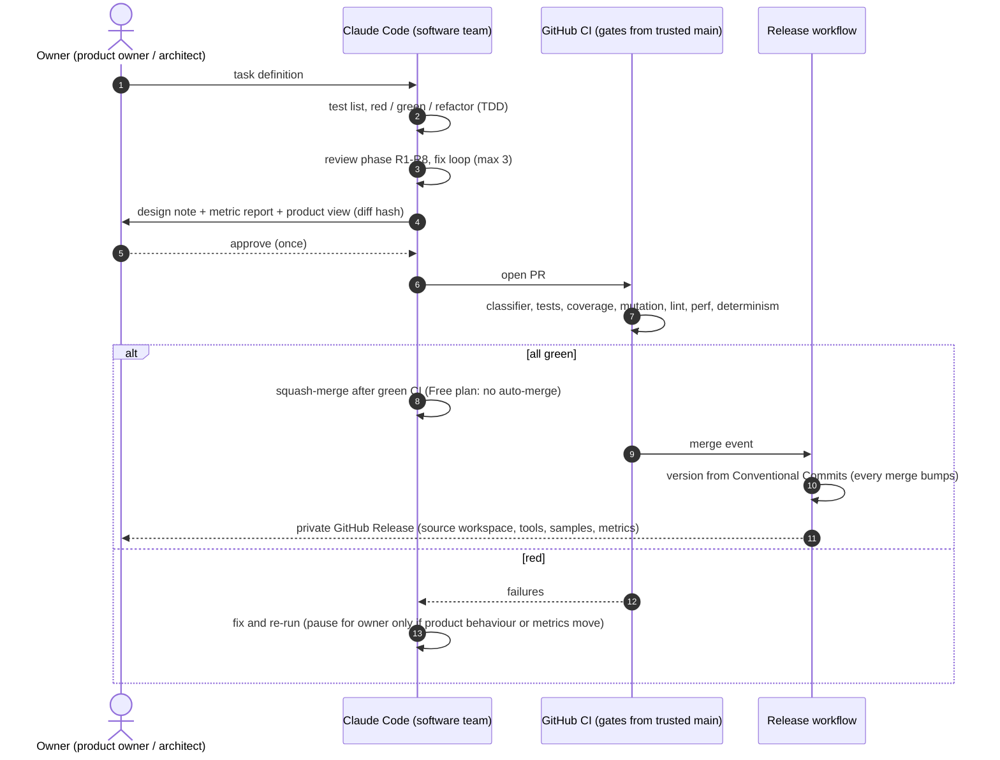

---

## 11. Change classes (activity diagram)

Source: [rules-digest §8](../rules-digest.md). The classifier is a tool, not the agent; the highest class wins and unsure rounds up.

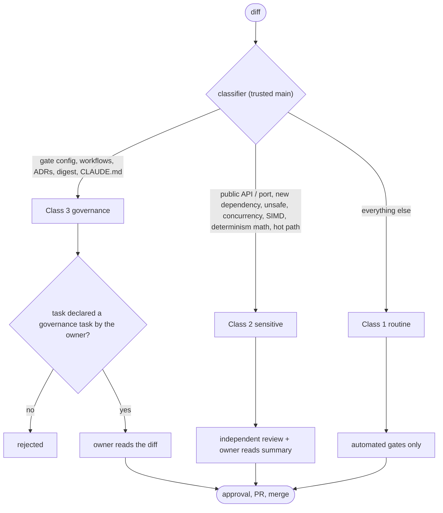
