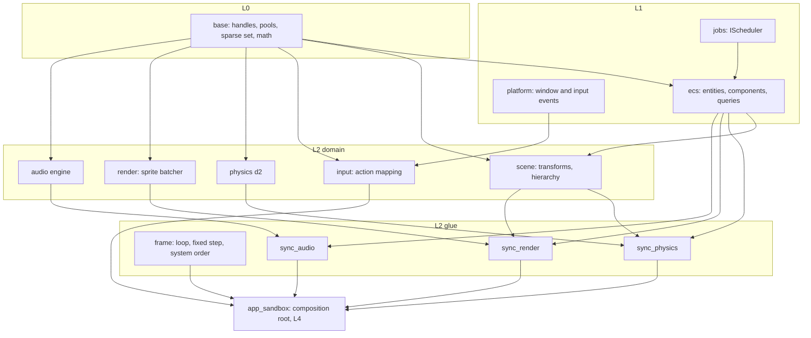
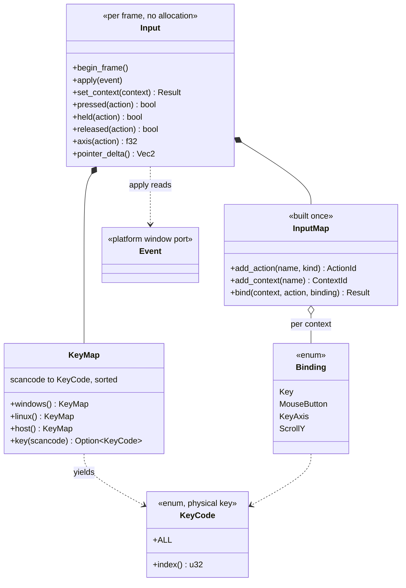
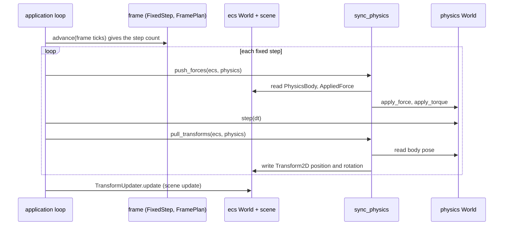
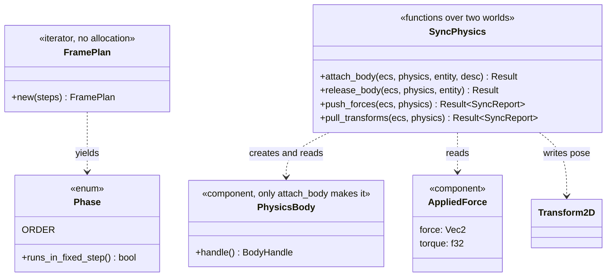
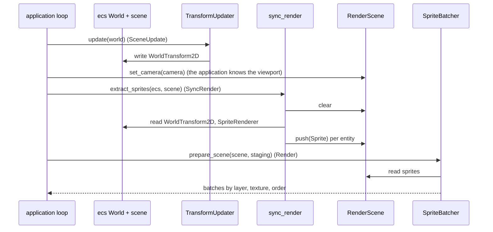
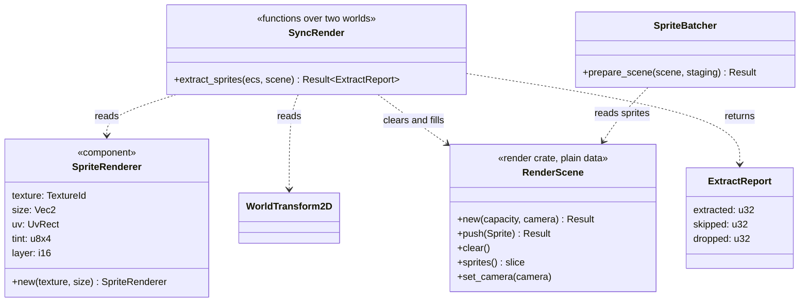
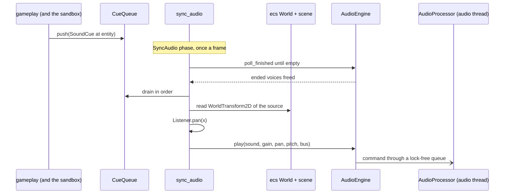
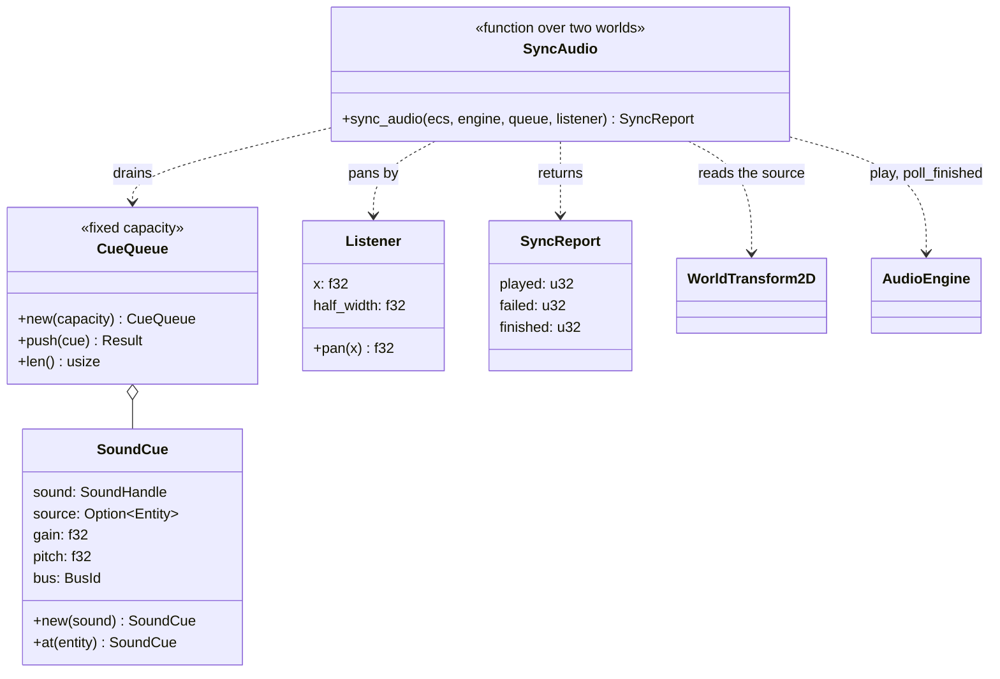
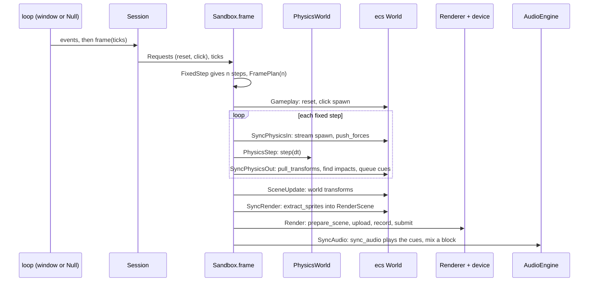
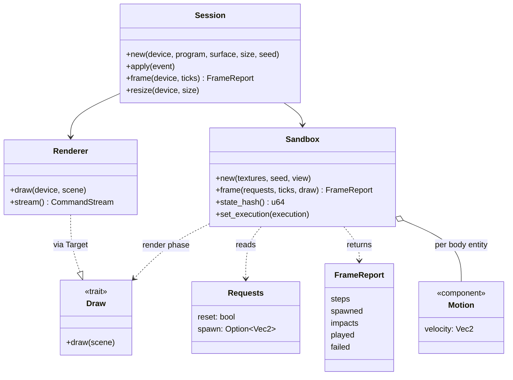

# ECS, scene, input mapping and the physics sandbox: phase 7 design note `[P]` (card 7-1)

Design note for phase 7, written before any code. It turns the phase 7 row of the [roadmap](../workflow/roadmap.md) into a buildable shape: an ECS whose storage is chosen by a measurement, a scene module (transforms and hierarchy), an input module (action mapping), the three glue crates that connect them to physics, render and audio, and the first small playable sample, the 2D physics sandbox.

Fixed inputs, not reopened here: the ECS is built in phase 7 and only then, when the sample needs it (D-8); the ECS is not the universal container, physics and audio keep their own storage and the ECS holds handles and synced state ([core-runtime §4](core-runtime.md)); physics does not know the ECS ([physics §1](physics.md), and `forbidden_edges` in `gates/architecture.toml`); the glue crates are the only code that knows two domain modules ([conventions §3](conventions.md)); the renderer consumes a plain snapshot, never the ECS; the application owns the loop; handles, not pointers, cross module boundaries; no `HashMap` iteration or unstable sort in simulation code ([determinism rules in the digest](../rules-digest.md)).

**Scope in one line:** a small sandbox where the player drops boxes and discs into a walled arena with the mouse and the keyboard, every object is an ECS entity, the physics world, the sprite batcher and the audio engine are driven only through the glue crates, and the ECS iteration benchmark and the frame budget are measured.

## 1. Evidence and what is still unverified

Findings are tagged **[K]** (known: read in this repository) or **[U]** (unverified, to be checked in the card named).

| Claim | Tag | Source or check |
|---|---|---|
| No `ecs`, `scene`, `input`, `sync_physics`, `sync_render` or `sync_audio` crate exists yet; `frame` holds only the fixed-step accumulator | K | `engine/` folder, `engine/frame/src/lib.rs` |
| The architecture check already knows these names: layers `ecs` 1, `scene` 2, `input` 2, `frame` 2, `sync_*` 2; an allowed same-layer edge `ecs -> jobs` (`scene -> ecs` and `input -> platform` go from layer 2 to layer 1, which the layer rule allows without a list entry, so the two existing list entries are redundant); `frame` and `sync_*` are glue; `physics -> ecs` is forbidden | K | `gates/architecture.toml` |
| A glue crate (`frame`, `sync_*`) is exempt from the same-layer edge list, so `sync_physics -> physics` and the other glue edges need no entry in `gates/architecture.toml`; the check still applies the layer rule and the forbidden edges (`physics -> ecs`) to every crate | K | `tools/arch-check/arch_check.py` line 142, `gates/architecture.toml` `glue` |
| `base` offers generation-checked handles (`Handle<T>`, `Pool<T>`), a fixed-capacity `SparseSet`, `DenseMap`, an `Arena`, a ring and an SPSC queue; the ECS entity id can be a `Handle` | K | `engine/base/src/pool.rs`, `sparse.rs`, `map.rs`, `arena.rs` |
| `jobs` offers `IScheduler::parallel_for(count, grain, body)` and `run_scope(tasks)`, with an inline (single thread), a reversed and a shuffled scheduler for determinism tests | K | `engine/jobs/src/scheduler.rs` |
| Physics is handle-based (`physics::d2`), has `IPhysicsDebugDraw`, and its determinism is tested on its own world | K | `engine/physics/src/d2`, [physics](physics.md) |
| The audio engine takes `play(SoundHandle, PlayParams)` and returns a `VoiceId`; finished voices are polled with `poll_finished` | K | `engine/audio/src/engine.rs` |
| The sprite batcher takes `Sprite` values and records a command stream; the render side already needs no ECS | K | `engine/render/src/sprite.rs` |
| The physics sample (card 4-24) holds its own input table (hardware scancodes per operating system), its own cursor mapping and its own simulation state, in plain code the tests run on the Null device. The input module is where its keys become layout-independent actions | K | `engine/app_physics_sample/src/controls.rs`, `mapping.rs`, `simulation.rs` |
| The window port delivers keyboard, mouse and window events by pull (`pump`), with scripted events on the Headless platform, so input mapping is testable with no display | K | [platform-ports §2.4](platform-ports.md), `engine/platform/src/window.rs` |
| The roadmap names a milestone for the native Win32 and audio adapters "before phase 7 closes" (Q4). They are not in the phase 7 row | K | [roadmap](../workflow/roadmap.md) scope-control rule 2 (a target, not a gate); see choice O8 |
| ADR-0003 (ECS storage) is not decided: [core-runtime §4](core-runtime.md) proposes a hybrid like Bevy's and says the decision is data-driven | K | core-runtime §4, phase 3 review |
| Published evidence says archetype tables win iteration and sparse sets win structural change | K | sources linked in core-runtime §4. Whether that holds for our component counts and our sandbox is what the spike measures |
| Whether type-erased column storage can be written without `unsafe` at a cost the benchmark accepts | **U** | card 7-2 (the spike builds both a safe and a type-erased variant) |
| The size of the ECS iteration target and of the frame budget | **U** | no number exists yet; card 7-5 and card 7-12 propose one from measurements and the owner accepts or changes it (choice O4) |

## 2. Where the code lives

- **`ecs` (L1)** depends on `base` and `jobs` only. It owns entities, component storage, queries and the declared-access rules. It knows no domain module.
- **`scene` (L2)** depends on `base` and `ecs`: the transform components (2D position, rotation, scale in the first version, with room for 3D in phase 8) and the parent-child hierarchy as an explicit component pair, as [core-runtime §4](core-runtime.md) decided. General relationships stay deferred.
- **`input` (L2)** depends on `base` and `platform`: layout-independent key codes, named actions, contexts and bindings, and the per-frame state (pressed, held, released, axis, pointer). It reads the platform event type and nothing else.
- **`frame` (L2 glue)** grows from the fixed-step accumulator into the frame loop description: phases (input, fixed-step simulation, extraction, render, audio) and the order of the glue systems. The application still owns the loop; `frame` supplies the pieces and the order.
- **`sync_physics`** copies kinematic targets and forces from the ECS into the physics world and the resulting transforms back; the body handle is a component. **`sync_render`** extracts a plain `RenderScene` snapshot (a list of sprites with transform, texture and layer, a camera) that the batcher consumes. **`sync_audio`** turns game events (a contact above a speed, a spawn) into `play` calls.
- **`app_sandbox` (L4)** is the composition root. It names the adapters and builds the world; no engine crate names a concrete adapter.

## 3. The ECS: how it is chosen and what it offers

**Storage by measurement (card 7-2).** A spike in `tools_ecs_spike` (a layer 4 tool, like the physics and scheduler spikes) builds the two minimal storages named in [core-runtime §4](core-runtime.md): archetype tables (one dense table per set of component types) and per-component sparse sets, plus the hybrid. It measures, on the sandbox's own shape (a handful of component types, thousands of entities), iteration over one to three components, entity spawn and despawn, and adding or removing one component. Every number is an instruction count (the gate form already used for physics) next to a wall-clock run. The output is a report in `wiki/spikes/` and a proposed ADR-0003 text; the ADR itself is a governance file and is written in a task the owner declares.

**API shape (proposal, fixed by the spike result).**

- An `Entity` is a `Handle`: index plus generation, eight bytes, safe to keep after despawn (a stale handle is refused, not dangling).
- A component is any `'static` plain type registered with the world; no macros are needed for registration.
- A query names the components it reads and writes as types; the access set is data, so two systems conflict only if one writes what the other touches.
- Iteration order is a function of the storage layout, never of a hash: the same spawn order gives the same iteration order (determinism rule, D0 and D1).
- Parallel iteration splits a table or a dense array into chunks and uses `IScheduler::parallel_for`; the chunk boundaries do not change the visible result.
- Structural changes (spawn, despawn, add or remove a component) made while iterating go to a command buffer applied at a fixed point, so a system never sees storage move under it.
- No allocation per frame on the hot path: tables and the command buffer reserve capacity once, as for the render and physics code ([digest §4](../rules-digest.md)).

**`unsafe`.** Type-erased columns (needed for archetype tables) usually need `unsafe`. The budget rule applies: the module must be on the allowlist with a count, each block carries a `// SAFETY:` comment, Miri runs on it. The spike builds a safe variant too (one typed vector per component and archetype behind a trait object at coarse granularity) so that the cost of avoiding `unsafe` is a measured number the owner can weigh (choice O3).

## 4. Scene, input, glue, and the sandbox

**Scene.** Local transform (translation, rotation, scale), a derived world transform recomputed top-down once per frame in hierarchy order, a parent component and a first-child and next-sibling pair so that children are visited without searching. Cycles are refused when the parent is set. Dirty flags are not in the first version: the benchmark decides whether a full recompute of a sandbox-sized scene is cheap enough.

**Input mapping.** The window port gives scancodes and pointer positions. The module adds layout-independent key codes, an `Action` (named, with a kind: button or axis), a `Context` (a set of bindings that can be switched), and per-frame state. The physics sample's table becomes data in the sandbox, not code. Rebinding at run time and text input stay out (no UI yet). Gamepad is out of v0 as in the platform note.

**As built (card 7-8, crate `engine/input`, layer 2, depends on `base` and `platform`, no ECS dependency, no `unsafe`).** A `KeyCode` is a physical key named by its place on a PC keyboard (letters, digits, Escape, Space, Enter, Tab, Backspace, shift, control and alt on both sides, the arrows and F1 to F12), so the key at the place of `Q` is `Q` on any layout. The platform event carries only a hardware scancode, so a `KeyMap` turns it into a key code: `KeyMap::windows()` (GLFW scancodes: the PC set-1 code, plus `0x100` for the extended keys), `KeyMap::linux()` (evdev code plus 8) and `KeyMap::host()` for the build's own system. The main block of both tables agrees with the physics sample's table for the five keys the sample uses (checked by tests); **the extended keys of the Windows table and the whole Linux table were derived from the key lists and have not been run on hardware**. A key the table does not know is counted in `unmapped_keys()` and does nothing. An `InputMap` is built once (it allocates): named actions of kind `Button` or `Axis`, named contexts, and bindings per context. A button takes a key or a mouse button; an axis takes a key pair (negative, positive: both down cancel to 0) or the vertical wheel; a binding of the wrong kind (asking a button for an axis reads inactive, not an error), a duplicate name a mouse button above 7, or an id out of range of the map is an `InputError` value (ids carry no map tag, so an id of another map that is in range names an unrelated action; keep ids with their map). An action is active while any of its bindings in the active context is; one context is active at a time (the first at the start), and switching it leaves keys and this frame's edges as they are and changes what they mean (a held key reads as held in the new context without a press there). Key pairs of one axis add up and are limited to -1..1; the wheel is added unlimited. The pointer is shared by all windows. `Input` holds the state: `begin_frame()` clears the pressed and released edges, the wheel and the pointer delta; `apply(&Event)` follows each event, taking events of every window; queries are `pressed`, `held`, `released`, `axis` (a sum, the wheel gives the amount of the frame), `pointer`, `pointer_delta`, `scroll`, `quit_requested` (a latch). Edges are kept as bit sets, not found by comparing two snapshots, so **a tap that starts and ends inside one frame still reports pressed and released**; a key repeat changes nothing; losing focus releases every key and button, so none stays stuck. A frame allocates nothing (counting-allocator test). Tests push scripted events through the Headless platform and `pump`, so no display is needed. Left out, as the note says: rebinding at run time, text input, gamepad, modifier keys as bindings, and more than 128 key codes.

**Glue.** Each glue crate is a set of plain functions over borrowed parts of the world, called by the frame loop in a fixed order: `input -> gameplay systems -> sync_physics (in) -> physics step (fixed) -> sync_physics (out) -> scene update -> sync_render (extract) -> render -> sync_audio`. The fixed-step part runs zero or more times a frame, the rest once. A test drives the whole order on the Null render device, the Null audio device and the Headless platform with scripted input and checks a replay hash of the ECS state (the same rule as the physics replay hash: identical across runs and across thread counts on one machine).

**As built (card 7-9, crates `engine/frame` extended and `engine/sync_physics`, layer 2 glue, no `unsafe`).** `frame` gets `Phase`, the nine phases of a frame in the order above (`Phase::ORDER`; `runs_in_fixed_step` is true for the three physics phases), and `FramePlan::new(steps)`, an allocation-free iterator that yields the phases of one frame: the two before the physics, the physics block `SyncPhysicsIn, PhysicsStep, SyncPhysicsOut` once per fixed step, then the four after it; a frame with no fixed step skips the block. The application still owns the loop: it asks `FixedStep::advance` for the number of steps, walks the plan and calls the matching function for each phase. `sync_physics` depends on `base`, `ecs`, `scene` and `physics`; physics does not depend on the ECS. A body is a component: `PhysicsBody` holds the `BodyHandle`, has no public constructor and is not `Clone`, so only `attach_body` makes one (it creates the body, gives the entity the component and a `Transform2D` at the body's pose, keeping an existing scale; it refuses a stale entity, an entity with a parent, an entity that has a body, and a full physics world, and changes nothing on a refusal). `release_body` destroys the body and removes the component (a body already destroyed behind the glue is not an error). The two copies are plain functions over the two worlds: `push_forces(&mut ecs, &mut physics)` applies the `AppliedForce` component (a force and a torque) to the body of every entity that has both, in the storage order of the ECS; a zero force is not applied because applying one wakes a sleeping body; a body that is gone, a static body or a value that is not finite is counted in `SyncReport::skipped` and applies nothing, not an error. `pull_transforms(&mut ecs, &physics)` writes the position and rotation of each body into the `Transform2D` of its entity and keeps the scale. Both make no allocator call after warm-up (counting-allocator test), and a frame loop test drives the phases of `FramePlan` with a falling and rolling ball, then the scene update, and finds the same physics state hash in two runs. **Limits, stated:** a body belongs on a root entity (a body pose is in world space, a `Transform2D` under a parent is local), which `attach_body` checks but a later `set_parent` can break, so a glue user must not parent a body entity; physics has only static and dynamic bodies, so there are no kinematic targets and the only way in is forces and torque; the copy out writes every body, also a sleeping one, and overwrites any change gameplay made to the transform of a body entity (there is no teleport yet); despawning an entity with `World::despawn` does not destroy its body, so call `release_body` first; a handle belongs to the physics world that made it; the replay hash across thread counts of the whole frame belongs to the later sandbox test. **Architecture check (recorded as the card asks):** `gates/architecture.toml` needed no change: `frame` and `sync_*` are glue, exempt from the same-layer edge list, so `sync_physics -> physics`, `-> scene` and `-> ecs` pass; `tools/arch-check` reports 35 crates, 0 violations, and with a temporary `physics -> ecs` dependency added it reports `forbidden-edge physics must not depend on ecs` (the probe was reverted and is not in the diff).

**As built (card 7-10, crates `engine/render` extended and `engine/sync_render`, layer 2 glue, no `unsafe`).** `render` gets `RenderScene`, the plain snapshot the renderer consumes: an orthographic camera and a list of `Sprite` values with a fixed capacity (at most `MAX_SPRITES`), filled with `push` (a full scene refuses the sprite and stays as it was), emptied with `clear` (the capacity stays), allocated once in `new`. `SpriteBatcher::prepare_scene` is `prepare` over the sprites of a scene. `render` still depends on `base` only. `sync_render` depends on `base`, `ecs`, `scene` and `render`: the component `SpriteRenderer` (texture, size at scale one, texture rectangle, tint, layer; `SpriteRenderer::new` takes the whole texture, a white tint and layer zero) makes an entity a sprite, and `extract_sprites(&mut ecs, &mut scene)` replaces the sprites of the scene with one sprite per entity that has a `SpriteRenderer` and a `WorldTransform2D`, in the storage order of the ECS. From the world matrix it takes the position (the translation), the angle (the turn of the x axis) and the size (the size of the renderer times the length of each axis). A value that is not finite or a size that is not positive is counted in `ExtractReport::skipped`, a sprite that does not fit in `dropped`, not an error. **The camera is not extracted:** the application sets it with `RenderScene::set_camera` (it knows the viewport; a camera entity can come later). The extraction makes no allocator call after warm-up (counting-allocator test, 200 entities), and a frame test drives `SceneUpdate`, `SyncRender` and `Render` of `FramePlan`, finds the batches in layer order, and two runs stage the same vertices bit for bit. **Limits, stated:** a mirror is not drawn mirrored: the lengths of the axes have no sign, so a negative scale on x shows the sprite turned by half a circle (a symmetric image looks right, an asymmetric one does not); a non-uniform scale under a rotated parent shears the matrix, and the sprite takes the axis lengths and the turn of the x axis, so a shear is not drawn; the order inside one layer and texture is the storage order of the ECS, which is by table (a set of components) and then by row, so an entity that gets another component moves to another table and changes place (stable for the same sequence of calls, not a promise across edits); no culling, no visibility flag (remove the component to hide); one camera per scene. **Architecture check:** `gates/architecture.toml` needed no change (`sync_render` is glue); `tools/arch-check` reports 36 crates and 0 violations. **Finding for the owner:** a temporary `render -> ecs` dependency is not refused, because the layer rule allows an edge down to layer 1 and only `physics -> ecs` is a forbidden edge, so "the renderer sees only the scene" holds by convention, not by the gate; adding `["render", "ecs"]` (and `["render", "scene"]`) to `forbidden_edges` is a governance change and is not part of this card.

**As built (card 7-11, crate `engine/sync_audio`, layer 2 glue, no `unsafe`; the `audio` crate is unchanged).** `sync_audio` depends on `base`, `ecs`, `scene` and `audio`. A game event is a `SoundCue` (the registered sound, an optional source entity, gain, pitch and bus; `SoundCue::new` gives gain one, pitch one, the master bus and no source, `at(entity)` sets the source) pushed into a `CueQueue` (fixed capacity, allocated once; a full queue refuses the cue with `SyncError::QueueFull` and changes nothing). Once a frame, in the `SyncAudio` phase, `sync_audio(&world, &mut engine, &mut queue, &listener)` first frees the voices that have ended (`poll_finished` until it is empty, so a voice slot is free for the cues of the same call), then plays every waiting cue in the order it was pushed and empties the queue. The pan comes from the world x of the source entity relative to the `Listener` (an x and a half width, usually the camera x and half the view width): `Listener::pan` runs from -1 to 1 and is clamped; a cue without a source, a source that is gone or has no `WorldTransform2D` (a source not yet updated by the scene update, which must run first, as the frame plan has it), or a number that is not usable gives the centre. It returns a `SyncReport` with `played`, `failed` and `finished`; a cue the engine refuses (an unknown sound, a gain or pitch out of range, a missing bus, no free voice, a full command queue) is counted in `failed` and is **not retried**, because a cue is an instant and a late one would be wrong. The call makes no allocator call after warm-up (counting-allocator test: one measured call with plays, failures and ended voices), and a frame test drives `Gameplay`, `SceneUpdate` and `SyncAudio` of `FramePlan` through a processor and finds that two runs give the same samples bit for bit. **Limits, stated:** the glue carries cues to the engine; **deciding that a contact above a speed or a spawn is a cue is gameplay and belongs to the sandbox (card 7-12)**, which reads the physics contacts and pushes the cues, so the glue has no physics dependency; pan only, no distance attenuation and no Doppler; one listener; looping sounds, stopping a voice and changing a bus are done on the `AudioEngine` directly, not by a cue; the voice handle of a cue is not kept. **Architecture check:** `gates/architecture.toml` needed no change; `tools/arch-check` reports 37 crates and 0 violations. **The finding of card 7-10 holds for audio too:** a temporary `audio -> ecs` dependency is not refused, so "the audio engine does not know the ECS" is held by convention; `forbidden_edges` would need `["audio", "ecs"]` (a governance change, not in this card).

**As built (card 7-12, crate `engine/app_sandbox`, layer 4, no `unsafe`; no engine crate changed).** `app_sandbox` is the composition root of phase 7: a library (the `Sandbox`, the `Renderer`, the `Session`, the loop) and the binary `app_sandbox [--frames N] [--null]`. It is built from the crates of cards 7-2 to 7-11 and from the old physics sample (kept, choice O5): it reuses that sample's arena, its constants, its textures and its controls (a click, R, Escape) and owns the rest. **Every object is an entity.** The floor and the two walls carry a `Transform2D` and a `SpriteRenderer` (their bodies are in the arena that the old sample builds; a static body never moves, so it has no body component). A falling box or disc is made by `attach_body` (the `PhysicsBody` and the `Transform2D`), a `SpriteRenderer` (layer 1, a checker for a box, an orange disc) and a `Motion` component (the velocity after the last step). **One frame is the nine phases of `FramePlan`**, with the fixed-step ones once per step the time holds: `Input` (the events became `Requests` before the frame), `Gameplay` (a reset, then a click, dropped inside the walls), `SyncPhysicsIn` (the stream drops a body every 12 steps up to 80; then `push_forces`), `PhysicsStep`, `SyncPhysicsOut` (`pull_transforms`, then impacts), `SceneUpdate`, `SyncRender` (`extract_sprites` into the `RenderScene`), `Render` (the `Draw` object batches, uploads, records and submits) and `SyncAudio` (`sync_audio`, then the mix). **An impact is a cue.** The physics crate reports no contact events and the glue has none, so the sandbox compares the velocity of each body with the one it had a step before: a change of 3 m/s or more (gravity changes it by 0.16 m/s a step) is an impact, and a `SoundCue` at that entity is queued, louder with the size of the change (gain 0.2 to 1). The sound is a decaying tone made in code; the pan comes from where the entity is, against a listener at the middle of the view. **No device for the sound.** The frame mixes a sixtieth of a second through the `AudioProcessor` on the calling thread (this stands in for the audio device, and frees the ended voices); the window run does not open an audio device, so it is silent, and a real device is the work of the native or miniaudio wiring (card 7-15 and later). The report of a frame says the steps, spawns, impacts, refused cues, extracted sprites, played and failed cues. **The render phase is a trait object** (`Draw`), so the tests give the sandbox a recorder and the session gives it the renderer and a device (coarse boundary, as the rules allow). **Replay hash:** `state_hash` is the hash of the physics state; it is the same for the same seed and the same scripted session, and the same with the solver on one worker and on four (tests; the entity transforms are copies of the poses, so the physics hash covers them). **Golden stream:** the fingerprint of the command stream after frames 1, 60 and 200 of seed 24 on the Null device is stored in the test (a change of the picture changes it). **Allocation:** 60 measured frames after 1100 warm-up frames (the stream is done, bodies move and rest) make no allocator call, and a second test checks every frame without a spawn in the first 400 frames, where impacts and cues happen; a frame that makes an entity may grow an ECS column (the ECS has no reserve call), so a frame with a spawn is excluded, and a reset (which builds a new world) is neither measured nor claimed. **Limits, stated:** the window run has no sound device; one scene (no pyramid, no solver option: the options are refused); no debug drawing; the keys are the old sample's scancode table (Windows tested, the Linux table not run); the frame budget and the comparison with the direct version are card 7-13.

**The sandbox (the plan; the as-built paragraph above says what card 7-12 delivered: no debug drawing yet, OpenGL only).** The mouse drops a box or a disc, a key resets the arena, a key toggles the debug drawing, another quits (what the physics sample does today), and now each object is an entity with transform, sprite and body components. A contact above a threshold plays a sound through `sync_audio`. The sample runs on the Null device in tests (an image-free golden check of the command stream, as in phase 6) and on OpenGL or Vulkan by the existing backend choice in the composition root. The old `app_physics_sample` stays as it is, so the cost of going through the ECS can be compared with the direct version on the same scene (choice O5).

## 5. Tests and measurements

- **Per crate, test first** as always: ECS (spawn, despawn, stale handle, query results, access conflicts, command buffer, iteration order, determinism under the reversed and shuffled schedulers), scene (hierarchy, cycle refusal, world transform against a hand computed case), input (bindings, contexts, press/hold/release across frames, scripted event sequences).
- **Allocation test** with the counting allocator: zero allocations per frame in steady state for the sandbox loop.
- **Replay hash** of the sandbox world after a scripted session, compared across runs and at one and several worker threads (D0, D1).
- **ECS iteration benchmark** registered like the physics one (instruction count under `valgrind` on the Linux runner, plus a wall-clock run on the owner's machine); the target is proposed by card 7-5 after the spike numbers exist and accepted by the owner (O4). Adding the entry to `gates/benchmarks.toml` is a governance step.
- **Frame budget** measured on the owner's machine (the reference machine) with the sandbox at a stated object count; the budget is proposed from the measurement and accepted by the owner (O4). The roadmap's exit line "meets frame budget on reference machine" is read against that accepted number.
- **Full metrics report and retrospective** by the usual milestone review at the end (card 7-14), with coverage and mutation runs as done for phase 6.

## 6. How the cards follow from this

Proposed; created in the Backlog after the owner accepts the note. Numbers are card ids.

| Card | Delivers | Class |
|---|---|---|
| 7-2 | ECS storage spike: archetype, sparse set, hybrid, safe and type-erased variants, report and a proposed ADR-0003 text | spike (TDD exception), report |
| 7-3 | ADR-0003 record (the decision, from the spike), and, if the spike chooses `unsafe`, the `ecs` entry in `gates/unsafe-budget.toml`; both before 7-4, so the first `ecs` PR does not break the budget gate | 3 (ADR and gate config, owner-declared governance task) |
| 7-4 | `ecs` part 1: entities, component registration, the chosen storage, spawn and despawn, command buffer | 2 (new public API, maybe `unsafe`) |
| 7-5 | `ecs` part 2: typed queries, declared access, parallel iteration on `IScheduler`; ECS iteration benchmark tool and a proposed target | 2 |
| 7-6 | CI: register the ECS iteration benchmark (`gates/benchmarks.toml`, a job in `.github/workflows/ci.yml`, and `gates/gates.toml` if a band is needed) | 3 (gate config and workflow, owner-declared) |
| 7-7 | `scene`: transforms, hierarchy, world transform update | 2 |
| 7-8 | `input`: key codes, actions, contexts, per-frame state, scripted tests | 2 |
| 7-9 | `frame` extension and `sync_physics` (first glue crate; the arch-check result for glue edges is recorded) | 2 |
| 7-10 | `sync_render`: the `RenderScene` snapshot and its use by the sprite batcher | 2 |
| 7-11 | `sync_audio`: game events to `play` calls | 2 |
| 7-12 | `app_sandbox`: the playable sample, golden stream test on Null, replay hash, allocation test | 2 |
| 7-13 | frame budget measurement and the proposed budget; comparison with the direct sample | 1 (measurement and docs) |
| 7-14 | phase 7 exit record, milestone review, retrospective | 1 (docs) |

Cards 7-3 and 7-6 are governance and are started only when the owner declares them. 7-3 comes before 7-4. Nothing from 7-4 on starts before the spike report (7-2) has been read and the storage choice is accepted.

## 7. Choices for the owner

| # | Choice | Options | Recommendation |
|---|---|---|---|
| O1 | Order of the phase | (a) spike first, then the ECS, then scene and input, then glue, then the sample · (b) input and scene in parallel with the ECS | (a): the glue crates and the sample need the ECS, and the spike may change its API; scene needs the ECS. Input has no dependency on the ECS and may start any time after the spike if you want two lines of work |
| O2 | ECS API style | (a) plain typed queries, no macros · (b) a derive macro for components | (a): a derive macro needs its own proc-macro crate, which the layer map and the architecture check do not cover, and registration stays explicit without it |
| O3 | `unsafe` in the ECS | (a) allowed if the spike shows a clear win, with budget and Miri · (b) a safe-only ECS even if slower | (a), decided on the measured difference; the spike reports both |
| O4 | Who sets the targets | (a) the cards propose the ECS iteration target and the frame budget from measurements, you accept or change them · (b) you name the numbers now | (a): no honest number exists yet |
| O5 | The old physics sample | (a) stays as it is, the sandbox is a new crate `app_sandbox` · (b) the sandbox replaces it | (a): the direct version is the comparison for the ECS cost, and the existing sample's tests stay valid |
| O6 | Parallel execution of systems | (a) access is declared from the start and checked, parallel iteration inside a query is built, running different systems in parallel is a later card · (b) both now | (a): the sandbox has few systems; the scheduler of systems is a separate design |
| O7 | Hierarchy | (a) parent component plus first-child and next-sibling, depth-first update · (b) general relationships | (a), as decided in core-runtime §4 |
| O8 | Native Win32 and audio adapters | (a) not in phase 7: they get their own phase or cards, and the roadmap line "before phase 7 closes" is changed by you · (b) added to phase 7 as cards after 7-13 | The roadmap sets a target for them to replace the stopgaps before phase 7 closes (scope-control rule 2), but the phase 7 row does not list them and the window, input and audio ports stay `experimental` until a native adapter exists. This is yours to decide; I would not add them silently |

## 8. Risks and what this note does not settle

- **The ECS as a bottleneck or as a straitjacket** (a new risk of this phase; the overhead risk R-3 in the risk table is the nearest existing one). The note keeps the ECS out of physics, audio and render storage, and measures before choosing. The risk shows as the sandbox being slower than the direct sample by more than the owner accepts.
- **Hidden iteration order.** Any storage that iterates in hash order would break determinism. The tests run with the reversed and shuffled schedulers and compare the replay hash.
- **`unsafe` surface.** Type-erased storage is the new `unsafe` area. Mitigation: a small module, `SAFETY` comments, Miri, the safe variant as the fallback, an independent security-minded review.
- **Command buffer and borrowed storage.** The usual source of ECS bugs; covered by tests that spawn and despawn while iterating.
- **Not settled here:** system scheduling across threads (O6), components added by data files and a scene file format, relationships beyond the hierarchy, change detection, serialisation of the world, 3D transforms (phase 8), text input and UI, gamepad, and the native adapters (O8).
