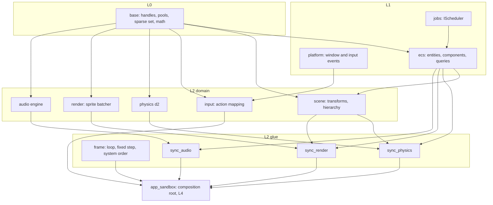

# ECS, scene, input mapping and the physics sandbox: phase 7 design note `[P]` (card 7-1)

Design note for phase 7, written before any code. It turns the phase 7 row of the [roadmap](../workflow/roadmap.md) into a buildable shape: an ECS whose storage is chosen by a measurement, a scene module (transforms and hierarchy), an input module (action mapping), the three glue crates that connect them to physics, render and audio, and the first small playable sample, the 2D physics sandbox.

Fixed inputs, not reopened here: the ECS is built in phase 7 and only then, when the sample needs it (D-8); the ECS is not the universal container, physics and audio keep their own storage and the ECS holds handles and synced state ([core-runtime §4](core-runtime.md)); physics does not know the ECS ([physics §1](physics.md), and `forbidden_edges` in `gates/architecture.toml`); the glue crates are the only code that knows two domain modules ([conventions §3](conventions.md)); the renderer consumes a plain snapshot, never the ECS; the application owns the loop; handles, not pointers, cross module boundaries; no `HashMap` iteration or unstable sort in simulation code ([determinism rules in the digest](../rules-digest.md)).

**Scope in one line:** a small sandbox where the player drops boxes and discs into a walled arena with the mouse and the keyboard, every object is an ECS entity, the physics world, the sprite batcher and the audio engine are driven only through the glue crates, and the ECS iteration benchmark and the frame budget are measured.

## 1. Evidence and what is still unverified

Findings are tagged **[K]** (known: read in this repository) or **[U]** (unverified, to be checked in the card named).

| Claim | Tag | Source or check |
|---|---|---|
| No `ecs`, `scene`, `input`, `sync_physics`, `sync_render` or `sync_audio` crate exists yet; `frame` holds only the fixed-step accumulator | K | `engine/` folder, `engine/frame/src/lib.rs` |
| The architecture check already knows these names: layers `ecs` 1, `scene` 2, `input` 2, `frame` 2, `sync_*` 2; an allowed same-layer edge `ecs -> jobs` (`scene -> ecs` and `input -> platform` go from layer 2 to layer 1, which the layer rule allows without a list entry, so the two existing list entries are redundant); `frame` and `sync_*` are glue; `physics -> ecs` is forbidden | K | `gates/architecture.toml` |
| A glue crate (`frame`, `sync_*`) is exempt from the same-layer edge list, so `sync_physics -> physics` and the other glue edges need no entry in `gates/architecture.toml`; the check still applies the layer rule and the forbidden edges (`physics -> ecs`) to every crate | K | `tools/arch-check/arch_check.py` line 142, `gates/architecture.toml` `glue` |
| `base` offers generation-checked handles (`Handle<T>`, `Pool<T>`), a fixed-capacity `SparseSet`, `DenseMap`, an `Arena`, a ring and an SPSC queue; the ECS entity id can be a `Handle` | K | `engine/base/src/pool.rs`, `sparse.rs`, `map.rs`, `arena.rs` |
| `jobs` offers `IScheduler::parallel_for(count, grain, body)` and `run_scope(tasks)`, with an inline (single thread), a reversed and a shuffled scheduler for determinism tests | K | `engine/jobs/src/scheduler.rs` |
| Physics is handle-based (`physics::d2`), has `IPhysicsDebugDraw`, and its determinism is tested on its own world | K | `engine/physics/src/d2`, [physics](physics.md) |
| The audio engine takes `play(SoundHandle, PlayParams)` and returns a `VoiceId`; finished voices are polled with `poll_finished` | K | `engine/audio/src/engine.rs` |
| The sprite batcher takes `Sprite` values and records a command stream; the render side already needs no ECS | K | `engine/render/src/sprite.rs` |
| The physics sample (card 4-24) holds its own input table (hardware scancodes per operating system), its own cursor mapping and its own simulation state, in plain code the tests run on the Null device. The input module is where its keys become layout-independent actions | K | `engine/app_physics_sample/src/controls.rs`, `mapping.rs`, `simulation.rs` |
| The window port delivers keyboard, mouse and window events by pull (`pump`), with scripted events on the Headless platform, so input mapping is testable with no display | K | [platform-ports §2.4](platform-ports.md), `engine/platform/src/window.rs` |
| The roadmap names a milestone for the native Win32 and audio adapters "before phase 7 closes" (Q4). They are not in the phase 7 row | K | [roadmap](../workflow/roadmap.md) scope-control rule 2 (a target, not a gate); see choice O8 |
| ADR-0003 (ECS storage) is not decided: [core-runtime §4](core-runtime.md) proposes a hybrid like Bevy's and says the decision is data-driven | K | core-runtime §4, phase 3 review |
| Published evidence says archetype tables win iteration and sparse sets win structural change | K | sources linked in core-runtime §4. Whether that holds for our component counts and our sandbox is what the spike measures |
| Whether type-erased column storage can be written without `unsafe` at a cost the benchmark accepts | **U** | card 7-2 (the spike builds both a safe and a type-erased variant) |
| The size of the ECS iteration target and of the frame budget | **U** | no number exists yet; card 7-5 and card 7-12 propose one from measurements and the owner accepts or changes it (choice O4) |

## 2. Where the code lives

- **`ecs` (L1)** depends on `base` and `jobs` only. It owns entities, component storage, queries and the declared-access rules. It knows no domain module.
- **`scene` (L2)** depends on `base` and `ecs`: the transform components (2D position, rotation, scale in the first version, with room for 3D in phase 8) and the parent-child hierarchy as an explicit component pair, as [core-runtime §4](core-runtime.md) decided. General relationships stay deferred.
- **`input` (L2)** depends on `base` and `platform`: layout-independent key codes, named actions, contexts and bindings, and the per-frame state (pressed, held, released, axis, pointer). It reads the platform event type and nothing else.
- **`frame` (L2 glue)** grows from the fixed-step accumulator into the frame loop description: phases (input, fixed-step simulation, extraction, render, audio) and the order of the glue systems. The application still owns the loop; `frame` supplies the pieces and the order.
- **`sync_physics`** copies kinematic targets and forces from the ECS into the physics world and the resulting transforms back; the body handle is a component. **`sync_render`** extracts a plain `RenderScene` snapshot (a list of sprites with transform, texture and layer, a camera) that the batcher consumes. **`sync_audio`** turns game events (a contact above a speed, a spawn) into `play` calls.
- **`app_sandbox` (L4)** is the composition root. It names the adapters and builds the world; no engine crate names a concrete adapter.

## 3. The ECS: how it is chosen and what it offers

**Storage by measurement (card 7-2).** A spike in `tools_ecs_spike` (a layer 4 tool, like the physics and scheduler spikes) builds the two minimal storages named in [core-runtime §4](core-runtime.md): archetype tables (one dense table per set of component types) and per-component sparse sets, plus the hybrid. It measures, on the sandbox's own shape (a handful of component types, thousands of entities), iteration over one to three components, entity spawn and despawn, and adding or removing one component. Every number is an instruction count (the gate form already used for physics) next to a wall-clock run. The output is a report in `wiki/spikes/` and a proposed ADR-0003 text; the ADR itself is a governance file and is written in a task the owner declares.

**API shape (proposal, fixed by the spike result).**

- An `Entity` is a `Handle`: index plus generation, eight bytes, safe to keep after despawn (a stale handle is refused, not dangling).
- A component is any `'static` plain type registered with the world; no macros are needed for registration.
- A query names the components it reads and writes as types; the access set is data, so two systems conflict only if one writes what the other touches.
- Iteration order is a function of the storage layout, never of a hash: the same spawn order gives the same iteration order (determinism rule, D0 and D1).
- Parallel iteration splits a table or a dense array into chunks and uses `IScheduler::parallel_for`; the chunk boundaries do not change the visible result.
- Structural changes (spawn, despawn, add or remove a component) made while iterating go to a command buffer applied at a fixed point, so a system never sees storage move under it.
- No allocation per frame on the hot path: tables and the command buffer reserve capacity once, as for the render and physics code ([digest §4](../rules-digest.md)).

**`unsafe`.** Type-erased columns (needed for archetype tables) usually need `unsafe`. The budget rule applies: the module must be on the allowlist with a count, each block carries a `// SAFETY:` comment, Miri runs on it. The spike builds a safe variant too (one typed vector per component and archetype behind a trait object at coarse granularity) so that the cost of avoiding `unsafe` is a measured number the owner can weigh (choice O3).

## 4. Scene, input, glue, and the sandbox

**Scene.** Local transform (translation, rotation, scale), a derived world transform recomputed top-down once per frame in hierarchy order, a parent component and a first-child and next-sibling pair so that children are visited without searching. Cycles are refused when the parent is set. Dirty flags are not in the first version: the benchmark decides whether a full recompute of a sandbox-sized scene is cheap enough.

**Input mapping.** The window port gives scancodes and pointer positions. The module adds layout-independent key codes, an `Action` (named, with a kind: button or axis), a `Context` (a set of bindings that can be switched), and per-frame state. The physics sample's table becomes data in the sandbox, not code. Rebinding at run time and text input stay out (no UI yet). Gamepad is out of v0 as in the platform note.

**Glue.** Each glue crate is a set of plain functions over borrowed parts of the world, called by the frame loop in a fixed order: `input -> gameplay systems -> sync_physics (in) -> physics step (fixed) -> sync_physics (out) -> scene update -> sync_render (extract) -> render -> sync_audio`. The fixed-step part runs zero or more times a frame, the rest once. A test drives the whole order on the Null render device, the Null audio device and the Headless platform with scripted input and checks a replay hash of the ECS state (the same rule as the physics replay hash: identical across runs and across thread counts on one machine).

**The sandbox.** The mouse drops a box or a disc, a key resets the arena, a key toggles the debug drawing, another quits (what the physics sample does today), and now each object is an entity with transform, sprite and body components. A contact above a threshold plays a sound through `sync_audio`. The sample runs on the Null device in tests (an image-free golden check of the command stream, as in phase 6) and on OpenGL or Vulkan by the existing backend choice in the composition root. The old `app_physics_sample` stays as it is, so the cost of going through the ECS can be compared with the direct version on the same scene (choice O5).

## 5. Tests and measurements

- **Per crate, test first** as always: ECS (spawn, despawn, stale handle, query results, access conflicts, command buffer, iteration order, determinism under the reversed and shuffled schedulers), scene (hierarchy, cycle refusal, world transform against a hand computed case), input (bindings, contexts, press/hold/release across frames, scripted event sequences).
- **Allocation test** with the counting allocator: zero allocations per frame in steady state for the sandbox loop.
- **Replay hash** of the sandbox world after a scripted session, compared across runs and at one and several worker threads (D0, D1).
- **ECS iteration benchmark** registered like the physics one (instruction count under `valgrind` on the Linux runner, plus a wall-clock run on the owner's machine); the target is proposed by card 7-5 after the spike numbers exist and accepted by the owner (O4). Adding the entry to `gates/benchmarks.toml` is a governance step.
- **Frame budget** measured on the owner's machine (the reference machine) with the sandbox at a stated object count; the budget is proposed from the measurement and accepted by the owner (O4). The roadmap's exit line "meets frame budget on reference machine" is read against that accepted number.
- **Full metrics report and retrospective** by the usual milestone review at the end (card 7-14), with coverage and mutation runs as done for phase 6.

## 6. How the cards follow from this

Proposed; created in the Backlog after the owner accepts the note. Numbers are card ids.

| Card | Delivers | Class |
|---|---|---|
| 7-2 | ECS storage spike: archetype, sparse set, hybrid, safe and type-erased variants, report and a proposed ADR-0003 text | spike (TDD exception), report |
| 7-3 | ADR-0003 record (the decision, from the spike), and, if the spike chooses `unsafe`, the `ecs` entry in `gates/unsafe-budget.toml`; both before 7-4, so the first `ecs` PR does not break the budget gate | 3 (ADR and gate config, owner-declared governance task) |
| 7-4 | `ecs` part 1: entities, component registration, the chosen storage, spawn and despawn, command buffer | 2 (new public API, maybe `unsafe`) |
| 7-5 | `ecs` part 2: typed queries, declared access, parallel iteration on `IScheduler`; ECS iteration benchmark tool and a proposed target | 2 |
| 7-6 | CI: register the ECS iteration benchmark (`gates/benchmarks.toml`, a job in `.github/workflows/ci.yml`, and `gates/gates.toml` if a band is needed) | 3 (gate config and workflow, owner-declared) |
| 7-7 | `scene`: transforms, hierarchy, world transform update | 2 |
| 7-8 | `input`: key codes, actions, contexts, per-frame state, scripted tests | 2 |
| 7-9 | `frame` extension and `sync_physics` (first glue crate; the arch-check result for glue edges is recorded) | 2 |
| 7-10 | `sync_render`: the `RenderScene` snapshot and its use by the sprite batcher | 2 |
| 7-11 | `sync_audio`: game events to `play` calls | 2 |
| 7-12 | `app_sandbox`: the playable sample, golden stream test on Null, replay hash, allocation test | 2 |
| 7-13 | frame budget measurement and the proposed budget; comparison with the direct sample | 1 (measurement and docs) |
| 7-14 | phase 7 exit record, milestone review, retrospective | 1 (docs) |

Cards 7-3 and 7-6 are governance and are started only when the owner declares them. 7-3 comes before 7-4. Nothing from 7-4 on starts before the spike report (7-2) has been read and the storage choice is accepted.

## 7. Choices for the owner

| # | Choice | Options | Recommendation |
|---|---|---|---|
| O1 | Order of the phase | (a) spike first, then the ECS, then scene and input, then glue, then the sample · (b) input and scene in parallel with the ECS | (a): the glue crates and the sample need the ECS, and the spike may change its API; scene needs the ECS. Input has no dependency on the ECS and may start any time after the spike if you want two lines of work |
| O2 | ECS API style | (a) plain typed queries, no macros · (b) a derive macro for components | (a): a derive macro needs its own proc-macro crate, which the layer map and the architecture check do not cover, and registration stays explicit without it |
| O3 | `unsafe` in the ECS | (a) allowed if the spike shows a clear win, with budget and Miri · (b) a safe-only ECS even if slower | (a), decided on the measured difference; the spike reports both |
| O4 | Who sets the targets | (a) the cards propose the ECS iteration target and the frame budget from measurements, you accept or change them · (b) you name the numbers now | (a): no honest number exists yet |
| O5 | The old physics sample | (a) stays as it is, the sandbox is a new crate `app_sandbox` · (b) the sandbox replaces it | (a): the direct version is the comparison for the ECS cost, and the existing sample's tests stay valid |
| O6 | Parallel execution of systems | (a) access is declared from the start and checked, parallel iteration inside a query is built, running different systems in parallel is a later card · (b) both now | (a): the sandbox has few systems; the scheduler of systems is a separate design |
| O7 | Hierarchy | (a) parent component plus first-child and next-sibling, depth-first update · (b) general relationships | (a), as decided in core-runtime §4 |
| O8 | Native Win32 and audio adapters | (a) not in phase 7: they get their own phase or cards, and the roadmap line "before phase 7 closes" is changed by you · (b) added to phase 7 as cards after 7-13 | The roadmap sets a target for them to replace the stopgaps before phase 7 closes (scope-control rule 2), but the phase 7 row does not list them and the window, input and audio ports stay `experimental` until a native adapter exists. This is yours to decide; I would not add them silently |

## 8. Risks and what this note does not settle

- **The ECS as a bottleneck or as a straitjacket** (a new risk of this phase; the overhead risk R-3 in the risk table is the nearest existing one). The note keeps the ECS out of physics, audio and render storage, and measures before choosing. The risk shows as the sandbox being slower than the direct sample by more than the owner accepts.
- **Hidden iteration order.** Any storage that iterates in hash order would break determinism. The tests run with the reversed and shuffled schedulers and compare the replay hash.
- **`unsafe` surface.** Type-erased storage is the new `unsafe` area. Mitigation: a small module, `SAFETY` comments, Miri, the safe variant as the fallback, an independent security-minded review.
- **Command buffer and borrowed storage.** The usual source of ECS bugs; covered by tests that spawn and despawn while iterating.
- **Not settled here:** system scheduling across threads (O6), components added by data files and a scene file format, relationships beyond the hierarchy, change detection, serialisation of the world, 3D transforms (phase 8), text input and UI, gamepad, and the native adapters (O8).
