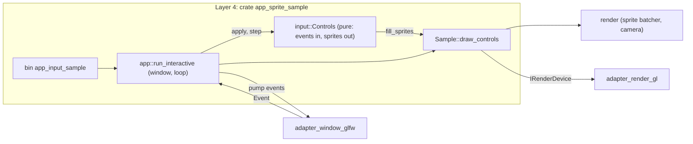
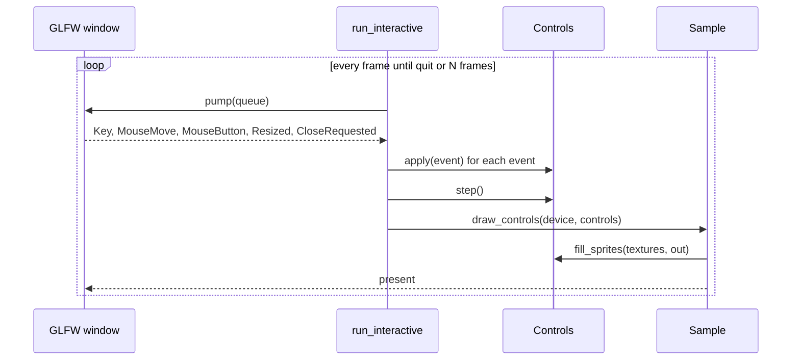
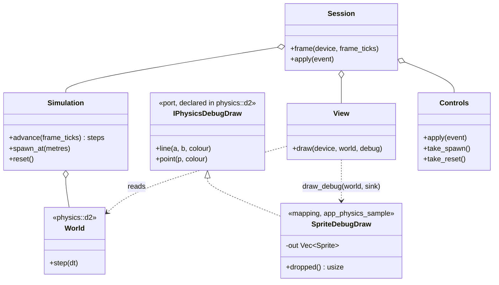

# Runnable examples `[P]` (cards 3-16 and 4-24)

The examples that open a window or print a result, and how to run them. They are layer 4 programs: they name adapters, and nothing else in the engine does ([overview](overview.md)). Every example has a pure part that is tested without a display and a thin part that owns the window and the loop.

## 1. The examples

| Example | Command | What it shows | Needs a display |
|---|---|---|---|
| `app_sprite_sample` (card 3-15) | `cargo run -p app_sprite_sample --release -- --frames 1800` | a triangle, then sprites, through the OpenGL 4.5 device | yes |
| `app_input_sample` (card 3-16) | `cargo run -p app_sprite_sample --release --bin app_input_sample` | arrow keys or WASD move a checker sprite, the mouse places a small square, a left click changes its colour, Escape ends it | yes |
| `app_physics_sample` (card 4-24) | `cargo run -p app_physics_sample --release` | boxes and discs fall into a walled arena under the 2D physics world, drawn with the sprite batcher, with the physics debug drawing on top; click drops a body, R resets, D toggles the debug drawing, Escape ends it | yes (`--null --frames N` needs none) |
| `tools_render_bench`, `tools_simd_bench`, `tools_physics_spike`, `tools_scheduler_spike`, `alloc-bench` | `cargo run -p <name> --release` | benchmarks and spikes that print a table | no |

`--frames N` ends a window example after N drawn frames (1 to 1,000,000); without it the example runs until the window is closed. Exit codes: 0 done, 1 failed, 2 bad arguments, 3 no device (the program prints `not run: device not set up (...)`).

## 2. Running a window example on Windows

1. The GLFW library is not in git ([THIRD_PARTY](../../THIRD_PARTY.md)): put `glfw3.dll` from the official 3.4 Windows build (`lib-vc2022`, SHA-256 in `THIRD_PARTY.md`) next to the program (`target\release\`), or set `DUCK_GLFW_LIB` to its full path.
2. Run the command of the table. `cargo clean` removes the copy next to the program.

On Linux the library is `libglfw.so.3` from the distribution package.

## 3. How the interactive example is built

The second program is a second binary of the crate `app_sprite_sample`, not a new crate: the window, the loop, the command line and the tests of 3-15 are reused, not copied. The key table holds hardware scancodes, which differ per operating system (Windows from GLFW, Linux/X11 as evdev plus 8; only the Windows table is run on the owner's machine); layout-independent key codes come with the input module in phase 7.





## 4. Tests

The pure part (`input::Controls`) has unit tests on plain events: start position, held and released keys, opposite keys, the view edge, a resize, the cursor mapping (y up, origin in the middle), the click toggle, quit by Escape or close request, and the same events giving the same sprites. An integration test draws the frame on the Null device (two draws) and checks that a warm frame makes no allocator call. Two process tests start the built program: a bad command line exits 2, and `--frames 3` exits 0 or reports `not run` where no display exists.

Not covered by an automatic test: the picture on a real display and the feel of the controls. They are checked by running the example.

Known limit: mouse positions arrive in screen units and the sprites are drawn in framebuffer pixels; the two are equal at 100% display scaling. With another scaling the square under the cursor is offset (the high-DPI event of the platform port, [platform-ports](platform-ports.md) section 13, is not used yet).

## 5. The falling boxes sample (card 4-24)

A new crate, `app_physics_sample` (layer 4 by the `app_*` row of `gates/architecture.toml`, no gate file changed). It reuses the window opener, the loop counter, the shader asset, the pipeline and buffer helpers and the checker texture of `app_sprite_sample` (their visibility was widened, nothing else changed there) and adds the physics side. The step runs on the calling thread: the world's default serial execution, no job pool.

What it shows. A floor and two walls (static boxes), a stream of one box or disc every 12 steps up to 80 bodies from a seeded generator (`Pcg32`, seed 24, so every run is the same), and clicks that add more up to 125 dynamic bodies. The world is stepped at a fixed 1/60 s through `frame::FixedStep` (nanosecond ticks, at most 4 steps per frame, the rest of a stall is dropped), metres become pixels at 20 pixels a metre, and the sprites go through the sprite batcher in one pass. The debug drawing is the port `IPhysicsDebugDraw` that `physics::d2` declares (`line`, `point`, with a colour role `DebugColour`; `draw_debug(&World, &mut dyn IPhysicsDebugDraw)` describes the body outlines, centres, contact points and normals); the sample implements it in `mapping::SpriteDebugDraw`, which turns each line into a thin rotated sprite and each point into a small square. `physics` knows no renderer.

Keys: left click drops a body at the cursor, R starts over with the same seed, D toggles the debug drawing, Escape or closing the window ends it. `--frames N` ends after N frames; `--null --frames N` runs the whole loop on the Null render device with a fixed step per frame and no sleeping, so it needs no display and prints the physics state hash (`drew 200 frames, state hash ...`), the same on every run.



```mermaid
sequenceDiagram
  participant L as loop (window or --null)
  participant S as Session
  participant C as Controls
  participant M as Simulation
  participant V as View
  participant D as IRenderDevice
  loop every frame until quit or N frames
    L->>S: apply(events)
    S->>C: apply(event)
    L->>S: frame(device, frame_ticks)
    S->>C: take_reset, take_spawn
    S->>M: reset or spawn_at(metres)
    S->>M: advance(frame_ticks)
    M->>M: FixedStep gives n steps; stream spawn, World.step(1/60) n times
    S->>V: draw(device, world, debug)
    V->>V: body_sprites, then draw_debug into SpriteDebugDraw
    V->>D: write_buffer, submit(stream), end_frame
  end
```

Tests (no display): the mapping (metres to pixels, one sprite per body with its pose, thin line and point sprites, the capacity bound and the drop count) and the controls (click to metres, one request per click or press, resize, keys) are unit tests on plain data; the simulation (fixed-step accounting, the stall cap, the stream period and limit, clicks clamped into the arena, a full world, same seed same hash, reset) likewise; `tests/session.rs` runs the frame on the Null device (n bodies are n sprites with the poses, the debug sprites come and go with the key, the same seed gives the same sprite list hash after 150 frames, a click adds exactly one body, reset, resize, a crowded arena of 125 bodies fits the frame); `tests/no_allocation.rs` checks that a warm frame, with a click and a stream spawn in it, makes no allocator call; `tests/binary.rs` starts the built program (bad arguments exit 2, `--null --frames 200` exits 0 with a stable hash, `--frames 3` exits 0 or reports `not run`). The port itself is tested in `engine/physics/tests/debug_draw.rs`.

Not covered by an automatic test: the picture on a real display, the feel of the click, and the Linux key table. Same display-scale limit as section 4.
