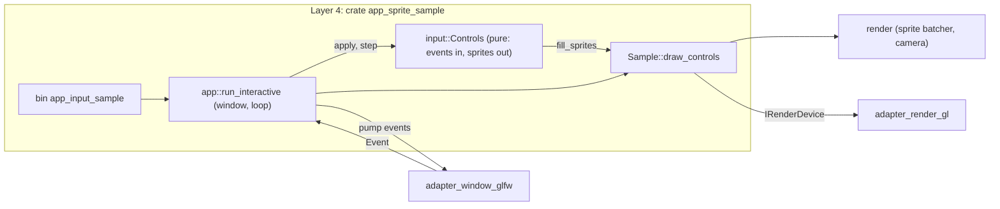
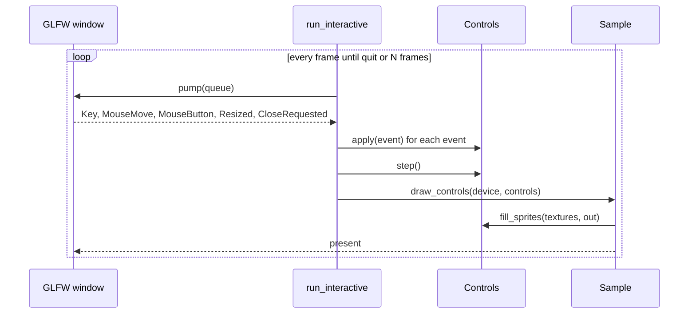

# Runnable examples `[P]` (card 3-16)

The examples that open a window or print a result, and how to run them. They are layer 4 programs: they name adapters, and nothing else in the engine does ([overview](overview.md)). Every example has a pure part that is tested without a display and a thin part that owns the window and the loop.

## 1. The examples

| Example | Command | What it shows | Needs a display |
|---|---|---|---|
| `app_sprite_sample` (card 3-15) | `cargo run -p app_sprite_sample --release -- --frames 1800` | a triangle, then sprites, through the OpenGL 4.5 device | yes |
| `app_input_sample` (card 3-16) | `cargo run -p app_sprite_sample --release --bin app_input_sample` | arrow keys or WASD move a checker sprite, the mouse places a small square, a left click changes its colour, Escape ends it | yes |
| `tools_render_bench`, `tools_simd_bench`, `tools_physics_spike`, `tools_scheduler_spike`, `alloc-bench` | `cargo run -p <name> --release` | benchmarks and spikes that print a table | no |

`--frames N` ends a window example after N drawn frames (1 to 1,000,000); without it the example runs until the window is closed. Exit codes: 0 done, 1 failed, 2 bad arguments, 3 no device (the program prints `not run: device not set up (...)`).

## 2. Running a window example on Windows

1. The GLFW library is not in git ([THIRD_PARTY](../../THIRD_PARTY.md)): put `glfw3.dll` from the official 3.4 Windows build (`lib-vc2022`, SHA-256 in `THIRD_PARTY.md`) next to the program (`target\release\`), or set `DUCK_GLFW_LIB` to its full path.
2. Run the command of the table. `cargo clean` removes the copy next to the program.

On Linux the library is `libglfw.so.3` from the distribution package.

## 3. How the interactive example is built

The second program is a second binary of the crate `app_sprite_sample`, not a new crate: the window, the loop, the command line and the tests of 3-15 are reused, not copied. The key table holds hardware scancodes, which differ per operating system (Windows from GLFW, Linux/X11 as evdev plus 8; only the Windows table is run on the owner's machine); layout-independent key codes come with the input module in phase 7.

## 4. Tests

The pure part (`input::Controls`) has unit tests on plain events: start position, held and released keys, opposite keys, the view edge, a resize, the cursor mapping (y up, origin in the middle), the click toggle, quit by Escape or close request, and the same events giving the same sprites. An integration test draws the frame on the Null device (two draws) and checks that a warm frame makes no allocator call. Two process tests start the built program: a bad command line exits 2, and `--frames 3` exits 0 or reports `not run` where no display exists.

Not covered by an automatic test: the picture on a real display and the feel of the controls. They are checked by running the example.

Known limit: mouse positions arrive in screen units and the sprites are drawn in framebuffer pixels; the two are equal at 100% display scaling. With another scaling the square under the cursor is offset (the high-DPI event of the platform port, [platform-ports](platform-ports.md) section 13, is not used yet).
