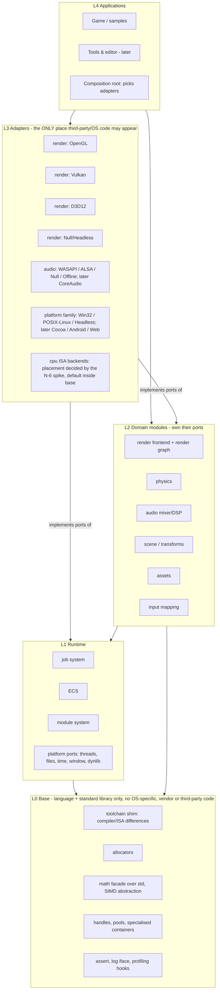

# Architecture Overview `[P]`

## 1. Style: layered + ports & adapters (hexagonal), data-oriented inside

Two ideas combined:

- **Hexagonal / ports-and-adapters** gives Flexibility: engine domain code owns *interfaces* (ports); anything external lives in *adapters* that implement them. Dependencies always point **inward**.
- **Data-oriented design** gives Performance: inside the domain, data is plain structs in contiguous storage addressed by handles, processed in bulk by systems/jobs. Virtual dispatch is reserved for coarse boundaries.

## 2. Layers and the dependency rule

More views (sequence, class, state): [diagrams](diagrams.md).



**Dependency rule (enforced by CI, see below):**

1. A layer may include only from itself and lower layers.
2. **Ports are declared in the domain/runtime module that needs them** (dependency inversion). Adapters depend on the port; the port never depends on an adapter.
3. L0-L2 contain **no** OS-specific, compiler-specific, vendor or third-party code; the language standard library is allowed (v0.6). Platform ports in L1 are interfaces only. **The OS is just another adapter.**
4. Only L4's composition root names concrete adapters.
5. Domain modules do not depend on each other except through declared, acyclic edges (e.g. `scene` -> `ecs`; `physics` does **not** depend on `ecs`, see [physics](physics.md)).

## 3. Module map

| Module | Layer | Owns port(s) | Depends on | Notes |
|---|---|---|---|---|
| `base` | L0 | `simd` abstraction and `IVirtualMemory` (declared here) | language + standard library only | toolchain shim, allocator interface, math facade, handles, specialised containers, assert. **ISA backends (scalar, SSE/AVX, NEON) live inside `base` behind `cfg(target_arch)`/`target_feature`, not in L3 `cpu_*` crates, unless the phase-1 spike (N-6) chooses the generic top-down design instead.** |
| `platform` | L1 | `IVirtualMemory`, `IThreads`, `IClock`, `IFileSystem` (virtual mounts, sync + background reads), `IWindow`/`ISurface`, `ILifecycle`, `IInputDevice`, `IDynLib`, `ISystemInfo`, log/profiler sinks | base | interfaces only; full list in [ports-and-adapters §3](ports-and-adapters.md); Win32 + POSIX/Linux first, Headless always |
| `jobs` | L1 | - | base, platform | injectable scheduler (see [core-runtime](core-runtime.md)) |
| `ecs` | L1 | - | base, jobs | archetype/hybrid storage (ADR-0003) |
| `modules` | L1 | - | base | plugin registry, optional hot reload |
| `physics` | L2 | `IPhysicsDebugDraw` (optional) | base, jobs | **standalone**, handle-based |
| `render` | L2 | `IRenderDevice` (RHI), `IShaderCompiler` | base, jobs | frontend + render graph + command stream |
| `audio` | L2 | `IAudioDevice`, `IAudioDecoder` | base, jobs | mixer graph, DSP |
| `assets` | L2 | `IAssetSource`, importers | base, jobs, platform | async streaming |
| `scene` | L2 | - | base, ecs | transforms, hierarchy |
| `input` | L2 | - | base, platform | action mapping over events from the platform `IInputDevice` (owned by `platform`) |
| `frame` | L2 glue | - | base, jobs | frame loop, fixed-step accumulator, system ordering ([conventions](conventions.md) §3) |
| `sync_physics`, `sync_render`, `sync_audio` | L2 glue | - | ecs, scene and the module they connect | the only code allowed to know two domain modules; renderer consumes a plain `RenderScene` snapshot ([conventions](conventions.md) §3) |
| `adapter_*` | L3 | implements ports | its port module + OS/3rd-party | one crate per adapter |
| `app_*`, `tools_*` | L4 | - | anything | composition root |

## 4. Runtime composition

The composition root creates adapters and injects them into engine services once, at startup:

```
let platform = win32::create_platform();                    // or posix::, headless::
let memory   = base::create_allocators();                   // std allocator by default, arenas layered on top
let renderer = render::create_renderer(gl::create_device(&window));   // or vk::, d3d12::, null::
let audio    = audio::create_audio(miniaudio::create_device());       // stopgap first, then wasapi::
let physics  = physics::create_world(cfg);
```

Selection is by **link-time or startup-time choice**, not per-call. This is what keeps the abstraction cost off the hot path.

## 5. Where virtual calls are allowed `[P]`

| Boundary | Call frequency | Mechanism |
|---|---|---|
| Platform / file / window / audio device | per frame or per audio buffer | virtual interface |
| Render device | per **pass / batch** (commands are recorded as POD into a stream, the backend decodes it in bulk) | one virtual `Submit(stream)` per pass |
| ECS iteration, physics inner loops, mixer inner loops | per element | no dynamic dispatch; generics / concrete types |
| Job submission | per job | function pointer + data, no virtuals |

Rationale and cost evidence: [state-of-the-art §Abstraction cost](../01-state-of-the-art.md). Validate with a benchmark before freezing (ADR-0005).

## 6. Editor-readiness (editor descoped for v0, door kept open) `[P]`

No editor, inspector, or reflection system is built in v0. We only follow rules that cost almost nothing now and avoid a rewrite later:

1. **Engine is a library, not a framework.** No global singletons, no engine-owned `main`; everything hangs off explicit instances (world, renderer, audio, physics) created by the composition root. An editor is then just another L4 application embedding several instances (e.g. an editing world and a play-in-editor world).
2. **Editor lives only in L4** (`tools_*`) and uses the public engine API, never internals. The engine never depends on editor code.
3. **Plain-data components and handle-based references**, so state is copyable, serialisable and diffable without special cases (already required by the data-oriented design).
4. **Data-driven assets and scenes** in a documented format with versioning; the runtime loads the same data an editor would write.
5. **Mutations as small explicit operations** where cheap (spawn, set component, reparent) so undo/redo and live editing can be layered on later; no hidden side effects in setters.
6. **Headless-capable and deterministic**, which is also what makes play-in-editor, replay and tooling tests easy.
7. **Deferred, not forbidden:** reflection/type metadata, property inspection and a central data model are *postponed* until needed. The Machinery's central data model (serialisation, undo/redo and collaboration for free) shows what a later editor wants from the core [S](https://www.gamedeveloper.com/programming/the-machinery-goes-open-beta). Adding component metadata registration later must not change existing component code (to be checked when it happens).

Gate: nothing in this section is allowed to add work to phases 0-7 beyond the listed rules.

## 8. Cross-cutting rules

- **Handles, not pointers** across module boundaries (32-bit index + generation). Benefits: serialisable, relocatable storage, safe stale detection, fewer double-frees (Box2D v3 reasoning [S](https://box2d.org/posts/2024/08/releasing-box2d-3.0)).
- **Error handling:** no panics in runtime layers (`panic = abort`, errors are values); `Result<T, Error>`-style returns and assertions with a debug/release policy [P].
- **Allocation:** hot paths take an arena/allocator explicitly; no hidden heap allocation per frame (counting allocator in tests).
- **Threading:** one injectable job system; subsystems never spawn raw threads (except the audio device thread owned by its adapter).
- **Determinism:** simulation modules take an explicit fixed `dt` and seed; no hidden clocks or global RNG.
- **Public ABI:** ordinary Rust (generics, traits) between modules; a **C ABI** (`#[repr(C)]` plain data, free functions, versioned) only at plug-in boundaries (N-11), as in Box2D and The Machinery.
- **Logging/profiling:** engine depends on tiny *interfaces* (`ILogSink`, profiling macros expanding to a hook); concrete profilers (e.g. Tracy) are dev-only adapters.
