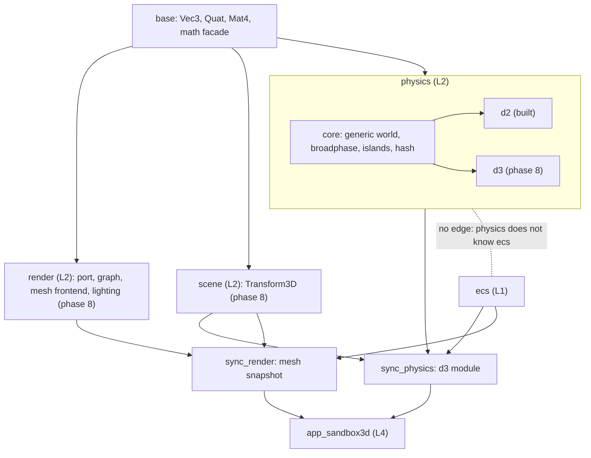
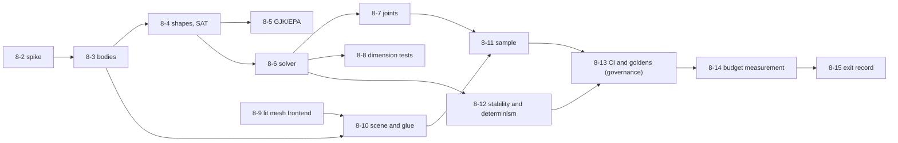

# 3D: phase 8 design note `[P]` (card 8-1)

Design note for phase 8 ("3D"), written before any code. It turns the phase 8 row of the [roadmap](../workflow/roadmap.md) into buildable cards: the `D=3` instance of the physics core, the 3D render features on the existing port, the glue and scene pieces that join them, a 3D sample, and the tests the roadmap names as exit criteria. The owner started phase 8 on 2026-11-17 ("start phase 8"). Nothing after this card starts before the owner has read the note and picked the choices in section 7.

Fixed inputs, not reopened here: physics is one dimension-generic core and 3D is the `D=3` instance of it ([ADR-0018](../decisions/adr-0018-physics-core.md), owner Q20); physics does not know the ECS ([physics §1](physics.md)); 3D render uses the existing port, graph and command stream, and the port is not reshaped for 3D ([rendering](rendering.md), roadmap); conventions are f32, SI units, right-handed Y-up, depth 0 to 1, column-major ([conventions](conventions.md)); no new third-party dependency without an owner decision.

**Scope in one line:** a 3D falling-boxes sample in which lit, depth-tested meshes follow a 3D rigid-body simulation (spheres, boxes, capsules, a few joints), driven through the phase 7 ECS and glue crates, with the physics proven against its own 2D instance and against stability and determinism scenes.

## 1. Evidence and what is still unverified

Findings are tagged **[K]** (known: read in this repository) or **[U]** (unverified, to be checked in the card named).

| Claim | Tag | Source or check |
|---|---|---|
| The `physics` crate holds the generic core (`core`) and the 2D instance (`d2`); there is no `d3` module | K | `engine/physics/src` |
| The `Dim` trait names the differing types (`Vec`, `Ang`, `Rot`, `InvInertia`, `Shape`, `Bounds`, `Manifold`, `Solver`, `Joint`) and the operations `apply_inverse_inertia`, `advance_rotation`, `shape_bounds`, `collide`, `mass_properties`; `Vec3` already implements its `Quantity` and `Magnitude` | K | `engine/physics/src/core/dim.rs` |
| ADR-0018 named a trigger for the fallback to separate 2D and 3D: "phase 8 shows that 3D needs a different solver structure". A `D=3` instance exists only in the spike, with an extruded 2D narrowphase | K | ADR-0018 section 4; `engine/tools_physics_spike/src/dims3.rs` |
| ADR-0018 says the dimension-consistency test is a tolerance test on short, non-chaotic scenes, because with a real 3D narrowphase bit equality will not hold | K | ADR-0018 decision 7 |
| The core already holds the dimension-independent parts the roadmap lists as shared: AABB tree broadphase, pairs, islands, sleeping, graph colouring, joint storage, the state hash | K | `engine/physics/src/core` |
| `base` has `Vec3`, `Quat` (rotate, conjugate, `nlerp`, `slerp`, `to_mat3`, `to_mat4`), `Mat3`, `Mat4` | K | `engine/base/src/math` |
| With the opt-in cross-platform determinism feature on, physics may call `sin`, `cos`, `exp` and the like only through the deterministic math facade in `base`; the arch-check scan enforces it. Whether the facade holds every function a 3D instance needs is not known | K / **U** | rules digest section 5; `gates/architecture.toml`; card 8-2 lists the functions needed |
| `render` has `PerspectiveCamera` (view-projection, `mvp`), `MeshVertex` (position, normal, uv; 32 bytes), a cube mesh and `record_mesh`, and a depth target. The textured mesh with depth runs on OpenGL 4.5 and Vulkan | K | `engine/render/src/camera.rs`, `mesh.rs`; [vulkan-and-mesh-v0](vulkan-and-mesh-v0.md) |
| The mesh sample's shader takes one uniform block (`mvp`) and a texture; there is no light, no normal matrix and no material | K | `engine/app_mesh_sample/shaders/mesh.vert` |
| The port can bind uniform buffers by slot (`BindUniforms`). Whether a light and material block fits the port and both adapters without a port revision | **U** | card 8-9 (the swap-diff check counts port revisions) |
| `scene` has `Transform2D` and `WorldTransform2D` only; `sync_physics` is written against `physics::d2`; `sync_render` builds sprites | K | `engine/scene/src/transform.rs`, `engine/sync_physics/src`, `engine/sync_render` |
| `assets` and `tools_assetc` handle textures (`dtex`) and shaders (`dshd`); there is no mesh file format or mesh converter | K | `engine/assets/src`, `engine/tools_assetc/src` |
| `forbidden_edges` holds only `physics -> ecs`; a `d3` module of `physics` needs no change to the architecture config | K | `gates/architecture.toml` |
| The golden hashes for cross-platform determinism are stored for 12 scenes in `gates/golden/physics-replay.toml`; 3D scenes need new entries, which is a governance file | K | rules digest section 5 |
| Whether a generic solver written for 2D carries 3D (3 tangent directions, tensor inertia, warm starting of 3D manifolds) without branches on `D` | **U** | card 8-2 (the spike) |
| Cost of 3D contact generation for box-box and capsule pairs in a stack, and how many contact points a stable stack needs | **U** | card 8-2, then card 8-5 |

## 2. Where the code lives

No new crate and no layer change are proposed. Every piece goes into a crate that already exists.

| Piece | Crate and module | Layer |
|---|---|---|
| `D=3` instance: bodies with quaternion and tensor inertia, shapes, narrowphase, solver, joints | `physics`, module `d3` | 2 |
| Planar-scene oracle and 3D scenes | `physics` tests, `tools_physics_bench` | 2 and tools |
| Lighting and material for meshes (shader, uniform block, pass recording) | `render` (frontend), shader sources in the sample, compiled by `tools_shaderc` | 2 |
| `Transform3D`, `WorldTransform3D` and their update | `scene` | 2 |
| 3D body sync, 3D mesh snapshot | `sync_physics` and `sync_render`, new `d3` and mesh modules | 2 (glue) |
| The 3D sample | new crate `app_sandbox3d` (layer 4) | 4 |
| Mesh file format and converter (optional, choice O5) | `assets`, `tools_assetc` | 2 and tools |

## 3. The physics instance

The roadmap row names quaternions, an inertia tensor, GJK/EPA/SAT, 3D manifolds and joints. ADR-0018 fixes the shape of the work: write the `D=3` instance behind the narrow `Dim` trait, keep shared code free of branches on `D`, and watch its triggers.

**Step 0, the spike (card 8-2).** Before the instance is built, a short spike answers the one question the ADR left for phase 8: does the generic core carry a 3D solver without a different structure? It builds a box-on-box stack with the sequential-impulse solver on the real `core`, counts methods added to `Dim`, counts places that need a branch on `D`, and reports bytes per body and per contact against the ADR-0018 figures. If a trigger fires, the result is a proposal for the owner (an ADR amendment is a governance task); the instance is not started on a fired trigger.

**Body and integration.** Orientation is a unit quaternion, advanced by the angular velocity and renormalised each step; angular velocity is a `Vec3`; inverse inertia is a symmetric 3x3 tensor in the body frame, rotated to the world frame per step. All trigonometry goes through the math facade when the cross-platform feature is on.

**Shapes.** Sphere, box and capsule first. Convex hulls (built from a vertex list, bounded size) use GJK for distance and EPA for penetration depth; box-box uses SAT with face and edge axes and clipping to a manifold of at most four points. Triangle meshes and heightfields are not in phase 8 (static meshes would need a mid-phase BVH over triangles; see section 8).

**Solver.** The structure of `core::solver` stays: soft constraints, warm starting, sub-stepping, colouring for parallel solving. The 3D instance supplies the contact block with two tangent directions, the friction cone and effective mass with a tensor.

**Joints.** Ball-and-socket, hinge (with limits) and distance first; the joint storage in `core::joint` is shared. Prismatic, cone-twist and motors are later.

**Debug draw.** The existing physics debug-draw port gets 3D shape output (wire boxes, spheres, capsules, contact points) as lines, so a 3D scene can be looked at before any lit mesh exists.

**Dimension-consistency.** A short, non-chaotic scene runs in the `D=2` instance and in the `D=3` instance with motion constrained to a plane (initial velocity and orientation in the plane, inertia chosen so rotation stays in the plane). Positions and angles agree within stated tolerances for a stated number of steps. Tolerances are written down in the test, measured, and not widened to get green. The scenes are a falling box, a rolling disc against sphere, an elastic collision and a pendulum. Stacking and other chaotic scenes are not used for this test.

**Determinism.** D0 and D1 apply to every 3D scene. Whether `D=3` joins the cross-platform feature (D2) is choice O6, because it adds entries to a governance file.

## 4. 3D render features on the existing port

Rule from the roadmap and the exit criteria: the render port, the platform ports and the engine and game code keep a swap diff of 0. The 3D features are a frontend over the existing port and graph.

- **Camera.** `PerspectiveCamera` exists. Added: a small orbit and fly camera controller as pure data and functions (events in, matrices out), testable with no display, in the sample first and moved into `render` only if a second sample needs it.
- **Lighting.** One directional light plus an ambient term, Lambert diffuse, a per-material colour and an optional texture. A uniform block carries the view-projection, the model and normal matrices, the light direction and colour, and the material. No shadows, no PBR, no point or spot lights, no skinning in phase 8 (choice O4).
- **Materials.** A material is plain data (colour, texture handle, one pipeline); the batcher sorts draws by pipeline and texture, as the sprite batcher does.
- **Primitive meshes.** Generated sphere, capsule, box and plane with normals, next to the existing cube; static data, no allocation per frame.
- **Mesh from a file.** Choice O5.
- **Contract.** The render contract suite runs on Null, OpenGL and Vulkan (phase 6); which of its cases already cover uniform blocks is checked in card 8-9. Phase 8 adds contract cases for the uniform-block layout the lit shader needs. If a lit mesh cannot be expressed without a port revision, that is a stop and a report to the owner, not a quiet change to the port.
- **Golden command streams.** The Null device records the stream of the 3D sample; a test pins it as phase 3 did for sprites.

## 5. Scene, glue and the sample

- `scene`: `Transform3D` (position `Vec3`, rotation `Quat`, scale `Vec3`) and `WorldTransform3D` (a `Mat4`), with the same parent and child-sibling hierarchy and depth-first update as 2D.
- `sync_physics` `d3`: copies body pose from the 3D physics world into `Transform3D` after each fixed step, and writes forces and kinematic targets the other way, as the 2D glue does. `sync_render` builds a mesh draw list from `WorldTransform3D` and a mesh and material component. Physics still does not know the ECS.
- `app_sandbox3d`: a walled box in which the player drops spheres, boxes and capsules with the mouse and the keyboard, an orbit camera, one light, a reset key. It uses `input` actions, the ECS, `frame` for the fixed step and the glue crates. A direct (no ECS) variant is not built; the ECS cost was measured in phase 7.
- Without a GPU or a display the binary prints "not run: device not set up" and exits, as the existing samples do, and its logic runs on the Null device in tests.

## 6. Tests and measurements

- Analytic unit tests first: free fall, a sphere on a plane, rotation of a free body with torque (quaternion stays unit length within a stated tolerance), inertia tensor of box, sphere and capsule against closed forms, elastic collision momentum.
- Geometry tests against brute-force oracles: SAT and GJK/EPA on random shape pairs; manifold points lie on both surfaces within a tolerance; ray cast.
- Property tests on random scenes: no NaN, no tunnelling beyond a stated epsilon, energy does not rise without input.
- Dimension-consistency scenes as in section 3.
- Stability scenes: a stack of boxes, a pyramid, a chain of joints, a high mass ratio pair; each must settle and sleep within a stated step count.
- Determinism: replay hash twice, at 1 and N threads, per scene (D0, D1), plus the golden hash on Windows and Linux if O6 is (a).
- Allocation: zero heap allocations per frame in the 3D step and in the sample, counted with the per-thread counting allocator.
- Benchmarks: 3D scenes (stack, pyramid, many spheres, a mixed pile) in `tools_physics_bench`, instruction counts on the hosted runner, wall time on the reference machine; the budget is proposed from measurement and accepted by the owner (choice O9), as in phase 7.
- Coverage and mutation of the changed L0 to L2 code are measured at the exit record, as for phases 6 and 7.

## 7. How the cards follow from this

Proposed; created in the Backlog after the owner accepts the note. Numbers are card ids.

| Card | Delivers | Class |
|---|---|---|
| 8-2 | 3D core spike: the `D=3` stack on the real core, trigger check against ADR-0018, list of math facade functions needed, report | spike (TDD exception), report |
| 8-3 | `physics::d3` bodies: quaternion orientation, inertia tensors, mass properties, integration, `Dim` impl, state hash | 2 (new public API) |
| 8-4 | `d3` shapes and narrowphase part 1: sphere, box, capsule; SAT and clipping manifolds; AABB bounds | 2 |
| 8-5 | `d3` narrowphase part 2: convex hull with GJK and EPA | 2 |
| 8-6 | `d3` contact solver with friction and warm starting, sleeping and islands on the shared core | 2 |
| 8-7 | `d3` joints: ball-and-socket, hinge with limits, distance | 2 |
| 8-8 | dimension-consistency tests (2D instance against 3D constrained to a plane) | 1 (tests only) |
| 8-9 | 3D debug draw; lit mesh frontend: light and material uniform block, primitive meshes, contract cases, Null golden stream | 2 (new public API in `render`) |
| 8-10 | `scene` `Transform3D` and hierarchy update; `sync_physics` `d3` and `sync_render` mesh snapshot | 2 |
| 8-11 | `app_sandbox3d`: the sample, golden stream test on Null, replay hash, allocation test, orbit camera | 2 |
| 8-12 | 3D stability and determinism scenes, replay tests at 1 and N threads | 1 (tests) |
| 8-13 | CI: register the 3D benchmarks (`gates/benchmarks.toml`, `ci.yml`), and the golden hashes of the 3D scenes (`gates/golden/physics-replay.toml`) if O6 is (a) | 3 (governance, owner-declared; main first) |
| 8-14 | 3D benchmark measurement and the proposed budget; coverage and mutation of the phase | 1 (measurement and docs) |
| 8-15 | phase 8 exit record, milestone review, retrospective, and the phase 9+ inputs the roadmap asks for ("revisit editor at the phase-8 review") | 1 (docs) |
| 8-16 | Optional (choice O5): mesh file format `dmesh` and converter | 2 |

Card 8-13 is governance and is started only when the owner declares it. Nothing from 8-3 on starts before the spike report (8-2) has been read and its outcome accepted. Cards 8-3 to 8-7 are a chain; 8-9 can run in parallel with 8-4 to 8-7 (render needs no physics); 8-10 needs 8-3 and 8-9; 8-11 needs 8-6, 8-7 and 8-10.

## 8. Choices for the owner

| # | Choice | Options | Recommendation |
|---|---|---|---|
| O1 | Order of the phase | (a) spike first (8-2), then physics, with render in parallel · (b) build the instance without the spike | (a): ADR-0018 left exactly this question for phase 8, and a fired trigger changes the plan |
| O2 | Shape set | (a) sphere, box, capsule · (b) (a) plus convex hull with GJK/EPA · (c) (b) plus static triangle meshes | (b): the roadmap names GJK/EPA; triangle meshes need their own broadphase and are the first thing to cut (scope-control rule 6 cuts 3D scope first) |
| O3 | Joints | (a) ball-and-socket, hinge with limits, distance · (b) (a) plus prismatic, cone-twist, motors | (a): enough for the sample and the chain scene; the rest is later |
| O4 | Render features | (a) one directional light, ambient, Lambert, colour and texture per material · (b) (a) plus Blinn-Phong specular · (c) (a) plus shadows | (a): "basic lighting and materials" in the roadmap; shadows need a second pass and depth-texture sampling that the port may not have, and would be a port question |
| O5 | Meshes from files | (a) generated primitives only; a file format later · (b) card 8-16: own `dmesh` format and converter (own code, no new dependency) | (a), with 8-16 listed as optional: the sample needs only primitives, and the card is the first to drop when behind |
| O6 | Cross-platform determinism for 3D | (a) `d3` joins the opt-in feature: facade for every math function, golden hashes on Windows and Linux (adds governance entries, card 8-13) · (b) D0 and D1 only in phase 8 | (a): the rule in the digest covers the physics crate, and a second instance that quietly sits outside it would weaken the claim; 8-2 reports the facade functions still missing |
| O7 | Scene | (a) `Transform3D` added next to `Transform2D`, both kept · (b) one transform type with a flag | (a): no branch on dimension in shared code, same rule as physics |
| O8 | Sample | (a) `app_sandbox3d` through ECS and the glue crates · (b) a direct sample like `app_physics_sample` | (a): the phase 7 glue is the integration the 3D sample should prove; the ECS cost is measured |
| O9 | Targets and budgets | (a) the cards propose the 3D benchmark budgets from measurement, you accept or change them · (b) you name the numbers now | (a): no honest number exists yet, as in phase 7 |

## 9. Risks and what this note does not settle

- **Robust 3D contact is the time sink the physics page already names** ([physics §6](physics.md)): box-box manifolds, stable stacking, GJK/EPA degeneracies. Mitigation: the oracle tests of section 6 first, a short shape list, the spike before the build, and cutting convex hulls (O2 (a)) if 8-4 runs long.
- **Generic core over-strained.** If the 3D instance needs branches on `D` or many new `Dim` methods, ADR-0018 triggers fire. The spike (8-2) is where this shows; the reaction (an ADR amendment, or separate 3D code) is the owner's.
- **Determinism of quaternion code.** Normalisation, slerp and inertia rotation use `sqrt` and trigonometry. `sqrt` is correctly rounded in IEEE and stays in physics; trigonometry must route through the facade under O6 (a). Missing facade functions are a change to `base` (Class 2).
- **A lit mesh may need a port change.** If the light and material block does not fit the port as it is, the swap-diff rule counts a port revision. The roadmap allows none for 3D; that case is a stop and a question to the owner.
- **Scope is large.** The roadmap itself says 3D is sequenced last and shrinks first. The cut order inside the phase is: card 8-16, then convex hulls (8-5), then joints beyond the ball-and-socket joint, then the sample's extras.
- **Not settled here:** where the native Win32 and audio adapters go (Backlog card 7-15, an open owner decision from phase 7), whether `render -> ecs` should be forbidden in the architecture config (a governance question from the phase 7 review), a gate for the frame budget, continuous collision detection, soft bodies, skinned meshes, a 3D audio listener, an editor (the roadmap asks to revisit it at the phase 8 review), and SIMD for the 3D solver (a later optimisation under the `simd` rules, with its own `unsafe` budget question).
