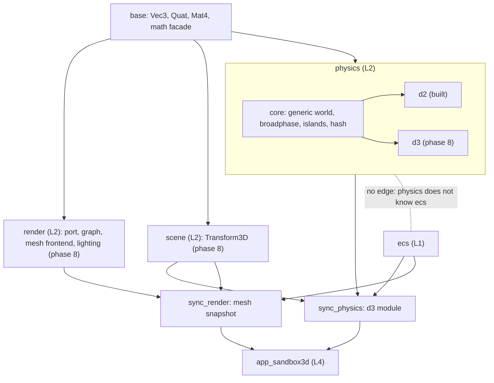
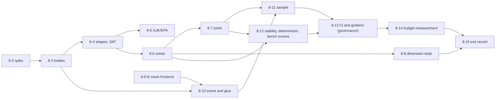

# 3D: phase 8 design note `[P]` (card 8-1)

Design note for phase 8 ("3D"), written before any code. It turns the phase 8 row of the [roadmap](../workflow/roadmap.md) into buildable cards: the `D=3` instance of the physics core, the 3D render features on the existing port, the glue and scene pieces that join them, a 3D sample, and the tests the roadmap names as exit criteria. The owner started phase 8 on 2026-11-17 ("start phase 8"). Nothing after this card starts before the owner has read the note and picked the choices in section 7.

Fixed inputs, not reopened here: physics is one dimension-generic core and 3D is the `D=3` instance of it ([ADR-0018](../decisions/adr-0018-physics-core.md), owner Q20); physics does not know the ECS ([physics §1](physics.md)); 3D render uses the existing port, graph and command stream, and the port is not reshaped for 3D ([rendering](rendering.md), roadmap); conventions are f32, SI units, right-handed Y-up, depth 0 to 1, column-major ([conventions](conventions.md)); no new third-party dependency without an owner decision.

**Scope in one line:** a 3D falling-boxes sample in which lit, depth-tested meshes follow a 3D rigid-body simulation (spheres, boxes, capsules, a few joints), driven through the phase 7 ECS and glue crates, with the physics proven against its own 2D instance and against stability and determinism scenes.

## 1. Evidence and what is still unverified

Findings are tagged **[K]** (known: read in this repository) or **[U]** (unverified, to be checked in the card named).

| Claim | Tag | Source or check |
|---|---|---|
| The `physics` crate holds the generic core (`core`) and the 2D instance (`d2`); there is no `d3` module | K | `engine/physics/src` |
| The `Dim` trait names the differing types (`Vec`, `Ang`, `Rot`, `InvInertia`, `Shape`, `Bounds`, `Manifold`, `Solver`, `Joint`) and the operations `apply_inverse_inertia`, `advance_rotation`, `shape_bounds`, `collide`, `mass_properties`; `Vec3` already implements its `Quantity` and `Magnitude` | K | `engine/physics/src/core/dim.rs` |
| ADR-0018 named a trigger for the fallback to separate 2D and 3D: "phase 8 shows that 3D needs a different solver structure". A `D=3` instance exists only in the spike, with an extruded 2D narrowphase | K | ADR-0018 section 4; `engine/tools_physics_spike/src/dims3.rs` |
| ADR-0018 says the dimension-consistency test is a tolerance test on short, non-chaotic scenes, because with a real 3D narrowphase bit equality will not hold | K | ADR-0018 decision 7 |
| The core already holds the dimension-independent parts the roadmap lists as shared: AABB tree broadphase, pairs, islands, sleeping, graph colouring, joint storage, the state hash | K | `engine/physics/src/core` |
| `base` has `Vec3`, `Quat` (rotate, conjugate, `nlerp`, `slerp`, `to_mat3`, `to_mat4`), `Mat3`, `Mat4` | K | `engine/base/src/math`, `engine/base/src/dmath` (the facade) |
| With the opt-in cross-platform determinism feature on, physics may call `sin`, `cos`, `exp` and the like only through the deterministic math facade in `base`; the arch-check scan enforces it. Whether the facade holds every function a 3D instance needs is not known | K / **U** | rules digest section 5; `gates/architecture.toml`; card 8-2 lists the functions needed |
| `render` has `PerspectiveCamera` (view-projection, `mvp`), `MeshVertex` (position, normal, uv; 32 bytes), a cube mesh and `record_mesh`, and a depth target. The textured mesh with depth runs on OpenGL 4.5 and Vulkan | K | `engine/render/src/camera.rs`, `mesh.rs`; [vulkan-and-mesh-v0](vulkan-and-mesh-v0.md) |
| The mesh sample's shader takes one uniform block (`mvp`) and a texture; there is no light, no normal matrix and no material | K | `engine/app_mesh_sample/shaders/mesh.vert` |
| The port can bind uniform buffers by slot (`BindUniforms`). Whether a light and material block fits the port and both adapters without a port revision | **U** | card 8-9 (the swap-diff check counts port revisions) |
| `scene` has `Transform2D` and `WorldTransform2D` only; `sync_physics` is written against `physics::d2` and generic over nothing (the `d3` glue either repeats it or shares a helper, decided in card 8-10); `sync_render` builds sprites | K | `engine/scene/src/transform.rs`, `engine/sync_physics/src`, `engine/sync_render` |
| `assets` and `tools_assetc` handle textures (`dtex`) and shaders (`dshd`); there is no mesh file format or mesh converter | K | `engine/assets/src`, `engine/tools_assetc/src` |
| `forbidden_edges` holds only `physics -> ecs`; a `d3` module of `physics` needs no change to the architecture config | K | `gates/architecture.toml` |
| The golden hashes for cross-platform determinism are stored for 12 scenes in `gates/golden/physics-replay.toml`; 3D scenes need new entries, which is a governance file | K | rules digest section 5 |
| Whether a generic solver written for 2D carries 3D (3 tangent directions, tensor inertia, warm starting of 3D manifolds) without branches on `D` | **U** | card 8-2 (the spike) |
| Cost of 3D contact generation for box-box and capsule pairs in a stack, and how many contact points a stable stack needs | **U** | card 8-2, then card 8-5 |

## 2. Where the code lives

No new crate and no layer change are proposed. Every piece goes into a crate that already exists.

| Piece | Crate and module | Layer |
|---|---|---|
| `D=3` instance: bodies with quaternion and tensor inertia, shapes, narrowphase, solver, joints | `physics`, module `d3` | 2 |
| Planar-scene oracle and 3D scenes | `physics` tests, `tools_physics_bench` | 2 and tools (L4) |
| Lighting and material for meshes (shader, uniform block, pass recording) | `render` (frontend), shader sources in the sample, compiled by `tools_shaderc` | 2 |
| `Transform3D`, `WorldTransform3D` and their update | `scene` | 2 |
| 3D body sync, 3D mesh snapshot | `sync_physics` and `sync_render`, new `d3` and mesh modules | 2 (glue) |
| The 3D sample | new crate `app_sandbox3d` (layer 4) | 4 |
| Mesh file format and converter (optional, choice O5) | `assets`, `tools_assetc` | 2 and tools (L4) |

## 3. The physics instance

The roadmap row names quaternions, an inertia tensor, GJK/EPA/SAT, 3D manifolds and joints. ADR-0018 fixes the shape of the work: write the `D=3` instance behind the narrow `Dim` trait, keep shared code free of branches on `D`, and watch its triggers.

**Step 0, the spike (card 8-2).** Before the instance is built, a short spike answers the one question the ADR left for phase 8: does the generic core carry a 3D solver without a different structure? It builds a box-on-box stack with the sequential-impulse solver on the real `core`, counts methods added to `Dim`, counts places that need a branch on `D`, and reports bytes per body and per contact against the ADR-0018 figures. If a trigger fires, the result is a proposal for the owner (an ADR amendment is a governance task); the instance is not started on a fired trigger.

**Body and integration.** Orientation is a unit quaternion, advanced by the angular velocity and renormalised each step; angular velocity is a `Vec3`; inverse inertia is, as built in card 8-3, the diagonal of the principal moments in the body frame (a `Vec3`), rotated to the world frame per step; sphere, box and capsule have their principal axes on the local axes, and the convex hull of card 8-5 will need either a principal-axes rotation or a full 3x3 tensor in this type. The integrator has no gyroscopic term unless `SolverConfig::gyroscopic` is set (card 8-3, opt-in since card 8-26, see the paragraph on the gyroscopic term below), so by default a torque-free body keeps its angular velocity, which is not physical for unequal moments. All trigonometry goes through the math facade when the cross-platform feature is on.

**Shapes.** Sphere, box and capsule first (built in card 8-4, see the next paragraph). Convex hulls (built from a vertex list, bounded size, card 8-5) use GJK for distance and EPA for penetration depth; box-box uses SAT with face and edge axes and clipping to a manifold of at most four points. Triangle meshes and heightfields are not in phase 8 (static meshes would need a mid-phase BVH over triangles; see section 8).

**Narrowphase for sphere, capsule and box (card 8-4).** A sphere is a capsule whose segment has length zero, so the round pairs (sphere-sphere, sphere-capsule, capsule-capsule) are one routine on two segments: closest points, a normal across both axes when the axes meet, and two points when two capsules lie side by side. A sphere or capsule against a box takes the nearest point of the segment to the box (the distance is convex along the segment, so a fixed-step ternary search finds it) and gives one point, or two when both ends are as near as the middle (a capsule lying on a face or along an edge); a segment that goes through the box has no nearest point worth taking, so the way out is found over the faces of the box and the faces across the segment and each box edge. Box-box is a separating axis test over fifteen axes, with the first box's face preferred to the second's and a face to an edge unless the other is better by 5e-4 m; a face axis gives a clipped face contact of at most four points, an edge axis one point. All routines work on fixed arrays and allocate nothing. A manifold keeps the 2D convention: normal from the first body to the second, `separation` negative while the shapes overlap. Known limit, the same as in 2D: a speculative contact between boxes that are still apart may be up to 4 mm above the true gap, because clipping can drop the corner nearest the other box; the normal and the depth of an overlap are exact. Three more limits found in review: boxes that are apart diagonally by a little less than the margin get a speculative contact early (the gap is measured along one axis, so it can be up to about 1.7 times too small at a corner), which only makes the solver stop an approach slightly too soon; the axis bias is an absolute 5e-4 m, so boxes smaller than about 1 cm lose accuracy and tiny ones can pick the wrong axis; and a capsule that goes through a box much deeper than the box is wide gets its points at the ends of the capsule, far from the box, so the solver of card 8-6 must not rely on their lever arm in that case (the normal and the depth are right). Contact points carry no feature id yet: the warm start of card 8-6 matches them by position.

**Convex hull (card 8-5).** `Hull::new` takes 4 to 64 points and keeps the corners of their convex hull, at most 32 (`MAX_HULL_VERTICES`); flat, line-like, repeated or too many points give `InvalidShape`, NaN or infinite points `NotFinite`. A hull is stored inline in `Shape3` (a fixed array, so the shape stays `Copy` and hashable), which makes `Shape3` about 448 bytes; the enum carries a scoped `#[expect(clippy::large_enum_variant)]` with that reason, and code that passes shapes around passes `&Shape3`. The corners are found by brute force (every triple of points is a candidate face plane; a plane with all points on one side is a face; a corner lies on three faces), which is fine at 64 points and is done once at build time. The stored vertices are in the principal frame of the solid, centred on its centre of mass, so the diagonal inertia of the `D=3` instance needs no change; `origin()` and `orientation()` say where the body must sit to put the hull where the input points were. Volume, centre and inertia come from tetrahedra to a corner, the principal axes from a Jacobi rotation (no trigonometry, so the result is the same on every platform). Contacts use GJK for the distance of two convex cores and EPA for the depth when they overlap, over one support-function view of every shape: a sphere is a point and a radius, a capsule a segment and a radius, a box and a hull their own solid; the radii are added to the gap afterwards. Every pair with a hull in it goes this way (hull against sphere, capsule, box and hull); the pairs without a hull keep the routines of card 8-4. The simplex, the EPA solid (at most 64 vertices and 128 faces) and all scratch are fixed arrays, so a query allocates nothing. The result of GJK and EPA is one contact point per pair, halfway between the surfaces, with the normal from the first shape to the second; card 8-18 turns it into up to four points (next paragraph). Known limits: EPA stops when the next point is no more than 1e-5 m beyond the nearest face, and when the solid is full it returns the nearest face found so far; the accuracy against an independent oracle is about 4 mm in the tests (the same bound as card 8-4). Thin hulls were a known limit until card 8-24 (below): use a `Box` for plates thinner than the limit stated there. The valid size range is about 1e-7 to 1e7 (the moments overflow `f32` above that, and the hull is refused).

**Hull contact manifolds (card 8-18).** `d3::face_clip` builds the manifold of every pair with a hull. GJK and EPA still give the first normal and point (and the answer when nothing better is found), but the normal of a nearly flat contact is noisy (up to about 0.016 rad in the cases measured, and in rare tilts of 1 to 2 degrees much more), and the corners within a millimetre of a noisy plane are one or two of four. So the face is found again from the corners: for a box or a hull, three corners near the farthest plane along the normal that span a plane with every corner of the solid on one side, the plane best aligned with the normal and within about 1.8 degrees of it (`FACE_WINDOW`, `MIN_FACE_COSINE`); the corners on that plane, put in order round the face by a pseudo-angle (no trigonometry), are the face. The larger fitted face is the reference, its exact normal becomes the contact normal, and the other shape's face (its own fitted face, or, when it has none, the corners within a thousandth of its reach of the farthest plane: an edge or one corner, a capsule's axis, a sphere's centre) is clipped to the sides of the reference as box against box does; the clipping code moved to `d3::clip` and both use it. Points further than the margin from the reference plane are dropped, more than four are cut to the four that spread most (deepest, farthest from it, the two largest areas; points that are as good as each other are told apart by their position, so the four do not change when the list starts at another corner), and when nothing is left the single GJK point stands. A hull cube resting on a face now gets four points with the true gaps (also when tilted by up to a degree or two), on an edge two, on a corner one; a capsule lying on a face two; a sphere one. Measured: a hull cube dropped on the floor rests at 0.5 m within 5 mm and stands still, a tilted one ends flat, a stack of five hull cubes stands as box stacks do. Known limits: a face is found only when three of its corners lie within 5% of the reach of the farthest plane along the normal and the face is within 1.8 degrees of the normal, so a hull tilted more than that is an edge or corner contact for that step (it then rocks down onto its face); a window holds at most 16 corners, and the planes are tried by brute force over the triples of it (at most 560 planes by up to 32 corners), which measured in a release build costs 1.7 microseconds for a hull cube on a box (as before), 6.8 for two 16-sided pucks lying on each other and 11.8 when no face fits (against 3.8 for GJK alone), the cheap angle test comes before the scan of all corners and the search stops at the first plane that fits; box against box keeps its own small polygon size (8 corners, a hull's is 64); the hull faces are found again on every query (no face list is stored in `Hull`, to keep `Shape3` at its size); a hull face and another hull's face that only just touch at an angle are clipped as parallel.

**What is left of the hull limits (card 8-34, Class 2; tests, one private helper, no behaviour change).** The four limits that card 8-24 left open were measured on the code of card 8-18, with a hull cube against a box cube (`engine/physics/tests/d3_hull_contacts.rs`). (1) Overlap: a hull cube rests as deep as a box (0.00107 m both), not the 13 to 16 mm of card 8-6. (2) Sinking: a column of 5 and of 10 hull cubes ends as low as the same column of boxes (0.011 m and 0.036 m below the ideal height): what remains is the solver's, not the hull's. (4) The switch from four points to two comes at a tilt of 1.5 degrees for the hull and for the box alike, which is the change from the face to the edge, and an edge is two points. (3) Hopping: a prism at rest keeps its points where they are (no move above 0.1 mm over 100 steps); a prism of 8, 12 or 16 sides that rolls has one point in a quarter of the steps where an edge touches (two), with at most 5 mm of sideways drift over the 240 steps: pinned as a finding, cause not looked into (card 8-71). The mutation survivor of card 8-24 (the reach in `Solid::into_hull`) is killed (by hand) by a unit test of `reach_from`, the other survivors of 8-24 being equivalent or boundary cases; the full mutation run was started and stopped by the system for lack of memory (card 8-70).

**A rolling prism keeps both points of its edge (card 8-71, Class 2; the face clipping of hull contacts).** Card 8-34 pinned as a finding that a prism of 8, 12 or 16 sides rolling on the floor has one contact point in a quarter of the steps where an edge touches (two points). Two causes, both in `face_clip.rs`. (1) At a corner the normal of EPA leans between 1.8 and 29 degrees from the face that touches, past the limit of a fitted face, so neither shape had a face and the single point of GJK stood: now a second try looks for the nearest face within 45 degrees (among the 8 corners nearest the normal), only for a contact no deeper than 5 % of the reach of the smaller shape and only when its deepest point and its gap along the normal (`gjk::gap_along`) lose at most a thousandth of that reach against GJK; unguarded it broke the oracle tests (deep overlaps, a ridge against a ridge) and a stack of hull cubes. (2) With a fitted reference face the other shape's edge kept the corners within a thousandth of the reach of its farthest plane, so a slightly tilted edge kept one end: now a shallow manifold of one point is tried again with every corner within the margin (the same reference and normal, so it only gains points; the points beyond the margin are dropped as before). Over 4 speeds (1.0 to 2.0 m/s) and the three prisms the one-point steps went from 31 to 70 of 240 to at most 9; the other pins of the roll (never more than 2 mm above the radius, at most 11 mm sideways, spin about the other axes at most 0.23 rad/s) hold. Cost: a rolling-prism scene takes about 35 % more time a step in a release build (8.9 to 11.8 microseconds a step, one prism on a floor; card 8-78). Above 2.2 m/s the prism hops by 3 to 4 mm before and after, and one scene drifts more sideways (card 8-76); GJK gives a depth 2.5 mm off for a tilted edge of a prism sunk 1 mm and gives no contact on one step in 240, with the code before as well (card 8-75); a contact point has no lower bound on its depth (card 8-77). The physics suite with the cross-platform feature passes, hashes included (`reviews/8-71.md`).

**The gyroscopic term (card 8-26, Class 2; opt-in, default unchanged).** `SolverConfig::gyroscopic` (default `false`, ignored in 2D) makes a 3D body keep its angular momentum instead of its angular velocity. A torque-free body whose principal moments differ then tumbles (Euler's equation `I dw/dt + w x I w = 0` in the body frame): a box spun about its middle axis turns over, a sphere is unchanged. The step is implicit, one Newton step per call (`d3/gyroscopic.rs`, as Bullet and Box2D v3 do), because the explicit one gains energy and blows up on a fast spin about the middle axis; it uses plain arithmetic only (no `sin`, `cos`, `sqrt`, no fused multiply-add), so it is the same on every platform. It runs in both places a body is integrated: `Body::integrate` (a body no constraint touches, one step of `dt`) and `SolverBody::integrate_velocity` (a body a contact or joint touches, each sub-step, with the orientation `turn * start`). It is a hook of the `Dim` trait with a default that keeps the spin, so 2D and the other implementers are unchanged. With the switch off the code path computes the same values as before: the existing tests of the physics crate, the stored golden hashes included, pass unchanged (a full run with the cross-platform feature on, before the last review fixes; rerun for the gates). A `SolverBody` is 28 bytes larger (the start orientation and the principal moments), so the per-pass copy of the parallel solve below, 312 bytes when it was measured, is 56 bytes more; the effect on the benchmark was not measured. **Measured** (box of half extents 0.5, 1, 0.25, spin (1, 4, 0.5) rad/s, 240 Hz): with the term the angular momentum is kept to 2.6 % over 2 s (the angular velocity itself moves by 4 rad/s); without it the momentum turns away by 82 %; a spin of 6 rad/s about the middle axis turns the body over at 1.46 s with the term and never without it (checked for 2 s). The scheme is first order and loses about 0.9 % of the momentum a second at 240 Hz (0.85 % a second over 10 s; measured as well: 0.2 % a second at 960 Hz and about 3 % a second at 60 Hz steps, the step a body no constraint touches gets, since it is not sub-stepped); that is numerical damping, not a conservation law. An extreme step is bounded only by the finite check (a test pins a finite result at a 10 s step). Not done: the term is not on by default (every golden hash and many pins would move: a governance card); a higher-order scheme; sub-stepping of untouched bodies; a full (non-diagonal) inertia tensor, which a body needs only if its shape has no principal axes on the local axes (the three shapes and the hull of card 8-5 are built on their principal axes).

**The deepest overlap (card 8-53, Class 2; one query, one `Dim` hook, one small type).** `World::deepest_overlap()` returns the deepest contact of the last step as `Option<Overlap>` (the two body handles in manifold order and the depth in metres; `None` when no shapes overlap, a speculative contact with a gap does not count), in 2D and 3D. A stack that a heavy body squashes shows here before it topples, and no speed bound sees it (card 8-39). It is found when asked, by one pass over `World::manifolds()`, so a step stores and costs nothing for it and a call allocates nothing (tested); the first of equal depths wins; it reads the manifolds as the last step (or `collide`) made them, so after `create_body` or `destroy_body` and before the next step it can name a body destroyed since, and a step refused as an error after such a change has already remade them. It needed a required hook in the `Dim` trait, which breaks an external implementer of `Dim` (`overlap_depth` of a manifold: the generic manifold had no depth accessor; D2 and D3 fold over their points, and the test dimension of `generic_core.rs` implements it). **Measured** (three unit boxes on a static floor, the top one of density 200, 5 s at 60 Hz, 3D): 0.24 m with the default solver (a quarter of a box, the top box moving at under 1 m/s at the end: asserted) and 8.5 mm with `STIFF_CONTACTS`; a top of density 1 gives 2 mm, and a top of 50 gives 29 mm and 2.8 mm. One measurement of this commit; the test pins it with wide margins (above 0.1, below 0.02, below 0.005). Not done: a threshold or an event (what a game does with the number is the game's); the depth of joints (a joint has a position error, not an overlap); the report over several steps (read it every step, or keep the maximum yourself).

**Contact solver (card 8-6).** `Solver3` fills the `ContactSolver` seam of the 3D instance and replaces `FreeSolver`; it is scalar (colouring and the parallel solve came with card 8-19, see below; joints with card 8-7). It is the soft step of the 2D solver: 4 sub-steps, one relax pass, restitution once after the last sub-step, the spring coefficients shared with 2D through `core::soft`. Per point there is one normal and two tangents (a frame that depends on the normal alone); friction is limited to a circular cone of the friction coefficient times the normal impulse; the effective mass of every direction uses the world inverse inertia tensor of the start of the step, and a body that turns within a step keeps that tensor (the same simplification as 2D, which has a scalar). A contact point has no feature id (card 8-4), so the warm start is matched by position: a point takes the impulses of the nearest point of the same pair from the last step within 2 cm, each kept point once, and a point that moved further starts from zero. Sleeping and islands are the shared core's: a manifold whose bodies all sleep or are static is not solved and keeps its warm start. Measured on the first scenes (card 8-6): a column of ten boxes stands for 5 s with the top box 3.6 cm low and 9 mm off the axis, a box holds on a 20 degree slope and slides at the expected acceleration on 35 degrees at friction 0.5. The 9 mm is a fixed offset that depends on the orientation of the boxes, not a growing drift: it comes from the order in which the points of a face are solved. Known limits: hulls rest since card 8-18 (they had one contact point until then); no gyroscopic term unless asked for (card 8-3, 8-26); the inverse inertia is not updated inside a step.

**Joints (card 8-7, done).** Ball-and-socket, hinge with angle limits and distance (a rigid rod, or a rope between two lengths) are in `d3::joint` (descriptions, checked when added) and `d3::solver::joint` (the solve); the joint storage in `core::joint` is shared with 2D. `Solver3` solves the joints serially before the contacts in every pass (warm start, soft solve, relax). The hinge solves its three point rows and two axis-alignment rows together (a Schur complement: one row after another made a heavy door wobble out of its plane); a limit uses the angle's reduced mass (the inertia about the axis less what the anchors take) and pushes with a torque plus the matching point reaction, recomputed at the warm start from the current arms and not stored (a stored copy went stale and left the anchor 0.2 m off). A violated limit counts at most 0.02 rad (0.02 m for a rope) of error, so a body that starts far outside its range is eased back instead of thrown. Motors, springs and prismatic or cone-twist joints are later (card 8-20 for the hinge motor and the distance spring).
**Parallel contact solve (card 8-19).** `Solver3` now sweeps its contacts colour by colour, as `Solver2` does: the shared `core::colouring` gives every constraint the lowest colour that none of its awake dynamic bodies uses yet (at most 24 colours; constraints that find none form an overflow set that is solved last, serially), the colours are visited in order and the constraints of a colour in manifold-list order. Inside a colour the order cannot matter (no two share a moving body), so a colour can run in parallel. `World::set_execution` takes the same `SolverExecution` as in 2D: with a scheduler in it, each colour is cut into fixed chunks (default 32 constraints, never depending on the worker count), the chunks run through `parallel_for`, and the join is the barrier between colours. A chunk only reads the shared constraint and body arrays and works on copies it keeps in its own pre-sized buffer (one `Mutex` per chunk, locked once, never contended): the two solver bodies and the accumulated impulses of each constraint; the rest of a constraint (`Shape`: frame, anchors, effective masses, softness) is shared and read only, which is why a `Constraint` is split into `Shape` and `Impulses` (the copy per pass was 312 bytes before card 8-26 added 56, the impulses and the two bodies, not the 632 of the whole record and the two bodies). After the join a serial scatter stores the buffers in chunk order, the dynamic bodies in the order the serial loop stores them, static ones never. No `unsafe`, no allocation in a step (counting allocator, caller and every worker). The serial colour order is the reference, and the state hash after every step is the same bit for bit at 1, 2, 4 and 6 workers, for chunk sizes 1 to 1000, for reversed, shuffled and single-range schedulers, for a scheduler that refuses the call, and across sleeping and waking islands; shuffling or reversing the constraints inside each colour changes no bit either. Joints stay serial and come before the contacts in every pass (as in 2D), so a scene with joints equals its serial self too. There is no lane (SIMD) path in 3D. **Measured:** the staged path on one thread costs about 1.04 times the serial loop (881 bodies, 4920 contacts, 13 colours, release, the one clean round of two runs). **Not measured:** scaling with workers. The laptop slowed itself 10 to 15 times after the first round of every run (plain serial 17 ms in round one, 230 to 270 ms afterwards), so the pool rows are not usable; benchmarks are cards 8-12 and 8-14, and the rule of thumb of 2D (a pool pays from colours of a few hundred constraints) is not confirmed for 3D. The solver does not switch to the serial path by itself. Known limits: the serial order is now colour order, not manifold-list order, so a scene settles to a slightly different (equally valid) state than before this card; the joints, the position integration, `prepare` and `finish` stay serial.

Known limits of the joints (measured, not solved; the numbers are in the `d3::joint` module doc): bodies whose masses differ by about 30 times or more, joined at points far from their centres, can make the soft step diverge (a rod with a 100 times heavier end is 0.02 m off, 10 000 times is 2 m off); a body that is small for its arm (mass times arm squared over the inertia about the axis above about 1000) can end up moving through its limit range instead of resting at the near limit, and above about 5000 with a fast approach the step can diverge (one scanned scene of 216 ended non-finite); a diverging step used to end with huge but finite values and `Ok` (since card 8-25 the step is refused when a body would be faster than the speed bounds, see below; a divergence under the bounds is still not seen); a body spinning faster than the step can follow can pass through a limit (no continuous check). A hinge whose second local axis points against the first is treated as the same line seen from the other side (the sign is fixed at creation).

**Debug draw.** The existing debug-draw trait is `physics::d2::IPhysicsDebugDraw`, 2D only, although [physics §4](physics.md) lists the port as shared. Decided in card 8-4: `physics::d3` has its own `IPhysicsDebugDraw` over `Vec3` (a generic trait would need a vector type parameter on a port that only differs in that type), and the two dimensions share `DebugColour` and `NORMAL_LENGTH`, which moved to `physics::core` (`d2` re-exports them, so its paths are unchanged). It outputs wire boxes (twelve edges), spheres (three great circles), capsules (two rings, four sides, four half circles over the caps) and contact points and normals as lines, so a 3D scene can be looked at before any lit mesh exists.

**Dimension-consistency.** A short, non-chaotic scene runs in the `D=2` instance and in the `D=3` instance with motion constrained to a plane (initial velocity and orientation in the plane, inertia chosen so rotation stays in the plane). Positions and angles agree within stated tolerances for a stated number of steps. Tolerances are written down in the test, measured, and not widened to get green. The scenes are a falling box, a rolling disc against sphere, an elastic collision and a pendulum. Stacking and other chaotic scenes are not used for this test.

**Determinism.** D0 and D1 apply to every 3D scene. Whether `D=3` joins the cross-platform feature (D2) is choice O6, because it adds entries to a governance file.

## 4. 3D render features on the existing port

Rule from the roadmap and the exit criteria: the render port, the platform ports and the engine and game code get no revision, and no engine code changes outside the 3D additions (the swap-diff tool counts port revisions separately from other files). The 3D features are a frontend over the existing port and graph.

- **Camera.** `PerspectiveCamera` exists. Added: a small orbit and fly camera controller as pure data and functions (events in, matrices out), testable with no display, in the sample first and moved into `render` only if a second sample needs it.
- **Lighting.** One directional light plus an ambient term, Lambert diffuse, a per-material colour and an optional texture. A uniform block carries the view-projection, the model and normal matrices, the light direction and colour, and the material. No shadows, no PBR, no point or spot lights, no skinning in phase 8 (choice O4).
- **Materials.** A material is plain data (colour, texture handle, one pipeline); the batcher sorts draws by pipeline and texture, as the sprite batcher does.
- **Lit mesh frontend (card 8-9, layout changed in card 8-11).** `render::lit` and `render::shapes`, no port change. Two uniform blocks in two slots of the port's eight, each a whole buffer the caller writes: slot 0 the object block, read by the vertex stage (192 bytes: `mat4 mvp`, `mat4 model`, `mat3 normal` with its columns padded to four floats, `vec4 colour`, std140), slot 1 the light block, read by the fragment stage (48 bytes: the unit vector towards the light, the colour, the ambient colour, each a `vec4`). **Why two and not three (card 8-11):** card 8-9 had a third block for the material colour in the fragment stage, but the shader tool (`tools_shaderc`) accepts one uniform block per module, so a fragment stage reading both the light and the material could not be built; the colour moved into the object block and the vertex stage hands it on. The normal matrix is the inverse transpose of the model's upper three by three, so a non-uniform scale does not skew the lighting (it is not normalised: the shader normalises the transformed normal); a model that cannot be inverted, or a colour that is not finite, gives no block. A draw binds one buffer per slot, so each object has its own object buffer (the stream cannot write buffer data between two draws) and all of them share the light buffer. `LitQueue` holds the frame's draws with a fixed capacity and orders them by pipeline, then texture, then insertion index, as the sprite batcher does. `shapes` writes a sphere, a capsule (axis along Y), a box (the cube scaled) and a plane (in XZ, facing up) into caller-supplied slices, counter-clockwise from outside, with unit normals and 16-bit indices, and refuses a parameter that is not positive and finite, a mesh of more than 65 536 vertices or a slice that is too small. The render contract suite has a case (`lit_block_contract`): two uniform buffers of those sizes, each written whole and refused one byte over, bound to two slots in one pass; the Null device, the OpenGL device and the Vulkan device on the development machine all pass it, so the blocks fit the port as it is. The sort only orders the draws, it does not skip a bind that repeats.
- **Primitive meshes.** Generated sphere, capsule, box and plane with normals, next to the existing cube; built once at load, no allocation per frame (done in card 8-9, see below).
- **Mesh from a file.** Choice O5.
- **Contract.** The render contract suite runs on Null, OpenGL and Vulkan (phase 6); which of its cases already cover uniform blocks is checked in card 8-9. Phase 8 adds contract cases for the uniform-block layout the lit shader needs. If a lit mesh cannot be expressed without a port revision, that is a stop and a report to the owner, not a quiet change to the port.
- **Golden command streams.** The Null device records the stream of the 3D sample; a test pins it as phase 3 did for sprites.

## 5. Scene, glue and the sample

- `scene`: `Transform3D` (position `Vec3`, rotation `Quat`, scale `Vec3`) and `WorldTransform3D` (a `Mat4`), with the same parent and child-sibling hierarchy and depth-first update as 2D.
- `sync_physics` `d3`: copies body pose from the 3D physics world into `Transform3D` after each fixed step, and writes forces and kinematic targets the other way, as the 2D glue does. `sync_render` builds a mesh draw list from `WorldTransform3D` and a mesh and material component. Physics still does not know the ECS.
- **Built in card 8-10.** `scene`: `Transform3D` (position `Vec3`, rotation `Quat`, scale `Vec3`; scale, then rotation, then translation) and `WorldTransform3D` (a `Mat4`); the parent and child-sibling links are the same components as in 2D, and `set_parent` now takes an entity with either transform. The depth-first update is one generic walk behind two updaters (`TransformUpdater` for 2D, unchanged API, and `TransformUpdater3D`): each skips the roots of the other dimension, so one ECS world can hold 2D trees and 3D trees, and `set_parent` refuses to join the two (`SceneError::MixedDimensions`, also for an entity that has both transforms, which neither updater updates). The one leak left is a parent whose transform was removed by hand and that has children of both kinds: both updaters walk it. `sync_physics::d3` (a module next to the 2D glue): `PhysicsBody`, `AppliedForce` (force and torque as `Vec3`), `attach_body`, `release_body`, `push_forces`, `pull_transforms`, with the same rules as 2D (root entities only, a refused call changes nothing, zero force does not wake a body, a body that is gone is counted as skipped). **Decision asked by the card: the 3D glue repeats the 2D glue, it does not share a helper.** (An entity given a body by the 3D glue should have no `Transform2D`: it would then have both and no updater would update it.) The handle, the description, the torque (a vector, not a number) and the rotation (a quaternion, not an angle) all differ, so a generic version would be about as long as the two copies together and would change the 2D public API; the repetition is about 130 lines. `render::mesh_scene` holds the snapshot (`MeshScene`: a `PerspectiveCamera`, one `DirectionalLight` and up to 16 384 `MeshInstance`s, each a `MeshRef` index into the caller's mesh table, a model `Mat4`, a `Material` and a texture); `sync_render::d3` adds `MeshRenderer` and `extract_meshes`, which skips an entity whose matrix is not finite, has no normal matrix (a zero scale) or has a colour that is not finite, so every instance of the snapshot can be drawn. Nothing allocates after a warm-up in the update or in the two copies (counting allocator). **Not done:** the sample that drives all this (8-11) and the lit shader.
- **Built in card 8-11.** The new layer 4 crate `engine/app_sandbox3d` (no `unsafe`), the 3D counterpart of `app_sandbox`: spheres, boxes and capsules fall into a walled box (a floor and four walls, static bodies), every piece an entity with a `Transform3D` (whose scale sizes the unit mesh), a `MeshRenderer` and a body; the stream drops 40 pieces, one every 20 steps, and the user drops more (`1`, `2`, `3` choose sphere, box or capsule, `Space` or the primary button drops it, at a random point over the floor; at most 128 pieces). One frame runs the nine phases of the frame plan through `sync_physics::d3`, `TransformUpdater3D` and `sync_render::d3`; the render phase hands the `MeshScene` to a `Renderer` that writes one object buffer per instance, orders the draws with `LitQueue` and records one cleared pass with depth. The three meshes (sphere radius 1, box half extents 1, capsule of radius 0.5 and half length 0.5) are made once from `render::shapes`. The controls go through the `input` crate (named actions; secondary button and drag orbit, the wheel zooms, `R` resets, `Escape` quits); the orbit camera (`OrbitCamera`) is data and pure functions: drag and wheel amounts in, a `PerspectiveCamera` out, pitch and distance held in range. The lit GLSL (`shaders/lit.vert`, `shaders/lit.frag`) and its two assets (GLSL text and SPIR-V, made by `tools_shaderc`) are checked in and a test compares them with the tool's output (it is skipped with "not run: tool not set up" when glslang and SPIRV-Cross are missing, and fails with `DUCK_REQUIRE_SHADER_TOOLS=1`). Tests: a golden fingerprint of the command stream on the Null device (frames 1, 60 and 200), the replay hash (same run twice, another seed differs, 1 and 4 threads equal), a zero-allocation test of warm frames, and an image test that draws a lit scene on the OpenGL and the Vulkan device, reads it back and checks the lit side against the shaded side (and that the shaded side is not black), the colour of each object and the depth order. `app_sandbox3d --null --frames N` runs the loop with no window. **Not done:** audio (the card does not ask for it), picking (a drop lands at a random point, not under the cursor), a debug view of the bodies, and a run on Linux or ARM64.
- **Built in card 8-12.** `tools_physics_bench::scene3d`, the 3D scene catalogue of the bench tool (dev-time, report only): six scenes (a ten-box tower, a six-layer pyramid of 91 boxes, a box twenty times as dense on four light ones, a pile of 60 spheres and one of 90 mixed shapes dropped into a walled box, a chain of 12 spheres on ball joints), each judged by what it must do (stand, stay in the box, keep the links together) and each hashed. Tests (`tests/scenes3d.rs`): no blow-up, no overflow of the pair and manifold lists, standing scenes move less than 0.05 m after settling, piles do not escape, the chain's links stay within 5% of a link length, every scene gives the same final hash twice (D0), and its hash trace (every tenth step) is the same on the serial scalar solver, on the work-stealing pool at 1, 2 and 4 workers, and with SIMD on at each of those (D1; the small scenes fit in one chunk, so worker count matters little there, the pyramid and the piles are the real test); standing scenes are checked with sleeping on and off. The report prints a "3D scenes" table. Finding: a pile of spheres needs a stand-in for rolling resistance (angular damping 2 per second on the pile bodies) to come to rest, because the solver models none; with it the sphere pile sleeps by step 800. In the mixed pile one capsule rocks at about 0.1 m/s until about step 3600 (it then sleeps; seen in a one-off probe run, not asserted by a test), so the pile test asks for "settling" (under 0.25 m/s at step 800), not rest. Not done here: registering the 3D benchmarks and golden hashes (card 8-13, governance).
- **Built in card 8-14.** 3D benchmark measurement and a proposed budget (`docs/budgets/physics-benchmark-8-14.md`, `tools_physics_bench::measure3d`, bench-only `Scene3::LargePyramid` of 1,015 boxes). Findings on the owner's laptop (not the reference protocol, one run of 30 iterations): the large pyramid costs 18.6 ms per step on one thread, 11.6 ms on a 4-worker pool; the pool pays on a scene of about a thousand boxes and not on small ones (efficiency 0.14 to 0.50); the lane path gains nothing in 3D today; a 3D box costs about eight times a 2D box per step; the large pyramid stands where the 2D W1 does not. The budget (W4 <= 21 ms, W4p <= 13 ms, W4s <= 1.5 ms, W4m <= 0.6 ms) was a proposal for the owner to accept (O9 a); nothing in `gates/` changed, registration is card 8-13. **Accepted by the owner as proposed on 2026-11-20 (card 8-45)**; the figures are still from the laptop, and the hosted gate has so far only recorded a first baseline. Coverage of every phase 8 file in `physics/src/d3` is above the 90% gate (figures per file in the note); mutation was run for the card 8-19 files (239 of 241 viable caught). Branch coverage and a whole-phase mutation run were not made.
- **Built in card 8-29** (the code half of 8-13, ordered by the owner on 2026-11-19: code first, then the governance card). `engine/physics/tests/golden3d.rs` records the state hash after chosen steps of five `D=3` scenes (a pyramid, a sleeping tower, a heavy crate on light ones, a mixed pile of spheres, boxes, capsules and hulls, a chain with ball, hinge and distance joints) in the line format of the 2D recorder, on the scalar serial reference. With the feature `cross-platform-determinism` on, the 97 hashes were identical on Windows and on Linux (WSL2) x86-64; they were also identical with the feature off, so these scenes do not tell the feature on from off (a limit of the check, not a proof that the feature is unneeded). `engine/tools_physics3d_bench` is a new dev tool whose command `icount-workload --layers N --steps N` runs a square pyramid on the serial solver and prints the box count and the state hash, for the instruction-count gate; the hash was the same on both platforms. Nothing in `gates/` changed; registering them is card 8-13 (governance, main first).
- **Built in card 8-32** (ordered by the owner on 2026-11-19, found in card 8-27). `app_sandbox3d --vulkan` runs the same window loop on the Vulkan 1.3 device (the SPIR-V asset, the validation report checked after every frame) instead of OpenGL 4.5; before, Vulkan ran only in the offscreen image test. The loop is generic over the sample's `Backend` trait, so the two windows differ in the device and the shader asset only; `--vulkan` with `--null` is refused. The crate now names `adapter_render_vk` as a normal dependency (layer 4 is the composition root).
- **Built in card 8-24** (thin hulls, `engine/physics/src/d3/hull.rs`). Found by an independent reference: a brute-force f64 volume of the hull of random tilted plates, in `d3_hull.rs`. Before, at a thickness of 1e-4 of the size, up to 65 of 200 six-point plates came back with a volume off by a few percent or much more and no error (the worst 91% off); the plane tolerance was a fixed share of the size, as large as the plate, and the closed-surface check compared the gap in the faces with the total area, so a gap that is large against the small volume of a plate went unseen. Now: (1) the thickness is measured from the points alone (the smallest width along the three axes of their spread), (2) the plane tolerance is the smaller of the old fixed share and one hundredth of that thickness, (3) points thinner than 5e-5 of the size are refused (`InvalidShape`), and (4) the closed-surface check also refuses a hull whose gap could change the volume by more than a hundredth (the gap times the reach of the corners, over three, against the volume). In 16 configurations of 200 random plates (1e-4 to 1e-3 thick, 6 to 16 points) no plate had a volume off from the reference by a few percent (at 1e-4 with six points a third of them had before, fewer with more points); the share of refused plates fell too (at 3e-4 and 8 points from 35% to 4%, at 16 points from 76% to 20%, measured by a probe, only a bound of 30% is in a test). No golden hash of `gates/golden/physics3d-replay.toml` moved. What is left: plates thinner than the limit are refused, and many plates of 1e-4 thickness are still refused (about 40 to 65 in 100, fewer with more points), because the faces cannot then be told apart. An exact flat slab (a thin box) between 3e-5 and 5e-5 of its size built correctly before and is refused now: use a `Box` for such slabs. Drawing a hull works from its stored corners and does not apply the limit again.
- **Built in card 8-31** (found in card 8-27). The checker texture of the floor and the walls shimmered into stripes at a distance. Two suspected causes were found in the code and both were changed; **whether the stripes are gone is not known, nobody has looked at the picture yet**. (1) The floor and the walls were drawn with the one unit box, which puts the whole texture on every face however large the face is, so a long wall and its thin rim sampled it at very different rates (a test measures the stretch on a wall of 1 by 3 by 24 metres). Now each block of the scenery has its own mesh whose texture coordinates run one unit per `TILE_METRES` (12 m, squares of 1.5 m, about the density the floor had, because a denser pattern would alias more with one mip level) in both directions on every face (`scenery_meshes`, mesh numbers from `SCENERY_FIRST`); the pieces keep the three unit meshes. (2) The sampler was nearest for both minifying and magnifying; now it is linear when minifying, nearest when magnifying (crisp squares near) and repeats; with one mip level linear only blends neighbouring texels, so it is a small help, not the cure. **Mip levels** came with card 8-35 (next bullet). The golden command-stream fingerprints of the sample moved because the scenery binds its own buffers (a dump of frame 1 before and after differs in buffer handles only).
- **Built in card 8-35** (follow-up of 8-31, Class 2: a public change of the render port). `IRenderDevice::write_texture_level(texture, level, region, bytes)` writes one mip level; `write_texture` stays and is level 0, so no caller changed. The region and the byte count are those of the level (each level half as wide and high as the one above, never below one texel); a level beyond the texture's `mip_count`, a region outside the level or a wrong byte count is `InvalidDescription`. The device does not make levels, the caller does: `render::mips` has `level_count`, `level_size`, `downsample` (a 2 by 2 box average) and `mip_chain`. The contract suite checks that a write to level 1 or 2 leaves level 0 alone (a broken test device that writes every level into level 0 fails it), and the Null, OpenGL and Vulkan devices implement it. The OpenGL test draws a texture of 64, 128 and 256 texels over a surface of 64 and sees the colour of level 0, 1 and 2 (it was red when the adapter ignored the level, see the review file); the Vulkan tests run against the fake driver, which now checks the level and the region against the level's size. The sandbox builds the full chain of the checker texture. **Checked in card 8-42:** the Vulkan device now has the same sampling test as OpenGL, on a real device (a 16, 32 and 64 texel texture over a 16 texel target shows level 0, 1 and 2; red when the adapter writes every level into level 0), and both tests also rewrite level 1 and see the picture change. **Not known:** whether the stripes of card 8-31 are gone when the camera moves. In the still pictures of the sandbox taken after tiny camera steps, with the old single-level texture and with the chain, the author saw no difference; the lod was not measured, the pictures are not kept in the repository, and that the zig-zag on the small pieces is at about one texel per pixel is a guess (the first level is used from a 2 to 1 reduction). Nobody has watched it move, and nothing was tried at a greater distance. The box average is in 8-bit units and is not gamma-aware.
- **Built in card 8-25** (found in 8-7, F-JOINT of the milestone review). A scan of hinge scenes (a cube of 0.02 to 0.2 m on an arm of 3 to 20 m, started 1 to 3 rad round, with and without gravity) showed that many tiny-for-the-arm scenes ended with speeds of 1e11 to 1e18 m/s or already overflowing a length, and `World::step` returned `Ok` every time, because the check only looked for NaN and infinity. Now the shared core refuses the step when a body would end with a linear speed above `MAX_SPEED` (1e5 m/s then, 1e4 since card 8-41) or an angular speed above `MAX_SPIN` (1e5 rad/s then, 2000 since card 8-41): `PhysicsError::Diverged`, a new value of the error enum, and nothing changes (as for `NotFinite`; the check is in the core, so the 2D world has it too). The bounds are far above any scene of the engine (a bullet is about a thousand metres per second) and none of the golden hashes or scenes moved. A diverging scene is now refused within a few dozen steps; it is not repaired: the same call gives the same error until the scene changes. **Not done:** a divergence that stays below the bounds, a position bound beyond what the broadphase holds, and the bodies of a refused world are not marked; a body created or set with a speed above the bound, or given a huge force, used to make every step fail (card 8-36 closed that, next bullet); a divergence below the bounds and contact-only blow-ups were not scanned (card 8-37).
- **Built in card 8-46** (follow-up of 8-40, Class 2: public rule of the shared physics core). A body given exactly `MAX_SPEED` was accepted by `create_body` and refused by the next steps (`Diverged`, after 24 steps in the scan, with no contact): gravity adds a little speed to a speed that is already at the bound. Owner choice (2026-11-20, "headroom at create/set"): `create_body` and the velocity setters accept at most `MAX_GIVEN_SPEED` (half of `MAX_SPEED`, 5000 m/s) and `MAX_GIVEN_SPIN` (half of `MAX_SPIN`, 1000 rad/s), both new public constants re-exported by `d2` and `d3`; a larger speed is `SpeedTooHigh`. The step keeps the bounds adopted in 8-41, so a body given its speed is not refused by the first steps for gravity, damping or a force alone. It is not a guarantee against every collision: in a head-on elastic collision of a light body with a much heavier one (both given the largest speed, restitution 1) the light body can leave at up to three times the given speed, and the step refuses that as `Diverged` (found by the independent review). Card 8-47 (owner, 2026-11-20) keeps it that way and pins it: [speed-bounds-scan section 7](../spikes/speed-bounds-scan.md). A test gives a body the largest given speed and spin and steps it 600 times in 3D and in 2D (red when the headroom is removed: `Diverged` at 3D step 12). Existing tests that gave exactly the bound now give the largest given speed, with their step lengths scaled so the arithmetic in their comments holds. **Not done:** the numbers of the scan were not re-run beyond the tests (the largest speed of a healthy scene is a bullet of about 1000 m/s and the largest healthy spin 521 rad/s, both inside the new limits); a game that really needs a body faster than 5000 m/s or 1000 rad/s now gets `SpeedTooHigh` at creation.
- **Built in card 8-50** (owner, 2026-11-20: "I like the opt-in world setting"; Class 2, public API of the shared physics core). `SpeedPolicy` (`Refuse`, the default, or `Clamp { linear, angular }`) is chosen with `World::set_speed_policy`, read with `speed_policy()`, and the bodies the last step clamped are `clamped_bodies()`. Under `Refuse` nothing changes (the step is refused as `Diverged`, and a world that refuses hashes exactly as before). Under `Clamp` the step brings every dynamic body that ended faster than the limits back to them, direction kept (one square root, exact under IEEE 754), and goes on; the limits are above zero and at most `MAX_GIVEN_SPEED` and `MAX_GIVEN_SPIN`, so a clamped speed is inside the bounds, otherwise `InvalidSpeedLimit`. A value that is not a number or an overflow still refuses the step (`NotFinite`). The clamp runs on the result of the step, so the step that crossed a limit was moved and its contacts solved with the higher speed: it is not the clamp before the solver of other engines. A setter on the world, not a `WorldConfig` field, keeps the forty or so places that build a config unchanged. [speed-bounds-scan section 9](../spikes/speed-bounds-scan.md).
- **Built in card 8-49** (follow-up of 8-48; Class 2: one public query). `World::diverged_bodies()` returns the handles of the bodies whose speed passed the bound in a step refused as `Diverged`, in slot order (empty otherwise; read-only; reserved capacity, no allocation); destroying them let the refused scenes of 8-48 step again. A scan of boxes found the refusals depend on speed and spin together (in that scan a spin cap alone would have to be about 250 rad/s to remove them); no rule changed and the choice of a joint limit is left to the owner. [speed-bounds-scan section 10](../spikes/speed-bounds-scan.md). **Extended in card 8-38** (Class 2, owner's choice among three): a step refused as `NotFinite` now fills the same list with the bodies whose new state is not finite or cannot be held by the broadphase, so a huge force or torque names the body it was applied to (tested in 2D and 3D, force and torque; the light ball between two ordinary ones is named alone, and destroying it lets the world step again). `apply_force` and `apply_torque` still accept any finite value (a bound would need the step length, which the call does not know), the refused step still drops the forces of all bodies (a kept huge force would fail every later step), a body that overflows only through a contact with the culprit is named too, and a solver that overflows while every body stays finite names nobody (not tested: the case is hard to build).
- **Built in card 8-51** (follow-up of 8-49; Class 1: tests and a report). The speed edge was tried on capsules, hulls, hits off the line of centres, rows of five to eight, friction, the other spin axes and the clamp in a stack: off-centre hits refuse boxes, capsules and hulls from about 1000 m/s (far off the line) to about 5000 (near it), spheres hardly ever; the clamp steps every refused row and off-centre throw tried (the stack scene was never refused, so it shows only finiteness). Pinned in `collision_shapes_edge.rs`, written up in `wiki/spikes/speed-bounds-scan.md` section 11.
- **Built in card 8-39** (Class 1: tests and a report). The stack with a heavy top: the region that settles is small and shrinks with height (at every offset tried: ratio 100 on two boxes, 10 on up to five, 5 on up to eight; at most offsets 20 on five, 50 on three), the failure is toppling and, from ratio 1000, bodies flung under 100 m/s, and more sub-steps do not cure it. Pinned in `stack_mass_ratio.rs`; written up in `wiki/spikes/speed-bounds-scan.md` section 12. A real fix is solver work, not started.
- **Built in card 8-54** (follow-up of 8-39; Class 2: one public constant). `SolverConfig::STIFF_CONTACTS`, an opt-in preset (8 sub-steps, 2 relax passes, contact stiffness 120 Hz) that keeps a column of up to eight boxes standing under a top up to 100 times as dense, where the default comes apart; the default and all hashes are unchanged; about 2.3 times the step time of a calm pile. Written up in `wiki/spikes/speed-bounds-scan.md` section 13. Card 8-68 then set its contact damping ratio to 5 (the default 10 made a pyramid of 44 rows ring): section 20 of the same page.
- **Built in card 8-52** (follow-up of 8-51; Class 1: tests and a report). `collision_angled_edge.rs` (10 tests) pins the speed edge where both bodies move and one at an angle (nothing refused at 800 m/s per body; a tilt of 60 degrees moves a box's edge from about 3100 to 4250), for a hull of 24 corners (like a box), for friction with spin (decides the capsule, not the hulls), and for a stack hit by a box, a capsule or a hull (never refused; thrown through the floor; the clamp bounds the fall). No engine change. See section 14 of `wiki/spikes/speed-bounds-scan.md`.
- **Built in card 8-57** (follow-up of 8-54; Class 1: tests and a report). The preset is pinned on the chains, whips, bridges and the mixed scene of the stability catalogue (same bounds as the default), with sleeping on (asleep by step 40), at steps of 30 Hz (tall stacks still settle, 2D and 3D) and on a pyramid of 44 rows (still moving at 300 steps, at rest by 2400). Three observations are pinned as findings and left unexplained: random-bin seed 1147 (a calm contact 0.030 m deep), the mixed whip that no longer moves the pyramid, and the slower settling of the 44-row pyramid. Open: the instruction-count gate (governance), shapes other than boxes and 3D joints, the causes. See section 13 of `wiki/spikes/speed-bounds-scan.md`. Since card 8-68 (damping ratio 5) that pyramid is at rest: [speed-bounds-scan](../spikes/speed-bounds-scan.md) section 20.
- **Built in card 8-44** (follow-up of 8-42; Class 1: tests and a measurement, no engine change). (1) The Vulkan level test now also runs with the sandbox's sampler (linear minification, so a linear mip mode) on a real device. (2) The OpenGL and Vulkan level tests under linear mipmapping allow 2 of 255 per channel; on this machine both devices were exact (tolerance 0 passes). (3) Shimmer in motion, measured on the OpenGL device: a checker shifted by an eighth of a pixel per frame. At four texels per pixel without mip levels a quarter of the pixel steps are pops (largest 128 of 255); with the chain none (largest 32). At one texel per pixel the levels change nothing and **nearest magnification, which the sandbox's sampler has, pops whole texels (255 in one frame); linear magnification does not (32)**. So in a flat checker the mip chain removes the popping of distant surfaces, and at about one texel per pixel nearest magnification moves the picture in whole texels whatever the levels are; if the small pieces of the sandbox crawl when moving, that is the likely reason (nobody has seen it, and the perspective floor and grazing angles were not measured). Whether that is wanted (a crisp checker) is an owner choice; nobody has looked at the sandbox moving, the measurement is of a flat test picture, not of the perspective floor. The same motion test was added for Vulkan in card 8-62.
- **Built in card 8-23** (Class 1: tests only). The two survivors of the mutation run of 8-14 are killed. (1) `write_back` skips a static or sleeping body: for a static body the skip is equivalent (`set_motion` and `integrate` both ignore it), for a sleeping body it is not, but in a world the solver's motion of a sleeper is zero (it can be touched through a contact or joint with a static body), so the mutant is invisible there; a unit test gives the solver a nonzero motion for a sleeper and checks that it stays. (2) `has_room` is true when there is at least one buffer for every chunk: a hand-made job with too few buffers says false (the caller then runs the serial reference). Both were checked red by making each change again. Not done, still open from the card: one mutation run over the whole phase, and branch coverage (needs nightly).
- **Built in card 8-43, part 1** (Class 1: a refactor, no behaviour change). The Vulkan adapter had its own copies of the level-size rule (`level_extent`) and of the chain length (`mip_limit`), and the Null device one of the chain length (`max_mips`); they now call `render::mips::level_size` and `level_count`, so the rule is written in the render crate, used by the Null device and the Vulkan adapter. The fake driver keeps its own rule as an independent oracle, and `assets` (the `.dtex` format) keeps its own, as it should not depend on `render`. **Part 2 is not done and is an owner choice:** `render::mips::downsample` averages 8-bit sRGB values, so a mean is too dark (a black and white checker averages to 127 where linear light gives about 188); that is fine for a checker and wrong for a photograph. A gamma-aware filter would move any golden fingerprint of a mipmapped picture (Class 2); until the owner asks, the limit is stated here and in the `mips` page header.
- **Built in card 8-62** (follow-up of 8-44; Class 1: tests and a measurement, no engine change). (1) The moving-checker tests of 8-44 now also run on the Vulkan adapter (geometry shifted by an eighth of a pixel per frame, no new shader): at four texels per pixel 1024 of 3840 pixel steps pop (largest 128) without mip levels and none with them (largest 32); at one texel per pixel nearest magnification pops 255 and linear stays under 64, the same as on OpenGL. (2) **The sandbox's own floor** (its scenery block, its renderer, a light of the test's own and no walls, its texture of 8 texels per 12 m, so a texel is 1.5 m) was drawn on both devices with the renderer's mip chain and with the same checker as one level: **from the start view not one of the 22282 floor pixels differs**, the floor is not minified there (a texel is about 20 pixels); only at the lowest, farthest view the camera allows (pitch 0.05, 40 m) do the levels change a strip at the horizon (437 of 1367 floor pixels, by up to 75 of 255 in one channel on OpenGL; 426 and 76 on Vulkan). A camera orbit with 32 frames at four views gave the same frame-to-frame changes with and without the chain (measured in a scratch run, not pinned: the changes are cell edges moving across the floor). So **from the start view a flicker of the floor cannot be a missing mip level**, and at the lowest, farthest view only a horizon strip can (views in between, for example a low pitch at 18 m, were not sampled), and the nearest magnification of 8-44 does not make the floor pop either (the texels are 20 pixels wide there); what is left to look at is the pieces (spheres, boxes and capsules with the same texture), which were not measured (card 8-63). Nobody has watched the sandbox move.
- **Built in card 8-36** (follow-up of 8-25). (1) `create_body`, `set_linear_velocity` and `set_angular_velocity` refuse a speed above `MAX_SPEED` or `MAX_SPIN` where it is given: `PhysicsError::SpeedTooHigh`, nothing changes; exactly the bound was allowed (since card 8-46 the limit at create and set is half of the bound, next bullet); the same check in the shared core serves 2D and 3D. Before, the call succeeded and every later step failed. (2) A refused step (`NotFinite` or `Diverged`) drops the forces and torques that were applied for it: a force acts in the next step only, and kept, a huge one made every later step fail until the opposite force was applied. A refused step still changes nothing else; a test applies a huge force, sees the step refused, and finds the world exactly as it was before the force. **Checked against the established engines** (the owner asked, after the fact): Jolt, PhysX, Box2D and Unity clamp a body's velocity to a maximum so that a scene "does not explode", and none of them refuses the step; Rapier checks for numbers that are not finite at the start and end of a step and quarantines the body. The owner chose to keep the refusal (an error value, the blow-up is not hidden) over clamping. What the others add: their maxima are far lower than ours (tens to hundreds of metres or radians per second), so the bound of card 8-25 is loose and card 8-37 starts from those values. Several existing tests built bodies with a speed of 3e38 to overflow a step; they now reach the same overflow with a force or a very long step and still check the same refusal. **Not done:** a bound on the force itself, and which force caused a refusal is not reported (card 8-38), the tighter bounds (card 8-37).
- **Built in card 8-41** (the owner adopted the proposal of card 8-37, 2026-11-20). `MAX_SPIN` is now 2000 rad/s and `MAX_SPEED` 1e4 m/s (both were 1e5, chosen, not measured). The scan ([spikes/speed-bounds-scan](../spikes/speed-bounds-scan.md)) put the fastest healthy scene at 521 rad/s and the slowest absurd one (a chain with a heavy end of 10 000 times the density) at 8058 rad/s; chains of that kind, which ended with every step `Ok`, are now refused as `Diverged`. A speed above the new bounds given to `create_body` or a setter is `SpeedTooHigh`. Golden hashes did not move. A game that needs a body spinning faster than 2000 rad/s (a propeller) must say so to the owner: the bound is a constant, not a setting per body. **Not done:** a bound per body or per world, the slow blow-up of a very heavy top on a stack that no speed bound sees (card 8-39), the 2D and ARM64 scan (card 8-40).
- `app_sandbox3d`: a walled box in which the player drops spheres, boxes and capsules with the mouse and the keyboard, an orbit camera, one light, a reset key. It uses `input` actions, the ECS, `frame` for the fixed step and the glue crates. A direct (no ECS) variant is not built; the ECS cost was measured in phase 7.
- Without a GPU or a display the binary prints "not run: device not set up" and exits, as the existing samples do, and its logic runs on the Null device in tests.

## 6. Tests and measurements

- Analytic unit tests first: free fall, a sphere on a plane, rotation of a free body with torque (quaternion stays unit length within a stated tolerance), inertia tensor of box, sphere and capsule against closed forms, elastic collision momentum.
- Geometry tests against brute-force oracles: SAT and GJK/EPA on random shape pairs; manifold points lie on both surfaces within a tolerance; ray cast.
- Property tests on random scenes: no NaN, no tunnelling beyond a stated epsilon, energy does not rise without input.
- Dimension-consistency scenes as in section 3.
- Stability scenes: a stack of boxes, a pyramid, a chain of joints, a high mass ratio pair; each must settle and sleep within a stated step count.
- Determinism: replay hash twice, at 1 and N threads, per scene (D0, D1), plus the golden hash on Windows and Linux if O6 is (a).
- Allocation: zero heap allocations per frame in the 3D step and in the sample, counted with the per-thread counting allocator.
- Benchmarks: 3D scenes (stack, pyramid, many spheres, a mixed pile) in `tools_physics_bench`, instruction counts on the hosted runner, wall time on the reference machine; the budget is proposed from measurement and accepted by the owner (choice O9), as in phase 7.
- Coverage and mutation of the changed L0 to L2 code are measured at the exit record, as for phases 6 and 7.

## 7. How the cards follow from this

Created in the Backlog on 2026-11-17 after the owner accepted the note (section 8). Numbers are card ids.

| Card | Delivers | Class |
|---|---|---|
| 8-2 | 3D core spike: the `D=3` stack on the real core, trigger check against ADR-0018, list of math facade functions needed, report | spike (TDD exception), report |
| 8-3 | `physics::d3` bodies: quaternion orientation, inertia tensors, mass properties, integration, `Dim` impl, state hash | 2 (new public API) |
| 8-4 | `d3` shapes and narrowphase part 1: sphere, box, capsule; SAT and clipping manifolds; AABB bounds; 3D debug-draw trait and output | 2 |
| 8-5 | `d3` narrowphase part 2: convex hull with GJK and EPA | 2 |
| 8-6 | `d3` contact solver with friction and warm starting, sleeping and islands on the shared core | 2 |
| 8-7 | `d3` joints: ball-and-socket, hinge with limits, distance | 2 |
| 8-8 | dimension-consistency tests (2D instance against 3D constrained to a plane) | 1 (tests only) |
| 8-9 | Lit mesh frontend: light and material uniform block, primitive meshes, contract cases, Null golden stream | 2 (new public API in `render`) |
| 8-10 | `scene` `Transform3D` and hierarchy update; `sync_physics` `d3` and `sync_render` mesh snapshot | 2 |
| 8-11 | `app_sandbox3d`: the sample, golden stream test on Null, replay hash, allocation test, orbit camera | 2 |
| 8-12 | 3D stability and determinism scenes, the 3D benchmark scenes in `tools_physics_bench`, replay tests at 1 and N threads | 1 (tests and a bench tool scene list) |
| 8-13 | CI: register the 3D benchmarks (`gates/benchmarks.toml`, `ci.yml`), and the golden hashes of the 3D scenes (`gates/golden/physics-replay.toml`) if O6 is (a) | 3 (governance, owner-declared; main first) |
| 8-14 | 3D benchmark measurement and the proposed budget; coverage and mutation of the phase | 1 (measurement and docs) |
| 8-15 | phase 8 exit record, milestone review, retrospective, and the phase 9+ inputs the roadmap asks for ("revisit editor at the phase-8 review") | 1 (docs) |
| 8-16 | Optional (choice O5): mesh file format `dmesh` and converter | 2 |

Card 8-13 is governance and is started only when the owner declares it. Nothing from 8-3 on starts before the spike report (8-2) has been read and its outcome accepted. Cards 8-3, 8-4, 8-6 and 8-7 are a chain and 8-5 hangs off 8-4 (cutting it breaks nothing downstream); 8-9 can run in parallel with 8-4 to 8-7 (render needs no physics); 8-10 needs 8-3 and 8-9; 8-11 needs 8-6, 8-7 and 8-10.

## 8. Choices for the owner

**Decided (owner, 2026-11-17, "accept all recommendations"):** O1 to O9 are accepted as recommended in the last column: spike first; sphere, box, capsule and convex hull (no triangle meshes); ball-and-socket, hinge and distance joints; one directional light with Lambert shading; generated primitive meshes (card 8-16 stays optional); `d3` joins the cross-platform determinism feature; `Transform3D` next to `Transform2D`; the sample through ECS and the glue crates; budgets proposed from measurement and accepted by the owner. Cards 8-2 to 8-16 were created in the Backlog on that day. Nothing starts before the owner says which card goes first.

| # | Choice | Options | Recommendation |
|---|---|---|---|
| O1 | Order of the phase | (a) spike first (8-2), then physics, with render in parallel · (b) build the instance without the spike | (a): ADR-0018 left exactly this question for phase 8, and a fired trigger changes the plan |
| O2 | Shape set | (a) sphere, box, capsule · (b) (a) plus convex hull with GJK/EPA · (c) (b) plus static triangle meshes | (b): the roadmap names GJK/EPA; triangle meshes need their own broadphase and are the first thing to cut (roadmap operating rule 6, the cut order, drops 3D scope first) |
| O3 | Joints | (a) ball-and-socket, hinge with limits, distance · (b) (a) plus prismatic, cone-twist, motors | (a): enough for the sample and the chain scene; the rest is later |
| O4 | Render features | (a) one directional light, ambient, Lambert, colour and texture per material · (b) (a) plus Blinn-Phong specular · (c) (a) plus shadows | (a): "basic lighting and materials" in the roadmap; shadows need a second pass and depth-texture sampling that the port may not have, and would be a port question |
| O5 | Meshes from files | (a) generated primitives only; a file format later · (b) card 8-16: own `dmesh` format and converter (own code, no new dependency) | (a), with 8-16 listed as optional: the sample needs only primitives, and the card is the first to drop when behind |
| O6 | Cross-platform determinism for 3D | (a) `d3` joins the opt-in feature: facade for every math function, golden hashes on Windows and Linux (adds governance entries, card 8-13) · (b) D0 and D1 only in phase 8 | (a): the rule in the digest covers the physics crate, and a second instance that quietly sits outside it would weaken the claim; 8-2 reports the facade functions still missing |
| O7 | Scene | (a) `Transform3D` added next to `Transform2D`, both kept · (b) one transform type with a flag | (a): no branch on dimension in shared code, same rule as physics |
| O8 | Sample | (a) `app_sandbox3d` through ECS and the glue crates · (b) a direct sample like `app_physics_sample` | (a): the phase 7 glue is the integration the 3D sample should prove; the ECS cost is measured |
| O9 | Targets and budgets | (a) the cards propose the 3D benchmark budgets from measurement, you accept or change them · (b) you name the numbers now | (a): no honest number exists yet, as in phase 7 |

## 9. Risks and what this note does not settle

- **Robust 3D contact is the time sink the physics page already names** ([physics §6](physics.md)): box-box manifolds, stable stacking, GJK/EPA degeneracies. Mitigation: the oracle tests of section 6 first, a short shape list, the spike before the build, and cutting convex hulls (O2 (a)) if 8-4 runs long.
- **Generic core over-strained.** If the 3D instance needs branches on `D` or many new `Dim` methods, ADR-0018 triggers fire. The spike (8-2) is where this shows; the reaction (an ADR amendment, or separate 3D code) is the owner's.
- **Determinism of quaternion code.** Normalisation, slerp and inertia rotation use `sqrt` and trigonometry. `sqrt` is correctly rounded in IEEE and stays in physics; trigonometry must route through the facade under O6 (a). Missing facade functions are a change to `base` (Class 2).
- **A lit mesh may need a port change.** If the light and material block does not fit the port as it is, the swap-diff rule counts a port revision. The phase 8 exit criterion expects none (the port is already `stable`); that case is a stop and a question to the owner.
- **Scope is large.** The roadmap itself says 3D is sequenced last and shrinks first. The cut order inside the phase is: card 8-16, then convex hulls (8-5), then joints beyond the ball-and-socket joint, then the sample's extras.
- **Not settled here:** where the native Win32 and audio adapters go (Backlog card 7-15, an open owner decision from phase 7), whether `render -> ecs` should be forbidden in the architecture config (a governance question from the phase 7 review), a gate for the frame budget, continuous collision detection, soft bodies, skinned meshes, a 3D audio listener, an editor (the roadmap asks to revisit it at the phase 8 review), and SIMD for the 3D solver (a later optimisation under the `simd` rules, with its own `unsafe` budget question).
