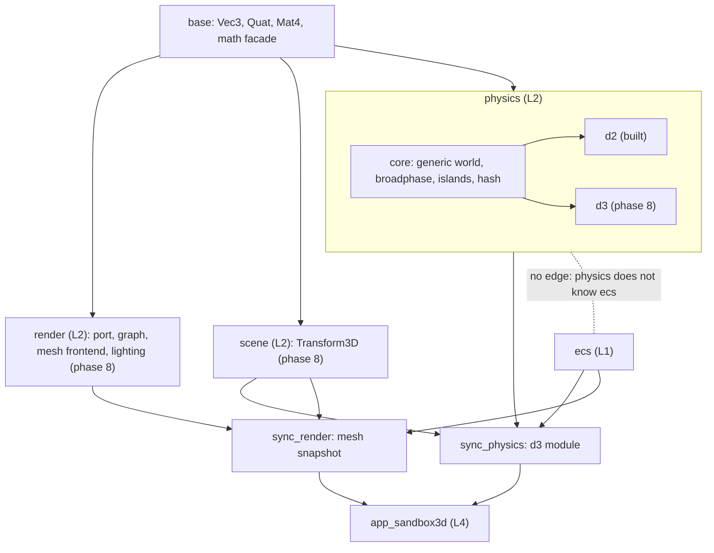
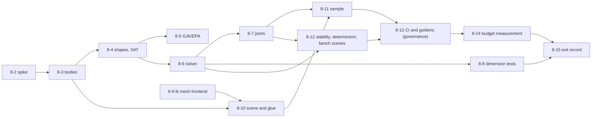

# 3D: phase 8 design note `[P]` (card 8-1)

Design note for phase 8 ("3D"), written before any code. It turns the phase 8 row of the [roadmap](../workflow/roadmap.md) into buildable cards: the `D=3` instance of the physics core, the 3D render features on the existing port, the glue and scene pieces that join them, a 3D sample, and the tests the roadmap names as exit criteria. The owner started phase 8 on 2026-11-17 ("start phase 8"). Nothing after this card starts before the owner has read the note and picked the choices in section 7.

Fixed inputs, not reopened here: physics is one dimension-generic core and 3D is the `D=3` instance of it ([ADR-0018](../decisions/adr-0018-physics-core.md), owner Q20); physics does not know the ECS ([physics §1](physics.md)); 3D render uses the existing port, graph and command stream, and the port is not reshaped for 3D ([rendering](rendering.md), roadmap); conventions are f32, SI units, right-handed Y-up, depth 0 to 1, column-major ([conventions](conventions.md)); no new third-party dependency without an owner decision.

**Scope in one line:** a 3D falling-boxes sample in which lit, depth-tested meshes follow a 3D rigid-body simulation (spheres, boxes, capsules, a few joints), driven through the phase 7 ECS and glue crates, with the physics proven against its own 2D instance and against stability and determinism scenes.

## 1. Evidence and what is still unverified

Findings are tagged **[K]** (known: read in this repository) or **[U]** (unverified, to be checked in the card named).

| Claim | Tag | Source or check |
|---|---|---|
| The `physics` crate holds the generic core (`core`) and the 2D instance (`d2`); there is no `d3` module | K | `engine/physics/src` |
| The `Dim` trait names the differing types (`Vec`, `Ang`, `Rot`, `InvInertia`, `Shape`, `Bounds`, `Manifold`, `Solver`, `Joint`) and the operations `apply_inverse_inertia`, `advance_rotation`, `shape_bounds`, `collide`, `mass_properties`; `Vec3` already implements its `Quantity` and `Magnitude` | K | `engine/physics/src/core/dim.rs` |
| ADR-0018 named a trigger for the fallback to separate 2D and 3D: "phase 8 shows that 3D needs a different solver structure". A `D=3` instance exists only in the spike, with an extruded 2D narrowphase | K | ADR-0018 section 4; `engine/tools_physics_spike/src/dims3.rs` |
| ADR-0018 says the dimension-consistency test is a tolerance test on short, non-chaotic scenes, because with a real 3D narrowphase bit equality will not hold | K | ADR-0018 decision 7 |
| The core already holds the dimension-independent parts the roadmap lists as shared: AABB tree broadphase, pairs, islands, sleeping, graph colouring, joint storage, the state hash | K | `engine/physics/src/core` |
| `base` has `Vec3`, `Quat` (rotate, conjugate, `nlerp`, `slerp`, `to_mat3`, `to_mat4`), `Mat3`, `Mat4` | K | `engine/base/src/math`, `engine/base/src/dmath` (the facade) |
| With the opt-in cross-platform determinism feature on, physics may call `sin`, `cos`, `exp` and the like only through the deterministic math facade in `base`; the arch-check scan enforces it. Whether the facade holds every function a 3D instance needs is not known | K / **U** | rules digest section 5; `gates/architecture.toml`; card 8-2 lists the functions needed |
| `render` has `PerspectiveCamera` (view-projection, `mvp`), `MeshVertex` (position, normal, uv; 32 bytes), a cube mesh and `record_mesh`, and a depth target. The textured mesh with depth runs on OpenGL 4.5 and Vulkan | K | `engine/render/src/camera.rs`, `mesh.rs`; [vulkan-and-mesh-v0](vulkan-and-mesh-v0.md) |
| The mesh sample's shader takes one uniform block (`mvp`) and a texture; there is no light, no normal matrix and no material | K | `engine/app_mesh_sample/shaders/mesh.vert` |
| The port can bind uniform buffers by slot (`BindUniforms`). Whether a light and material block fits the port and both adapters without a port revision | **U** | card 8-9 (the swap-diff check counts port revisions) |
| `scene` has `Transform2D` and `WorldTransform2D` only; `sync_physics` is written against `physics::d2` and generic over nothing (the `d3` glue either repeats it or shares a helper, decided in card 8-10); `sync_render` builds sprites | K | `engine/scene/src/transform.rs`, `engine/sync_physics/src`, `engine/sync_render` |
| `assets` and `tools_assetc` handle textures (`dtex`) and shaders (`dshd`); there is no mesh file format or mesh converter | K | `engine/assets/src`, `engine/tools_assetc/src` |
| `forbidden_edges` holds only `physics -> ecs`; a `d3` module of `physics` needs no change to the architecture config | K | `gates/architecture.toml` |
| The golden hashes for cross-platform determinism are stored for 12 scenes in `gates/golden/physics-replay.toml`; 3D scenes need new entries, which is a governance file | K | rules digest section 5 |
| Whether a generic solver written for 2D carries 3D (3 tangent directions, tensor inertia, warm starting of 3D manifolds) without branches on `D` | **U** | card 8-2 (the spike) |
| Cost of 3D contact generation for box-box and capsule pairs in a stack, and how many contact points a stable stack needs | **U** | card 8-2, then card 8-5 |

## 2. Where the code lives

No new crate and no layer change are proposed. Every piece goes into a crate that already exists.

| Piece | Crate and module | Layer |
|---|---|---|
| `D=3` instance: bodies with quaternion and tensor inertia, shapes, narrowphase, solver, joints | `physics`, module `d3` | 2 |
| Planar-scene oracle and 3D scenes | `physics` tests, `tools_physics_bench` | 2 and tools (L4) |
| Lighting and material for meshes (shader, uniform block, pass recording) | `render` (frontend), shader sources in the sample, compiled by `tools_shaderc` | 2 |
| `Transform3D`, `WorldTransform3D` and their update | `scene` | 2 |
| 3D body sync, 3D mesh snapshot | `sync_physics` and `sync_render`, new `d3` and mesh modules | 2 (glue) |
| The 3D sample | new crate `app_sandbox3d` (layer 4) | 4 |
| Mesh file format and converter (optional, choice O5) | `assets`, `tools_assetc` | 2 and tools (L4) |

## 3. The physics instance

The roadmap row names quaternions, an inertia tensor, GJK/EPA/SAT, 3D manifolds and joints. ADR-0018 fixes the shape of the work: write the `D=3` instance behind the narrow `Dim` trait, keep shared code free of branches on `D`, and watch its triggers.

**Step 0, the spike (card 8-2).** Before the instance is built, a short spike answers the one question the ADR left for phase 8: does the generic core carry a 3D solver without a different structure? It builds a box-on-box stack with the sequential-impulse solver on the real `core`, counts methods added to `Dim`, counts places that need a branch on `D`, and reports bytes per body and per contact against the ADR-0018 figures. If a trigger fires, the result is a proposal for the owner (an ADR amendment is a governance task); the instance is not started on a fired trigger.

**Body and integration.** Orientation is a unit quaternion, advanced by the angular velocity and renormalised each step; angular velocity is a `Vec3`; inverse inertia is, as built in card 8-3, the diagonal of the principal moments in the body frame (a `Vec3`), rotated to the world frame per step; sphere, box and capsule have their principal axes on the local axes, and the convex hull of card 8-5 will need either a principal-axes rotation or a full 3x3 tensor in this type. The integrator has no gyroscopic term (card 8-3), so a torque-free body keeps its angular velocity, which is not physical for unequal moments. All trigonometry goes through the math facade when the cross-platform feature is on.

**Shapes.** Sphere, box and capsule first (built in card 8-4, see the next paragraph). Convex hulls (built from a vertex list, bounded size, card 8-5) use GJK for distance and EPA for penetration depth; box-box uses SAT with face and edge axes and clipping to a manifold of at most four points. Triangle meshes and heightfields are not in phase 8 (static meshes would need a mid-phase BVH over triangles; see section 8).

**Narrowphase for sphere, capsule and box (card 8-4).** A sphere is a capsule whose segment has length zero, so the round pairs (sphere-sphere, sphere-capsule, capsule-capsule) are one routine on two segments: closest points, a normal across both axes when the axes meet, and two points when two capsules lie side by side. A sphere or capsule against a box takes the nearest point of the segment to the box (the distance is convex along the segment, so a fixed-step ternary search finds it) and gives one point, or two when both ends are as near as the middle (a capsule lying on a face or along an edge); a segment that goes through the box has no nearest point worth taking, so the way out is found over the faces of the box and the faces across the segment and each box edge. Box-box is a separating axis test over fifteen axes, with the first box's face preferred to the second's and a face to an edge unless the other is better by 5e-4 m; a face axis gives a clipped face contact of at most four points, an edge axis one point. All routines work on fixed arrays and allocate nothing. A manifold keeps the 2D convention: normal from the first body to the second, `separation` negative while the shapes overlap. Known limit, the same as in 2D: a speculative contact between boxes that are still apart may be up to 4 mm above the true gap, because clipping can drop the corner nearest the other box; the normal and the depth of an overlap are exact. Three more limits found in review: boxes that are apart diagonally by a little less than the margin get a speculative contact early (the gap is measured along one axis, so it can be up to about 1.7 times too small at a corner), which only makes the solver stop an approach slightly too soon; the axis bias is an absolute 5e-4 m, so boxes smaller than about 1 cm lose accuracy and tiny ones can pick the wrong axis; and a capsule that goes through a box much deeper than the box is wide gets its points at the ends of the capsule, far from the box, so the solver of card 8-6 must not rely on their lever arm in that case (the normal and the depth are right). Contact points carry no feature id yet: the warm start of card 8-6 matches them by position.

**Convex hull (card 8-5).** `Hull::new` takes 4 to 64 points and keeps the corners of their convex hull, at most 32 (`MAX_HULL_VERTICES`); flat, line-like, repeated or too many points give `InvalidShape`, NaN or infinite points `NotFinite`. A hull is stored inline in `Shape3` (a fixed array, so the shape stays `Copy` and hashable), which makes `Shape3` about 448 bytes; the enum carries a scoped `#[expect(clippy::large_enum_variant)]` with that reason, and code that passes shapes around passes `&Shape3`. The corners are found by brute force (every triple of points is a candidate face plane; a plane with all points on one side is a face; a corner lies on three faces), which is fine at 64 points and is done once at build time. The stored vertices are in the principal frame of the solid, centred on its centre of mass, so the diagonal inertia of the `D=3` instance needs no change; `origin()` and `orientation()` say where the body must sit to put the hull where the input points were. Volume, centre and inertia come from tetrahedra to a corner, the principal axes from a Jacobi rotation (no trigonometry, so the result is the same on every platform). Contacts use GJK for the distance of two convex cores and EPA for the depth when they overlap, over one support-function view of every shape: a sphere is a point and a radius, a capsule a segment and a radius, a box and a hull their own solid; the radii are added to the gap afterwards. Every pair with a hull in it goes this way (hull against sphere, capsule, box and hull); the pairs without a hull keep the routines of card 8-4. The simplex, the EPA solid (at most 64 vertices and 128 faces) and all scratch are fixed arrays, so a query allocates nothing. The result of GJK and EPA is one contact point per pair, halfway between the surfaces, with the normal from the first shape to the second; card 8-18 turns it into up to four points (next paragraph). Known limits: EPA stops when the next point is no more than 1e-5 m beyond the nearest face, and when the solid is full it returns the nearest face found so far; the accuracy against an independent oracle is about 4 mm in the tests (the same bound as card 8-4). Thin hulls are a known limit: the planes are found to about 2e-5 of the hull size, so the volume of a plate is good to about 0.3% at a thickness of 1% of its size and to a few percent at 0.1% (one case in the review was 12% low). Hulls that thin are often refused with `InvalidShape` (5% of random 8-point plates, 25% at 16 points, 65% at 32, 95% at 64, at 0.1% thickness). Below about 0.05% of the size a wrong volume can be accepted without an error (up to 70% in the review's probe, mostly with 8 or fewer points). The valid size range is about 1e-7 to 1e7 (the moments overflow `f32` above that, and the hull is refused). Use a `Box` for plates.

**Hull contact manifolds (card 8-18).** `d3::face_clip` builds the manifold of every pair with a hull. GJK and EPA still give the first normal and point (and the answer when nothing better is found), but the normal of a nearly flat contact is noisy (up to about 0.016 rad in the cases measured, and in rare tilts of 1 to 2 degrees much more), and the corners within a millimetre of a noisy plane are one or two of four. So the face is found again from the corners: for a box or a hull, three corners near the farthest plane along the normal that span a plane with every corner of the solid on one side, the plane best aligned with the normal and within about 1.8 degrees of it (`FACE_WINDOW`, `MIN_FACE_COSINE`); the corners on that plane, put in order round the face by a pseudo-angle (no trigonometry), are the face. The larger fitted face is the reference, its exact normal becomes the contact normal, and the other shape's face (its own fitted face, or, when it has none, the corners within a thousandth of its reach of the farthest plane: an edge or one corner, a capsule's axis, a sphere's centre) is clipped to the sides of the reference as box against box does; the clipping code moved to `d3::clip` and both use it. Points further than the margin from the reference plane are dropped, more than four are cut to the four that spread most (deepest, farthest from it, the two largest areas; points that are as good as each other are told apart by their position, so the four do not change when the list starts at another corner), and when nothing is left the single GJK point stands. A hull cube resting on a face now gets four points with the true gaps (also when tilted by up to a degree or two), on an edge two, on a corner one; a capsule lying on a face two; a sphere one. Measured: a hull cube dropped on the floor rests at 0.5 m within 5 mm and stands still, a tilted one ends flat, a stack of five hull cubes stands as box stacks do. Known limits: a face is found only when three of its corners lie within 5% of the reach of the farthest plane along the normal and the face is within 1.8 degrees of the normal, so a hull tilted more than that is an edge or corner contact for that step (it then rocks down onto its face); a window holds at most 16 corners, and the planes are tried by brute force over the triples of it (at most 560 planes by up to 32 corners), which measured in a release build costs 1.7 microseconds for a hull cube on a box (as before), 6.8 for two 16-sided pucks lying on each other and 11.8 when no face fits (against 3.8 for GJK alone), the cheap angle test comes before the scan of all corners and the search stops at the first plane that fits; box against box keeps its own small polygon size (8 corners, a hull's is 64); the hull faces are found again on every query (no face list is stored in `Hull`, to keep `Shape3` at its size); a hull face and another hull's face that only just touch at an angle are clipped as parallel.

**Contact solver (card 8-6).** `Solver3` fills the `ContactSolver` seam of the 3D instance and replaces `FreeSolver`; it is scalar (colouring and the parallel solve came with card 8-19, see below; joints with card 8-7). It is the soft step of the 2D solver: 4 sub-steps, one relax pass, restitution once after the last sub-step, the spring coefficients shared with 2D through `core::soft`. Per point there is one normal and two tangents (a frame that depends on the normal alone); friction is limited to a circular cone of the friction coefficient times the normal impulse; the effective mass of every direction uses the world inverse inertia tensor of the start of the step, and a body that turns within a step keeps that tensor (the same simplification as 2D, which has a scalar). A contact point has no feature id (card 8-4), so the warm start is matched by position: a point takes the impulses of the nearest point of the same pair from the last step within 2 cm, each kept point once, and a point that moved further starts from zero. Sleeping and islands are the shared core's: a manifold whose bodies all sleep or are static is not solved and keeps its warm start. Measured on the first scenes (card 8-6): a column of ten boxes stands for 5 s with the top box 3.6 cm low and 9 mm off the axis, a box holds on a 20 degree slope and slides at the expected acceleration on 35 degrees at friction 0.5. The 9 mm is a fixed offset that depends on the orientation of the boxes, not a growing drift: it comes from the order in which the points of a face are solved. Known limits: hulls rest since card 8-18 (they had one contact point until then); no gyroscopic term (card 8-3); the inverse inertia is not updated inside a step.

**Joints (card 8-7, done).** Ball-and-socket, hinge with angle limits and distance (a rigid rod, or a rope between two lengths) are in `d3::joint` (descriptions, checked when added) and `d3::solver::joint` (the solve); the joint storage in `core::joint` is shared with 2D. `Solver3` solves the joints serially before the contacts in every pass (warm start, soft solve, relax). The hinge solves its three point rows and two axis-alignment rows together (a Schur complement: one row after another made a heavy door wobble out of its plane); a limit uses the angle's reduced mass (the inertia about the axis less what the anchors take) and pushes with a torque plus the matching point reaction, recomputed at the warm start from the current arms and not stored (a stored copy went stale and left the anchor 0.2 m off). A violated limit counts at most 0.02 rad (0.02 m for a rope) of error, so a body that starts far outside its range is eased back instead of thrown. Motors, springs and prismatic or cone-twist joints are later (card 8-20 for the hinge motor and the distance spring).
**Parallel contact solve (card 8-19).** `Solver3` now sweeps its contacts colour by colour, as `Solver2` does: the shared `core::colouring` gives every constraint the lowest colour that none of its awake dynamic bodies uses yet (at most 24 colours; constraints that find none form an overflow set that is solved last, serially), the colours are visited in order and the constraints of a colour in manifold-list order. Inside a colour the order cannot matter (no two share a moving body), so a colour can run in parallel. `World::set_execution` takes the same `SolverExecution` as in 2D: with a scheduler in it, each colour is cut into fixed chunks (default 32 constraints, never depending on the worker count), the chunks run through `parallel_for`, and the join is the barrier between colours. A chunk only reads the shared constraint and body arrays and works on copies it keeps in its own pre-sized buffer (one `Mutex` per chunk, locked once, never contended): the two solver bodies and the accumulated impulses of each constraint; the rest of a constraint (`Shape`: frame, anchors, effective masses, softness) is shared and read only, which is why a `Constraint` is split into `Shape` and `Impulses` (the copy per pass is 312 bytes, the impulses and the two bodies, not the 632 of the whole record and the two bodies). After the join a serial scatter stores the buffers in chunk order, the dynamic bodies in the order the serial loop stores them, static ones never. No `unsafe`, no allocation in a step (counting allocator, caller and every worker). The serial colour order is the reference, and the state hash after every step is the same bit for bit at 1, 2, 4 and 6 workers, for chunk sizes 1 to 1000, for reversed, shuffled and single-range schedulers, for a scheduler that refuses the call, and across sleeping and waking islands; shuffling or reversing the constraints inside each colour changes no bit either. Joints stay serial and come before the contacts in every pass (as in 2D), so a scene with joints equals its serial self too. There is no lane (SIMD) path in 3D. **Measured:** the staged path on one thread costs about 1.04 times the serial loop (881 bodies, 4920 contacts, 13 colours, release, the one clean round of two runs). **Not measured:** scaling with workers. The laptop slowed itself 10 to 15 times after the first round of every run (plain serial 17 ms in round one, 230 to 270 ms afterwards), so the pool rows are not usable; benchmarks are cards 8-12 and 8-14, and the rule of thumb of 2D (a pool pays from colours of a few hundred constraints) is not confirmed for 3D. The solver does not switch to the serial path by itself. Known limits: the serial order is now colour order, not manifold-list order, so a scene settles to a slightly different (equally valid) state than before this card; the joints, the position integration, `prepare` and `finish` stay serial.

Known limits of the joints (measured, not solved; the numbers are in the `d3::joint` module doc): bodies whose masses differ by about 30 times or more, joined at points far from their centres, can make the soft step diverge (a rod with a 100 times heavier end is 0.02 m off, 10 000 times is 2 m off); a body that is small for its arm (mass times arm squared over the inertia about the axis above about 1000) can end up moving through its limit range instead of resting at the near limit, and above about 5000 with a fast approach the step can diverge (one scanned scene of 216 ended non-finite); a diverging step can end with huge but finite values the finiteness check does not see; a body spinning faster than the step can follow can pass through a limit (no continuous check). A hinge whose second local axis points against the first is treated as the same line seen from the other side (the sign is fixed at creation).

**Debug draw.** The existing debug-draw trait is `physics::d2::IPhysicsDebugDraw`, 2D only, although [physics §4](physics.md) lists the port as shared. Decided in card 8-4: `physics::d3` has its own `IPhysicsDebugDraw` over `Vec3` (a generic trait would need a vector type parameter on a port that only differs in that type), and the two dimensions share `DebugColour` and `NORMAL_LENGTH`, which moved to `physics::core` (`d2` re-exports them, so its paths are unchanged). It outputs wire boxes (twelve edges), spheres (three great circles), capsules (two rings, four sides, four half circles over the caps) and contact points and normals as lines, so a 3D scene can be looked at before any lit mesh exists.

**Dimension-consistency.** A short, non-chaotic scene runs in the `D=2` instance and in the `D=3` instance with motion constrained to a plane (initial velocity and orientation in the plane, inertia chosen so rotation stays in the plane). Positions and angles agree within stated tolerances for a stated number of steps. Tolerances are written down in the test, measured, and not widened to get green. The scenes are a falling box, a rolling disc against sphere, an elastic collision and a pendulum. Stacking and other chaotic scenes are not used for this test.

**Determinism.** D0 and D1 apply to every 3D scene. Whether `D=3` joins the cross-platform feature (D2) is choice O6, because it adds entries to a governance file.

## 4. 3D render features on the existing port

Rule from the roadmap and the exit criteria: the render port, the platform ports and the engine and game code get no revision, and no engine code changes outside the 3D additions (the swap-diff tool counts port revisions separately from other files). The 3D features are a frontend over the existing port and graph.

- **Camera.** `PerspectiveCamera` exists. Added: a small orbit and fly camera controller as pure data and functions (events in, matrices out), testable with no display, in the sample first and moved into `render` only if a second sample needs it.
- **Lighting.** One directional light plus an ambient term, Lambert diffuse, a per-material colour and an optional texture. A uniform block carries the view-projection, the model and normal matrices, the light direction and colour, and the material. No shadows, no PBR, no point or spot lights, no skinning in phase 8 (choice O4).
- **Materials.** A material is plain data (colour, texture handle, one pipeline); the batcher sorts draws by pipeline and texture, as the sprite batcher does.
- **Primitive meshes.** Generated sphere, capsule, box and plane with normals, next to the existing cube; built once at load, no allocation per frame.
- **Mesh from a file.** Choice O5.
- **Contract.** The render contract suite runs on Null, OpenGL and Vulkan (phase 6); which of its cases already cover uniform blocks is checked in card 8-9. Phase 8 adds contract cases for the uniform-block layout the lit shader needs. If a lit mesh cannot be expressed without a port revision, that is a stop and a report to the owner, not a quiet change to the port.
- **Golden command streams.** The Null device records the stream of the 3D sample; a test pins it as phase 3 did for sprites.

## 5. Scene, glue and the sample

- `scene`: `Transform3D` (position `Vec3`, rotation `Quat`, scale `Vec3`) and `WorldTransform3D` (a `Mat4`), with the same parent and child-sibling hierarchy and depth-first update as 2D.
- `sync_physics` `d3`: copies body pose from the 3D physics world into `Transform3D` after each fixed step, and writes forces and kinematic targets the other way, as the 2D glue does. `sync_render` builds a mesh draw list from `WorldTransform3D` and a mesh and material component. Physics still does not know the ECS.
- `app_sandbox3d`: a walled box in which the player drops spheres, boxes and capsules with the mouse and the keyboard, an orbit camera, one light, a reset key. It uses `input` actions, the ECS, `frame` for the fixed step and the glue crates. A direct (no ECS) variant is not built; the ECS cost was measured in phase 7.
- Without a GPU or a display the binary prints "not run: device not set up" and exits, as the existing samples do, and its logic runs on the Null device in tests.

## 6. Tests and measurements

- Analytic unit tests first: free fall, a sphere on a plane, rotation of a free body with torque (quaternion stays unit length within a stated tolerance), inertia tensor of box, sphere and capsule against closed forms, elastic collision momentum.
- Geometry tests against brute-force oracles: SAT and GJK/EPA on random shape pairs; manifold points lie on both surfaces within a tolerance; ray cast.
- Property tests on random scenes: no NaN, no tunnelling beyond a stated epsilon, energy does not rise without input.
- Dimension-consistency scenes as in section 3.
- Stability scenes: a stack of boxes, a pyramid, a chain of joints, a high mass ratio pair; each must settle and sleep within a stated step count.
- Determinism: replay hash twice, at 1 and N threads, per scene (D0, D1), plus the golden hash on Windows and Linux if O6 is (a).
- Allocation: zero heap allocations per frame in the 3D step and in the sample, counted with the per-thread counting allocator.
- Benchmarks: 3D scenes (stack, pyramid, many spheres, a mixed pile) in `tools_physics_bench`, instruction counts on the hosted runner, wall time on the reference machine; the budget is proposed from measurement and accepted by the owner (choice O9), as in phase 7.
- Coverage and mutation of the changed L0 to L2 code are measured at the exit record, as for phases 6 and 7.

## 7. How the cards follow from this

Created in the Backlog on 2026-11-17 after the owner accepted the note (section 8). Numbers are card ids.

| Card | Delivers | Class |
|---|---|---|
| 8-2 | 3D core spike: the `D=3` stack on the real core, trigger check against ADR-0018, list of math facade functions needed, report | spike (TDD exception), report |
| 8-3 | `physics::d3` bodies: quaternion orientation, inertia tensors, mass properties, integration, `Dim` impl, state hash | 2 (new public API) |
| 8-4 | `d3` shapes and narrowphase part 1: sphere, box, capsule; SAT and clipping manifolds; AABB bounds; 3D debug-draw trait and output | 2 |
| 8-5 | `d3` narrowphase part 2: convex hull with GJK and EPA | 2 |
| 8-6 | `d3` contact solver with friction and warm starting, sleeping and islands on the shared core | 2 |
| 8-7 | `d3` joints: ball-and-socket, hinge with limits, distance | 2 |
| 8-8 | dimension-consistency tests (2D instance against 3D constrained to a plane) | 1 (tests only) |
| 8-9 | Lit mesh frontend: light and material uniform block, primitive meshes, contract cases, Null golden stream | 2 (new public API in `render`) |
| 8-10 | `scene` `Transform3D` and hierarchy update; `sync_physics` `d3` and `sync_render` mesh snapshot | 2 |
| 8-11 | `app_sandbox3d`: the sample, golden stream test on Null, replay hash, allocation test, orbit camera | 2 |
| 8-12 | 3D stability and determinism scenes, the 3D benchmark scenes in `tools_physics_bench`, replay tests at 1 and N threads | 1 (tests and a bench tool scene list) |
| 8-13 | CI: register the 3D benchmarks (`gates/benchmarks.toml`, `ci.yml`), and the golden hashes of the 3D scenes (`gates/golden/physics-replay.toml`) if O6 is (a) | 3 (governance, owner-declared; main first) |
| 8-14 | 3D benchmark measurement and the proposed budget; coverage and mutation of the phase | 1 (measurement and docs) |
| 8-15 | phase 8 exit record, milestone review, retrospective, and the phase 9+ inputs the roadmap asks for ("revisit editor at the phase-8 review") | 1 (docs) |
| 8-16 | Optional (choice O5): mesh file format `dmesh` and converter | 2 |

Card 8-13 is governance and is started only when the owner declares it. Nothing from 8-3 on starts before the spike report (8-2) has been read and its outcome accepted. Cards 8-3, 8-4, 8-6 and 8-7 are a chain and 8-5 hangs off 8-4 (cutting it breaks nothing downstream); 8-9 can run in parallel with 8-4 to 8-7 (render needs no physics); 8-10 needs 8-3 and 8-9; 8-11 needs 8-6, 8-7 and 8-10.

## 8. Choices for the owner

**Decided (owner, 2026-11-17, "accept all recommendations"):** O1 to O9 are accepted as recommended in the last column: spike first; sphere, box, capsule and convex hull (no triangle meshes); ball-and-socket, hinge and distance joints; one directional light with Lambert shading; generated primitive meshes (card 8-16 stays optional); `d3` joins the cross-platform determinism feature; `Transform3D` next to `Transform2D`; the sample through ECS and the glue crates; budgets proposed from measurement and accepted by the owner. Cards 8-2 to 8-16 were created in the Backlog on that day. Nothing starts before the owner says which card goes first.

| # | Choice | Options | Recommendation |
|---|---|---|---|
| O1 | Order of the phase | (a) spike first (8-2), then physics, with render in parallel · (b) build the instance without the spike | (a): ADR-0018 left exactly this question for phase 8, and a fired trigger changes the plan |
| O2 | Shape set | (a) sphere, box, capsule · (b) (a) plus convex hull with GJK/EPA · (c) (b) plus static triangle meshes | (b): the roadmap names GJK/EPA; triangle meshes need their own broadphase and are the first thing to cut (roadmap operating rule 6, the cut order, drops 3D scope first) |
| O3 | Joints | (a) ball-and-socket, hinge with limits, distance · (b) (a) plus prismatic, cone-twist, motors | (a): enough for the sample and the chain scene; the rest is later |
| O4 | Render features | (a) one directional light, ambient, Lambert, colour and texture per material · (b) (a) plus Blinn-Phong specular · (c) (a) plus shadows | (a): "basic lighting and materials" in the roadmap; shadows need a second pass and depth-texture sampling that the port may not have, and would be a port question |
| O5 | Meshes from files | (a) generated primitives only; a file format later · (b) card 8-16: own `dmesh` format and converter (own code, no new dependency) | (a), with 8-16 listed as optional: the sample needs only primitives, and the card is the first to drop when behind |
| O6 | Cross-platform determinism for 3D | (a) `d3` joins the opt-in feature: facade for every math function, golden hashes on Windows and Linux (adds governance entries, card 8-13) · (b) D0 and D1 only in phase 8 | (a): the rule in the digest covers the physics crate, and a second instance that quietly sits outside it would weaken the claim; 8-2 reports the facade functions still missing |
| O7 | Scene | (a) `Transform3D` added next to `Transform2D`, both kept · (b) one transform type with a flag | (a): no branch on dimension in shared code, same rule as physics |
| O8 | Sample | (a) `app_sandbox3d` through ECS and the glue crates · (b) a direct sample like `app_physics_sample` | (a): the phase 7 glue is the integration the 3D sample should prove; the ECS cost is measured |
| O9 | Targets and budgets | (a) the cards propose the 3D benchmark budgets from measurement, you accept or change them · (b) you name the numbers now | (a): no honest number exists yet, as in phase 7 |

## 9. Risks and what this note does not settle

- **Robust 3D contact is the time sink the physics page already names** ([physics §6](physics.md)): box-box manifolds, stable stacking, GJK/EPA degeneracies. Mitigation: the oracle tests of section 6 first, a short shape list, the spike before the build, and cutting convex hulls (O2 (a)) if 8-4 runs long.
- **Generic core over-strained.** If the 3D instance needs branches on `D` or many new `Dim` methods, ADR-0018 triggers fire. The spike (8-2) is where this shows; the reaction (an ADR amendment, or separate 3D code) is the owner's.
- **Determinism of quaternion code.** Normalisation, slerp and inertia rotation use `sqrt` and trigonometry. `sqrt` is correctly rounded in IEEE and stays in physics; trigonometry must route through the facade under O6 (a). Missing facade functions are a change to `base` (Class 2).
- **A lit mesh may need a port change.** If the light and material block does not fit the port as it is, the swap-diff rule counts a port revision. The phase 8 exit criterion expects none (the port is already `stable`); that case is a stop and a question to the owner.
- **Scope is large.** The roadmap itself says 3D is sequenced last and shrinks first. The cut order inside the phase is: card 8-16, then convex hulls (8-5), then joints beyond the ball-and-socket joint, then the sample's extras.
- **Not settled here:** where the native Win32 and audio adapters go (Backlog card 7-15, an open owner decision from phase 7), whether `render -> ecs` should be forbidden in the architecture config (a governance question from the phase 7 review), a gate for the frame budget, continuous collision detection, soft bodies, skinned meshes, a 3D audio listener, an editor (the roadmap asks to revisit it at the phase 8 review), and SIMD for the 3D solver (a later optimisation under the `simd` rules, with its own `unsafe` budget question).
