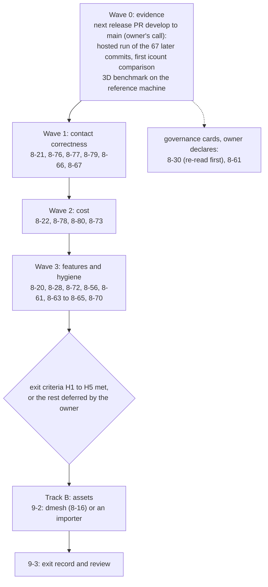

# Phase 9: harden 3D, then the asset decision `[P]` (card 9-1)

Design note for phase 9, written before any work. The owner gave the go-ahead on 2026-11-24 ("Could we go with phase9?") and chose, among three directions, "Harden 3D, then assets", which is the recommendation of section 7 of the [phase 8 milestone review](../spikes/phase8-milestone-review.md). The roadmap row for phase 9+ is only a list of topics (D3D12 and Metal, asset pipeline and streaming, hot-reload modules, scripting, editor and tools, native adapters); this note takes two of them, hardening of the 3D code that phase 8 built and the first decision on assets, and leaves the rest on the board. It decides nothing that is the owner's; section 6 lists those.

**Scope in one line:** turn the evidence phase 8 left open (the first instruction-count comparison, the hosted run of the 67 commits since the phase 8 release, the budget on the reference machine) and its open correctness findings into closed items, then choose how a real model gets into the engine; no new subsystem is started.

## 1. Evidence and what is still unverified

Findings are tagged **[K]** (known: read in this repository or on the board) or **[U]** (unverified, to be checked in the card named).

| Claim | Tag | Source or check |
|---|---|---|
| Phase 8 ended "done with named limits"; its review (2026-11-19) lists F-HOSTED, F-GOLDEN, F-BUDGET and F-SINGLE as open | K | [phase 8 milestone review](../spikes/phase8-milestone-review.md) section 5 |
| **Two of those rows are out of date.** The phase 8 release (`main` at `2cd43a9`, 2026-11-19, the `ci` run 44605816554, success) ran on hosted runners the jobs "D2 golden hashes, 3D scenes" on Windows and on Ubuntu (feature on) and "Physics 3D instruction count" on Ubuntu (callgrind, base against head), all green. F-HOSTED ("no hosted CI has run phase 8 code") and F-GOLDEN ("no 3D golden hash and no Linux run") were true on 2026-11-19 before that run | K | `gh run view 44605816554`; `gates/golden/physics3d-replay.toml`; `docs/budgets/physics-benchmark-8-14.md` section 5 |
| What that run did not do: the instruction-count gate recorded a first baseline **without comparing** (the base tree had no benchmark tool); the first comparison is the next pull request that reaches the gate. The owner accepted the 3D budget (W4 at most 21 ms, W4p 13 ms, W4s 1.5 ms, W4m 0.6 ms) on 2026-11-20 as laptop figures; no reference machine was named | K | `docs/budgets/physics-benchmark-8-14.md` section 5, card 8-45 |
| The 3D golden hashes were also recorded on Windows and verified on Linux under WSL2 before the release, equal | K | `reviews/8-13.md` |
| Since the release `develop` holds 31 merged pull requests (67 commits) that `main` does not, among them the hull-contact cards 8-71 and 8-75 (new code in `face_clip.rs`, `gjk.rs`, `wide.rs`); none has been through hosted `ci` | K | `git rev-list --count origin/main..origin/develop`, 2026-11-24; `develop` runs only `pr-title` and `governance-guard` |
| Open cards on the Backlog that belong to 3D hardening (their texts are on the board, not in the repository, so none is checked here; 8-30 in particular was written before the release run and may be partly done): 8-20 (joint motor and spring), 8-21 (capsule rocking), 8-22 (cost of the solver, lanes), 8-28 (ECS reserve), 8-30 and 8-61 (governance), 8-56, 8-63 to 8-67 (solver behaviour and speed edges), 8-70 (mutation run, needs memory), 8-72 (full inertia tensor), 8-73 (gyroscopic cost), 8-76 to 8-80 (hull contact quality and cost), and the card for the 3D benchmark on the reference machine | U | the board, 2026-11-24 |
| 3D content is generated primitives only; a real model needs a file format (card 8-16, `dmesh`) or an importer; hulls built from file points meet the thin-hull limit | K | milestone review section 7, F-HULL |
| Whether the next hosted run (the 67 commits) is green, whether the 3D hashes of 8-71 and 8-75 are unchanged on Linux, and what the first instruction-count comparison says | **U** | the next release PR |
| What the 3D box costs on the reference machine, and whether the lane path ever pays in 3D | **U** | the benchmark card; card 8-22 |

## 2. The order and why

**Wave 0, evidence first.** What the laptop cannot check is the hosted run of the 67 commits since the phase 8 release, the first comparison of the instruction-count gate against its baseline, and the figures on the reference machine. Everything in the later waves is measured against numbers that Wave 0 may move, so it comes first. Two steps need the owner: opening the next release PR (`develop` into `main`, one PR, a merge commit with `Release-Batch:`), and running or allowing the 3D benchmark on the reference machine. A red job in the release PR is a stop; gate numbers change only in a governance task the owner declares (card 8-30 is the board's card for that; its text predates the 2026-11-19 run, so it is re-read before it is used).

**Wave 1, contact correctness.** The cards that found a wrong or missing answer, not a slow one (each is Class 2 or Class 1 with a Class 2 fix, so each runs the review phase R1 to R8 with an independent reviewer): 8-21 (a capsule that rocks, with a deliberately weakened pile test waiting to be restored), 8-76 (a fast roll hops and drifts), 8-77 (a contact point of any depth behind the plane), 8-79 (the single-precision steps that remain after card 8-75), and the speed-edge cards 8-66 and 8-67. Each starts with a failing test.

**Wave 2, cost.** 8-22 (profile first: a 3D box costs about 8 times a 2D one and the lane path gains nothing), with 8-78 and 8-80 (what card 8-71 and card 8-75 added to the hull path) and 8-73 (the gyroscopic term). Wave 2 follows Wave 0 because a cost is only a cost against the reference-machine figure.

**Wave 3, features and hygiene.** 8-20 (hinge motor and distance spring), 8-28 (a reserve call so a spawning frame does not allocate), 8-72 (a full inertia tensor; only if a sample needs it), the `STIFF_CONTACTS` cluster 8-56 to 8-65 (with the governance card 8-61), 8-63 (shimmer of the pieces) and 8-70 (a mutation run that waits for memory). These are not blockers for the exit; the owner may defer any of them.

**Track B, assets,** starts after the exit criteria: card 9-2 compares the own `dmesh` format (8-16, own code, no new dependency) with an importer (a third-party tier and licence entry in `THIRD_PARTY.md`) on one real model, with the thin-hull limit in view. It ends in a choice, not in code.

## 3. Proposed exit criteria of the hardening track `[P]`

| # | Criterion | Evidence |
|---|---|---|
| H1 | The release PR that carries the 67 commits ran `d3_determinism` and `physics3d_icount` green on Windows and Linux, the instruction-count gate compared head with its baseline inside its noise limit (or the owner accepted the difference), and the 3D golden hashes are equal on both platforms (or a card names the difference) | the release PR checks, card 8-30 if numbers must change |
| H2 | W4, W4p, W4s and W4m are confirmed or changed by the owner on the reference machine under its protocol, and the machine is named | the benchmark card, `docs/budgets/` |
| H3 | Each open correctness finding of Wave 1 is closed, or deferred by the owner with its reason written on its card | the cards |
| H4 | 8-22 has a profile and a decision on the lane path; the 3D box cost is measured again on the reference machine | the card, `docs/budgets/` |
| H5 | No gate lowered, no test weakened or skipped, no waiver | the pull requests, the reviews |

## 4. New cards

Only the cards that this note creates (all three are on the board); the open cards above keep their ids and stay on the board.

| Card | Class | Title | When |
|---|---|---|---|
| 9-1 | 1 (docs) | this note | now |
| 9-2 | 1 (design note and spike) | assets: `dmesh` or an importer | after H1 to H5 or when the owner decides |
| 9-3 | 1 (docs) | phase 9 exit record and milestone review | at the end |

## 5. What this note does not settle

- It does not start the `STIFF_CONTACTS` cluster or the other Wave 3 cards; their value to a game is the owner's judgement.
- The number of cards in Waves 1 and 2 is the number on the board today. A hardening track has no end of its own: the exit criteria are the cap, and a new finding becomes a Backlog card, not a reason to extend the phase.
- It does not choose between D3D12, Metal, scripting, hot reload, native adapters or an editor; they stay on the board (the card of phase 9+, and 7-15).
- The review file of this card is `reviews/9-1.md`; the figures of section 1 were read on 2026-11-24 and will drift.

## 6. Choices for the owner

| # | Choice | Options | Recommendation |
|---|---|---|---|
| P1 | The next release PR (`develop` into `main`) | (a) open it now: it is the hosted run of the 67 commits and the first icount comparison that Wave 0 needs · (b) after Wave 1 · (c) not in this phase | (a): H1 cannot be met without it and 67 commits are a large diff to review at once; run `ci` by hand on `main` after it if you want the hosted run on the merged tree |
| P2 | Governance tasks | declare 8-30 only if the first comparison asks for a change of numbers; declare 8-61 when you want the preset gated | wait for the comparison |
| P3 | The reference machine | who runs the 3D benchmark, and which machine is the reference | you run it, or allow the run on that machine; I prepare the command |
| P4 | Wave 3 | (a) keep all in the phase · (b) keep 8-20 and 8-28, defer the `STIFF_CONTACTS` cluster · (c) defer all of Wave 3 | (b): the cluster is tuning of a preset, not a defect; 8-20 and 8-28 are missing features |
| P5 | Order inside Waves 1 and 2 | by the order above, or your pick card by card as before | your pick card by card, as in phase 8 |

## 7. Risks

- **The milestone review is stale in places** (F-HOSTED and F-GOLDEN were out of date by the release run of 2026-11-19, F-BUDGET carries an update note): I read the board and the CI history, not only the page. Any other row may be stale too, and the review page is not edited here (a dated record).
- **The next hosted run may be red.** That is the point of Wave 0, and it may reorder Waves 1 and 2. Hosted `ci` runs only on `main` and by hand, so each run costs the owner's CI budget: one release PR, not one per card.
- **Reference-machine access** is the owner's: without it H2 and H4 stay open.
- **Memory:** mutation runs of the physics crate were stopped for low memory on this machine (8-70); no mutation figure is a promise of this phase.
