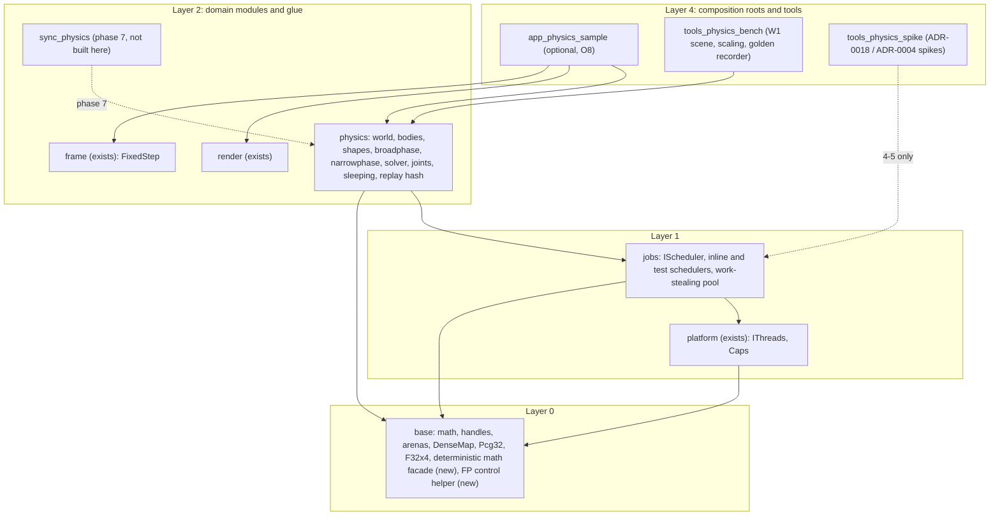
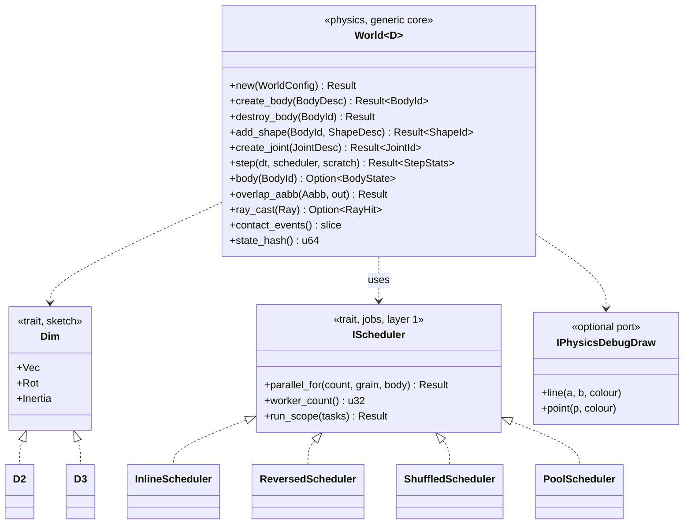
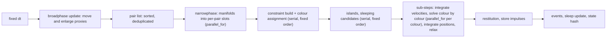
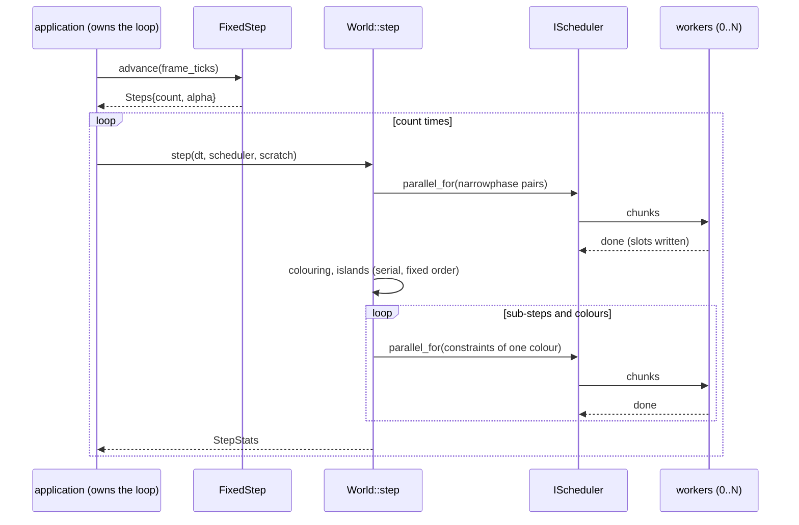
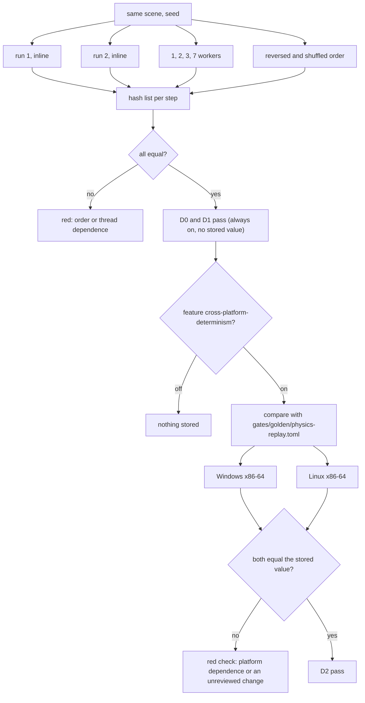
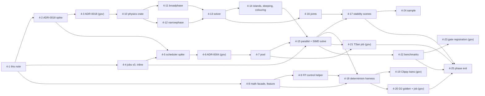

# Physics and the job system v0: design note `[P]` (card 4-1)

Design note for phase 4, written before any code. It turns the phase 4 row of the [roadmap](../workflow/roadmap.md) and the design in [physics](physics.md) and [core-runtime §3](core-runtime.md) into the first buildable shape: the `jobs` crate with `IScheduler` and a work-stealing pool, the `physics` crate (a dimension-generic core instantiated for 2D), the determinism harness (D0 and D1 required, D2 opt-in), the two spikes the roadmap puts first (ADR-0018 dimensionality, ADR-0004 scheduler), tests, a proposed card breakdown and the choices that are the owner's. Owner go-ahead for phase 4: 2026-11-03 (given in the session that started this card; not recorded elsewhere in the repository).

Fixed inputs, not reopened here: physics is a standalone module with no ECS dependency and a handle-based API (ADR-0012, [overview](overview.md)); 2D first, 3D in phase 8, option B (dimension-generic core, 2D = `D=2`) accepted as the default (Q3, Q20) and still to be validated by the ADR-0018 spike; the Soft-Step-style solver with graph colouring (ADR-0012); the job system comes with physics, ECS waits for phase 7 (D-8); `IScheduler` with a deterministic single-thread scheduler for tests (ADR-0004, [core-runtime §3](core-runtime.md)); D0 and D1 required, D2 opt-in for the physics crate only (ADR-0007, owner v0.36); `f32`, SI units, right-handed Y-up, 2D rotation counter-clockwise in radians, handles of 8 bytes ([conventions](conventions.md)); zero heap allocations per frame on hot paths, counted per thread ([rules-digest §4](../rules-digest.md)); the roadmap's phase 4 exit: stacking and chain stability scenes pass, D0 and D1 determinism tests pass, replay hash identical across runs and thread counts on each platform, TSan clean, a scaling benchmark, benchmarks against target.

**Scope in one line:** a 2D rigid-body world steps deterministically at a fixed time step, on one thread or many, with the same bits at every thread count, and the same bits on Windows and Linux x86-64 when the opt-in feature is on; every step of that is testable without a window, a GPU or a second machine.

**What phase 3 and the earlier phases already give (checked in the repository on 2026-11-03).**

| Piece | Where | State |
|---|---|---|
| Vectors and matrices, `f32` (`Vec2/3/4`, `Mat3/4`, `Quat`) | `engine/base/src/math` | exist; `Vec2` and `Vec3` are separate structs, there is no dimension trait; `Mat3`/`Quat` call `sin_cos`/`sin` of `std` (libm) |
| `Handle<T>` (index plus generation), `Pool<T>` | `base::pool` | exist; `Pool::insert` returns the value back when full (failure is a value) |
| `DenseMap` (insertion-ordered hash map), `SparseSet`, `Ring`, `Pcg32` | `base::map`, `sparse`, `ring`, `rng` | exist; iteration order is a function of the operations only |
| `Arena`, `ArenaVec`, counting allocator with per-thread counters | `base::arena`, `base::alloc` | exist |
| `F32x4` (add, sub, mul, div, neg, `sqrt`, `min`, `max`, `abs`, `horizontal_sum`), scalar reference, SSE2 and NEON backends | `base::simd` | exist; no estimate operation and no fused operation |
| `IThreads` (`spawn`, `parallelism`, `has_threads`), `StdThreads`, `NullThreads` | `platform::threads` | exist; the job given to `spawn` is a `Box<dyn FnOnce>` |
| `FixedStep` (integer ticks, `count`, `alpha`, `dropped`) | `engine/frame` | exists; no dependency on `jobs` yet |
| Layer map and edges: `jobs = 1`, `physics = 2`, edges `physics -> jobs`, `jobs -> platform`, forbidden `physics -> ecs`; scan rules for the `physics` crate (libm functions, `mul_add`, fused intrinsics, `HashMap`/`HashSet`, unstable sort; the estimate-intrinsic rule covers `physics` and `base`); thread creation allowed only in `platform` and `jobs` | `gates/architecture.toml` | exist (read, not run for this card) |
| Not present | | no `jobs` and no `physics` crate; no `cross-platform-determinism` feature anywhere (search of `*.toml`, `*.rs`, `*.yml`); no `gates/golden/` folder; no facade for transcendental functions; no code that sets or asserts the floating-point control state (search for `mxcsr`, `fpcr`, `FTZ`); no TSan or Miri job in `.github/workflows/ci.yml`; no instruction-count benchmark tool |

## 1. Where the code lives

- **`jobs` (layer 1, new crate)** declares `IScheduler`, the deterministic inline scheduler (the Null path, used when `Caps::has_threads` is false and in unit tests), test schedulers that change the execution order on one thread, and the work-stealing pool. It depends on `base` and `platform` (edge `jobs -> platform` is in the allowed list). It creates its worker threads through `IThreads` or directly through `std::thread`, which the scan allows only in `jobs` and `platform` (O5). Layer 1 is outside the physics scan, so `jobs` may use `std` atomics, `Mutex` and `Condvar` as the policy says ([ports-and-adapters](ports-and-adapters.md)).
- **`physics` (layer 2, new crate)** is one crate with modules (`core`, `d2`, later `d3`), not several crates. Reason, checked in `gates/architecture.toml`: the layer table maps the exact name `physics`, an unmapped workspace crate is a violation (fail closed), and the libm, fused-operation, `HashMap` and sort scan rows are limited to `crates = ["physics"]`. A second crate such as `physics_core` would need a governance edit to the layer table and to every scan row, and until then would not be scanned at all. One crate keeps the existing rules in force with no governance step. If the ADR-0018 spike (card 4-2) shows that a split is needed, that is a governance cost to put into the ADR.
- **`physics` depends on `base` and `jobs` only.** It does not know the ECS (`forbidden_edges = [["physics", "ecs"]]`), the scene or the renderer. Debug drawing is an optional port `IPhysicsDebugDraw` declared by `physics`; the sample, not `physics`, implements it with the sprite batcher.
- **Glue.** `frame` already exists and owns the fixed-step accumulator; the application calls `physics.step(dt)` once per step returned by `FixedStep::advance`. `sync_physics` (ECS to physics) is phase 7 and is not built here; until then samples feed `physics` plain structs ([conventions §3](conventions.md)). Only glue crates know two domain modules, so `physics` never imports `render` and `render` never imports `physics`.
- **New directories in L4.** `tools_physics_bench` and `tools_physics_spike` are `tools_*` crates (layer 4, no layer-table edit needed, the glob `tools_*` is mapped), like `tools_render_bench` and `tools_simd_bench`.
- **Architecture rows.** Reading the file, the crate placement needs no new row: `jobs`, `physics`, the edges and the scan rules exist. The first card of each crate checks this by running arch-check; a needed edit would make that card a governance task.

## 2. The API shape (sketches)

Names and signatures are sketches and will change in the cards. Handles, not pointers, cross the module boundary; errors are values; no panic crosses the API.

- **`IScheduler`.** Three needs, from [core-runtime §3](core-runtime.md): run a loop over a range in parallel (`parallel_for`, chunks of at least `grain` indices), run a set of independent tasks to completion (`run_scope`), and ask how many workers there are. A task counter and a `wait_help` call (the waiting thread executes jobs) are the internal mechanism, not the first public surface. Dispatch is `&dyn IScheduler`: one virtual call per phase of the step (a few per step), never per body or per contact (ADR-0005).
- **As built in card 4-4.** `run_scope` takes a slice of borrowed tasks (`&[&dyn Fn() + Sync]`), not a closure that spawns, and `for_each` is added; the signatures and bounds are in [core-runtime](core-runtime.md) section 3.
- **As built in card 4-7.** `jobs::pool::WorkStealingPool` is the pool decided in [ADR-0004](../decisions/adr-0004-job-system.md) (lock-free Chase-Lev deques, binary splitting, threads only through `IThreads`, a 200 microsecond spin-yield-park budget); its description, class and state views are in [core-runtime](core-runtime.md) section 3.
- **Borrowed closures.** `parallel_for` and `run_scope` take closures that borrow the caller's data, so that no `Box` is allocated per frame (the existing `platform::threads::Job` is a `Box<dyn FnOnce() + 'static>`, which allocates). Running a borrowing closure on a worker thread needs a small amount of `unsafe` (lifetime erasure guarded by the scope waiting for completion). This is the one place where `jobs` is expected to use `unsafe` (section 8).
- **`World<D>`.** The step takes a scheduler and a per-step scratch `Arena` as parameters, so there is no global state and no hidden thread. `WorldConfig` fixes the capacities (bodies, shapes, joints, contacts, tree nodes) at creation; creating a body past the capacity returns an error value and never reallocates, so a steady-state frame allocates nothing (section 7). `dt` is `f32` seconds computed once from `FixedStep::step_ticks`.
- **Body state.** 2D rotation is stored as a `(cos, sin)` pair, not an angle, and is advanced in the step by a first-order update followed by a normalisation, so the step itself calls no `sin`, `cos` or `atan2`. Those are needed only to create a body from an angle and to read an angle back, and both go through the facade (section 5). This follows Box2D v3 **[K, from background knowledge, not re-read this session]** and is a design choice made so that the hot loop needs no libm at all.
- **Queries and events.** Overlap queries and ray casts run between steps in v0 (O7). Contact begin and end events are a slice filled by the step and polled by the caller, never a callback, in line with the file system port, where completion is polled so that no engine code runs on a thread it does not own ([platform-ports §2.3](platform-ports.md)).
- **Dimension generic core.** `Dim` is a sketch: associated types for the vector, the rotation and the inertia, plus the shape set. The shared parts and the specialised parts are those of [physics §4](physics.md) (shared: broadphase tree, pair management, islands, sleeping, colouring, solver loop structure, handles, hashing; specialised: body layout, narrowphase and manifolds, constraint math, SIMD packing, shape set). Rust has no `if constexpr` and limited const-generic expressions, so [review-v0.10 B14](../review-v0.10.md) asks the spike to check feasibility, compile time and code shared, not bytes per body only.

## 3. Algorithm choices for v0

The stage list is the pipeline of [physics §2](physics.md). Rows marked [S] there are sourced from Box2D v3 and Jolt material; the details below the table that go beyond that page are **[K]**: background knowledge, to be checked when the card is built.

| Stage | v0 choice | Why / what keeps it deterministic |
|---|---|---|
| Broadphase | dynamic AABB tree (BVH), one tree for static and one for moving bodies **[K for the split]**, fat AABBs with a margin, incremental updates; pairs come out sorted by (lower handle, higher handle) and deduplicated | the order of pairs is a total order on handles, never an address or a hash order; no `HashMap`; insertion heuristics use no randomness. The roadmap names the BVH; sort-and-sweep is simpler but does not scale to W1-sized scenes **[K]** |
| Narrowphase | 2D: circle, convex polygon (boxes included, up to a small vertex count), static segment; polygon pairs by SAT with edge clipping giving up to 2 contact points; capsule later. Each pair writes into its own pre-allocated slot, so threads never append to a shared list | the output order is the pair order, not the order in which threads finish. A brute-force oracle checks the geometry (property test) |
| Solver | Soft-Step-style: soft contact constraints, sub-stepping (a small number of sub-steps per step) instead of velocity and position iteration counts, a relax pass, restitution applied after the solve, contacts built once per step. Scalar reference first, SIMD form after, tested bit for bit against the reference | [S] Box2D v3 (release post and migration notes linked in [physics §2](physics.md)). The reference machine workload W1 is written in iteration counts (section 10, O9) |
| Parallel solve | graph colouring: constraints are assigned a colour so that no two constraints of one colour touch the same dynamic body; the colours are solved one after the other, and the constraints inside a colour in parallel; constraints that do not fit into the colour limit go to a serial overflow set solved last | colour assignment is a serial pass in a fixed constraint order, so it is the same at any thread count. Inside a colour the constraints share no body, so the arithmetic of each constraint is independent of the others and of the chunking. There is no floating-point reduction across threads in the solve; any sum that must exist (island energy, sleep time) is accumulated serially in handle order |
| Sleeping | islands built serially by union-find over touching non-static bodies in handle order; an island sleeps when all its bodies stay below a velocity threshold for a time; a sleeping island wakes when a body of another island touches it or a joint or a user call changes it | the island order is the order of the lowest body handle; thresholds are fixed config values, tested |
| Joints | v0: **revolute** and **distance** joints, soft, in the same solver and colouring (O6) | a chain is a row of revolute joints, which is the "chain stability" exit scene, if read that way |
| Not in v0 | time-of-impact CCD (v0 has a speculative margin for fast bodies **[K]**), prismatic, weld, wheel, motor limits beyond revolute, rounded polygons, compound shapes, sensors beyond overlap events, soft bodies, cloth, vehicles | [physics §6](physics.md) keeps the feature list short on purpose |
| Large worlds | usable world size documented and tested at the limit; recentring is the caller's job | [physics §2](physics.md) (Box2D notes about 20 km **[S]**) |

## 4. The job system

**Question the spike decides (ADR-0004; answered by [scheduler-spike](../spikes/scheduler-spike.md) and recorded in [adr-0004-job-system](../decisions/adr-0004-job-system.md)):** which scheduler is the first real one. The roadmap row says "deterministic scheduler and the scheduler spike", `IScheduler` plus a work-stealing pool. The index proposes a work-stealing pool with task counters and a deterministic single-thread scheduler for tests, against fibers.

- **What is certain without a spike:** the interface (section 2), the deterministic single-thread scheduler (it is the Null path, needs no threads, and runs jobs inline in dependency order, [core-runtime §3](core-runtime.md)), and the rules: no blocking I/O or locks inside jobs, blocking work goes to an I/O pool, the audio thread is outside the job system.
- **What the spike measures:** candidates built from `std` only (the policy allows no third-party crate in L0-L2 and `allowed_external` is empty): (a) one shared queue with a `Mutex` and `Condvar`; (b) per-worker deques with stealing, mutex-protected; (c) per-worker lock-free deques (Chase-Lev), which need `unsafe` **[K]**; (d) static partition with no stealing, which suits the uniform work of a colour. Workloads: the colour-by-colour solve loop from the ADR-0018 spike scene, many tiny tasks, a few large tasks, and a worker that is delayed on purpose. Measures: wall time at 1, 2, 4 and 6 workers, the cost of an empty `parallel_for`, allocator calls per frame (target zero), `unsafe` lines needed, and the effort of making D1 hold. The cards of ECS iteration (phase 7) and the mixer (phase 5) do not exist yet, so the spike stands in synthetic loops for them and says so.
- **Fibers** (Naughty Dog, [state of the art](../01-state-of-the-art.md): only the talk listing was read) need context switching, which is assembly or a third-party crate; the policy bans both in L0-L2 without a decision. The spike excludes them and records that, for the owner to confirm (O4).
- **How it relates to D0 and D1.** A scheduler decides *which thread runs which chunk and in what order*; the physics decides *what a chunk computes*. D1 holds when the result of every chunk is a pure function of the chunk's index range and of data that no other chunk in the same phase writes. The scheduler contract therefore promises nothing about order, and the contract suite proves the weaker, testable property: every index is run exactly once, `parallel_for` returns only after all chunks finished, and results written to disjoint slots are visible to the caller afterwards. To catch an accidental dependence on order **without needing a many-core machine**, `jobs` offers test schedulers on one thread: in order, in reverse order, and in a seeded shuffled order (`Pcg32`). A physics scene that gives the same hash under all of them has no order dependence in the code the test schedulers reach.
- **Worker count is a parameter, not read from the machine.** The pool takes a worker count at construction (`PoolScheduler::new(workers)`), so the D1 tests run at 1, 2, 3 and 7 workers on any runner, including a two-core hosted one; `IThreads::parallelism()` only supplies the default.
- **`Caps::has_threads` false** selects the inline scheduler, as today's Headless platform does by default ([platform-ports §2.2](platform-ports.md)).
- **Floating-point control state.** Each worker, and the calling thread, sets and asserts the control state (round to nearest even, denormals kept) at the start of every simulation job ([rules-digest §5](../rules-digest.md), [physics §3](physics.md) rule 6). A driver or audio library loaded in-process can change it **[K]**. Where this helper lives is O10.

## 5. The determinism harness

D0 (same machine, same thread count) and D1 (any thread count) are required; D2 (Windows and Linux x86-64, physics only) is opt-in ([physics §3](physics.md), ADR-0007). The rules are already written there; this section says how they become tests and which parts touch a governance file.

| Part | What it is | Governance? |
|---|---|---|
| State hash | FNV-1a over the bit patterns of every body's position, rotation pair and velocities and its sleep flag, in handle order, after each step (the benchmark scene of phase 3 already pins an FNV-1a hash of its output bytes, review 3-13) | no |
| Replay test D0/D1, always on | one scene run twice, and at 1, 2, 3, 7 workers, and under the in-order, reversed and shuffled test schedulers, in one process; all hash lists must be equal; reads no stored value | no |
| Seeded scenes | pyramid, row of boxes, chain, scatter of mixed shapes from `Pcg32`, a sleeping and waking scene, a scene with body creation and destruction between steps | no |
| Hash/scan bans | `HashMap`/`HashSet`, unstable sort, libm functions, `mul_add`, fused and estimate intrinsics in `physics`: already refused by arch-check (`gates/architecture.toml`) | no change needed |
| Clippy `disallowed-methods` for `physics` | planned second line for the same bans ([ports-and-adapters](ports-and-adapters.md)); `clippy.toml` is a protected path and is workspace-wide, so a per-crate `disallowed-methods` needs a crate-level `clippy.toml` (also protected, `**/clippy.toml`) | **yes** (governance card) |
| Facade of deterministic math in `base` | one signature per function (`sin`, `cos`, `tan`, `atan2`, `exp`, `log`, `pow`, `powi`), two implementations: platform `std` with the feature off, own functions built from `+ - * /`, `sqrt` and comparisons with the feature on; `madd(a, b, c)`: fused when the CPU has FMA and the feature is off, `a * b + c` otherwise; tested against a high-precision oracle with a stated ULP bound and bit for bit against stored test vectors. Module name decided when it is built | no (Class 2: determinism math; `base` may call libm, so the scan does not apply) |
| Cargo feature `cross-platform-determinism` | in `base` (switch of the facade) and in `physics` (forwards to `base`); off by default | no (`Cargo.toml` of a crate is not a protected path; a workspace `.cargo/config.toml` would be) |
| Build guard | `compile_error!` when the feature is on and `target_feature = "fma"` is enabled (for example through `RUSTFLAGS` with `-C target-cpu=native`) **[K that `cfg(target_feature)` reflects `target-cpu=native`; to be tested on both targets]**, plus a CI check of `RUSTFLAGS` | the `compile_error!` no; the CI check **yes** (workflow) |
| `base` math that calls libm (`Mat3` rotation constructors, `Quat::from_axis_angle`, `Quat::slerp`) | routed through the facade when the feature is on; scan does not see libm reached through `base` ([physics §3](physics.md) Limits), so this must land before D2 is claimed | no (Class 2) |
| Floating-point control state helper | set and assert round-to-nearest-even and denormals kept at the start of each simulation job; reading and writing the control register needs `std::arch` or assembly, which the scan allows only in `base` (`MXCSR` on x86-64 and `FPCR` on AArch64 **[K, to be checked in the card: whether the stable `std::arch` intrinsics for `MXCSR` are usable on the pinned toolchain 1.94.1]**); new `unsafe` lines in `base` | **yes**, if it adds `unsafe`: a row or a raised budget in `gates/unsafe-budget.toml` |
| Golden file `gates/golden/physics-replay.toml` | a fixed set of scenes, the hash after each step (or each K-th) with the feature on; format and recorder defined in the card; the folder does not exist today | **yes**: `gates/` is protected; an intended change of physics results is a governance change that the owner sees (the price stated in [physics §3](physics.md) rule 8) |
| D2 CI job, Windows x86-64 and Linux x86-64, feature on | compares the stored hashes; the existing `ci` workflow runs only on `main` and by hand, so the job is added to it and the owner runs it by hand on a branch like `gl_linux` was ([delivery-pipeline](../workflow/delivery-pipeline.md)) | **yes** (workflow) |
| D2 cost report | the same scene with the feature on and off, wall time reported (D-10) | no |

**Lesson from phase 3 (R-21), for this phase.** A hand-started `ci` run showed a pinned vertex hash of rotated sprites differing between Linux x86-64 and AArch64, because `f32::sin_cos` is not bit-identical across platforms (review 3-13, [phase 3 review §8](../spikes/phase3-milestone-review.md)). Consequences here: (1) the physics step avoids `sin`/`cos` entirely by keeping the rotation as a pair (section 2); (2) the D0/D1 replay test never stores a hash, so it cannot fail for that reason; (3) every stored hash (D2 golden) is taken with the feature on, where the physics path calls no libm; (4) a rotated-sprite golden in the render benchmark (adjustment A12 of the phase 3 review) can use the facade once it exists, and is not a phase 4 requirement; (5) the test for each facade function must include the platform pair that failed, Linux x86-64 against Windows x86-64, which the D2 job gives.

**Toolchain.** The pinned `rust-toolchain.toml` is part of the D2 promise (physics §3 rule 10): a compiler update is accepted only when the golden hash still matches on both platforms. A toolchain change is already a governance change (`rust-toolchain.toml` is protected).

## 6. TSan and Miri expectations

- **TSan.** Required by the roadmap ("TSan clean") and by [quality-metrics](../workflow/quality-metrics.md) ("clean nightly; required on changes to concurrency code"). TSan is not available on the MSVC target, so it runs on Linux with the nightly toolchain **[K: it needs `-Zsanitizer=thread` and, to be sound, a rebuilt standard library, `-Zbuild-std`]**. No TSan job exists in `.github/workflows/ci.yml` today. The job is a governance card (workflow); the toolchain it needs is pinned like the others; it runs by hand and on `main` like the rest of `ci`, not nightly, because of the Actions minutes budget (R-24). What it covers: the `jobs` contract suite at several worker counts, and the physics replay scenes with the pool.
- **Miri.** `ci.yml` has no Miri job either (search of the file); the phase 1 and 2 cards ran it by hand on the arena and SIMD code **[K, from the card reviews, not re-opened for this note]**. **Card 4-7 ran Miri by hand on the pool tests (result in `reviews/4-7.md`); a Miri job in CI is still not configured.** The expectation for phase 4 is the same: Miri on the `unsafe` of `jobs` (the lifetime-erasure code) and on any new `unsafe` of `base` that does not cross FFI or intrinsics; the floating-point control helper uses intrinsics Miri may not run **[K]**, so it is covered by tests and review, and the card says so.
- Each card's review states TSan and Miri as run or not run, never as green by silence.

## 7. Test levels

| Level | What | Notes |
|---|---|---|
| Unit (analytic) | free fall against the closed form; elastic collision conserves momentum; friction cone; restitution; joint limits; colour assignment (no two constraints of a colour share a body); island building and sleeping thresholds; tree insertion and removal invariants | no machine dependence; scalar |
| Geometry | SAT and clipping against a brute-force oracle; distance and closest point; ray cast; manifold point counts | property tests with seeded `Pcg32` |
| Property | random scenes: no NaN, no tunnelling beyond a stated epsilon, energy does not rise without input, SIMD equals scalar bit for bit (`to_bits`) | |
| Scenario scenes (the stability exit criterion) | stacking pyramid (the W1 shape, smaller for unit time), long chain of revolute-joined bodies, high mass ratio stack; each asserts "still settled after N steps" with a stated tolerance from `docs/budgets` (no box moved more than 0.05 m) | these are the contract/scenario scenes of the phase; if they fail, the solver is not done |
| Dimension oracle | a short non-chaotic scene in the 2D instance against the same scene in the 3D instance constrained to a plane | phase 8, not here ([physics §4](physics.md)) |
| Scheduler contract | each index exactly once; join before return; disjoint-slot visibility; no allocation per call after warm-up; run for every scheduler (inline, reversed, shuffled, pool at several worker counts); a deliberately faulty scheduler (skips an index) must fail the suite (lesson of R-23: contract helpers can be emptied without a failing test) | the suite lives in `jobs` behind a `contract-tests` feature like `platform` and `render` |
| Determinism | D0/D1 replay tests (section 5); D2 golden only with the feature on | |
| Concurrency | TSan on the pool and the parallel solve (section 6) | Linux, nightly toolchain |
| No-allocation | one step in steady state makes zero allocator calls on the calling thread and on each worker (counting allocator, per-thread counters, asserted inside the job); body creation within capacity allocates nothing | the per-thread counters exist in `base::alloc` |
| Benchmark | W1 scene (below), a scaling scene, scheduler overhead; see below | |

**Benchmarks against target.** W1 (1,000-box pyramid, fixed step 1/60 s, 300 steps, one thread) has a provisional budget of at most 2.0 ms median per step on the named reference machine, and a pyramid still standing after 300 steps ([docs/budgets/reference-machine-and-workloads.md](../../docs/budgets/reference-machine-and-workloads.md)). The CPU scaling target of the vision page is the parallel-efficiency figure stated in [00-vision-and-requirements](../00-vision-and-requirements.md) (CPU scaling row), up to N cores, N to be chosen (O10 below). Measurement protocol: the reference machine rules (mains power, high performance plan, release build, warm-up, at least 30 timed iterations, median and 95th percentile). Machine: 6 performance plus 8 efficiency cores, so efficiency across all 20 threads is not meaningful; the scaling run reports 1, 2, 4 and 6 workers.

**What phase 3 learned about benchmarks, and what it owes this phase.**

- The PR benchmark gate (warn 5%, fail 10%) is specified on **instruction counts** ([rules-digest §7](../rules-digest.md), `gates/gates.toml [benchmark]`). The repository has no instruction-count tooling: the `metrics` job's benchmark step runs only the `skeleton` crate's bench, and nothing is registered for `tools_render_bench` (phase 3 review §6, adjustment A9). Wall time varied between sessions by far more than the warn and fail bands of that gate (R-8 materialised, review 3-13 and phase 3 review §6, recorded figures not re-measured here). So in phase 4 the physics benchmarks are **reports first**, as phase 3's was, and the card that builds an instruction-count measure and the governance card that registers the benchmarks are separate (cards 4-22 and 4-23, O11). How to count instructions on a hosted runner (a tool such as `valgrind --tool=callgrind` on Linux, or hardware counters, which a hosted virtual machine may not expose) is **[K, not verified]** and is the first thing card 4-22 checks.
- A deterministic proxy exists for a physics scene and needs no tool: counters of work done (pairs tested, manifolds built, constraints solved, colours used, sub-steps), which do not vary with the machine. They are reported and can be pinned in tests; they do not replace instruction counts.
- Evidence from one developer machine (R-25): the scaling benchmark is first measured on the reference machine only; Linux and the hosted runners are reported as not measured until someone runs them.
- **Not in phase 4:** the CI installation of the shader tools and `DUCK_REQUIRE_SHADER_TOOLS=1` (adjustments A2 to A4, A10 and the combined-sampler correction), PNG input, robust buffer access, the failing `adapter_window_glfw` test (A8). Those are phase 3 follow-ups chosen by the owner separately and no card of this note depends on them.

## 8. Allocation rules and unsafe budget

- **Allocation tools in the order of the digest** ([core-runtime §2](core-runtime.md), ADR-0022): design the allocation away (flat arrays with `u32` indices, fixed capacities in `WorldConfig`); reuse capacity (`clear()` and `with_capacity` at creation); per-step scratch in an `Arena` (contact slots, colour tables, island ids: types without drop glue, fixed capacity, reset once per step, failure is a value `Err(ScratchFull)` that the caller sizes for); pool and handles for bodies, shapes, joints (`Pool`); the general allocator only at world creation.
- **Zero heap allocations per step in steady state**, on the calling thread and on every worker, asserted by the counting allocator inside the job. Steady state excludes world creation and the first step if buffers warm up; the test states which.
- **No `HashMap`, `HashSet` or unstable sort in `physics`**; the pair set uses `DenseMap` (insertion-ordered, fixed capacity) or sorted arrays.
- **`unsafe` expectations.** `physics`: none planned; indices and slices, the SIMD form through the safe `F32x4`. If the solver needs `get_unchecked` or split borrows of body arrays for the colour-parallel loop, that is the second place for `unsafe` and the card says so before writing it. `jobs`: a small amount for lifetime erasure in `parallel_for` and `run_scope`, plus the lock-free deque if the spike picks it; the spike reports the line count. `base`: the floating-point control helper. Each file with `unsafe` needs an entry in `gates/unsafe-budget.toml` (a protected path): every card that adds `unsafe` has a governance step, or is declared a governance task, and every block has a `// SAFETY:` comment. Today the L0-L2 ratio is 71 of 15,226 code lines (0.47%) against a limit of 5% (phase 3 review §3.1). **As built in card 4-7:** the lock-free deque turned out to need no `unsafe` (its slots are atomics holding plain numbers), and the lifetime erasure is one `unsafe` line in `engine/jobs/src/pool/erased.rs` (budget row of 1 line in `gates/unsafe-budget.toml`); the L0-L2 ratio is then 72 of 17,458 code lines (0.41%). Numbers for the new budgets are set from the code when written, like the earlier rows, not guessed here.
- **Clean-code limits** apply as everywhere; a deviation in a hot path needs a `PERF:` comment naming an existing benchmark.

## 9. How the cards follow from this

Proposed; no card exists yet. The main session creates them in Backlog after the owner accepts this note, with ids 4-2 and following (the next free number was checked: `reviews/` holds no `4-*` file). Class: 1 routine, 2 sensitive, 3 governance (the card is declared a governance task by the owner when it starts).

| Card | Delivers | Class | Governance? |
|---|---|---|---|
| 4-2 | **ADR-0018 spike** (`tools_physics_spike`, a `wiki/spikes/` page): minimal body and solver for a stacking scene in A (locked-axis 3D) and B (dimension-generic) [and C if cheap]; bytes per body, step time, code shared, compile time, Rust feasibility (B14 of review-v0.10) | spike (TDD exception, throw-away code) | no |
| 4-3 | record the result in ADR-0018 and, if it changes, ADR-0012; crate layout (one `physics` crate with modules, section 1) confirmed | 3 | **yes** (ADRs) |
| 4-4 | `jobs` crate v0: `IScheduler`, inline scheduler, reversed and shuffled test schedulers, scheduler contract suite, no threads yet | 2 | no, unless arch-check needs a row |
| 4-5 | **scheduler spike** (ADR-0004): candidates (a) to (d) of section 4, a `wiki/spikes/` page | spike | no |
| 4-6 | record the result in ADR-0004 | 3 | **yes** (ADRs) |
| 4-7 | `jobs` work-stealing pool (the chosen candidate), contract suite at several worker counts, per-thread allocation assertion, Miri on its `unsafe` | 2 (concurrency, `unsafe`) | step: `gates/unsafe-budget.toml` row |
| 4-8 | `base` deterministic math facade (own `sin/cos/tan/atan2/exp/log/pow`, `madd`), feature `cross-platform-determinism`, `compile_error!` guard, `Quat`/`Mat3` routed through it | 2 (determinism math, public API of layer 0) | no |
| 4-9 | floating-point control state helper (set and assert, both targets) | 2 (`unsafe`) | step: `gates/unsafe-budget.toml` |
| 4-10 | `physics` crate: world, handles, bodies, shapes, integration, fixed capacities, state hash, the first free-fall and momentum tests | 2 (new module) | no, unless arch-check needs a row |
| 4-11 | broadphase tree and pair list | 2 | no |
| 4-12 | 2D narrowphase and manifolds, brute-force oracle | 2 | no |
| 4-13 | solver: soft contacts, sub-stepping, friction, restitution, scalar reference, pyramid settles | 2 | no |
| 4-14 | islands, sleeping, graph colouring (serial) | 2 | no |
| 4-15 | parallel colour solve through `IScheduler`, SIMD solver path equal to scalar bit for bit | 2 (concurrency, SIMD) | no |
| 4-16 | joints v0 (revolute, distance) and the chain scene | 2 | no |
| 4-17 | scenario scenes and property tests for the stability exit criterion (stacking, chain, high mass ratio) | 2 | no |
| 4-18 | determinism harness: D0/D1 replay tests at several worker counts and schedulers | 2 | no |
| 4-19 | Clippy `disallowed-methods` for `physics` (crate-level `clippy.toml`) | 3 | **yes** (`clippy.toml`) |
| 4-20 | D2 gate: golden recorder, `gates/golden/physics-replay.toml`, Windows and Linux job with the feature on, `RUSTFLAGS` check, cost report | 3 | **yes** (`gates/`, workflow) |
| 4-21 | TSan job on Linux (nightly toolchain, pinned) | 3 | **yes** (workflow) |
| 4-22 | `tools_physics_bench`: W1 scene, scaling scene, work counters, scheduler overhead; instruction-count measure investigated and, if feasible, built | 2 | no |
| 4-23 | register the physics benchmarks in `gates/gates.toml [benchmark]` and CI once 4-22 has an instruction-count measure | 3 | **yes** (gate configuration); conditional (O11) |
| 4-24 | first physics sample `app_physics_sample`: falling boxes drawn through the sprite batcher, `IPhysicsDebugDraw` implemented there | 2 | no; conditional (O8) |
| 4-25 | phase 4 exit record and milestone review, as cards 2-18 and 3-14 | 1 (docs) | no |

Cards 4-19, 4-23 and 4-24 have no edge into 4-25 on purpose: 4-19 is a gate that can land any time after 4-18, 4-23 and 4-24 are conditional (O11, O8) and are recorded in the exit record as done or cut.

Parallel work is possible after 4-1: 4-2, 4-4 and 4-8 do not depend on each other; 4-3 must precede 4-10 because the layout of the physics crate depends on the ADR-0018 result; 4-5/4-6/4-7 (the pool) are needed only by 4-15, so the solver cards 4-10 to 4-14 and 4-16 can be written and tested on the inline scheduler first. A checkpoint after 4-13 (the first pyramid that settles) is proposed for a go/cut decision, in line with operating rule 2 of the roadmap.

**Which parts are governance edits and so need an owner-declared governance task:** 4-3 and 4-6 (ADRs), 4-19 (`clippy.toml`), 4-20 (`gates/golden/`, workflow), 4-21 (workflow), 4-23 (`gates/gates.toml`), and the `gates/unsafe-budget.toml` step of 4-7 and 4-9. The `compile_error!` guard, the facade, the feature and the physics scan rules need none. Everything else is an ordinary Class 1 or 2 card that goes into `develop`; governance cards go to `main` first ([delivery-pipeline](../workflow/delivery-pipeline.md)).

## 10. Choices for the owner

| # | Choice | Options | Recommendation |
|---|---|---|---|
| O1 | Write the ADR-0018 spike first | (a) spike first, then the physics crate (recommended) · (b) build option B directly and keep the spike as a later check | (a): the roadmap says "spike first", the cost of a wrong layout is paid in every later card, and Rust makes option B harder than C++ (B14). Keep the spike small: one stacking scene, three layouts, measured numbers; throw-away code |
| O2 | Solver | (a) Soft-Step-style with sub-stepping, scalar reference then SIMD (recommended) · (b) classic sequential impulses with iteration counts | (a): it is the ADR-0012 decision and the roadmap row; stability for stacks and chains is the point. (b) is simpler and is the fallback if the checkpoint after 4-13 shows the soft solver is not converging in the iteration budget |
| O3 | Scheduler spike scope | (a) `std`-only candidates (a) to (d) of section 4 on the physics solve loop and synthetic loops (recommended) · (b) also fibers · (c) skip the spike, build candidate (b) directly | (a): the third-party and assembly cost of fibers is outside the policy; ECS and mixer workloads do not exist yet, so the spike says its evidence is synthetic and ADR-0004 stays open for phase 7 to revisit |
| O4 | Fibers | excluded from phase 4 (recommended) · included | excluded: needs context switching, so assembly or a crate, both banned in L0-L2 without an owner decision; record the exclusion in ADR-0004 |
| O5 | How the pool creates threads | through `IThreads` (recommended) · directly with `std::thread` inside `jobs` | through `IThreads`: the port exists, has a Null path that makes `has_threads` false testable, and keeps one place where threads are created; `std::thread` stays allowed in `jobs` for scoped use if the spike needs it |
| O6 | Joint scope in v0 | (a) revolute and distance (recommended) · (b) none · (c) also prismatic and weld | (a): the roadmap exit names a "chain stability" scene, and a chain is a row of revolute joints **[reading of the exit criterion; if you read "chain" as bodies in contact, (b) is possible]**; the rest wait for the 3D phase or a sample need |
| O7 | Concurrent queries during `step` | not in v0, queries between steps only (recommended) · lock-free broadphase with queries during the step | not in v0: it is the Jolt feature that needs a lock-free broadphase and a lot of TSan work. [physics §5](physics.md) lists "concurrent queries during Step" in the TSan row; that row is to be corrected in a later as-built edit if you accept this |
| O8 | A first physics sample in this phase | (a) a small sample (falling boxes drawn through the sprite batcher), last card, optional (recommended) · (b) none, the sandbox waits for phase 7 as in the roadmap | (a): the sprite sample exists, the cost is small, and a visible result closes the phase the way phase 3 needed one; it is not an exit criterion and is cut first when behind (operating rule 6) |
| O9 | Reference workload W1 | keep the definition and rewrite its solver parameters for the soft solver (recommended) · keep 10 velocity and 4 position iterations | W1 in `docs/budgets` says "10 velocity and 4 position solver iterations", which the Soft-Step solver does not have; propose "4 sub-steps, 1 relax" as the equivalent and ask for your approval of the edit before 4-22 (the file says budgets are never changed quietly) |
| O10 | N for the scaling target and where the FP-control helper lives | N = 4 workers with 1, 2, 4, 6 reported, helper in `base` (recommended) · other | 4: 6 performance cores on the reference machine, efficiency cores make a 20-thread figure meaningless; helper in `base` because `std::arch` is allowed only there |
| O11 | Instruction-count gate for physics | (a) benchmarks are reports in phase 4, instruction counts investigated in 4-22, gate registration (4-23) only if a measure works on the hosted runner (recommended) · (b) make the gate a precondition of the phase | (a): phase 3 showed wall time cannot gate; the tool does not exist and its feasibility on a hosted VM is unverified; making it a precondition could stall the phase |
| O12 | Cross-platform D2 as part of the exit | D2 in the exit as the roadmap row says (golden, job): cards 4-8, 4-9, 4-20 (recommended) · defer to a later phase | in: the digest and ADR-0007 already say the golden file and job are created with the physics crate in phase 4, and the decisions about sin/cos in phase 3 (R-21) are cheapest to settle before the solver is large |

None of O1 to O12 is decided on the owner's behalf; the recommendations are mine.

## 11. Risks and what this note does not settle

- **Floating-point determinism across platforms (R-21).** Compiler, ISA and libm differences. Mitigation in the design: no libm in the step (rotation pair), facade for the rest, no FMA with the feature on, a build guard, a stored golden hash compared on Windows and Linux x86-64, and the ISA-specific corner cases of `min`, `max`, `abs` and any new reduction pinned in the `simd` contract before D2 is claimed on a new ISA ([physics §3](physics.md) rule 2). **Not proven**: until the golden job runs, D2 is a rule set.
- **`sin_cos` differences found in phase 3.** Handled as in section 5. The facade functions need oracles; their quality (ULP bound) is a design task of card 4-8, and a loose bound can be a visible accuracy loss in a rotating body **[K]**.
- **Thread-count independence (D1).** The design depends on one property: within a colour, constraints share no body and no reduction crosses threads. A bug that violates it shows up only as a hash difference; the reversed and shuffled test schedulers and the worker-count sweep exist to find it. TSan finds races, not order dependence.
- **Scheduler evidence is synthetic.** ECS and mixer workloads do not exist; the spike decides on physics and synthetic loops, and ADR-0004 may be revisited in phase 7.
- **Physics is a time sink (R-5, R-17).** 2D only, short feature list, strict v1 scope. Proposed: 22 to 25 cards against 15 in phase 3; if the phase needs about twice the planned iterations, stop and cut (operating rule 2). Cut order: the sample (4-24), joints beyond revolute, gate registration (4-23), then SIMD of the solver (the exit criteria need the scalar reference to be correct and the parallel solve to be deterministic, not SIMD).
- **Dimension-generic over-engineering (R-17).** The spike and the rule "share only what is demonstrably the same" ([physics §6](physics.md)).
- **CI minutes (R-24).** D2 on Windows (billed at about 1.67 times, [tooling-and-ci](../workflow/tooling-and-ci.md)) and Linux, TSan, and the existing jobs add up. All new jobs run on `main` and by hand only.
- **Evidence from one machine (R-25).** Benchmarks and scaling are first measured on the reference machine only.
- **Unverified in this note.** Everything marked `[K]`; in addition: that arch-check passes today with a `physics` and a `jobs` crate added (the layer rules were read, not run on a new crate); that the dimension-generic design is expressible with acceptable compile time in Rust (the spike decides); that instruction counting works on a hosted runner; that `MXCSR` can be set and read through stable `std::arch` on the pinned toolchain; that TSan with `-Zbuild-std` works on the runner image; the Soft-Step details beyond the sources linked in [physics §2](physics.md).
- **Not settled here:** the exact `IScheduler` signatures, the vertex limit of polygons, the colour limit and overflow handling, sub-step count, sleep thresholds, the facade's module name and ULP bounds, the golden file schema, the number of bodies per chunk (grain), the debug-draw port details. Each is decided in the card that first needs it.
