# Physics and the job system v0: design note `[P]` (card 4-1)

Design note for phase 4, written before any code. It turns the phase 4 row of the [roadmap](../workflow/roadmap.md) and the design in [physics](physics.md) and [core-runtime §3](core-runtime.md) into the first buildable shape: the `jobs` crate with `IScheduler` and a work-stealing pool, the `physics` crate (a dimension-generic core instantiated for 2D), the determinism harness (D0 and D1 required, D2 opt-in), the two spikes the roadmap puts first (ADR-0018 dimensionality, ADR-0004 scheduler), tests, a proposed card breakdown and the choices that are the owner's. Owner go-ahead for phase 4: 2026-11-03 (given in the session that started this card; not recorded elsewhere in the repository).

Fixed inputs, not reopened here: physics is a standalone module with no ECS dependency and a handle-based API (ADR-0012, [overview](overview.md)); 2D first, 3D in phase 8, option B (dimension-generic core, 2D = `D=2`) accepted as the default (Q3, Q20) and recommended by the ADR-0018 spike, recorded in [ADR-0018](../decisions/adr-0018-physics-core.md) (card 4-3); the Soft-Step-style solver with graph colouring (ADR-0012); the job system comes with physics, ECS waits for phase 7 (D-8); `IScheduler` with a deterministic single-thread scheduler for tests (ADR-0004, [core-runtime §3](core-runtime.md)); D0 and D1 required, D2 opt-in for the physics crate only (ADR-0007, owner v0.36); `f32`, SI units, right-handed Y-up, 2D rotation counter-clockwise in radians, handles of 8 bytes ([conventions](conventions.md)); zero heap allocations per frame on hot paths, counted per thread ([rules-digest §4](../rules-digest.md)); the roadmap's phase 4 exit: stacking and chain stability scenes pass, D0 and D1 determinism tests pass, replay hash identical across runs and thread counts on each platform, TSan clean, a scaling benchmark, benchmarks against target.

**Scope in one line:** a 2D rigid-body world steps deterministically at a fixed time step, on one thread or many, with the same bits at every thread count, and the same bits on Windows and Linux x86-64 when the opt-in feature is on; every step of that is testable without a window, a GPU or a second machine.

**What phase 3 and the earlier phases already give (checked in the repository on 2026-11-03).**

| Piece | Where | State |
|---|---|---|
| Vectors and matrices, `f32` (`Vec2/3/4`, `Mat3/4`, `Quat`) | `engine/base/src/math` | exist; `Vec2` and `Vec3` are separate structs, there is no dimension trait; `Mat3`/`Quat` call `sin_cos`/`sin` of `std` (libm) |
| `Handle<T>` (index plus generation), `Pool<T>` | `base::pool` | exist; `Pool::insert` returns the value back when full (failure is a value) |
| `DenseMap` (insertion-ordered hash map), `SparseSet`, `Ring`, `Pcg32` | `base::map`, `sparse`, `ring`, `rng` | exist; iteration order is a function of the operations only |
| `Arena`, `ArenaVec`, counting allocator with per-thread counters | `base::arena`, `base::alloc` | exist |
| `F32x4` (add, sub, mul, div, neg, `sqrt`, `min`, `max`, `abs`, `horizontal_sum`), scalar reference, SSE2 and NEON backends | `base::simd` | exist; no estimate operation and no fused operation |
| `IThreads` (`spawn`, `parallelism`, `has_threads`), `StdThreads`, `NullThreads` | `platform::threads` | exist; the job given to `spawn` is a `Box<dyn FnOnce>` |
| `FixedStep` (integer ticks, `count`, `alpha`, `dropped`) | `engine/frame` | exists; no dependency on `jobs` yet |
| Layer map and edges: `jobs = 1`, `physics = 2`, edges `physics -> jobs`, `jobs -> platform`, forbidden `physics -> ecs`; scan rules for the `physics` crate (libm functions, `mul_add`, fused intrinsics, `HashMap`/`HashSet`, unstable sort; the estimate-intrinsic rule covers `physics` and `base`); thread creation allowed only in `platform` and `jobs` | `gates/architecture.toml` | exist (read, not run for this card) |
| Not present | | no `jobs` and no `physics` crate; no `cross-platform-determinism` feature anywhere (search of `*.toml`, `*.rs`, `*.yml`); no `gates/golden/` folder; no facade for transcendental functions; no code that sets or asserts the floating-point control state when this note was written (since card 4-9 it is `base::fpenv`); no TSan or Miri job in `.github/workflows/ci.yml`; no instruction-count benchmark tool |

## 1. Where the code lives

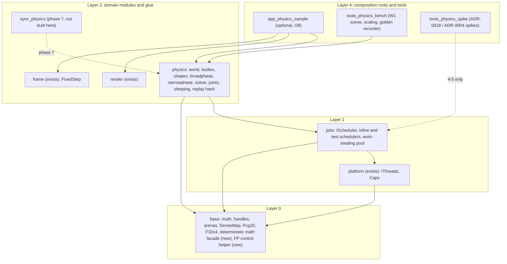

- **`jobs` (layer 1, new crate)** declares `IScheduler`, the deterministic inline scheduler (the Null path, used when `Caps::has_threads` is false and in unit tests), test schedulers that change the execution order on one thread, and the work-stealing pool. It depends on `base` and `platform` (edge `jobs -> platform` is in the allowed list). It creates its worker threads through `IThreads` or directly through `std::thread`, which the scan allows only in `jobs` and `platform` (O5). Layer 1 is outside the physics scan, so `jobs` may use `std` atomics, `Mutex` and `Condvar` as the policy says ([ports-and-adapters](ports-and-adapters.md)).
- **`physics` (layer 2, new crate)** is one crate with modules (`core`, `d2`, later `d3`), not several crates. Reason, checked in `gates/architecture.toml`: the layer table maps the exact name `physics`, an unmapped workspace crate is a violation (fail closed), and the libm, fused-operation, `HashMap` and sort scan rows are limited to `crates = ["physics"]`. A second crate such as `physics_core` would need a governance edit to the layer table and to every scan row, and until then would not be scanned at all. One crate keeps the existing rules in force with no governance step. The ADR-0018 spike (card 4-2) showed no need to split (compile time gives no reason) and [ADR-0018](../decisions/adr-0018-physics-core.md) confirms the one-crate layout.
- **`physics` depends on `base` and `jobs` only.** It does not know the ECS (`forbidden_edges = [["physics", "ecs"]]`), the scene or the renderer. Debug drawing is an optional port `IPhysicsDebugDraw` declared by `physics`; the sample, not `physics`, implements it with the sprite batcher.
- **Glue.** `frame` already exists and owns the fixed-step accumulator; the application calls `physics.step(dt)` once per step returned by `FixedStep::advance`. `sync_physics` (ECS to physics) is phase 7 and is not built here; until then samples feed `physics` plain structs ([conventions §3](conventions.md)). Only glue crates know two domain modules, so `physics` never imports `render` and `render` never imports `physics`.
- **New directories in L4.** `tools_physics_bench` and `tools_physics_spike` are `tools_*` crates (layer 4, no layer-table edit needed, the glob `tools_*` is mapped), like `tools_render_bench` and `tools_simd_bench`.
- **Architecture rows.** Reading the file, the crate placement needs no new row: `jobs`, `physics`, the edges and the scan rules exist. The first card of each crate checks this by running arch-check; a needed edit would make that card a governance task.

## 2. The API shape (sketches)

Names and signatures are sketches and will change in the cards. Handles, not pointers, cross the module boundary; errors are values; no panic crosses the API.

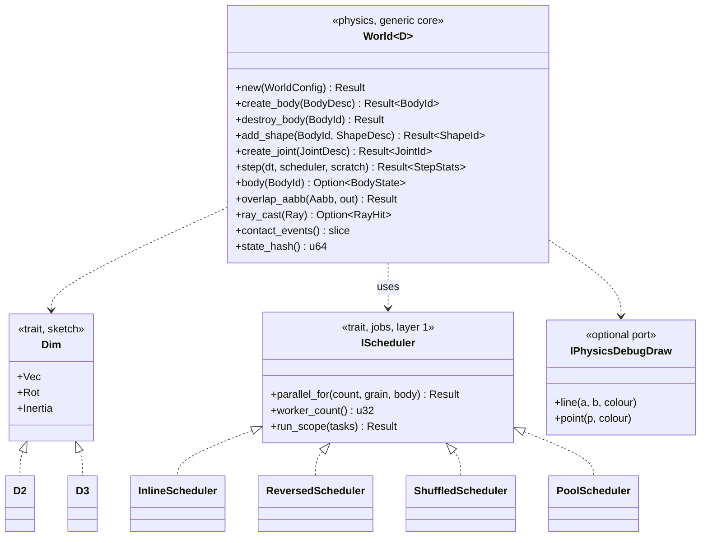

- **`IScheduler`.** Three needs, from [core-runtime §3](core-runtime.md): run a loop over a range in parallel (`parallel_for`, chunks of at least `grain` indices), run a set of independent tasks to completion (`run_scope`), and ask how many workers there are. A task counter and a `wait_help` call (the waiting thread executes jobs) are the internal mechanism, not the first public surface. Dispatch is `&dyn IScheduler`: one virtual call per phase of the step (a few per step), never per body or per contact (ADR-0005).
- **As built in card 4-4.** `run_scope` takes a slice of borrowed tasks (`&[&dyn Fn() + Sync]`), not a closure that spawns, and `for_each` is added; the signatures and bounds are in [core-runtime](core-runtime.md) section 3.
- **As built in card 4-7.** `jobs::pool::WorkStealingPool` is the pool decided in [ADR-0004](../decisions/adr-0004-job-system.md) (lock-free Chase-Lev deques, binary splitting, threads only through `IThreads`, a 200 microsecond spin-yield-park budget); its description, class and state views are in [core-runtime](core-runtime.md) section 3.
- **As built in card 4-10.** The `physics` crate exists (`engine/physics`, layer 2, depends on `base` only; the edge to `jobs` is not used yet; arch-check needed no new row). Modules `core` (generic: `Dim`, `World<D>`, `Body<D>`, `BodyDesc<D>`, `BodyHandle<D>`, `PhysicsError`, `StateHasher`) and `d2` (`D2`, `Rot2`, `Shape2`, aliases `World`, `Body`, `BodyDesc`, `BodyHandle`, `WorldConfig`); no `d3` yet (phase 8), a test instance in `tests/generic_core.rs` proves the core steps for a second dimension. Differences from the sketch above: `step(dt)` takes no scheduler and no scratch arena yet (nothing to parallelise before cards 4-11 to 4-15), `WorldConfig` has `max_bodies` and `gravity` only (shapes, joints and contacts get capacities with their cards), bodies are static or dynamic (kinematic is not built), shapes are a circle and a box (polygons come with the narrowphase, card 4-12), and `body()` returns a read-only view with accessors, not a `BodyState` copy. `Dim` has five associated types and three methods (ADR-0018 trigger: about 30 methods). Details, the class and sequence views and the numbers: [reviews/4-10](../../reviews/4-10.md).

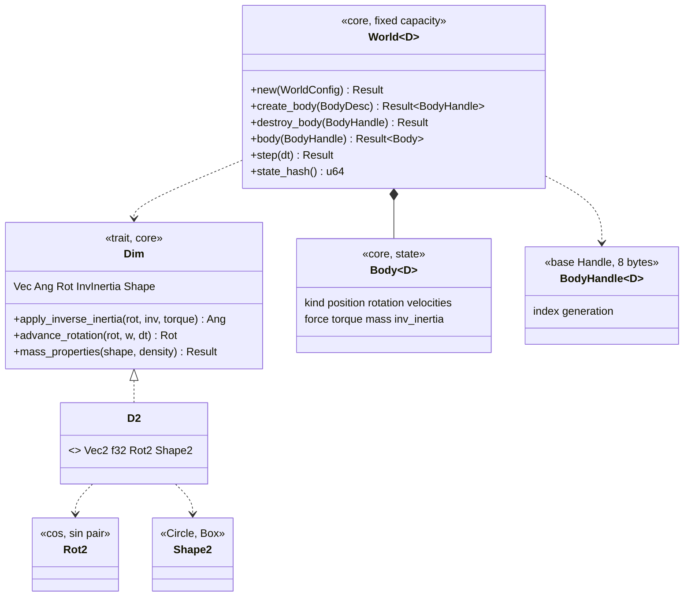

- **As built in card 4-11.** The world has a broadphase: two dynamic AABB trees (one for static bodies with margin 0, one for dynamic bodies with the margin of `WorldConfig`, default 0.1 m) and a canonical pair list. `Dim` gains one associated type (`Bounds`, an axis-aligned box with the six operations of the `Bounds` trait) and one method (`shape_bounds`); 2D uses `Aabb2`. The tree (`core::tree::Tree<B>`) is a Box2D v2.4 style tree on an arena of `2 * capacity - 1` nodes allocated once: sibling choice by the surface-area heuristic (a tie goes to the second child), AVL rotations after every insert and remove (the validator test checks height <= floor(log2(n + 2)) * 1.44 + 1), fat box = tight box + margin, a leaf is re-inserted only when its tight box leaves its fat box, queries walk the tree without a stack (parent links), the leaf id is the body slot index. Nothing allocates after `World::new`. The pair list (`core::pairs::PairList<D>`) has a fixed capacity (`WorldConfig::max_pairs`, at most 2^24); each step regenerates it: every dynamic body asks the dynamic tree (only for bodies with a higher slot index, so a pair is found once) and the static tree, so two static bodies are never paired, and the list is sorted by (lower slot index, higher slot index) with an in-place heap sort (`core::sort`; the standard stable sort allocates and the unstable one is banned). Touching boxes count as overlapping. When the list is full, further pairs are counted (`missing()`), `is_complete()` is false and the step still returns `Ok`; this is the documented overflow flag. There is no collision filtering because this note defines none. The state hash is unchanged (a pinned test compares it with the value of card 4-10); `broadphase_hash()` hashes the tree structure and is separate. Tree performance is not measured here (card 4-22). Class and sequence views below; evidence and numbers: [reviews/4-11](../../reviews/4-11.md).

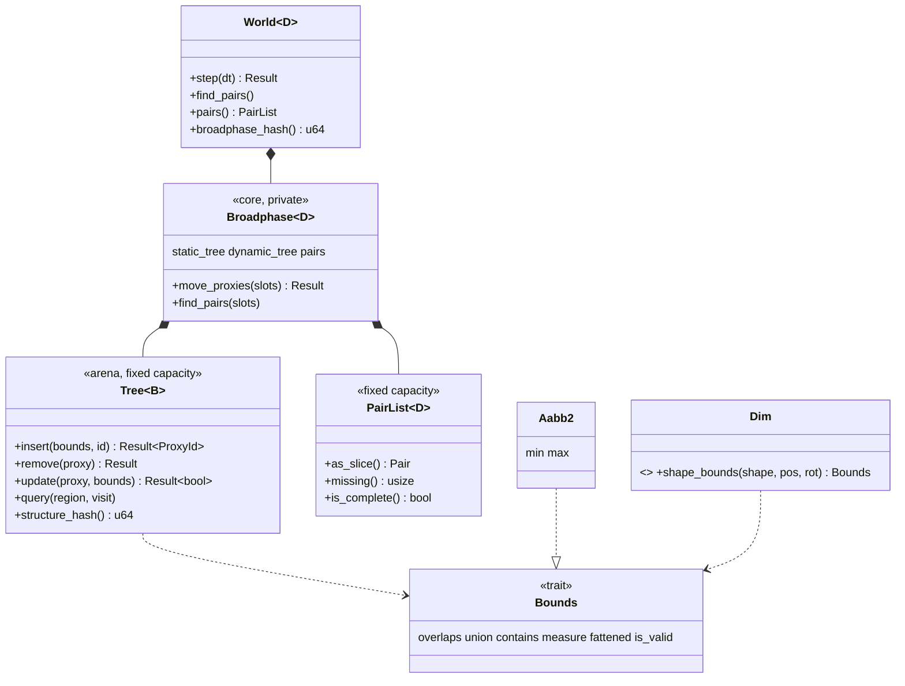

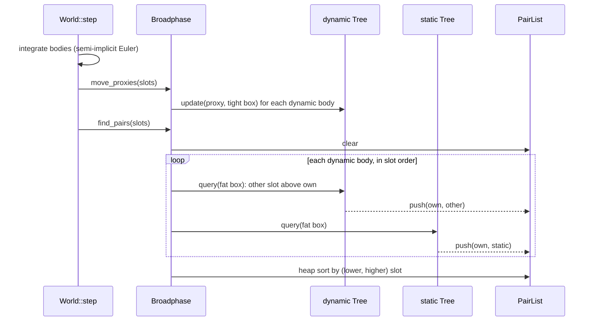

- **As built in card 4-12.** After the broadphase the step runs the narrowphase: every pair of the pair list, in list order, is collided by `Dim::collide(a, b, margin)` (`Dim` gains one associated type, `Manifold`, and this one method; `Placed<D>` is the shape, position and rotation of a body) and the result goes into a fixed-capacity buffer owned by the world (`core::manifolds::ManifoldList<D>`, capacity `WorldConfig::max_manifolds`, at most 2^24, overflow counted by `missing()` and `is_complete()` like the pair list). A pair with no contact (further apart than the speculative margin, `WorldConfig::speculative_margin`, default 0.02 m) leaves no entry, so the list is a subsequence of the pair list in the same order. The 2D narrowphase (`d2::narrowphase`, `d2::polygon`) handles the four pairs of the shapes that exist: circle-circle in closed form, circle-box by the Box2D face and vertex regions of the box, box-box by the separating axis test on the face normals of both boxes with reference and incident face clipping (up to two points); the roles of the two boxes are fixed by a small bias (`REFERENCE_FACE_BIAS`, 0.0005 m) that keeps the first body's face as the reference when two faces are almost equally good, ties go to the lower index, and a circle and a box give bit-identical results in either order (the result is computed with the box as first shape and flipped). All work is done in a frame whose origin is the first body's centre, so moving both bodies by the same exact amount changes no relative bit. A `Manifold2` has the unit normal (from the first body to the second), up to `MAX_MANIFOLD_POINTS` = 2 points, and per point the world position (the middle between the two surfaces), the separation (negative when overlapping), the two anchors (the point relative to each body centre, in world axes) and a 16-bit `FeatureId` (kind, and the vertex or face indices that produced the point) that stays the same while the same features touch, which the solver needs for warm starting (card 4-13). Only `+ - * /` and `sqrt` are used, no `sin`, `cos` or `atan2`, no libm, and a result that is not finite (huge coordinates) is `None`, so there is no NaN in a manifold. Degenerate cases are values: coincident centres give the x axis as the normal, zero-radius circles are valid, touching shapes give separation 0. There is **no polygon shape**: this note fixes no vertex limit, so none was invented; the clipping code works on up to 8 vertices internally and is tested with a hexagon and a triangle, but the public shape set is still circle and box. Nothing is applied to the bodies (no force, no impulse; the solver is card 4-13), the state hash is unchanged (pinned test), and the list has its own hash (`ManifoldList::hash`, separate from the state hash). Nothing allocates (per-thread counting allocator test, overflow included). Narrowphase performance is not measured here (card 4-22). Class and sequence views below; evidence and numbers: [reviews/4-12](../../reviews/4-12.md).

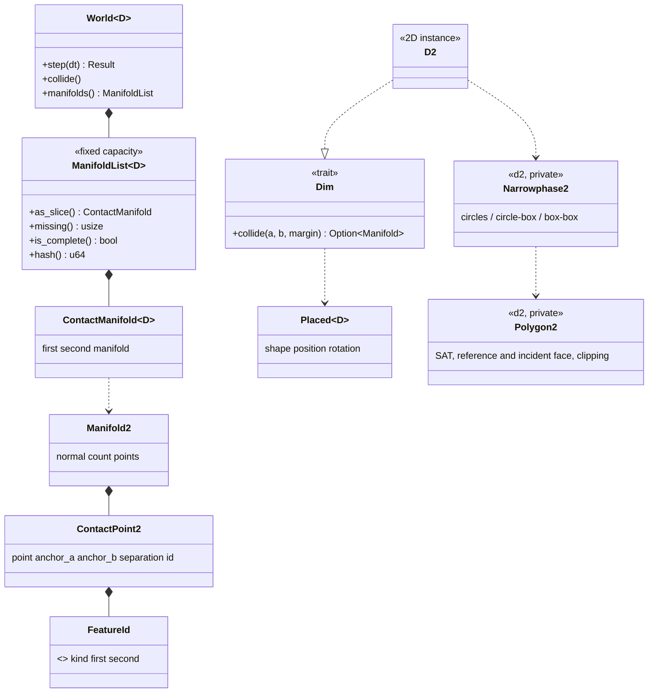

```mermaid
sequenceDiagram
  participant W as World::step
  participant B as Broadphase
  participant M as ManifoldList
  participant D as Dim::collide (D2)
  participant N as narrowphase
  W->>B: move_proxies, find_pairs (4-11)
  B-->>W: pairs in canonical order
  W->>M: clear
  loop each pair, in list order
    W->>D: collide(placed first, placed second, margin)
    D->>N: circles / box-box / circle-box
    N-->>D: Option of Manifold2 (normal, up to 2 points, ids)
    D-->>W: Some manifold within the margin, else None
    W->>M: push (counts missing when full)
  end
  Note over W,M: no force is applied; the solver reads the list (card 4-13)
```

- **As built in card 4-13.** The step now moves bodies by contact. `World::step` hands the manifold list of the last step to the contact solver (`Dim` gains `type Solver: ContactSolver<Self>`; the seam and the tunables `SolverConfig` live in `core::solver`, the 2D scalar solver `Solver2` in `d2::solver`), commits, and then runs the broadphase and the narrowphase on the new positions (cards 4-11 and 4-12). The solver is a soft step in the manner of `Box2D` v3 **[K]** (owner choice O2): per step `sub_steps` sub-steps (default 4) and per sub-step the order integrate velocities, warm start, solve soft contacts (friction first, then the normal), integrate positions, relax (`relax_iterations`, default 1); after the last sub-step restitution (threshold 1 m/s), and the accumulated impulses are kept for the next step, matched by body pair and feature id with a cursor over the pair-ordered list (no search, no hash map). The separation of a point is updated from the motion of its two anchors, so the manifold is made once per step; a point with a positive separation is speculative (it may close the gap within one sub-step and no more). Friction is mixed as the square root of the product, restitution as the maximum, a static body has infinite mass. The constraints are visited in manifold-list order and every operation is plain `f32` in a fixed order (no `mul_add`, no `sin`, no `cos`; the rotation of an anchor is a `(cos, sin)` multiply), so the SIMD solver of card 4-15 can be required to equal this one bit for bit. A body no manifold touches takes the old single Euler step, so a world without contacts hashes exactly as before. The step is atomic: the solver works on a scratch copy of the bodies and the world commits only if everything is finite and representable, else it returns `NotFinite` and changes nothing. Defaults and the reasons for them are in [reviews/4-13](../../reviews/4-13.md); the one that differs from `Box2D`, a linear slop of 1 mm instead of 5 mm, was measured on the pyramid. Nothing in the step allocates. Performance is not measured (card 4-22); the golden hash across platforms is card 4-20.

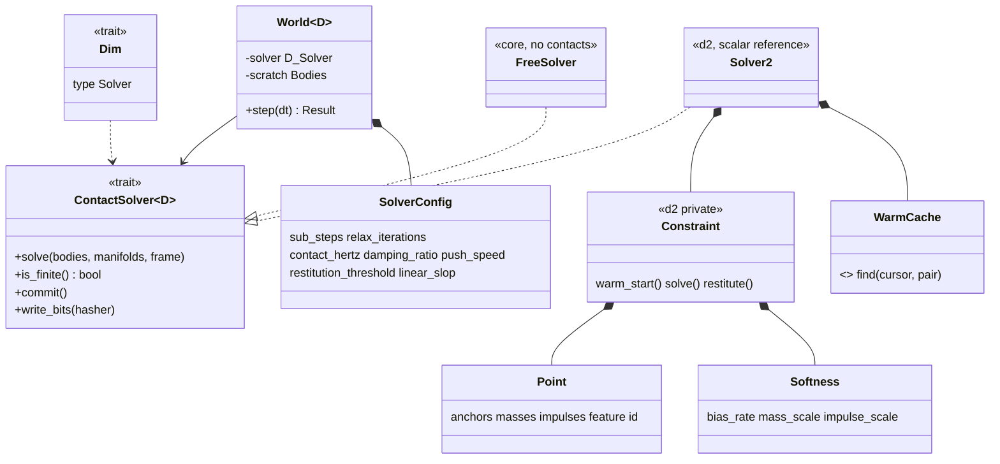

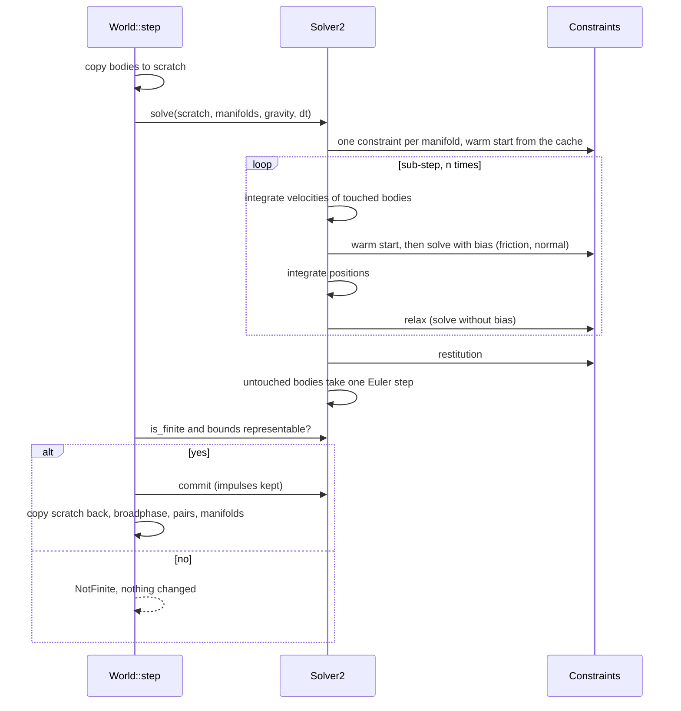

- **As built in card 4-14.** The world now knows which bodies can influence each other, lets resting groups sleep, and solves the contacts colour by colour. (1) *Islands* (`core::islands`, private): a union-find over the manifold list, built after every collide, joins the two bodies of a manifold when both are dynamic (a static body never joins, so two piles on one floor are two islands); the root is always the lowest slot, so the island id (`World::island_of`) is the lowest body slot whatever the manifold order. (2) *Sleeping* (`core::sleep`: `SleepConfig` with `enabled`, `time_to_sleep` 0.5 s, `linear_speed` 0.05 m/s, `angular_speed` 2 degrees per second; values from Box2D v3 and v2 **[K, from memory, not re-read]**): every awake dynamic body keeps a rest timer; an island whose bodies are all awake and all rested for the time falls asleep, its velocities become zero and the step leaves it alone (no integration, no constraint, the contacts and their warm start persist). It wakes by an awake body in contact (the solve wakes the island first, on the scratch copies, so a refused step wakes nothing), by `World::wake`, by every setter (`set_linear_velocity`, `set_angular_velocity`, `apply_force`, `apply_torque`), when a static body is created (every sleeper wakes, because a static body is in no island), and when a body is destroyed (its island and the islands of the bodies that touched it wake). A new dynamic body wakes what it touches by the awake-contact rule. The sleep flag is hashed as one tag byte after the body, only when set, so the flag itself adds no bytes to a world in which nothing sleeps (the contact hashes still changed once, because of the new solve order, see below) and `WorldConfig::sleep.enabled = false` is bit-identical to sleeping on until the first island sleeps. (3) *Colouring* (`core::colouring`, public so card 4-15 can drive it): a greedy, serial colouring in manifold order gives each constraint the lowest of at most 24 colours that none of its dynamic bodies uses yet (one `u32` mask per body; static bodies are exempt); a constraint that finds no colour goes to the overflow set, solved after the colours in canonical order, reported by `SolverStats::overflow` and never an error; a counting sort gives the solve order (colour 0, 1, ..., overflow), canonical inside a colour. `Solver2` sweeps its constraints in that order; a static body is no longer written back by a constraint, so the order inside a colour changes no bit (a test reverses and shuffles the order inside the colours and compares the state hash after 120 steps). The contact hashes were re-pinned once, for the new solve order and for sleeping (reasons in `tests/hash_pin.rs`); the rest timers are not hashed (the flag shows their effect), the island and sleep passes cost O(capacity) per step (to be measured in card 4-22), and card 4-15 must equal this serial result bit for bit. All storage is allocated at creation; zero allocator calls per step with sleeping, waking and overflow (per-thread counters).

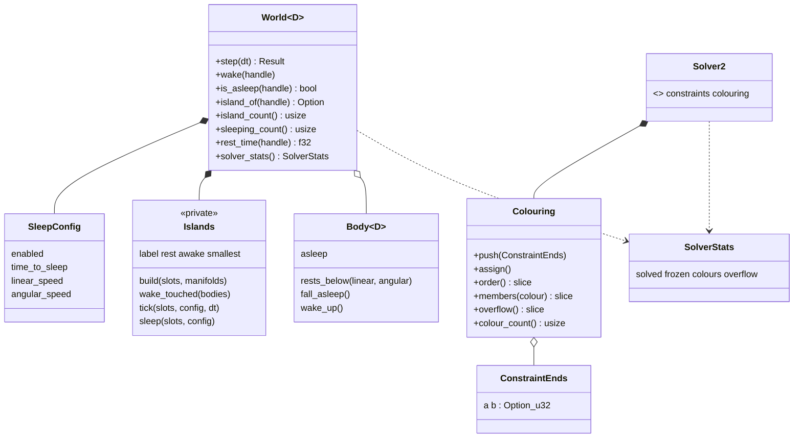

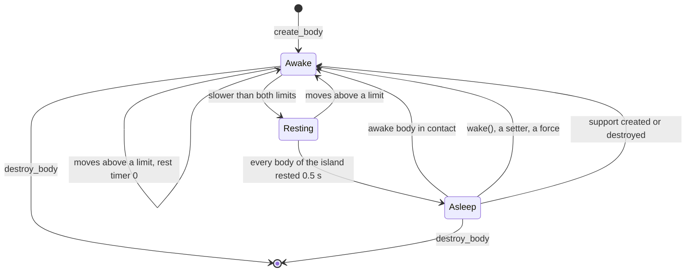

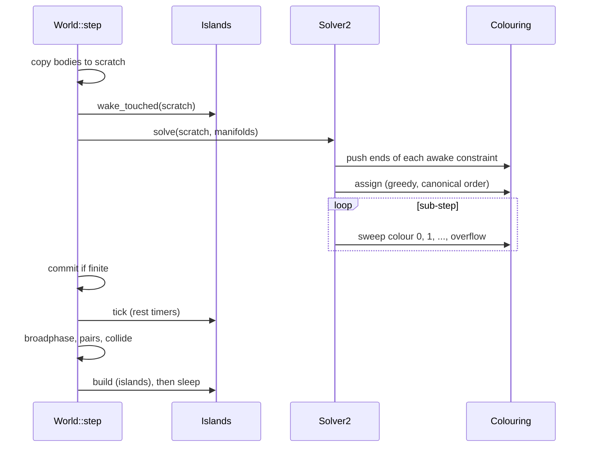

- **As built in card 4-15.** The solver can run a colour as parallel chunks and four constraints at a time; the result is bit for bit the serial scalar one. (1) *Execution options* (`core::execution::SolverExecution`, set with `World::set_execution`): an optional `Arc<dyn IScheduler>`, a `simd` flag and a chunk size (default 32, `DEFAULT_CHUNK`); the default `SolverExecution::SERIAL` is the scalar reference of card 4-14 on the calling thread and nothing else changes. `physics` now depends on `jobs` (layer 2 on layer 1, an edge the architecture file already allows; no gate file was touched) and only uses the `IScheduler` port, so the caller (a test, later the application) builds the pool. (2) *Staged colour solve* (`d2::solver::stage`): each colour's members, in canonical order, are cut into chunks of a fixed size (the cut depends on the colour size and the chunk size, never on the worker count); one `parallel_for(chunks, grain 1)` runs the chunks and its join is the barrier between colours. A chunk copies each constraint and the two bodies it joins out of a `Mutex` slot (each member is locked twice per pass, once to load and once to store, by one chunk only, so the lock is never contended) and from the shared body array (read only), computes on the copies, and stores the constraint back; after the join the dynamic bodies are stored back **serially in canonical order** (static ends never, as in the reference). That is why no `unsafe` is needed: no thread ever writes a body array another thread reads. The overflow set, `touch`, `finish`, restitution's store, the position integration and the warm-start cache stay serial. A colour with one chunk, a missing scheduler or a scheduler that refuses the call (`Busy`, `TooManyChunks`) is run on the calling thread by the same code. (3) *Lane path* (`d2::solver::constraint::lanes`): four constraints per group in `base::simd::F32x4` (the safe SSE2 or NEON type; no intrinsic and no `unsafe` in `physics`); `solve` and `warm_start` run lane-wise with the same operations in the same order as the scalar code, the branches (speculative or soft term, friction clamp, `max` of the accumulated impulse) are taken per lane by the scalar functions the reference calls, a one-point manifold leaves its second point unchanged by selecting the old lane, and restitution (staged like the other passes, with a scalar body per group) plus the remainder of a chunk (fewer than four) use the scalar code. The lane branch gives the same bits as the scalar one, so a test-only counter shows that it ran, and mutation testing checks it. (4) *Floating-point state*: `Solver2::solve` takes one `base::fpenv::FpGuard::deterministic()` for the whole solve (the calling thread), and every chunk takes its own, which covers the pool workers; each chunk runs its arithmetic in a function that is never inlined (the opaque boundary of the helper). Performance caveat: the staged path copies the constraint and both bodies per pass and scatters serially, so with few constraints per colour it can be slower than the serial path; nothing is measured here (card 4-22). Not done: parallel velocity and position integration of the bodies, a hand-written intrinsic path (needs a governance step), scaling numbers (card 4-22), TSan (card 4-21), the cross-platform golden (card 4-20). Tests: `tests/parallel.rs` (hash after every step equal for scalar serial, lanes serial, staged scalar, lanes and scalar through a pool of 1, 2, 4 and 6 workers, chunk sizes 1 to 1000, reversed, shuffled and single-range schedulers, a refusing scheduler, pile, pyramid, hub with overflow, sleeping and waking islands), `tests/parallel_allocation.rs` (no allocator call on the caller or on any worker) and the lane unit tests; review [reviews/4-15](../../reviews/4-15.md).

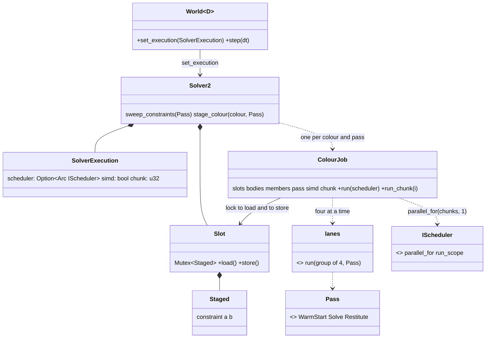

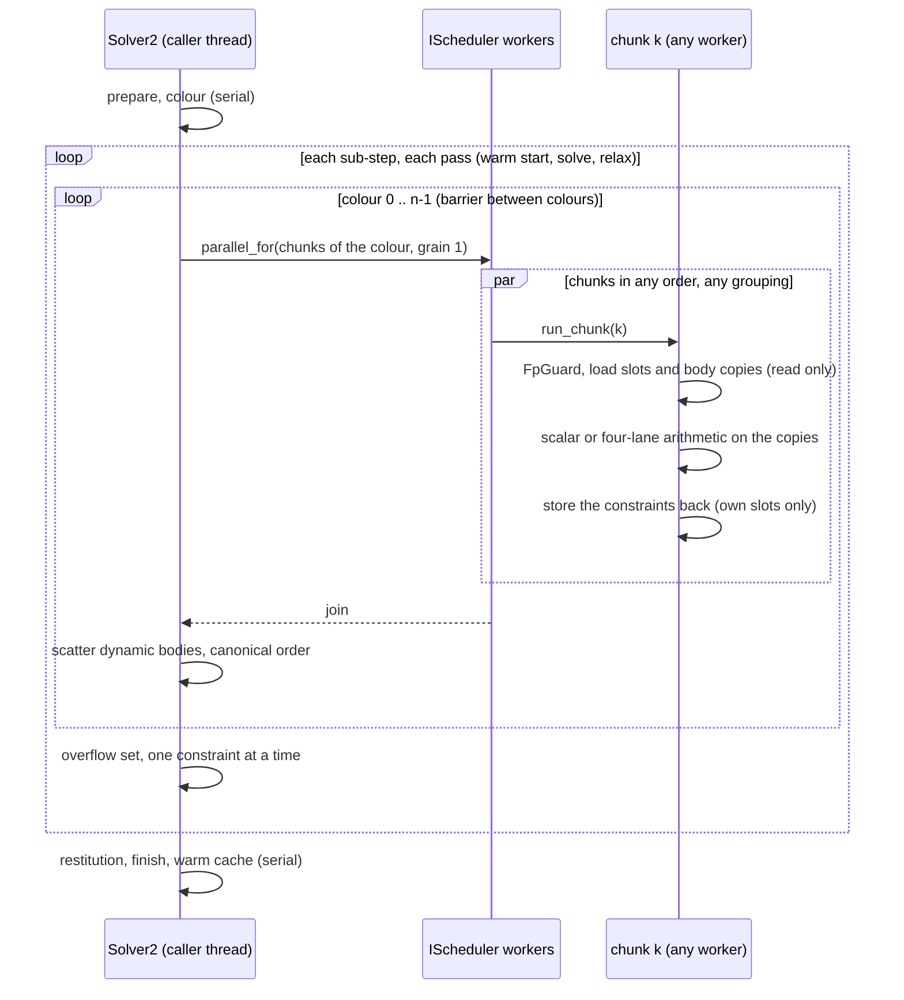

- **As built in card 4-16.** The world has joints: a revolute joint (a hinge, with optional angle limits and a small motor) and a distance joint (a rod, a spring, a rope or a strut), solved in the same soft-step scheme as the contacts. (1) *Handles and descriptions* (`core::joint`, `d2::joint`): `JointHandle` is a generation-checked `base::pool` handle like a body handle; `WorldConfig::max_joints` fixes the capacity (above `MAX_JOINTS` the world is refused, a full table returns `JointCapacityExhausted` as a value, a stale handle `StaleJoint`, a bad number `InvalidJoint` or `NotFinite`); `World::create_joint(&JointDesc)`, `destroy_joint`, `joint`, `joints` (slot order), `contains_joint`, `joint_count`. `Dim` gains one associated type, `Joint` (a `JointShape` that validates itself; 2D: `Joint2` with `Revolute(RevoluteJoint2)` and `Distance(DistanceJoint2)`), so the generic core stores joints without knowing their kinds. One end may be static, two static ends or one body twice is `InvalidJoint`. Destroying a body destroys its joints (their handles go stale) and wakes the bodies at their other ends. Bodies joined by a joint do not collide with each other unless `JointDesc::collide_connected` is set (the Box2D default **[K]**); the exemption is a sorted list of body-slot pairs searched by `contact_of`, so it ends with the joint. (2) *Revolute*: anchors in each body's frame (relative to its centre of mass), a reference angle, optional `AngleLimits` and an optional `Motor` (`max_torque`, `speed`); order of the constraints inside a joint: motor, lower limit, upper limit, then the point constraint (a 2x2 symmetric solve). Limits are speculative while the angle is inside them (the joint may close the gap within one sub-step and no more), soft when violated. (3) *Distance*: a rest length, a rigid rod when `spring` is `None`, a spring with `hertz` above zero (own softness), slack with `hertz` zero (a rope or strut: only the limits act, and limits are allowed only with a spring field), optional `LengthLimits` with `0 <= min <= length <= max`. (4) *In the solver* (`d2::solver::joint`): the joints are prepared after the contacts (so the bodies of a world without joints are touched in the same order as before), carry a `JointWarm` cache matched by joint handle with a forward cursor (no search), and use the rigid softness `SolverConfig::joint_hertz` (`DEFAULT_JOINT_HERTZ` = 60, capped at a quarter of the sub-step rate) and `joint_damping_ratio` (`DEFAULT_JOINT_DAMPING_RATIO` = 2.0), the values of Box2D v3.0 **[K]**. **Ordering decision:** the joints are not coloured. In every pass of every sub-step (warm start, solve, relax) all joints are visited first, serially on the calling thread in joint-slot order, then the contacts colour by colour. A joint therefore never reaches the scheduler or the lanes, so the parallel and SIMD paths equal the scalar serial one by construction, the staged path only has to write its bodies back after every colour (it already does), and the hashes of scenes without joints did not change. The price is that the joints are a serial part of the step (a long chain is solved on one thread; colouring the joints together with the contacts and a SIMD joint path are follow-ups once a benchmark, card 4-22, shows the joints matter). (5) *Islands and sleeping:* a joint between two dynamic bodies unites them in the union-find (a static end joins nothing), so a chain is one island and sleeps and wakes as one; `create_joint` and `destroy_joint` rouse the dynamic ends. A joint is solved when one of its bodies is awake, and its warm start is kept as it is while both sleep. (6) *Hash:* the state hash covers the joint impulses (a count, then per joint its handle and six floats) and nothing at all while there are no joints; joint parameters are not hashed (like body shapes, a replay recreates them). `SolverStats` gains `joints_solved` and `joints_frozen`. The step stays atomic and allocation free (per-thread counters, `tests/joint_allocation.rs`). Measured and tuned numbers, the decisions and the open points: [reviews/4-16](../../reviews/4-16.md).

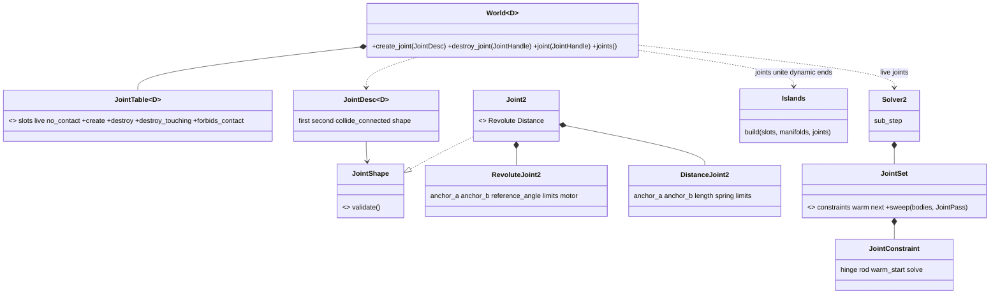

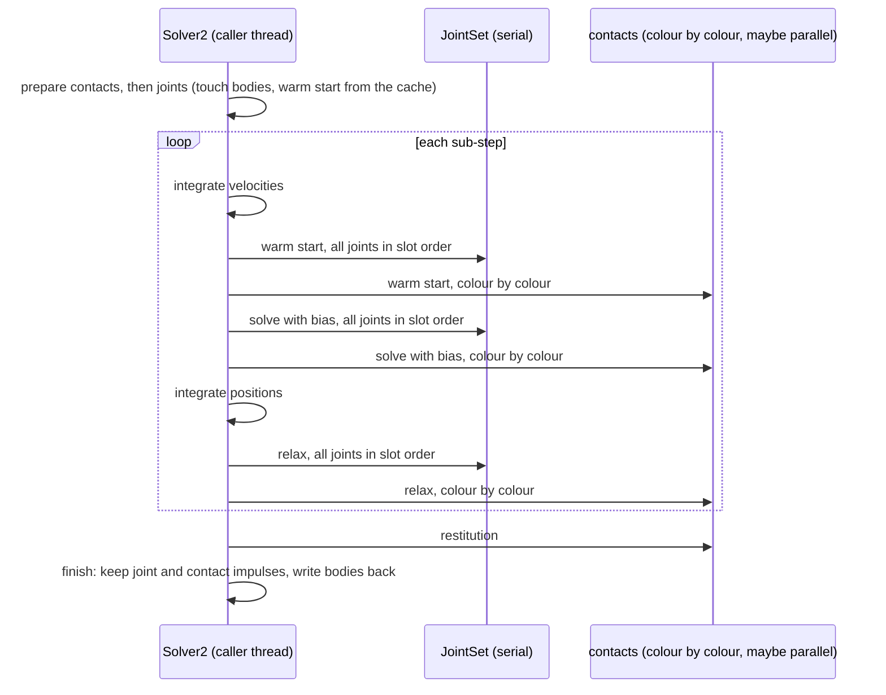

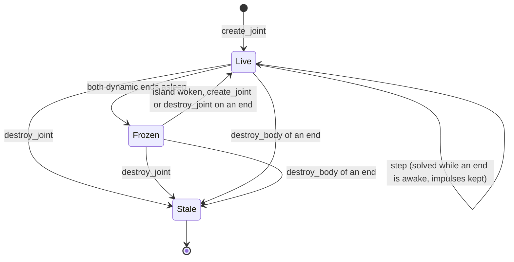

- **As built in card 4-17.** The stability exit criterion is exercised by one integration test target, `engine/physics/tests/stability/` (34 tests, tests only: no engine file changed, no hash pin changed). (1) *Scenes*: pyramids of 5 and 10 rows of the W1 boxes, columns of 2 to 10 boxes with a maximum-height probe, mass ratios 1:10 and 1:100, hanging and horizontal chains of 20 and 30 links with end weights, a bridge with a load, and a mixed scene (pyramid, whip and a bin of circles); the bounds (`limits.rs`: drift 0.05 m, rest speed 0.02 m/s, penetration 0.02 m, hinge error 0.05 m) were written before measuring (the few that changed after measuring are listed in the review and in `limits.rs`) and each test prints `STABILITY | scene | metric | measured | bound`. (2) *Execution matrix*: eight scenes give the same state hash after every step under scalar serial, lanes serial, and pools of 1, 2, 4 and 6 workers with lanes on and off, and the resting scenes also give the same sleep flags. (3) *Properties*: 8 properties over 25 seeded `Pcg32` scenes (25 scenes, 200 checks; finite and in bounds, energy does not rise, no deep contact once calm, same seed same hash, serial equals parallel equals lanes, sleeping equals awake until the first sleep, refused calls change nothing, a full world reports overflow as a value). (4) *Findings*: the solver does not meet five of the bounds stated in advance (a column of 11 or more boxes drifts or topples, a 1:100:1:100 column collapses, a chain of 50 links stretches, a pyramid of 20 rows compresses by 0.0527 m, the heavy bridge load is still moving at 8 s); W1-scale stacking (about 1,000 boxes) is therefore not demonstrated, the largest passing pyramid has 55 boxes; `findings.rs` keeps each as a test that asserts the bound is still exceeded, so an improvement turns it red and the scene moves back to the settled tests. Numbers, tolerance table, mutation-style checks and the exit-criterion mapping: [reviews/4-17](../../reviews/4-17.md).

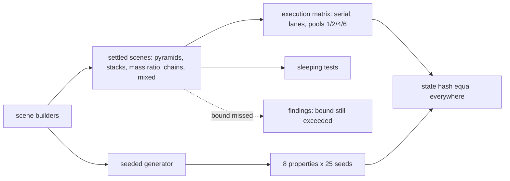

- **Borrowed closures.** `parallel_for` and `run_scope` take closures that borrow the caller's data, so that no `Box` is allocated per frame (the existing `platform::threads::Job` is a `Box<dyn FnOnce() + 'static>`, which allocates). Running a borrowing closure on a worker thread needs a small amount of `unsafe` (lifetime erasure guarded by the scope waiting for completion). This is the one place where `jobs` is expected to use `unsafe` (section 8).
- **`World<D>`.** The step takes a scheduler and a per-step scratch `Arena` as parameters, so there is no global state and no hidden thread. `WorldConfig` fixes the capacities (bodies, shapes, joints, contacts, tree nodes) at creation; creating a body past the capacity returns an error value and never reallocates, so a steady-state frame allocates nothing (section 7). `dt` is `f32` seconds computed once from `FixedStep::step_ticks`.
- **Body state.** 2D rotation is stored as a `(cos, sin)` pair, not an angle, and is advanced in the step by a first-order update followed by a normalisation, so the step itself calls no `sin`, `cos` or `atan2`. Those are needed only to create a body from an angle and to read an angle back, and both go through the facade (section 5). This follows Box2D v3 **[K, from background knowledge, not re-read this session]** and is a design choice made so that the hot loop needs no libm at all.
- **Queries and events.** Overlap queries and ray casts run between steps in v0 (O7). Contact begin and end events are a slice filled by the step and polled by the caller, never a callback, in line with the file system port, where completion is polled so that no engine code runs on a thread it does not own ([platform-ports §2.3](platform-ports.md)).
- **Dimension generic core.** `Dim` is a sketch: associated types for the vector, the rotation and the inertia, plus the shape set. The shared parts and the specialised parts are those of [physics §4](physics.md) (shared: broadphase tree, pair management, islands, sleeping, colouring, solver loop structure, handles, hashing; specialised: body layout, narrowphase and manifolds, constraint math, SIMD packing, shape set). Rust has no `if constexpr` and limited const-generic expressions, so [review-v0.10 B14](../review-v0.10.md) asks the spike to check feasibility, compile time and code shared, not bytes per body only.

## 3. Algorithm choices for v0

The stage list is the pipeline of [physics §2](physics.md). Rows marked [S] there are sourced from Box2D v3 and Jolt material; the details below the table that go beyond that page are **[K]**: background knowledge, to be checked when the card is built.

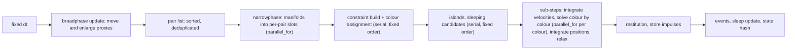

| Stage | v0 choice | Why / what keeps it deterministic |
|---|---|---|
| Broadphase | dynamic AABB tree (BVH), one tree for static and one for moving bodies **[K for the split]**, fat AABBs with a margin, incremental updates; pairs come out sorted by (lower handle, higher handle) and deduplicated | the order of pairs is a total order on handles, never an address or a hash order; no `HashMap`; insertion heuristics use no randomness. The roadmap names the BVH; sort-and-sweep is simpler but does not scale to W1-sized scenes **[K]** |
| Narrowphase | 2D: circle, convex polygon (boxes included, up to a small vertex count), static segment; polygon pairs by SAT with edge clipping giving up to 2 contact points; capsule later. Each pair writes into its own pre-allocated slot, so threads never append to a shared list | the output order is the pair order, not the order in which threads finish. A brute-force oracle checks the geometry (property test) |
| Solver | Soft-Step-style: soft contact constraints, sub-stepping (a small number of sub-steps per step) instead of velocity and position iteration counts, a relax pass, restitution applied after the solve, contacts built once per step. Scalar reference first, SIMD form after, tested bit for bit against the reference | [S] Box2D v3 (release post and migration notes linked in [physics §2](physics.md)). The reference machine workload W1 is written in iteration counts (section 10, O9) |
| Parallel solve | graph colouring: constraints are assigned a colour so that no two constraints of one colour touch the same dynamic body; the colours are solved one after the other, and the constraints inside a colour in parallel; constraints that do not fit into the colour limit go to a serial overflow set solved last | colour assignment is a serial pass in a fixed constraint order, so it is the same at any thread count. Inside a colour the constraints share no body, so the arithmetic of each constraint is independent of the others and of the chunking. There is no floating-point reduction across threads in the solve; any sum that must exist (island energy, sleep time) is accumulated serially in handle order |
| Sleeping | islands built serially by union-find over touching non-static bodies in handle order; an island sleeps when all its bodies stay below a velocity threshold for a time; a sleeping island wakes when a body of another island touches it or a joint or a user call changes it | the island order is the order of the lowest body handle; thresholds are fixed config values, tested |
| Joints | v0: **revolute** and **distance** joints, soft, in the same soft-step solver (O6); as built in card 4-16 the joints are solved serially before the contacts in every pass and are not coloured | a chain is a row of revolute joints, which is the "chain stability" exit scene, if read that way |
| Not in v0 | time-of-impact CCD (v0 has a speculative margin for fast bodies **[K]**), prismatic, weld, wheel, motor limits beyond revolute, rounded polygons, compound shapes, sensors beyond overlap events, soft bodies, cloth, vehicles | [physics §6](physics.md) keeps the feature list short on purpose |
| Large worlds | usable world size documented and tested at the limit; recentring is the caller's job | [physics §2](physics.md) (Box2D notes about 20 km **[S]**) |

## 4. The job system

**Question the spike decides (ADR-0004; answered by [scheduler-spike](../spikes/scheduler-spike.md) and recorded in [adr-0004-job-system](../decisions/adr-0004-job-system.md)):** which scheduler is the first real one. The roadmap row says "deterministic scheduler and the scheduler spike", `IScheduler` plus a work-stealing pool. The index proposes a work-stealing pool with task counters and a deterministic single-thread scheduler for tests, against fibers.

- **What is certain without a spike:** the interface (section 2), the deterministic single-thread scheduler (it is the Null path, needs no threads, and runs jobs inline in dependency order, [core-runtime §3](core-runtime.md)), and the rules: no blocking I/O or locks inside jobs, blocking work goes to an I/O pool, the audio thread is outside the job system.
- **What the spike measures:** candidates built from `std` only (the policy allows no third-party crate in L0-L2 and `allowed_external` is empty): (a) one shared queue with a `Mutex` and `Condvar`; (b) per-worker deques with stealing, mutex-protected; (c) per-worker lock-free deques (Chase-Lev), which need `unsafe` **[K]**; (d) static partition with no stealing, which suits the uniform work of a colour. Workloads: the colour-by-colour solve loop from the ADR-0018 spike scene, many tiny tasks, a few large tasks, and a worker that is delayed on purpose. Measures: wall time at 1, 2, 4 and 6 workers, the cost of an empty `parallel_for`, allocator calls per frame (target zero), `unsafe` lines needed, and the effort of making D1 hold. The cards of ECS iteration (phase 7) and the mixer (phase 5) do not exist yet, so the spike stands in synthetic loops for them and says so.
- **Fibers** (Naughty Dog, [state of the art](../01-state-of-the-art.md): only the talk listing was read) need context switching, which is assembly or a third-party crate; the policy bans both in L0-L2 without a decision. The spike excludes them and records that, for the owner to confirm (O4).
- **How it relates to D0 and D1.** A scheduler decides *which thread runs which chunk and in what order*; the physics decides *what a chunk computes*. D1 holds when the result of every chunk is a pure function of the chunk's index range and of data that no other chunk in the same phase writes. The scheduler contract therefore promises nothing about order, and the contract suite proves the weaker, testable property: every index is run exactly once, `parallel_for` returns only after all chunks finished, and results written to disjoint slots are visible to the caller afterwards. To catch an accidental dependence on order **without needing a many-core machine**, `jobs` offers test schedulers on one thread: in order, in reverse order, and in a seeded shuffled order (`Pcg32`). A physics scene that gives the same hash under all of them has no order dependence in the code the test schedulers reach.
- **Worker count is a parameter, not read from the machine.** The pool takes a worker count at construction (`PoolScheduler::new(workers)`), so the D1 tests run at 1, 2, 3 and 7 workers on any runner, including a two-core hosted one; `IThreads::parallelism()` only supplies the default.
- **`Caps::has_threads` false** selects the inline scheduler, as today's Headless platform does by default ([platform-ports §2.2](platform-ports.md)).
- **Floating-point control state.** Each worker, and the calling thread, sets and asserts the control state (round to nearest even, denormals kept) at the start of every simulation job ([rules-digest §5](../rules-digest.md), [physics §3](physics.md) rule 6). A driver or audio library loaded in-process can change it **[K]**. Where this helper lives is O10. **As built in card 4-9:** the helper is the module `base::fpenv` (O10: in `base`); `set_deterministic`, `assert_deterministic` and `FpGuard` are described in [reviews/4-9](../../reviews/4-9.md) and in the module comment. `jobs` does not call it; **as built in card 4-15** the solver of `physics` takes a `FpGuard::deterministic()` for the whole solve and one at the start of every colour chunk (the guard restores what it found), which covers the calling thread and every pool worker without a change to `jobs`.

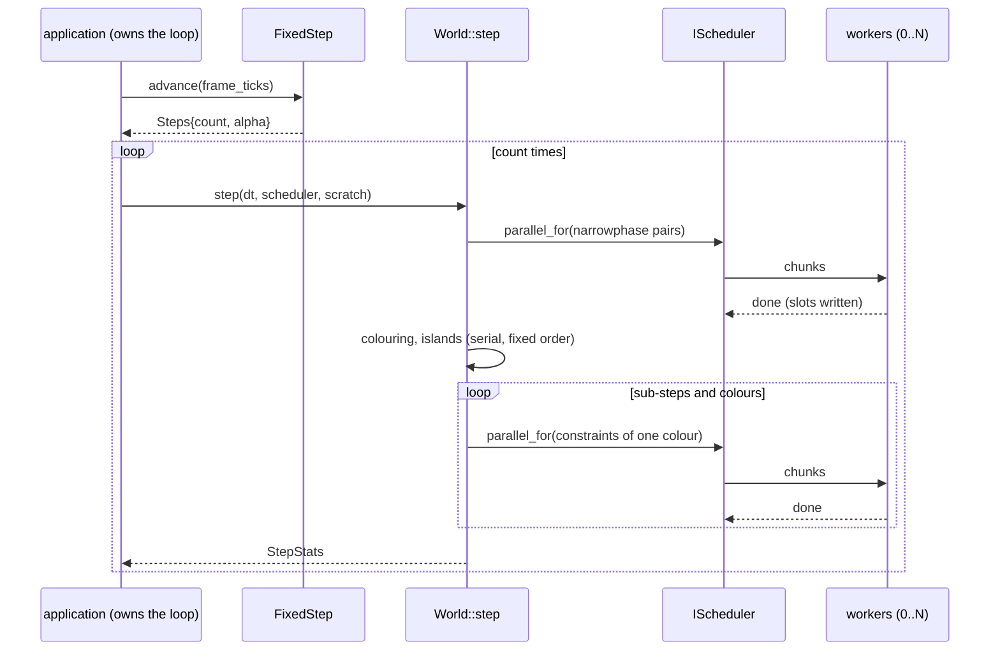

## 5. The determinism harness

D0 (same machine, same thread count) and D1 (any thread count) are required; D2 (Windows and Linux x86-64, physics only) is opt-in ([physics §3](physics.md), ADR-0007). The rules are already written there; this section says how they become tests and which parts touch a governance file.

| Part | What it is | Governance? |
|---|---|---|
| State hash | FNV-1a over the bit patterns of every body's position, rotation pair and velocities and its sleep flag, in handle order, after each step (the benchmark scene of phase 3 already pins an FNV-1a hash of its output bytes, review 3-13) | no |
| Replay test D0/D1, always on | one scene run twice, and at 1, 2, 3, 7 workers, and under the in-order, reversed and shuffled test schedulers, in one process; all hash lists must be equal; reads no stored value | no |
| Seeded scenes | pyramid, row of boxes, chain, scatter of mixed shapes from `Pcg32`, a sleeping and waking scene, a scene with body creation and destruction between steps | no |
| Hash/scan bans | `HashMap`/`HashSet`, unstable sort, libm functions, `mul_add`, fused and estimate intrinsics in `physics`: already refused by arch-check (`gates/architecture.toml`) | no change needed |
| Clippy `disallowed-methods` for `physics` | planned second line for the same bans ([ports-and-adapters](ports-and-adapters.md)); `clippy.toml` is a protected path and is workspace-wide, so a per-crate `disallowed-methods` needs a crate-level `clippy.toml` (also protected, `**/clippy.toml`) | **yes** (governance card) |
| Facade of deterministic math in `base` | one signature per function (`sin`, `cos`, `tan`, `atan2`, `exp`, `log`, `pow`, `powi`), two implementations: platform `std` with the feature off, own functions built from `+ - * /`, `sqrt` and comparisons with the feature on; `madd(a, b, c)`: fused when the CPU has FMA and the feature is off, `a * b + c` otherwise; tested against a high-precision oracle with a stated ULP bound and bit for bit against stored test vectors. Module `base::dmath` (card 4-8) | no (Class 2: determinism math; `base` may call libm, so the scan does not apply) |
| Cargo feature `cross-platform-determinism` | in `base` (switch of the facade) and in `physics` (forwards to `base`); off by default | no (`Cargo.toml` of a crate is not a protected path; a workspace `.cargo/config.toml` would be) |
| Build guard | `compile_error!` when the feature is on and `target_feature = "fma"` is enabled (for example through `RUSTFLAGS` with `-C target-cpu=native`) **[K that `cfg(target_feature)` reflects `target-cpu=native`; to be tested on both targets]**, plus a CI check of `RUSTFLAGS` | the `compile_error!` no; the CI check **yes** (workflow) |
| `base` math that calls libm (`Mat3` rotation constructors, `Quat::from_axis_angle`, `Quat::slerp`) | routed through the facade when the feature is on; scan does not see libm reached through `base` ([physics §3](physics.md) Limits), so this must land before D2 is claimed | no (Class 2) |
| Floating-point control state helper | set and assert round-to-nearest-even and denormals kept at the start of each simulation job; reading and writing the control register needs `std::arch` or assembly, which the scan allows only in `base` (`MXCSR` on x86-64 and `FPCR` on AArch64 **[K, to be checked in the card: whether the stable `std::arch` intrinsics for `MXCSR` are usable on the pinned toolchain 1.94.1]**); new `unsafe` lines in `base` | **yes**, if it adds `unsafe`: a row or a raised budget in `gates/unsafe-budget.toml` |
| Golden file `gates/golden/physics-replay.toml` | a fixed set of scenes, the hash after each step (or each K-th) with the feature on; format and recorder defined in the card; the folder does not exist today | **yes**: `gates/` is protected; an intended change of physics results is a governance change that the owner sees (the price stated in [physics §3](physics.md) rule 8) |
| D2 CI job, Windows x86-64 and Linux x86-64, feature on | compares the stored hashes; the existing `ci` workflow runs only on `main` and by hand, so the job is added to it and the owner runs it by hand on a branch like `gl_linux` was ([delivery-pipeline](../workflow/delivery-pipeline.md)) | **yes** (workflow) |
| D2 cost report | the same scene with the feature on and off, wall time reported (D-10) | no |

```mermaid
flowchart TB
  S["same scene, seed"] --> R1["run 1, inline"]
  S --> R2["run 2, inline"]
  S --> R3["1, 2, 3, 7 workers"]
  S --> R4["reversed and shuffled order"]
  R1 --> H["hash list per step"]
  R2 --> H
  R3 --> H
  R4 --> H
  H --> E{"all equal?"}
  E -->|"no"| F["red: order or thread dependence"]
  E -->|"yes"| P["D0 and D1 pass (always on, no stored value)"]
  P --> O{"feature cross-platform-determinism?"}
  O -->|"off"| N["nothing stored"]
  O -->|"on"| G["compare with gates/golden/physics-replay.toml"]
  G --> W["Windows x86-64"]
  G --> L["Linux x86-64"]
  W --> OK{"both equal the stored value?"}
  L --> OK
  OK -->|"no"| X["red check: platform dependence or an unreviewed change"]
  OK -->|"yes"| D2["D2 pass"]
```

**Lesson from phase 3 (R-21), for this phase.** A hand-started `ci` run showed a pinned vertex hash of rotated sprites differing between Linux x86-64 and AArch64, because `f32::sin_cos` is not bit-identical across platforms (review 3-13, [phase 3 review §8](../spikes/phase3-milestone-review.md)). Consequences here: (1) the physics step avoids `sin`/`cos` entirely by keeping the rotation as a pair (section 2); (2) the D0/D1 replay test never stores a hash, so it cannot fail for that reason; (3) every stored hash (D2 golden) is taken with the feature on, where the physics path calls no libm; (4) a rotated-sprite golden in the render benchmark (adjustment A12 of the phase 3 review) can use the facade once it exists, and is not a phase 4 requirement; (5) the test for each facade function must include the platform pair that failed, Linux x86-64 against Windows x86-64, which the D2 job gives.

**Toolchain.** The pinned `rust-toolchain.toml` is part of the D2 promise (physics §3 rule 10): a compiler update is accepted only when the golden hash still matches on both platforms. A toolchain change is already a governance change (`rust-toolchain.toml` is protected).

**As built in card 4-8.** The facade is the module `base::dmath` ([engine/base/src/dmath](../../engine/base/src/dmath/mod.rs)): the free functions `sin`, `cos`, `sin_cos`, `tan`, `atan2`, `asin`, `acos`, `exp`, `log`, `pow`, `powi` and `madd`, one signature each, switched by the Cargo feature `cross-platform-determinism` of `base` (off by default; `physics` will forward it). Off: the `std` function of the platform. On: the own function of `base::dmath::portable`, which does all arithmetic in IEEE `f64` with `+ - * /` and `sqrt` only (Cody-Waite reduction by `pi/2` and `ln 2`, Taylor series whose coefficients are computed at compile time, argument halving for the arctangent), and rounds once to `f32` in integer arithmetic, so the result depends on neither a libm nor the rounding-mode register. Measured: at most 0.5000 `f32` ulp against the `f64` functions of `std` for every function over dense sweeps (the documented bound is 0.51; `powi` 1 ulp for `|n| <= 2^16`), and identical bit patterns on Windows x86-64 and Linux x86-64 (WSL) for the pinned table and a 40960-value hash. `sin`, `cos` and `tan` are accurate for every finite `f32` (Cody-Waite up to `2^20`, an exact Payne-Hanek reduction with 256 bits of `2/pi` above it); NaN and the infinities give NaN. `Mat3::from_rotation_x/y/z`, `Quat::from_axis_angle` and `Quat::slerp` call the facade, so they are deterministic with the feature on and unchanged with it off. A `compile_error!` refuses the feature together with `target_feature = "fma"`; it is a conservative policy guard (Rust never fuses by itself and the own functions call no `mul_add`), kept so that the build is the one the reference results are taken with; a second one refuses 32-bit x86 without SSE2 (x87; this one is not tested, no such target is built). The FMA guard was checked: `-C target-feature=+fma` and `-C target-cpu=native` on the reference machine both trigger it. The CI check of `RUSTFLAGS` and the D2 job stay with cards 4-19 and 4-20. Details and measurements: [review 4-8](../../reviews/4-8.md).

```mermaid
classDiagram
  class dmath {
    <<facade in base>>
    DETERMINISTIC
    sin cos sin_cos tan
    atan2 asin acos
    exp log pow powi
    madd
  }
  class portable {
    <<own, f64 inside, one rounding>>
    trig inverse explog
  }
  class series {
    <<const coefficients, horner>>
  }
  class convert {
    <<to_f32 in integer arithmetic>>
  }
  class StdLibm {
    <<platform libm, feature off>>
  }
  class Mat3 {
    from_rotation_x y z
  }
  class Quat {
    from_axis_angle
    slerp
  }
  class Physics {
    <<crate, phase 4>>
  }
  dmath ..> portable : feature on
  dmath ..> StdLibm : feature off
  portable --> series
  portable --> convert
  Mat3 ..> dmath
  Quat ..> dmath
  Physics ..> dmath : never calls std sin or cos
```

```mermaid
flowchart LR
  B["cargo build base"] --> F{"feature cross-platform-determinism?"}
  F -->|"off"| S["facade calls std; madd fused only with target_feature fma"]
  F -->|"on"| G{"target_feature fma?"}
  G -->|"yes"| E["compile_error!"]
  G -->|"no"| P["facade calls portable; madd is a * b + c"]
```

**As built in card 4-18.** The harness of this section is an integration test target, `engine/physics/tests/determinism/` (16 tests, tests only: no engine file, no hash pin and no gate file changed; `physics` gains the dev-dependency `jobs` with the feature `contract-tests`). A recorder runs a scene (a world builder, an optional hook before each step for body and joint creation and destruction, a step count) under one `SolverExecution` and keeps, after every step, the state hash, the sleeping count, the solver counters and the bit pattern of every live body; a difference is reported as the first step, body and field. The matrix runs 10 scenes (pyramid, row of boxes, whip chain, three scatters of circles and boxes from `Pcg32` seeds, sleepers woken by a ball, creation and destruction with slot reuse, a hub that overflows the 24 colours, hinges and contacts together) under 39 configurations (scalar serial, lanes serial, and scalar and lanes through the inline, reversed, one-range, three shuffled and four pool schedulers at 1, 2, 3 and 7 workers, chunk sizes 1, 7, 32 and huge on the interleaving ones, and two refusing schedulers), pool and shuffled ones twice, against the scalar serial reference (itself run twice); two 600-step scenes run under four of them. A probe on every scheduler counts the calls and the threads that ran a chunk, so a configuration that quietly stays serial fails the test by name. The scheduler contract of `jobs` is run on every scheduler of the matrix, and five deliberately faulty schedulers (skip the last chunk, run the first twice, run nothing, skip or repeat a task) must fail both the contract and the replay comparison. Not covered: a perturbed floating-point control state (it cannot be set without `unsafe` or `std::arch`, both refused outside `base`), the golden hash (4-20), Clippy bans (4-19), TSan (4-21). Fault injection, the table of configurations and scenes, and the bounds that moved: [reviews/4-18](../../reviews/4-18.md).

```mermaid
classDiagram
  class Scene { name steps build events }
  class Recorder { record(scene, execution) Trace }
  class Trace { samples hash asleep stats bodies first_difference }
  class Config { name SolverExecution Probe uses_scheduler }
  class Probe { calls threads }
  class Scheduler { <<IScheduler>> inline reversed shuffled pool OneRange Refusing }
  class Faulty { <<test only>> skips repeats runs nothing }
  class Contract { <<jobs::contract>> scheduler_contract }
  Recorder ..> Scene
  Recorder ..> Config
  Recorder --> Trace
  Config --> Scheduler : wraps with Probe
  Faulty ..|> Scheduler
  Contract ..> Scheduler
  Contract ..> Faulty : must fail
```

```mermaid
flowchart LR
  S[scene] --> R[serial reference x2]
  S --> C[39 configs, 2 runs where threaded]
  R --> T1[Trace]
  C --> T2[Trace]
  T1 --> D{equal?}
  T2 --> D
  D -->|no| F[step, body, field]
  D -->|yes| U{scheduler asked?}
  U -->|no| X[silent serial: red]
  U -->|yes| OK[D0 and D1 hold]
```

## 6. TSan and Miri expectations

- **TSan.** Required by the roadmap ("TSan clean") and by [quality-metrics](../workflow/quality-metrics.md) ("clean nightly; required on changes to concurrency code"). TSan is not available on the MSVC target, so it runs on Linux with the nightly toolchain **[K: it needs `-Zsanitizer=thread` and, to be sound, a rebuilt standard library, `-Zbuild-std`]**. No TSan job exists in `.github/workflows/ci.yml` today. The job is a governance card (workflow); the toolchain it needs is pinned like the others; it runs by hand and on `main` like the rest of `ci`, not nightly, because of the Actions minutes budget (R-24). What it covers: the `jobs` contract suite at several worker counts, and the physics replay scenes with the pool.
- **Miri.** `ci.yml` has no Miri job either (search of the file); the phase 1 and 2 cards ran it by hand on the arena and SIMD code **[K, from the card reviews, not re-opened for this note]**. **Card 4-7 ran Miri by hand on the pool tests (result in `reviews/4-7.md`); a Miri job in CI is still not configured.** The expectation for phase 4 is the same: Miri on the `unsafe` of `jobs` (the lifetime-erasure code) and on any new `unsafe` of `base` that does not cross FFI or intrinsics; the floating-point control helper uses intrinsics Miri may not run **[K]**, so it is covered by tests and review, and the card says so. **As built in card 4-9:** `MXCSR` is read and written with inline assembly (the stable `_mm_getcsr` and `_mm_setcsr` are deprecated), which Miri cannot run, so `base::fpenv` is covered by tests on Windows and Linux, mutation testing and review.
- Each card's review states TSan and Miri as run or not run, never as green by silence.

## 7. Test levels

| Level | What | Notes |
|---|---|---|
| Unit (analytic) | free fall against the closed form; elastic collision conserves momentum; friction cone; restitution; joint limits; colour assignment (no two constraints of a colour share a body); island building and sleeping thresholds; tree insertion and removal invariants | no machine dependence; scalar |
| Geometry | SAT and clipping against a brute-force oracle; distance and closest point; ray cast; manifold point counts | property tests with seeded `Pcg32` |
| Property | random scenes: no NaN, no tunnelling beyond a stated epsilon, energy does not rise without input, SIMD equals scalar bit for bit (`to_bits`) | |
| Scenario scenes (the stability exit criterion) | stacking pyramid (the W1 shape, smaller for unit time), long chain of revolute-joined bodies, high mass ratio stack; each asserts "still settled after N steps" with a stated tolerance from `docs/budgets` (no box moved more than 0.05 m) | these are the contract/scenario scenes of the phase; if they fail, the solver is not done |
| Dimension oracle | a short non-chaotic scene in the 2D instance against the same scene in the 3D instance constrained to a plane | phase 8, not here ([physics §4](physics.md)) |
| Scheduler contract | each index exactly once; join before return; disjoint-slot visibility; no allocation per call after warm-up; run for every scheduler (inline, reversed, shuffled, pool at several worker counts); a deliberately faulty scheduler (skips an index) must fail the suite (lesson of R-23: contract helpers can be emptied without a failing test) | the suite lives in `jobs` behind a `contract-tests` feature like `platform` and `render` |
| Determinism | D0/D1 replay tests (section 5); D2 golden only with the feature on | |
| Concurrency | TSan on the pool and the parallel solve (section 6) | Linux, nightly toolchain |
| No-allocation | one step in steady state makes zero allocator calls on the calling thread and on each worker (counting allocator, per-thread counters, asserted inside the job); body creation within capacity allocates nothing | the per-thread counters exist in `base::alloc` |
| Benchmark | W1 scene (below), a scaling scene, scheduler overhead; see below | |

**Benchmarks against target.** W1 (1,000-box pyramid, fixed step 1/60 s, 300 steps, one thread) has a provisional budget of at most 2.0 ms median per step on the named reference machine, and a pyramid still standing after 300 steps ([docs/budgets/reference-machine-and-workloads.md](../../docs/budgets/reference-machine-and-workloads.md)). The CPU scaling target of the vision page is the parallel-efficiency figure stated in [00-vision-and-requirements](../00-vision-and-requirements.md) (CPU scaling row), up to N cores, N to be chosen (O10 below). Measurement protocol: the reference machine rules (mains power, high performance plan, release build, warm-up, at least 30 timed iterations, median and 95th percentile). Machine: 6 performance plus 8 efficiency cores, so efficiency across all 20 threads is not meaningful; the scaling run reports 1, 2, 4 and 6 workers.

**What phase 3 learned about benchmarks, and what it owes this phase.**

- The PR benchmark gate (warn 5%, fail 10%) is specified on **instruction counts** ([rules-digest §7](../rules-digest.md), `gates/gates.toml [benchmark]`). The repository has no instruction-count tooling: the `metrics` job's benchmark step runs only the `skeleton` crate's bench, and nothing is registered for `tools_render_bench` (phase 3 review §6, adjustment A9). Wall time varied between sessions by far more than the warn and fail bands of that gate (R-8 materialised, review 3-13 and phase 3 review §6, recorded figures not re-measured here). So in phase 4 the physics benchmarks are **reports first**, as phase 3's was, and the card that builds an instruction-count measure and the governance card that registers the benchmarks are separate (cards 4-22 and 4-23, O11). How to count instructions on a hosted runner (a tool such as `valgrind --tool=callgrind` on Linux, or hardware counters, which a hosted virtual machine may not expose) is **[K, not verified]** and is the first thing card 4-22 checks.
- A deterministic proxy exists for a physics scene and needs no tool: counters of work done (pairs tested, manifolds built, constraints solved, colours used, sub-steps), which do not vary with the machine. They are reported and can be pinned in tests; they do not replace instruction counts.
- Evidence from one developer machine (R-25): the scaling benchmark is first measured on the reference machine only; Linux and the hosted runners are reported as not measured until someone runs them.
- **Not in phase 4:** the CI installation of the shader tools and `DUCK_REQUIRE_SHADER_TOOLS=1` (adjustments A2 to A4, A10 and the combined-sampler correction), PNG input, robust buffer access, the failing `adapter_window_glfw` test (A8). Those are phase 3 follow-ups chosen by the owner separately and no card of this note depends on them.

## 8. Allocation rules and unsafe budget

- **Allocation tools in the order of the digest** ([core-runtime §2](core-runtime.md), ADR-0022): design the allocation away (flat arrays with `u32` indices, fixed capacities in `WorldConfig`); reuse capacity (`clear()` and `with_capacity` at creation); per-step scratch in an `Arena` (contact slots, colour tables, island ids: types without drop glue, fixed capacity, reset once per step, failure is a value `Err(ScratchFull)` that the caller sizes for); pool and handles for bodies, shapes, joints (`Pool`); the general allocator only at world creation.
- **Zero heap allocations per step in steady state**, on the calling thread and on every worker, asserted by the counting allocator inside the job. Steady state excludes world creation and the first step if buffers warm up; the test states which.
- **No `HashMap`, `HashSet` or unstable sort in `physics`**; the pair set uses `DenseMap` (insertion-ordered, fixed capacity) or sorted arrays.
- **`unsafe` expectations.** `physics`: none planned; indices and slices, the SIMD form through the safe `F32x4`. If the solver needs `get_unchecked` or split borrows of body arrays for the colour-parallel loop, that is the second place for `unsafe` and the card says so before writing it. `jobs`: a small amount for lifetime erasure in `parallel_for` and `run_scope`, plus the lock-free deque if the spike picks it; the spike reports the line count. `base`: the floating-point control helper. **As built in card 4-9:** `engine/base/src/fpenv.rs` holds 12 `unsafe` lines (four inline-assembly blocks, read and write on each target), budget row of 12 in `gates/unsafe-budget.toml`; the L0-L2 ratio is then 84 of 18094 code lines (0.46%). Each file with `unsafe` needs an entry in `gates/unsafe-budget.toml` (a protected path): every card that adds `unsafe` has a governance step, or is declared a governance task, and every block has a `// SAFETY:` comment. Today the L0-L2 ratio is 71 of 15,226 code lines (0.47%) against a limit of 5% (phase 3 review §3.1). **As built in card 4-7:** the lock-free deque turned out to need no `unsafe` (its slots are atomics holding plain numbers), and the lifetime erasure is one `unsafe` line in `engine/jobs/src/pool/erased.rs` (budget row of 1 line in `gates/unsafe-budget.toml`); the L0-L2 ratio is then 72 of 17,458 code lines (0.41%). Numbers for the new budgets are set from the code when written, like the earlier rows, not guessed here.
- **Clean-code limits** apply as everywhere; a deviation in a hot path needs a `PERF:` comment naming an existing benchmark.

## 9. How the cards follow from this

Proposed; no card exists yet. The main session creates them in Backlog after the owner accepts this note, with ids 4-2 and following (the next free number was checked: `reviews/` holds no `4-*` file). Class: 1 routine, 2 sensitive, 3 governance (the card is declared a governance task by the owner when it starts).

| Card | Delivers | Class | Governance? |
|---|---|---|---|
| 4-2 | **ADR-0018 spike** (`tools_physics_spike`, a `wiki/spikes/` page): minimal body and solver for a stacking scene in A (locked-axis 3D) and B (dimension-generic) [and C if cheap]; bytes per body, step time, code shared, compile time, Rust feasibility (B14 of review-v0.10) | spike (TDD exception, throw-away code) | no |
| 4-3 | record the result in ADR-0018 and, if it changes, ADR-0012; crate layout (one `physics` crate with modules, section 1) confirmed | 3 | **yes** (ADRs) |
| 4-4 | `jobs` crate v0: `IScheduler`, inline scheduler, reversed and shuffled test schedulers, scheduler contract suite, no threads yet | 2 | no, unless arch-check needs a row |
| 4-5 | **scheduler spike** (ADR-0004): candidates (a) to (d) of section 4, a `wiki/spikes/` page | spike | no |
| 4-6 | record the result in ADR-0004 | 3 | **yes** (ADRs) |
| 4-7 | `jobs` work-stealing pool (the chosen candidate), contract suite at several worker counts, per-thread allocation assertion, Miri on its `unsafe` | 2 (concurrency, `unsafe`) | step: `gates/unsafe-budget.toml` row |
| 4-8 | `base` deterministic math facade (own `sin/cos/tan/atan2/exp/log/pow`, `madd`), feature `cross-platform-determinism`, `compile_error!` guard, `Quat`/`Mat3` routed through it (done: module `base::dmath`, see section 5) | 2 (determinism math, public API of layer 0) | no |
| 4-9 | floating-point control state helper (set and assert, both targets) | 2 (`unsafe`) | step: `gates/unsafe-budget.toml` |
| 4-10 | `physics` crate: world, handles, bodies, shapes, integration, fixed capacities, state hash, the first free-fall and momentum tests (done, see section 2; arch-check needed no row) | 2 (new module) | no, unless arch-check needs a row |
| 4-11 | broadphase tree and pair list | 2 | no |
| 4-12 | 2D narrowphase and manifolds, brute-force oracle | 2 | no |
| 4-13 | solver: soft contacts, sub-stepping, friction, restitution, scalar reference, pyramid settles | 2 | no |
| 4-14 | islands, sleeping, graph colouring (serial) | 2 | no |
| 4-15 | parallel colour solve through `IScheduler`, SIMD solver path equal to scalar bit for bit | 2 (concurrency, SIMD) | no |
| 4-16 | joints v0 (revolute, distance) and the chain scene | 2 | no |
| 4-17 | scenario scenes and property tests for the stability exit criterion (stacking, chain, high mass ratio) | 2 | no |
| 4-18 | determinism harness: D0/D1 replay tests at several worker counts and schedulers | 2 | no |
| 4-19 | Clippy `disallowed-methods` for `physics` (crate-level `clippy.toml`) | 3 | **yes** (`clippy.toml`) |
| 4-20 | D2 gate: golden recorder, `gates/golden/physics-replay.toml`, Windows and Linux job with the feature on, `RUSTFLAGS` check, cost report | 3 | **yes** (`gates/`, workflow) |
| 4-21 | TSan job on Linux (nightly toolchain, pinned) | 3 | **yes** (workflow) |
| 4-22 | `tools_physics_bench`: W1 scene, scaling scene, work counters, scheduler overhead; instruction-count measure investigated and, if feasible, built | 2 | no |
| 4-23 | register the physics benchmarks in `gates/gates.toml [benchmark]` and CI once 4-22 has an instruction-count measure | 3 | **yes** (gate configuration); conditional (O11) |
| 4-24 | first physics sample `app_physics_sample`: falling boxes drawn through the sprite batcher, `IPhysicsDebugDraw` implemented there | 2 | no; conditional (O8) |
| 4-25 | phase 4 exit record and milestone review, as cards 2-18 and 3-14 | 1 (docs) | no |

```mermaid
flowchart LR
  n1["4-1 this note"] --> n2["4-2 ADR-0018 spike"]
  n1 --> n4["4-4 jobs v0, inline"]
  n1 --> n8["4-8 math facade, feature"]
  n2 --> n3["4-3 ADR-0018 (gov)"]
  n3 --> n10["4-10 physics crate"]
  n2 --> n5["4-5 scheduler spike"]
  n4 --> n5
  n5 --> n6["4-6 ADR-0004 (gov)"]
  n6 --> n7["4-7 pool"]
  n8 --> n9["4-9 FP control helper"]
  n10 --> n11["4-11 broadphase"]
  n10 --> n12["4-12 narrowphase"]
  n11 --> n13["4-13 solver"]
  n12 --> n13
  n13 --> n14["4-14 islands, sleeping, colouring"]
  n13 --> n16["4-16 joints"]
  n14 --> n15["4-15 parallel + SIMD solve"]
  n7 --> n15
  n4 --> n15
  n15 --> n17["4-17 stability scenes"]
  n16 --> n17
  n9 --> n18["4-18 determinism harness"]
  n15 --> n18
  n8 --> n18
  n18 --> n19["4-19 Clippy bans (gov)"]
  n18 --> n20["4-20 D2 golden + job (gov)"]
  n7 --> n21["4-21 TSan job (gov)"]
  n15 --> n21
  n15 --> n22["4-22 benchmarks"]
  n22 --> n23["4-23 gate registration (gov)"]
  n17 --> n24["4-24 sample"]
  n20 --> n25["4-25 phase exit"]
  n21 --> n25
  n22 --> n25
  n17 --> n25
```

Cards 4-19, 4-23 and 4-24 have no edge into 4-25 on purpose: 4-19 is a gate that can land any time after 4-18, 4-23 and 4-24 are conditional (O11, O8) and are recorded in the exit record as done or cut.

Parallel work is possible after 4-1: 4-2, 4-4 and 4-8 do not depend on each other; 4-3 must precede 4-10 because the layout of the physics crate depends on the ADR-0018 result; 4-5/4-6/4-7 (the pool) are needed only by 4-15, so the solver cards 4-10 to 4-14 and 4-16 can be written and tested on the inline scheduler first. A checkpoint after 4-13 (the first pyramid that settles) is proposed for a go/cut decision, in line with operating rule 2 of the roadmap.

**Which parts are governance edits and so need an owner-declared governance task:** 4-3 and 4-6 (ADRs), 4-19 (`clippy.toml`), 4-20 (`gates/golden/`, workflow), 4-21 (workflow), 4-23 (`gates/gates.toml`), and the `gates/unsafe-budget.toml` step of 4-7 and 4-9. The `compile_error!` guard, the facade, the feature and the physics scan rules need none. Everything else is an ordinary Class 1 or 2 card that goes into `develop`; governance cards go to `main` first ([delivery-pipeline](../workflow/delivery-pipeline.md)).

## 10. Choices for the owner

| # | Choice | Options | Recommendation |
|---|---|---|---|
| O1 | Write the ADR-0018 spike first | (a) spike first, then the physics crate (recommended) · (b) build option B directly and keep the spike as a later check | (a): the roadmap says "spike first", the cost of a wrong layout is paid in every later card, and Rust makes option B harder than C++ (B14). Keep the spike small: one stacking scene, three layouts, measured numbers; throw-away code |
| O2 | Solver | (a) Soft-Step-style with sub-stepping, scalar reference then SIMD (recommended) · (b) classic sequential impulses with iteration counts | (a): it is the ADR-0012 decision and the roadmap row; stability for stacks and chains is the point. (b) is simpler and is the fallback if the checkpoint after 4-13 shows the soft solver is not converging in the iteration budget |
| O3 | Scheduler spike scope | (a) `std`-only candidates (a) to (d) of section 4 on the physics solve loop and synthetic loops (recommended) · (b) also fibers · (c) skip the spike, build candidate (b) directly | (a): the third-party and assembly cost of fibers is outside the policy; ECS and mixer workloads do not exist yet, so the spike says its evidence is synthetic and ADR-0004 stays open for phase 7 to revisit |
| O4 | Fibers | excluded from phase 4 (recommended) · included | excluded: needs context switching, so assembly or a crate, both banned in L0-L2 without an owner decision; record the exclusion in ADR-0004 |
| O5 | How the pool creates threads | through `IThreads` (recommended) · directly with `std::thread` inside `jobs` | through `IThreads`: the port exists, has a Null path that makes `has_threads` false testable, and keeps one place where threads are created; `std::thread` stays allowed in `jobs` for scoped use if the spike needs it |
| O6 | Joint scope in v0 | (a) revolute and distance (recommended) · (b) none · (c) also prismatic and weld | (a): the roadmap exit names a "chain stability" scene, and a chain is a row of revolute joints **[reading of the exit criterion; if you read "chain" as bodies in contact, (b) is possible]**; the rest wait for the 3D phase or a sample need |
| O7 | Concurrent queries during `step` | not in v0, queries between steps only (recommended) · lock-free broadphase with queries during the step | not in v0: it is the Jolt feature that needs a lock-free broadphase and a lot of TSan work. [physics §5](physics.md) lists "concurrent queries during Step" in the TSan row; that row is to be corrected in a later as-built edit if you accept this |
| O8 | A first physics sample in this phase | (a) a small sample (falling boxes drawn through the sprite batcher), last card, optional (recommended) · (b) none, the sandbox waits for phase 7 as in the roadmap | (a): the sprite sample exists, the cost is small, and a visible result closes the phase the way phase 3 needed one; it is not an exit criterion and is cut first when behind (operating rule 6) |
| O9 | Reference workload W1 | keep the definition and rewrite its solver parameters for the soft solver (recommended) · keep 10 velocity and 4 position iterations | W1 in `docs/budgets` says "10 velocity and 4 position solver iterations", which the Soft-Step solver does not have; propose "4 sub-steps, 1 relax" as the equivalent and ask for your approval of the edit before 4-22 (the file says budgets are never changed quietly) |
| O10 | N for the scaling target and where the FP-control helper lives | N = 4 workers with 1, 2, 4, 6 reported, helper in `base` (recommended) · other | 4: 6 performance cores on the reference machine, efficiency cores make a 20-thread figure meaningless; helper in `base` because `std::arch` is allowed only there |
| O11 | Instruction-count gate for physics | (a) benchmarks are reports in phase 4, instruction counts investigated in 4-22, gate registration (4-23) only if a measure works on the hosted runner (recommended) · (b) make the gate a precondition of the phase | (a): phase 3 showed wall time cannot gate; the tool does not exist and its feasibility on a hosted VM is unverified; making it a precondition could stall the phase |
| O12 | Cross-platform D2 as part of the exit | D2 in the exit as the roadmap row says (golden, job): cards 4-8, 4-9, 4-20 (recommended) · defer to a later phase | in: the digest and ADR-0007 already say the golden file and job are created with the physics crate in phase 4, and the decisions about sin/cos in phase 3 (R-21) are cheapest to settle before the solver is large |

None of O1 to O12 is decided on the owner's behalf; the recommendations are mine.

## 11. Risks and what this note does not settle

- **Floating-point determinism across platforms (R-21).** Compiler, ISA and libm differences. Mitigation in the design: no libm in the step (rotation pair), facade for the rest, no FMA with the feature on, a build guard, a stored golden hash compared on Windows and Linux x86-64, and the ISA-specific corner cases of `min`, `max`, `abs` and any new reduction pinned in the `simd` contract before D2 is claimed on a new ISA ([physics §3](physics.md) rule 2). **Not proven**: until the golden job runs, D2 is a rule set.
- **`sin_cos` differences found in phase 3.** Handled as in section 5. The facade functions need oracles; their quality (ULP bound) is a design task of card 4-8, and a loose bound can be a visible accuracy loss in a rotating body **[K]**.
- **Thread-count independence (D1).** The design depends on one property: within a colour, constraints share no body and no reduction crosses threads. A bug that violates it shows up only as a hash difference; the reversed and shuffled test schedulers and the worker-count sweep exist to find it. TSan finds races, not order dependence.
- **Scheduler evidence is synthetic.** ECS and mixer workloads do not exist; the spike decides on physics and synthetic loops, and ADR-0004 may be revisited in phase 7.
- **Physics is a time sink (R-5, R-17).** 2D only, short feature list, strict v1 scope. Proposed: 22 to 25 cards against 15 in phase 3; if the phase needs about twice the planned iterations, stop and cut (operating rule 2). Cut order: the sample (4-24), joints beyond revolute, gate registration (4-23), then SIMD of the solver (the exit criteria need the scalar reference to be correct and the parallel solve to be deterministic, not SIMD).
- **Dimension-generic over-engineering (R-17).** The spike and the rule "share only what is demonstrably the same" ([physics §6](physics.md)).
- **CI minutes (R-24).** D2 on Windows (billed at about 1.67 times, [tooling-and-ci](../workflow/tooling-and-ci.md)) and Linux, TSan, and the existing jobs add up. All new jobs run on `main` and by hand only.
- **Evidence from one machine (R-25).** Benchmarks and scaling are first measured on the reference machine only.
- **Unverified in this note.** Everything marked `[K]`; in addition: that arch-check passes today with a `physics` and a `jobs` crate added (the layer rules were read, not run on a new crate); that the dimension-generic design is expressible with acceptable compile time in Rust (the spike decides); that instruction counting works on a hosted runner; that `MXCSR` can be set and read through stable `std::arch` on the pinned toolchain (card 4-9 checked it: the intrinsics are deprecated, inline assembly is used instead); that TSan with `-Zbuild-std` works on the runner image; the Soft-Step details beyond the sources linked in [physics §2](physics.md).
- **Not settled here:** the exact `IScheduler` signatures, the vertex limit of polygons, the colour limit and overflow handling, sub-step count, sleep thresholds, the facade's module name and ULP bounds, the golden file schema, the number of bodies per chunk (grain), the debug-draw port details. Each is decided in the card that first needs it.
