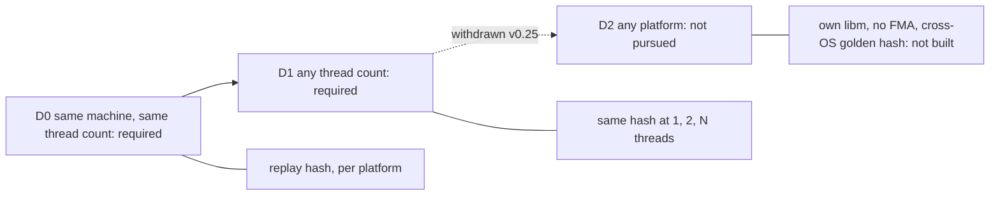

# Physics Architecture (from scratch) `[P]`

Templates studied: Box2D v3 and Jolt (see [state of the art](../01-state-of-the-art.md)). We write our own, using their published design lessons, not their code.

## 1. Boundaries

- `physics` is a **standalone L2 module**: depends only on `base` and `jobs`. It does **not** know about the ECS, scene, or renderer. This keeps its internal data layout free to be optimal and makes it testable in isolation.
- API is **handle-based** (bodies, shapes, joints are ids), like Box2D v3 [S](https://box2d.org/posts/2024/08/releasing-box2d-3.0); a C ABI exists only at plug-in boundaries (N-11), so the dimension-generic core is not forced through it.
- Integration with the ECS is a thin `physics_sync` system: write kinematic targets/forces in, read transforms out, using handles stored in components.
- Debug visualisation through an optional `IPhysicsDebugDraw` port.

## 2. Pipeline

```
fixed dt -> [broadphase update] -> [narrowphase pairs] -> [contact/constraint build]
         -> [island/graph-color partition] -> [solve (sub-stepped, SIMD)] -> [integrate] -> [CCD] -> [events]
```

| Stage | Proposed approach | Source of the idea |
|---|---|---|
| Broadphase | dynamic BVH (AABB tree) with a design that allows concurrent queries during simulation | Jolt's lock-free broadphase motivation [S](https://guerrilla-games.com/read/architecting-jolt-physics-for-horizon-forbidden-west) |
| Narrowphase | SAT/clipping (2D); GJK + EPA / SAT (3D) [K] | classic |
| Solver | **soft constraints + sub-stepping** ("Soft Step") instead of velocity/position iteration counts; contacts computed once per step [S](https://github.com/erincatto/box2d/blob/main/docs/migration.md) | Box2D v3 |
| Parallelism | **graph coloring** of constraints so each color solves in parallel; islands for sleeping | Box2D v3 (inspired by bepu) [S](https://box2d.org/posts/2024/08/releasing-box2d-3.0) |
| SIMD | body state packed small (Box2D fits it in 32 bytes) and solver vectorised; scalar reference kept as test oracle | Box2D v3 [S](https://box2d.org/posts/2024/08/releasing-box2d-3.0) |
| CCD | hybrid speculative + time-of-impact | Box2D v3 [S](https://box2d.org/posts/2024/08/releasing-box2d-3.0) |
| Large worlds | precision-aware algorithms; document the usable world size, recentre or switch to double beyond it | Box2D v3 notes ~20 km usable [S](https://box2d.org/posts/2024/08/releasing-box2d-3.0) |

## 3. Determinism (ADR-0007; owner: D0 and D1 required, D2 not pursued since v0.25)

Levels, each with its own test:

| Level | Meaning | Cost |
|---|---|---|
| **D0** Same binary, same machine, same inputs -> same state | replay hash test, fixed dt, ordered iteration, no data-race-dependent results | low; **required** |
| **D1** Same binary across runs with different thread counts | deterministic constraint ordering (coloring is deterministic), reduction order fixed | medium; **required** |
| **D2** Across compilers/CPUs/platforms | would need own math functions, no FMA or estimate instructions, and a golden hash shared by Windows, Linux and ARM64 | high; **not pursued (owner, v0.25, card 1-12)**. It was a goal from v0.7 to v0.24. ARM64 is a portability proof only. A new owner decision can bring it back |



Jolt documents determinism with explicit limits [S aggregator](https://github.com/hyv1001/JoltPhysics); we do the same: the limits are part of the spec, and tested by a **state-hash replay test** in CI.

**Rules that keep D0 and D1 (simulation code only; everything else may use `std`)**

1. **Strict IEEE float by default:** Rust has no fast-math and no implicit FMA contraction; keep it that way (no `fast-math`-style intrinsics, no x87, fixed rounding mode).
2. **SIMD matches scalar bit for bit on the same platform:** property test compares SIMD to scalar bitwise. This keeps the SIMD path testable; it is not a cross-platform promise.
3. **Own containers where order matters:** no `std` `HashMap`/`HashSet` iteration in simulation (Rust's default hasher is randomly seeded per process, which breaks even D0), no unstable sort on equal keys; use a deterministic hash map, stable `sort`/`sort_by` with a total order, and ordered iteration.
4. **Own seeded RNG**; no time- or address-dependent values; no pointer-ordering.
5. **Replay-hash test on every supported platform**: the same scene is run twice and at 1 and N threads, and the hashes must be equal. A stored golden hash is allowed only per platform and runner image, and is regenerated when the image or the toolchain changes (a platform libm update can change a result without any code change). Hashes are not compared between platforms.
6. **Control registers and enforcement (N-1):** set and assert the floating-point control state (rounding mode, FTZ/DAZ) at the start of every simulation job, because drivers and audio libraries loaded in-process (OpenGL, GLFW, miniaudio) can change it and that would break even D0 `[K]`. Clippy `disallowed-methods`/`disallowed-types` ban the functions and types listed in [ports-and-adapters](ports-and-adapters.md) from the simulation crates.

**Consequences of dropping D2 (v0.25):**

- D0 means the same binary on the same machine. A libm picked at run time by CPU features (for example an FMA code path) could differ between two machines of the same OS, so replay files and saves are not guaranteed to replay on another machine, and lockstep or rollback netcode between different machines is not supported by this decision. A server-authoritative design with state snapshots is unaffected.
- A SIMD backend chosen at run time (for example SSE2 versus AVX2) must still be bit-identical to the scalar reference on that machine.
- Replay-critical paths should avoid libm calls, or record the libm version with any stored golden hash.

**Withdrawn with D2 (v0.25):** own `sin/cos/tan/atan2/exp/log/pow` (platform libm is allowed in simulation code), the ban on FMA and reciprocal or rsqrt estimates as a cross-ISA rule, the cross-platform golden hash, the ARM64 replay gate (N-10) and the D2 cost report (D-10). The arch-check bans on libm functions in the `physics` and `base` crates (`gates/architecture.toml`) are governance configuration and were not changed by this decision; the owner decides whether to relax them, before phase 4 starts, because physics code that calls `sin` or `cos` would otherwise fail the architecture check.

## 4. Dimensionality: 2D and 3D, 2D first (Q3 answered; option B accepted by owner as the default, Q20; the ADR-0018 spike may revert to C)

Owner decision: **both 2D and 3D**; start with 2D physics + 2D graphics, ideally as a *subcase* of 3D; then add 3D.

"Subcase" can be implemented three ways:

| Option | What it is | Pros | Cons |
|---|---|---|---|
| **A. Restriction** | One 3D engine; "2D" = a 3D world with locked axes (z fixed, rotation only about z) | One code path, literally a subcase | 2D pays 3D costs: 6-DOF body state, quaternion, 3x3 inertia, 3D manifolds - a 2D-native body is far smaller (Box2D v3 fits body state in 32 bytes, which is what makes its SIMD solver map onto 256-bit vectors [S](https://box2d.org/posts/2024/08/releasing-box2d-3.0)); and phase 4 would already need robust 3D narrowphase (GJK/EPA, manifold generation), the hardest part - defeating "2D first de-risks". |
| **B. Dimension-generic core** *(accepted default, Q20)* | Shared algorithmic skeleton parameterised by a dimension trait (vector type, rotation = scalar angle or quaternion, inertia = scalar or 3x3 tensor, shape set). 2D is the `D=2` instance, 3D the `D=3` instance. Math-specific parts stay specialised. | One skeleton, one set of tests, 2D fast and small, 3D added later without redesign; honors "2D as a subcase" at the *design* level | Up-front design cost; template/concept complexity; risk of over-generalising |
| **C. Two separate libraries** (Box2D/Box3D-like) | Share only utilities | Easiest to optimise each | Duplicated logic and double maintenance - bad for a solo project |

**Shared vs specialised under option B**

| Shared (dimension-independent) | Specialised per dimension |
|---|---|
| Dynamic BVH broadphase (AABB of rank D), pair management | body state layout, integration (angle vs quaternion) |
| Islands, sleeping, graph coloring | narrowphase and manifold generation (2D SAT/clipping vs 3D GJK/EPA/SAT) |
| Solver loop structure (soft constraints, sub-stepping), job integration | constraint math (Jacobians, effective mass with scalar vs tensor inertia), joints |
| Handle/ID scheme, world API shape, events, debug draw port | SIMD packing |
| Determinism harness, benchmark scenes, test oracles | shape set (circle/polygon/capsule vs sphere/box/capsule/convex/mesh) |

**Bonus for TDD (limited, M2):** option A becomes a *test oracle* for **short, non-chaotic scenes** with stated tolerances: a scene simulated in the 2D instance must match the same scene in the 3D instance constrained to a plane. It is not used for stacking or other chaotic scenes, where a 3D solver drifts off the plane.

**Spike before phase 4 (ADR-0018):** minimal body + solver for a stacking scene in A and B; measure bytes/body, step time, and code shared. Decide with data. Keep rule: share only what is demonstrably the same; if a template needs `if constexpr (D == 2)` branches throughout, that part should be specialised instead.

## 5. TDD plan

| Test type | Examples |
|---|---|
| Unit (analytic) | free fall matches closed form within tolerance; elastic collision conserves momentum; friction cone; restitution; joint limits |
| Geometry | GJK/SAT vs brute-force oracle; distance/closest-point; ray cast |
| Property-based | random scenes: no NaN, no tunnelling beyond epsilon, energy never increases without input, SIMD == scalar |
| Stability scenes | stacking pyramid / long chain / high mass ratio must stay settled (Soft Step targets these [S](https://box2d.org/posts/2024/08/releasing-box2d-3.0)) |
| Determinism | replay N steps, hash state per step, compare to golden and across thread counts |
| Concurrency | TSan job: concurrent queries during `Step` |
| Benchmarks | N-body/stack/pyramid scenes, CSV output compared with main (Box2D practice) |

## 6. Risks

- Physics is a notorious time sink (robust 3D contact manifolds, stable stacking, CCD). Mitigation: scope in stages (2D first, 3D in its own phase), strong oracle tests including the dimension-consistency test, keep the feature list short (rigid bodies, a few shapes, a handful of joints; no soft bodies/cloth/vehicles).
- Dimension-generic design can become over-engineered. Mitigation: the spike and the "share only what is demonstrably the same" rule above.
