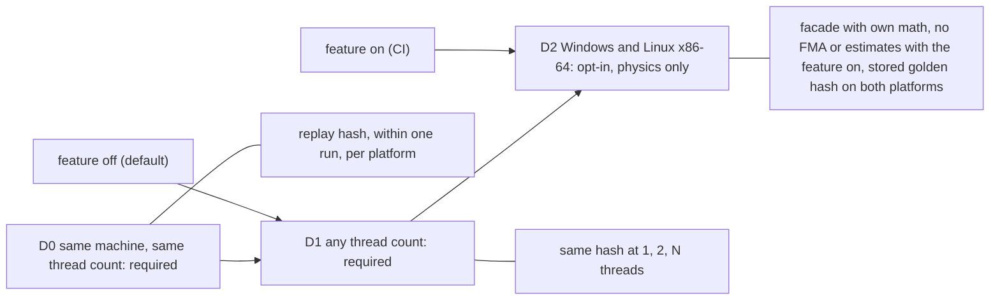
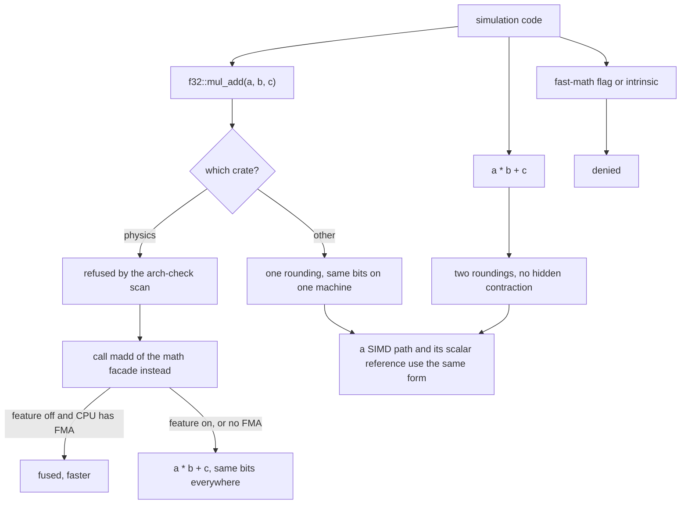
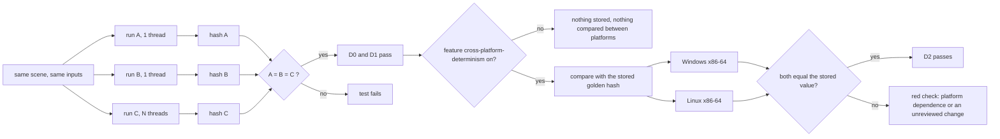

# Physics Architecture (from scratch) `[P]`

Templates studied: Box2D v3 and Jolt (see [state of the art](../01-state-of-the-art.md)). We write our own, using their published design lessons, not their code.

The phase 4 shape of the crates, the job system, the determinism harness, the cards and the choices for the owner is proposed in [physics-and-jobs-v0](physics-and-jobs-v0.md).

**As built in card 4-10:** the `physics` crate (`engine/physics`) holds the dimension-generic world core and the 2D instance: fixed-capacity bodies with generation-checked handles, static and dynamic bodies, circle and box shapes with mass properties, semi-implicit Euler with gravity, forces and damping, the 2D rotation as a (cos, sin) pair advanced without `sin`/`cos`/`atan2`, and the FNV-1a state hash used by the D0 replay tests. No broadphase, narrowphase, solver or joints yet (cards 4-11 to 4-16). See [physics-and-jobs-v0](physics-and-jobs-v0.md) section 2 and [reviews/4-10](../../reviews/4-10.md).

**As built in card 4-11:** the world has a broadphase: a dimension-generic dynamic AABB tree (fixed capacity, no allocation after creation, fat boxes with a margin, one tree for static and one for dynamic bodies) and a duplicate-free pair list in the canonical order (lower slot, higher slot) with a documented overflow flag; static-static pairs are skipped; the state hash is unchanged. Tree performance is not measured yet (card 4-22). See [physics-and-jobs-v0](physics-and-jobs-v0.md) section 2 and [reviews/4-11](../../reviews/4-11.md).

**As built in card 4-12:** after the broadphase the step runs a 2D narrowphase over the pair list and keeps the result in a fixed-capacity manifold list owned by the world (overflow counted like the pair list): circle-circle, circle-box (Box2D face and vertex regions) and box-box (separating axis test on the face normals, reference and incident face clipping, up to two points), a speculative margin (default 0.02 m), per point a position, a separation, two anchors and a stable 16-bit feature id; plain `+ - * /` and `sqrt` only, no NaN, exact under translation by powers of two and under quarter turns, a circle and a box give bit-identical results in either order. No polygon shape (the note fixes no vertex limit), no force applied (solver: card 4-13), state hash unchanged, performance not measured (card 4-22). See [physics-and-jobs-v0](physics-and-jobs-v0.md) section 2 and [reviews/4-12](../../reviews/4-12.md).

**As built in card 4-13:** the world has a contact solver: a soft step (per step 4 sub-steps; per sub-step integrate velocities, warm start, solve soft contacts with friction before the normal, integrate positions, relax once; restitution after the last sub-step with a 1 m/s threshold), warm starting by body pair and feature id, Coulomb friction mixed by the square root of the product and restitution by the maximum, speculative contacts, separation updated from the anchors' motion so the manifold is made once per step, an atomic step (`NotFinite` changes nothing), no allocation, plain `f32` in a fixed order as the scalar reference for the SIMD solver of card 4-15. A 10-high pyramid settles (checkpoint of the card). A body with a manifold in the margin takes four sub-steps while one without takes a single Euler step, so a body gains a small, deterministic position jump (about 1 mm at 60 Hz in free fall) when a contact first appears. No continuous collision detection yet (a fast body can embed before the first contact), performance not measured (card 4-22), cross-platform golden hash is card 4-20. See [physics-and-jobs-v0](physics-and-jobs-v0.md) section 2 and [reviews/4-13](../../reviews/4-13.md).

**As built in card 4-14:** the world finds islands (union-find over the manifolds of dynamic bodies, id = lowest slot, a static body joins none), lets resting islands sleep (`SleepConfig`: 0.5 s, 0.05 m/s, 2 degrees per second, all named constants; asleep = not integrated, not solved, contacts persist; wakes by an awake contact, `World::wake`, a setter, a static body created, a body destroyed; the flag is hashed only when set; `enabled = false` turns it off) and colours the constraints greedily and serially (at most 24 colours, overflow set solved last and reported as a value, canonical order inside a colour) so that the solver goes colour by colour and the order inside a colour changes no bit. Card 4-15 solves the colours in parallel and must equal this result bit for bit. Class and state views in [physics-and-jobs-v0](physics-and-jobs-v0.md) section 2, review [reviews/4-14](../../reviews/4-14.md). **As built in card 4-15:** the solver can run each colour as fixed-size chunks through the `jobs` `IScheduler` port (`World::set_execution`, `SolverExecution`; chunk cut independent of the worker count, bodies written back serially in canonical order, no `unsafe`) and four constraints at a time in `base::simd::F32x4` lanes; both equal the serial scalar solve bit for bit (tested at 1, 2, 4 and 6 workers; the default stays the scalar serial reference). Details, views and limits: [physics-and-jobs-v0](physics-and-jobs-v0.md) section 2, review [reviews/4-15](../../reviews/4-15.md). **As built in card 4-16:** the world has joints, a revolute joint (hinge with optional angle limits and a small motor) and a distance joint (rod, spring, rope or strut), as generation-checked handles with a capacity in `WorldConfig`; bodies joined by a joint do not collide unless asked; a joint between two dynamic bodies joins their island; the joints are solved in the same soft-step scheme with a warm start, serially before the contacts in every pass (not coloured, so the parallel and SIMD paths equal the scalar serial one by construction); the state hash covers the joint impulses and is unchanged for worlds without joints. A chain of 20 hinged links released horizontally keeps its hinges within a few centimetres (measured in the review). Details, views and numbers: [physics-and-jobs-v0](physics-and-jobs-v0.md) section 2, review [reviews/4-16](../../reviews/4-16.md).

**As built in card 4-17:** tests only. One integration target `engine/physics/tests/stability/` holds the stability scenes (pyramids, columns, mass ratios, chains, a bridge with a load, a mixed scene), the execution matrix (scalar serial, lanes, pools of 1, 2, 4 and 6 workers, equal state hash), sleeping variants and 8 properties over 25 seeded scenes. Five bounds stated before measuring are not met by the solver (tall columns, a 1:100:1:100 column, a 50-link chain, a 20-row pyramid, the heavy bridge load at 8 s) and are kept as findings, not weakened; W1-scale stacking is not demonstrated (largest pyramid that passes: 55 boxes). Details and views: [physics-and-jobs-v0](physics-and-jobs-v0.md) section 2, review [reviews/4-17](../../reviews/4-17.md).

**As built in card 4-18:** tests only. The target `engine/physics/tests/determinism/` replays 10 scenes under 39 execution configurations (scalar and lanes; inline, reversed, shuffled, one-range, refusing and pooled schedulers at 1, 2, 3 and 7 workers; chunk sizes 1, 7, 32 and huge), pool and shuffled ones twice, and compares the hash and the bits of every body after every step; probes show that the schedulers were used, and deliberately faulty schedulers must fail it. No stored value (the golden hash is card 4-20). Details: [physics-and-jobs-v0](physics-and-jobs-v0.md) section 5, review [reviews/4-18](../../reviews/4-18.md).

## 1. Boundaries

- `physics` is a **standalone L2 module**: depends only on `base` and `jobs`. It does **not** know about the ECS, scene, or renderer. This keeps its internal data layout free to be optimal and makes it testable in isolation.
- API is **handle-based** (bodies, shapes, joints are ids), like Box2D v3 [S](https://box2d.org/posts/2024/08/releasing-box2d-3.0); a C ABI exists only at plug-in boundaries (N-11), so the dimension-generic core is not forced through it.
- Integration with the ECS is a thin `physics_sync` system: write kinematic targets/forces in, read transforms out, using handles stored in components.
- Debug visualisation through an optional `IPhysicsDebugDraw` port.

## 2. Pipeline

```
fixed dt -> [broadphase update] -> [narrowphase pairs] -> [contact/constraint build]
         -> [island/graph-color partition] -> [solve (sub-stepped, SIMD)] -> [integrate] -> [CCD] -> [events]
```

| Stage | Proposed approach | Source of the idea |
|---|---|---|
| Broadphase | dynamic BVH (AABB tree) with a design that allows concurrent queries during simulation | Jolt's lock-free broadphase motivation [S](https://guerrilla-games.com/read/architecting-jolt-physics-for-horizon-forbidden-west) |
| Narrowphase | SAT/clipping (2D); GJK + EPA / SAT (3D) [K] | classic |
| Solver | **soft constraints + sub-stepping** ("Soft Step") instead of velocity/position iteration counts; contacts computed once per step [S](https://github.com/erincatto/box2d/blob/main/docs/migration.md) | Box2D v3 |
| Parallelism | **graph coloring** of constraints so each color solves in parallel; islands for sleeping | Box2D v3 (inspired by bepu) [S](https://box2d.org/posts/2024/08/releasing-box2d-3.0) |
| SIMD | body state packed small (Box2D fits it in 32 bytes) and solver vectorised; scalar reference kept as test oracle | Box2D v3 [S](https://box2d.org/posts/2024/08/releasing-box2d-3.0) |
| CCD | hybrid speculative + time-of-impact | Box2D v3 [S](https://box2d.org/posts/2024/08/releasing-box2d-3.0) |
| Large worlds | precision-aware algorithms; document the usable world size, recentre or switch to double beyond it | Box2D v3 notes ~20 km usable [S](https://box2d.org/posts/2024/08/releasing-box2d-3.0) |

## 3. Determinism (ADR-0007; owner: D0 and D1 required; D2 returns for physics only, opt-in, v0.36)

Levels, each with its own test:

| Level | Meaning | Cost |
|---|---|---|
| **D0** Same binary, same machine, same inputs -> same state | replay hash test, fixed dt, ordered iteration, no data-race-dependent results | low; **required** |
| **D1** Same binary across runs with different thread counts | deterministic constraint ordering (coloring is deterministic), reduction order fixed | medium; **required** |
| **D2** Same source and pinned toolchain, same inputs -> same physics state on Windows x86-64 and Linux x86-64 | the physics crate reaches `sin`, `cos`, `exp`, ... only through the deterministic math facade in `base`, which uses the engine's own functions; with the feature on, no fused multiply-add (the facade's `madd` is `a * b + c`) and no reciprocal estimate instructions; a golden replay hash stored in the repo and compared on both platforms | high; **opt-in** (Cargo feature `cross-platform-determinism`, off by default, on in CI). Owner decision v0.36 (card 1-23): it was a goal from v0.7 to v0.24, withdrawn in v0.25 (card 1-12) and returns now for **physics only**. ARM64 is a portability proof, not gated and not promised |



Jolt documents determinism with explicit limits [S aggregator](https://github.com/hyv1001/JoltPhysics); we do the same: the limits are part of the spec, and tested by a **state-hash replay test** in CI. The opt-in shape follows Jolt (a build option for cross-platform determinism, which its documentation reports as slower; the 8% figure quoted in discussion was not re-checked here) and Rapier (the `enhanced-determinism` feature); Box2D v3 also has a cross-platform level (see [container-competitors](../spikes/container-competitors.md)). Our cost is not measured yet; it is measured and reported when the physics crate exists (phase 4).

**Rules that keep D0 and D1 (simulation code only; everything else may use `std`)**

1. **Strict IEEE float by default:** Rust has no fast-math and no implicit FMA contraction; keep it that way (no `fast-math`-style intrinsics, no x87, fixed rounding mode). An **explicit `f32::mul_add` is allowed outside the physics crate**: it is one fused operation with a single rounding, so it is deterministic for D0 and D1 on one machine. It gives different bits from `a * b + c` (two roundings), so a SIMD path and its scalar reference must use the same form, and a test must pin it. **The physics crate does not call it** (arch-check scan); it calls `madd(a, b, c)` of the math facade (rule 7), which is a fused operation when the feature is off and the CPU has FMA, and `a * b + c` otherwise (always, when the feature is on). `mul_add` itself stays refused there, because on a CPU without hardware FMA it is a call to the platform's `fmaf`, and nobody has verified that this call is bit-identical on Windows and Linux.
2. **SIMD matches scalar bit for bit on the same platform:** property test compares SIMD to scalar bitwise. The `simd` abstraction offers no reciprocal or rsqrt estimate, and the arch-check scan refuses those intrinsics in `physics` and `base`; fused multiply-add intrinsics are refused in `physics` and may live only in `base`, behind the facade's `madd`, compiled out when the feature is on (no scanner sees a `cfg`, so review checks it); so the operations that exist today (`+ - * /`, `sqrt`, `horizontal_sum` with its fixed add order) are specified to give the same bits on every ISA. This is a specification, not yet a tested cross-ISA property: `min`, `max`, `abs`, conversions and any future reduction (for example a NEON horizontal add) have ISA-specific corner cases (NaN, signed zero, add order) that must be pinned in the abstraction contract, and every new ISA backend must pass the scalar-equality property test, before D2 is claimed for it. A new estimate operation, or a fused one outside the facade, is a governance change.
3. **Own containers where order matters:** no `std` `HashMap`/`HashSet` iteration in simulation (Rust's default hasher is randomly seeded per process, which breaks even D0), no unstable sort on equal keys; use a deterministic hash map, stable `sort`/`sort_by` with a total order, and ordered iteration.
4. **Own seeded RNG**; no time- or address-dependent values; no pointer-ordering.
5. **Replay-hash test on every supported platform, within one run (D0, D1):** the same scene is run twice and at 1 and N threads, in the same process on the same machine, and the hashes must be equal. This test is always on, with the feature on and off, and it reads no stored value. A stored hash is allowed only for D2, see rule 7. Golden files remain allowed for outputs that do not depend on libm or the CPU (render command streams, for example).
6. **Control registers and enforcement (N-1):** set and assert the floating-point control state (rounding mode, FTZ/DAZ) at the start of every simulation job, because drivers and audio libraries loaded in-process (OpenGL, GLFW, miniaudio) can change it and that would break even D0 `[K]`. The bans listed in [ports-and-adapters](ports-and-adapters.md) are enforced by the arch-check scan where a scanner can see them; Clippy `disallowed-methods`/`disallowed-types` is a planned second line for the physics crate (not configured yet), and the control-state assertion is a runtime check with its own test. For D2 the asserted state must be the same on both platforms: round to nearest even, denormals kept (no FTZ, no DAZ); the values are fixed and tested when the physics crate is built. **As built in card 4-9:** the helper is `base::fpenv` (`set_deterministic`, `assert_deterministic`, `FpGuard`; x86-64 `MXCSR` and AArch64 `FPCR`, see [reviews/4-9](../../reviews/4-9.md)); the physics crate and the job pool do not call it yet.

**Additional rules for D2 (physics crate, feature `cross-platform-determinism`)**

7. **Math facade:** the physics crate never calls `sin`, `cos`, `tan`, `atan2`, `exp`, `log`, `pow` or `powi`, nor `mul_add`, on a float; the arch-check scan refuses these spellings in `physics`. It calls the facade in `base` (module `base::dmath`, card 4-8), which has one signature per function and two implementations: the platform's `std` function with the feature off, and the engine's own function with the feature on. The own functions use only `+ - * /`, `sqrt` and comparisons, in a fixed order, so they give the same bits on every platform; each is tested against a high-precision oracle with a stated ULP bound and bit-for-bit against stored test vectors. `sqrt`, `abs`, `floor`, `min` and `max` are exact in IEEE and stay as they are. The facade also offers `madd(a, b, c)` (named `madd` because the scan refuses the name `fma`): with the feature off it is one fused operation when the CPU has FMA and `a * b + c` when it does not; with the feature on it is always `a * b + c`. The choice is made once per process (a single resolved function, for example in a `OnceLock`, or `cfg(target_feature = "fma")` at build time) and every caller goes through it; a scalar reference compiled without FMA next to a SIMD path with FMA would differ bitwise, so the scalar reference and the SIMD path must both call `madd`, and a test pins that they agree. Code in `base` that feeds physics (the vector, matrix and quaternion types) is written with separate multiply and add today and must stay so or use `madd`, never `mul_add`. The `base` math types that call libm today (`Quat::from_axis_angle`, `Quat::slerp`, the `rotation_*` constructors) must route through the facade when the feature is on; that change is made by card 4-8 (`Mat3::from_rotation_x/y/z`, `Quat::from_axis_angle` and `Quat::slerp` call `base::dmath`, and nothing else in `base` calls libm). The own functions work in `f64` with one rounding to `f32` done in integer arithmetic, are within 0.51 ulp of the exact value (measured 0.5000), and `sin`, `cos`, `tan` are accurate for every finite argument (exact Payne-Hanek reduction above `2^20`).
8. **Stored golden hash, feature on only (phase 4):** a fixed set of scenes is run with the feature on and the hash of the state after each step is compared with the value stored in `gates/golden/physics-replay.toml`, on Windows x86-64 and on Linux x86-64. The file is a protected path: an intended change of physics results is therefore a governance change that the owner sees, and an unintended one is a red check. The price is that every deliberate solver change needs a governance task to re-record the hash. The earlier objection to a stored hash (a libm chosen at run time by CPU features can change a result with no code change, v0.27) does not apply, because with the feature on the physics path calls no libm. With the feature off nothing is stored or compared. The file and the CI job are created with the physics crate in phase 4; there is nothing to hash before.
9. **Build flags:** with the feature on, the build must fail if fused instructions are enabled globally (`-C target-feature=+fma` or `-C target-cpu=native` in `RUSTFLAGS`, which CI sets in places): a `compile_error!` on `cfg(all(feature = "cross-platform-determinism", target_feature = "fma"))` and a CI check of `RUSTFLAGS`. As built (card 4-8): the `compile_error!` is in `base::dmath` (checked with `RUSTFLAGS` set to `-C target-feature=+fma` and to `-C target-cpu=native`); the CI check of `RUSTFLAGS` comes with the D2 job (card 4-20). Until that check exists the claim "fused code is compiled out with the feature on" is unverified, and no scanner can check it.
10. **Toolchain:** the pinned `rust-toolchain.toml` is part of the promise. A compiler update is accepted only when the golden hash still matches on both platforms.

FMA rule of point 1:





The within-run test reads no stored value, so a libm chosen at run time by CPU features cannot change its verdict. The D2 comparison reads the stored value and is run only with the feature on, where the physics path calls no libm.

**What each mode promises**

- **Feature off (default):** D0 and D1. FMA is used where the CPU has it, so results can differ between a machine with FMA and one without. A libm picked at run time by CPU features (for example a `sin` or `exp` variant that uses FMA inside) could differ between two machines of the same OS, so lockstep or rollback netcode between different machines is not supported in this mode. A server-authoritative design with state snapshots is unaffected. A replay or save file is valid only on the machine and build that wrote it.
- **Feature on:** physics results are bit-identical on Windows x86-64 and Linux x86-64 for the same source, the same pinned toolchain and the same inputs. Lockstep and rollback netcode between those platforms become possible for physics, with the limits Jolt also states: the same sequence of API calls (bodies created, changed and removed in the same order), the same fixed step, and inputs that are themselves identical.
- **Limits:** only the physics crate is covered, and the scan sees only the source of the physics crate: libm reached through `base` (the quaternion rotation and slerp functions) is not scanned; since card 4-8 those functions call the facade `base::dmath`, so the remaining gap is any other `base` code that calls libm in the future. Game code that computes forces or positions with the platform libm and feeds them to physics breaks the promise; the facade is available to it. ARM64 and other CPUs are not promised and not gated. Until the physics crate and the CI job exist (phase 4), D2 is a rule set, not a proven property.

**Restored with D2 (v0.36, narrower than v0.7 to v0.24: physics only, opt-in, no ARM64 gate):** own deterministic `sin/cos/tan/atan2/exp/log/pow` behind the facade, the ban on reciprocal or rsqrt estimates (arch-check, `physics` and `base`), the ban on calling FMA directly in `physics` (it is used through the facade, and only with the feature off), the cross-platform golden hash on Windows x86-64 and Linux x86-64, and the D2 cost report (D-10: measure the feature on and off). **Stays withdrawn:** the ARM64 replay gate (N-10), and any promise for code outside the physics crate. The arch-check bans on libm functions were removed from `gates/architecture.toml` in card 1-13 and are restored in card 1-23 for the `physics` crate only; `base` may call libm because the facade lives there. The bans that serve D0 and D1 (`HashMap`/`HashSet`, unstable sort) stay.

## 4. Dimensionality: 2D and 3D, 2D first (Q3 answered; option B accepted by owner as the default, Q20; the ADR-0018 spike recommended B and kept C as the fallback, see [ADR-0018](../decisions/adr-0018-physics-core.md))

Owner decision: **both 2D and 3D**; start with 2D physics + 2D graphics, ideally as a *subcase* of 3D; then add 3D.

"Subcase" can be implemented three ways:

| Option | What it is | Pros | Cons |
|---|---|---|---|
| **A. Restriction** | One 3D engine; "2D" = a 3D world with locked axes (z fixed, rotation only about z) | One code path, literally a subcase | 2D pays 3D costs: 6-DOF body state, quaternion, 3x3 inertia, 3D manifolds - a 2D-native body is far smaller (Box2D v3 fits body state in 32 bytes, which is what makes its SIMD solver map onto 256-bit vectors [S](https://box2d.org/posts/2024/08/releasing-box2d-3.0)); and phase 4 would already need robust 3D narrowphase (GJK/EPA, manifold generation), the hardest part - defeating "2D first de-risks". |
| **B. Dimension-generic core** *(accepted default, Q20)* | Shared algorithmic skeleton parameterised by a dimension trait (vector type, rotation = scalar angle or quaternion, inertia = scalar or 3x3 tensor, shape set). 2D is the `D=2` instance, 3D the `D=3` instance. Math-specific parts stay specialised. | One skeleton, one set of tests, 2D fast and small, 3D added later without redesign; honors "2D as a subcase" at the *design* level | Up-front design cost; template/concept complexity; risk of over-generalising |
| **C. Two separate libraries** (Box2D/Box3D-like) | Share only utilities | Easiest to optimise each | Duplicated logic and double maintenance - bad for a solo project |

**Shared vs specialised under option B**

| Shared (dimension-independent) | Specialised per dimension |
|---|---|
| Dynamic BVH broadphase (AABB of rank D), pair management | body state layout, integration (angle vs quaternion) |
| Islands, sleeping, graph coloring | narrowphase and manifold generation (2D SAT/clipping vs 3D GJK/EPA/SAT) |
| Solver loop structure (soft constraints, sub-stepping), job integration | constraint math (Jacobians, effective mass with scalar vs tensor inertia), joints |
| Handle/ID scheme, world API shape, events, debug draw port | SIMD packing |
| Determinism harness, benchmark scenes, test oracles | shape set (circle/polygon/capsule vs sphere/box/capsule/convex/mesh) |

**Bonus for TDD (limited, M2):** option A becomes a *test oracle* for **short, non-chaotic scenes** with stated tolerances: a scene simulated in the 2D instance must match the same scene in the 3D instance constrained to a plane. It is not used for stacking or other chaotic scenes, where a 3D solver drifts off the plane.

**Spike before phase 4 (ADR-0018, done in card 4-2, recorded in [ADR-0018](../decisions/adr-0018-physics-core.md)):** minimal body + solver for a stacking scene in A and B; measure bytes/body, step time, and code shared. Decide with data. Keep rule: share only what is demonstrably the same; if a template needs `if constexpr (D == 2)` branches throughout, that part should be specialised instead.

## 5. TDD plan

| Test type | Examples |
|---|---|
| Unit (analytic) | free fall matches closed form within tolerance; elastic collision conserves momentum; friction cone; restitution; joint limits |
| Geometry | GJK/SAT vs brute-force oracle; distance/closest-point; ray cast |
| Property-based | random scenes: no NaN, no tunnelling beyond epsilon, energy never increases without input, SIMD == scalar |
| Stability scenes | stacking pyramid / long chain / high mass ratio must stay settled (Soft Step targets these [S](https://box2d.org/posts/2024/08/releasing-box2d-3.0)) |
| Determinism | replay N steps twice and at 1 and N threads in one run, hash state per step, compare the hashes with each other (no stored golden) |
| Concurrency | TSan job: concurrent queries during `Step` |
| Benchmarks | N-body/stack/pyramid scenes, CSV output compared with main (Box2D practice) |

## 6. Risks

- Physics is a notorious time sink (robust 3D contact manifolds, stable stacking, CCD). Mitigation: scope in stages (2D first, 3D in its own phase), strong oracle tests including the dimension-consistency test, keep the feature list short (rigid bodies, a few shapes, a handful of joints; no soft bodies/cloth/vehicles).
- Dimension-generic design can become over-engineered. Mitigation: the spike and the "share only what is demonstrably the same" rule above.
