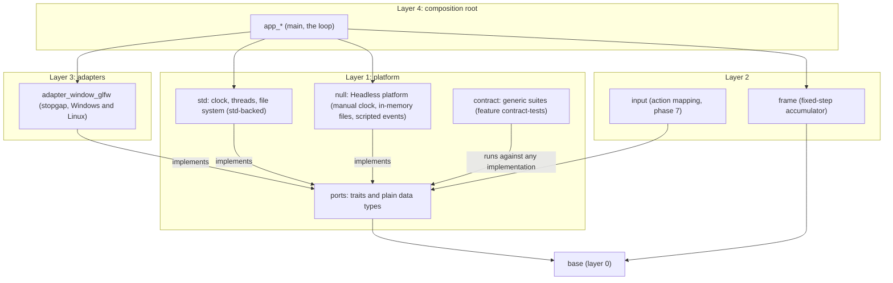
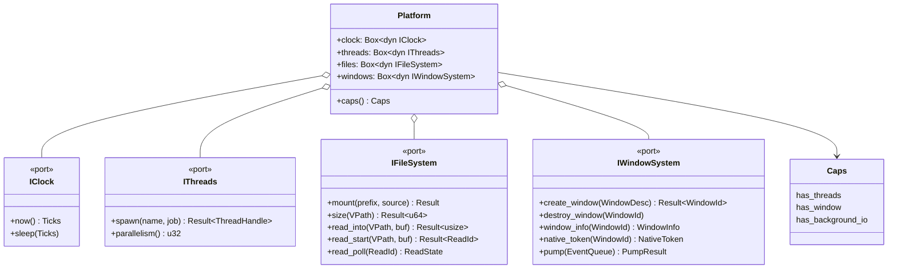
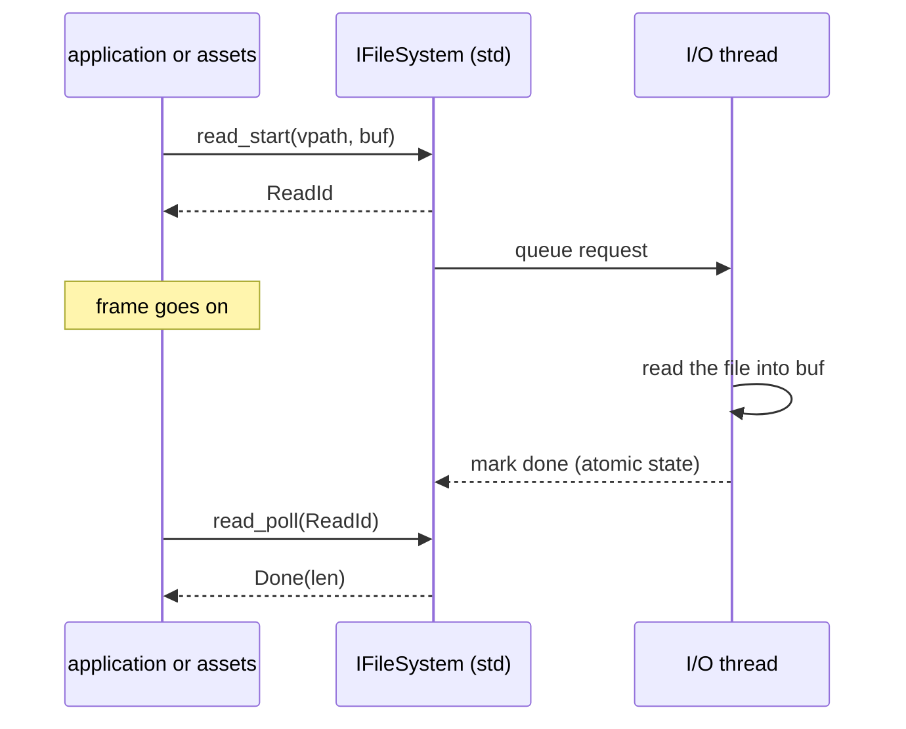
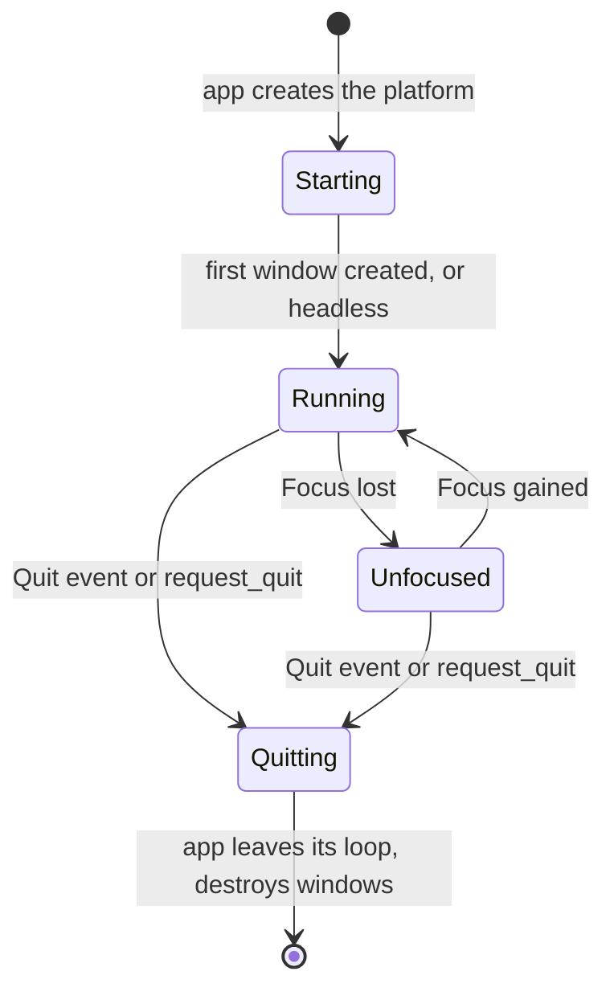
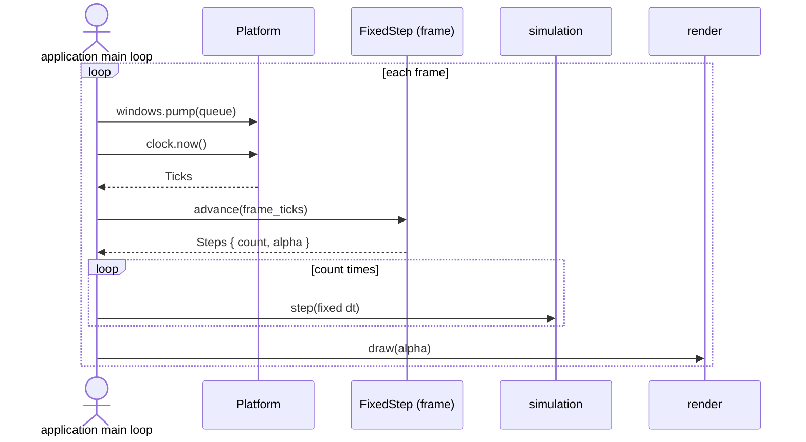
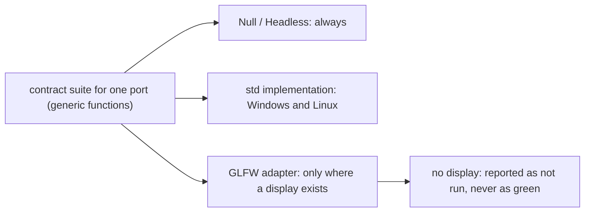
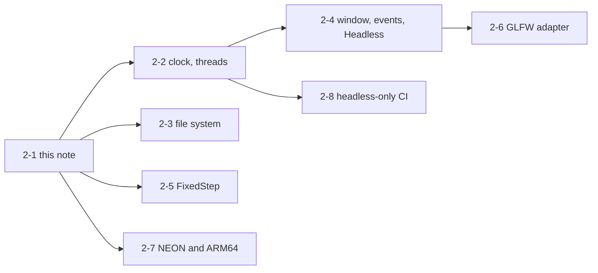
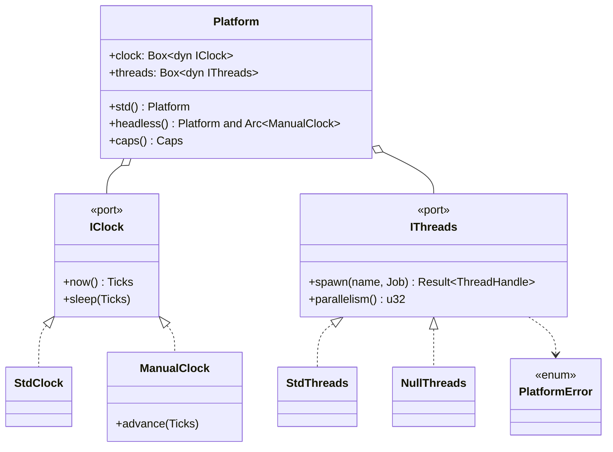
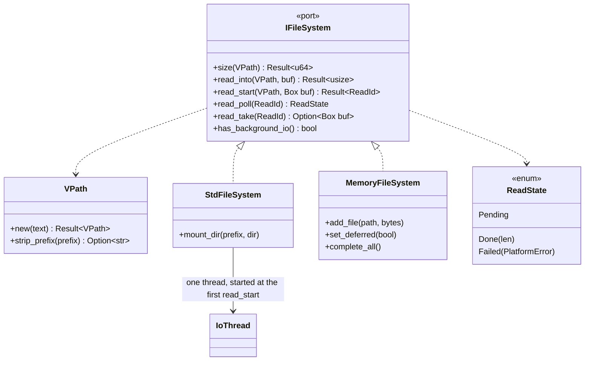
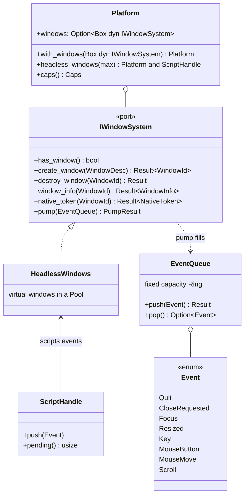

# Platform port family v0: design note `[P]` (card 2-1)

Design note for phase 2, written before any code. It fixes the shape of the platform ports named in [ports-and-adapters §3](ports-and-adapters.md) and in the phase 2 row of the [roadmap](../workflow/roadmap.md): clock, threads, file system with virtual mounts, window, events (lifecycle and input), the frame loop with a fixed step, and where the GLFW stopgap and the ARM64 work sit. **Everything here is a proposal**; the choices that are the owner's are in section 9 with a recommendation each. The names and signatures below are sketches to fix the shape, not final code.

Fixed inputs, not reopened here: `std` is used directly in layers 0-2 except the OS-facing parts, which go through ports ([ports-and-adapters §2](ports-and-adapters.md)); platform ports are shaped for **Windows and Linux only** (Q17); every port has a **Null adapter** and a **contract suite** and stays `experimental` until two real adapters pass it; window and input become `stable` only after a native adapter exists next to the GLFW stopgap (D-5); the application owns the loop ([conventions](conventions.md)); no global singletons ([overview §6](overview.md)); handles, not pointers, across module boundaries; zero heap allocations per frame on hot paths.

## 1. Where the code lives



- **`platform` (L1) declares the ports** and also holds the implementations that need nothing but `std`: the `std` clock, thread and file system seams, and the Null/Headless platform. `std::fs`, `std::time` and thread creation are allowed there by the existing rules (`allow_in` in `gates/architecture.toml`), nowhere else in layers 0-2. The Null platform has no external code, so it is not a layer-3 adapter and any test in any layer can use it without a layer break. (Choice O1.)
- **`adapter_window_glfw` (L3)** is the only code that touches GLFW. It implements the window and event ports and nothing else; clock, threads and files stay `std`-backed, because GLFW does not provide them.
- **`frame` (L2, glue)** knows no platform: it gets time as plain numbers from the application. This keeps the simulation clock-free ([conventions](conventions.md), determinism rules).
- **No new crate besides `adapter_window_glfw`.** `platform` and `frame` already have a layer in the architecture config; the new adapter crate matches the existing `adapter_*` pattern. The contract suites are a module of `platform` behind a Cargo feature, so adapter crates can run them from their own tests without a separate crate.

## 2. Shape of the ports



The composition root builds one `Platform` value (sketch) from the chosen implementations and passes it down explicitly; there is no global platform. Services take the port they need, not the whole bundle. Calls cross the boundary once per frame or per request, so a `dyn` trait object costs nothing measurable (overview §5: platform, file and window are "per frame" boundaries).

### 2.1 Clock

- `Ticks` is an integer count of nanoseconds on a monotonic clock (u64). Integers, not `f32`/`f64` seconds, so an accumulator never drifts (O4). Wall-clock time is **not** in v0: nothing in phase 2 needs it, and it is the main source of non-reproducible values; a later card adds it.
- `now()` is the only place the clock is read. `sleep` is for the application's frame pacing only.
- The `std` implementation uses `std::time::Instant`. The Null implementation is a **manual clock**: time moves only when the test or the headless app calls `advance`. This is what makes the frame loop deterministic in tests and in CI.
- Contract: `now()` never goes backwards; the manual clock advances by exactly the requested amount; `sleep` returns after at least the requested time on the `std` clock and advances the manual clock on the Null one.

### 2.2 Threads

- v0 is deliberately small: `spawn(name, job)`, `parallelism()` and a `ThreadHandle` that can be joined. Mutex, condvar, atomics and thread-local storage are `std` directly in layers 0-2, as the policy says; the port is only for **creating** threads, which the architecture config allows only in `platform` and `jobs`.
- `Caps.has_threads` false selects the deterministic single-thread path: `spawn` returns `Unsupported` and the job system (phase 4) runs the same work inline. The Headless platform has threads off by default, so tests exercise the single-thread path.
- Affinity hints, priorities, semaphores and fibers wait for the job system (phase 4), where the first real need is known.

### 2.3 File system

- Paths are a `VPath`: UTF-8, `/` separators, no `..`, no drive letters, case-sensitive. A raw OS path never crosses the port. A `VPath` is validated on creation and the error is a value.
- `mount(prefix, source)` binds a virtual prefix (`assets/`, `test/`) to a source. Sources in v0: a **directory** (the `std` implementation, `std::fs` inside `platform`) and **in-memory files** (the Null implementation, for tests). A packed archive source comes with the asset pipeline, not now.
- **Synchronous reads without allocation:** `size(path)` then `read_into(path, buf)` into a caller-owned buffer (an arena slice, for instance). The port never returns an owned `Vec`.
- **Background reads:** `read_start(path, buf)` returns a `ReadId` (a handle) and `read_poll(id)` returns `Pending`, `Done(len)` or `Failed(error)`. The `std` implementation runs reads on **one I/O thread** owned by the file system; completion is **polled by the caller**, never delivered as a callback from a foreign thread, so no engine code runs on a thread it does not own. The Null implementation completes at the next `poll`, or when the test calls `complete_all()`, so tests can force both orders.
- **Read-only in v0.** Nothing in phase 2 writes files; writing (saves, logs to disk) arrives with the first need (O5). That also keeps the contract suite small.



### 2.4 Window, lifecycle and input

- **One port for the window system**, `IWindowSystem`, holds three things that GLFW (and Win32 later) always provide together: windows, the lifecycle (quit, focus), and the input events. Splitting them into three traits would force every adapter to share hidden state between them. The roadmap's separate `ILifecycle` and `IInputDevice` become **event kinds** of this one stream (O7). The port stays replaceable: a native Win32 adapter implements the same trait.
- **Windows are handles.** `create_window(WindowDesc)` returns a `WindowId` (a `Handle`, so a stale id is detected). `WindowInfo` gives the size in pixels, the framebuffer size, the scale factor, focus and the close request flag. `native_token(WindowId)` returns an **opaque token** only the matching render adapter can interpret (rule 7 of ports-and-adapters); no `HWND` or GLFW type is visible in the port.
- **Events are pulled, not pushed.** `pump(&mut EventQueue)` polls the OS, appends plain-data events to a **caller-owned queue of fixed capacity** (a ring from `base`), and returns how many were dropped if the queue was full. No allocation per frame; no callback into engine code.

```text
Event = Quit | Focus { window, gained } | Resized { window, size, scale }
      | Key { window, scancode, key, action, mods }
      | MouseButton { window, button, action, mods } | MouseMove { window, x, y } | Scroll { window, dx, dy }
      | GamepadButton { pad, button, action } | GamepadAxis { pad, axis, value }
```

- v0 input is keyboard, mouse and gamepad. Touch and sensors are out (Q17). Text input (characters) is deferred to the first UI need. Action mapping (bindings, contexts) is the layer-2 `input` module in a later phase and only reads this stream.
- **Headless:** the Null platform has no window; `has_window` is false. Its `pump` replays **scripted events** given by the test, in order, so input logic is testable with no display. `create_window` returns `Unsupported` there.



Suspend and resume are not modelled: desktop only (ports-and-adapters §3, "desktop subset first").

## 3. The frame loop and the fixed step

The application owns the loop; `frame` supplies the part that must be exact and testable, the **fixed-step accumulator**.



- `FixedStep::new(step_ticks, max_steps)`; `advance(frame_ticks) -> Steps { count, alpha }`. All integers; `alpha` is the leftover fraction for render interpolation, computed once. `max_steps` caps the work after a long stall (the "spiral of death"): the extra time is dropped and reported in `Steps`, never silently run.
- It reads **no clock** and has no platform dependency, so it is a pure function of its inputs: the test feeds it ticks, and a headless run feeds it the manual clock. The same input gives the same step counts on every machine (D0, D1).
- The simulation receives the fixed `dt` as a plain value converted once from the step ticks.
- Render extraction and the pipelined frame stay as in [core-runtime §5](core-runtime.md); this note changes nothing there.

## 4. Contract suites

One generic suite per port, in `platform::contract` behind the feature `contract-tests`. A suite is a set of functions that take the thing under test (v0: the instance, plus a flag where behaviour differs, such as `exact` for the manual clock); each adapter's own tests call the suite with its instance. A new adapter is accepted when the suite for its port passes unchanged.



What each suite proves (the minimum for v0):

| Port | Contract |
|---|---|
| Clock | monotonic; `sleep` waits at least the requested time (std) or advances the clock by exactly that (manual) |
| Threads | a spawned job runs once; join returns after it; `parallelism()` is at least 1; with `has_threads` false, `spawn` is `Unsupported` |
| File system | read of a mounted file returns its bytes; a too-small buffer is an error that names the needed size; an unmounted or `..` path is rejected; a background read ends `Done` with the same bytes as the sync read; an unknown file ends `Failed(NotFound)`; the same behaviour for the directory and the in-memory source |
| Window system | create then destroy; a stale `WindowId` is rejected; `pump` appends nothing beyond the queue capacity and reports the drop count; scripted events come out in order (Null) |

The GLFW window tests need a display. A job without one reports them as `not run: device not set up`, which the owner's rule excludes from the pass/fail verdict ([github-plan-findings](../workflow/github-plan-findings.md)); they never count as green. The Null and `std` suites run everywhere, so the headless-only build and the banned-import jobs stay green with no device.

## 5. Errors, capabilities, allocation

- **Errors are values.** A small `PlatformError` enum (`NotFound`, `Denied`, `Unsupported`, `InvalidPath`, `BufferTooSmall { needed }`, `Io`, `QueueFull`). The adapter translates OS and GLFW errors into it and keeps the detail in its own log, never in the port (anti-corruption, ports-and-adapters §6). No panics cross the boundary.
- **`Caps`** (threads, window, background I/O) is how engine code asks "can I?" instead of testing the OS ([ports-and-adapters §4](ports-and-adapters.md) rule 6).
- **No allocation per frame:** events go into a fixed queue, file reads into caller buffers, read requests live in a fixed pool from `base`. Allocation happens at startup (mounting, creating windows, spawning the I/O thread) and the counting-allocator test of each port proves the per-frame calls make none.

## 6. The GLFW stopgap boundary

- GLFW is a **T1-stopgap** (zlib licence) behind the window-system port, with the exit plan already in `THIRD_PARTY.md`: a native Win32 adapter before phase 7 closes. Nothing outside `adapter_window_glfw` names GLFW; the port exposes no GLFW type and its behaviour is the contract suite, not GLFW's documentation.
- GLFW has a small C API, so the binding is **hand-written** in the adapter (T1-bindings rule for small C APIs). The `unsafe` budget gets a new allowlisted module with its own limit; that is a change to `gates/unsafe-budget.toml`, a protected path, so it is a **governance** step inside card 2-6 and the owner declares it then.
- **How GLFW is obtained** (build from vendored source, a pinned prebuilt library, or loaded at run time) is the largest open question of the phase and is not decided here (O3).
- GLFW counts as **one** adapter even on two operating systems (D-5). The window and event ports therefore stay `experimental` after phase 2; the Null and `std` implementations are what the rest of the engine builds on.

## 7. ARM64 and NEON

- The NEON backend is a new backend inside `base`'s `simd` module, next to the scalar and SSE2 ones, behind `cfg(target_arch = "aarch64")`. It must be bit-identical to the scalar reference like the others. It needs an ARM64 test run to mean anything.
- Whether GitHub Free gives a hosted ARM64 runner for a private repository is **not verified** ([github-plan-findings](../workflow/github-plan-findings.md)). Card 2-7 starts by finding out with a test run. If there is none, the NEON code is still written and compiled (cross-check build), and the test run is reported as `not run: device not set up`, as the owner's rule allows. The workflow change is governance.

## 8. How the cards follow from this

| Card | Delivers | Class |
|---|---|---|
| 2-2 | `Platform`, `IClock`, `IThreads`, `Caps`, `PlatformError`, std and Null implementations, contract suites for both | 2 (new ports) |
| 2-3 | `VPath`, `IFileSystem`, directory and in-memory sources, background reads, contract suite | 2 |
| 2-4 | `IWindowSystem`, `Event`, `EventQueue`, Headless platform with scripted events, contract suite | 2 |
| 2-5 | `FixedStep` in `frame` | 2 |
| 2-6 | `adapter_window_glfw`, hand-written binding, `THIRD_PARTY.md` entry, unsafe budget | 2, with a governance step |
| 2-7 | NEON backend and the ARM64 job | 3 (workflow) |
| 2-8 | headless-only and banned-import CI jobs | 3 (workflow) |



## 9. Choices for the owner

| # | Choice | Options | Recommendation |
|---|---|---|---|
| O1 | Where do the Null/Headless and `std` implementations live | in `platform` as modules (recommended) · in separate `adapter_*` crates | in `platform`: no external code in them, usable by every test without a layer break; one fewer crate per port |
| O2 | How ports are used | `dyn` trait objects in a `Platform` bundle (recommended) · generics through the whole engine | `dyn`: calls are per frame or per request; generics would spread type parameters through every module |
| O3 | How GLFW is obtained | (a) vendor the C source and build it with a C compiler crate · (b) a pinned prebuilt library per OS, hash-checked in CI · (c) load it at run time through a dynamic-library port | decide in card 2-6 after a short spike; (c) needs no build dependency but needs the library next to the program; (a) adds a C build to every machine, including the Linux system headers |
| O4 | Time unit | integer nanosecond ticks (recommended) · `f64` seconds | ticks: exact, no drift in the accumulator |
| O5 | File writing in v0 | read-only (recommended) · read and write | read-only until the first real need |
| O6 | Event delivery | pulled into a caller-owned queue (recommended) · callbacks | pulled: no foreign-thread callbacks, no allocation |
| O7 | Lifecycle and input | event kinds of one `IWindowSystem` (recommended) · three separate ports as the roadmap lists | one port: GLFW and Win32 provide them together; the roadmap wording is updated if you agree |
| O8 | Wall-clock time | not in v0 (recommended) · included | not in v0: no phase 2 user, and it is a source of non-reproducible values |

O1 to O8 were accepted with the recommendations (owner, 2026-11-01). Cards 2-3, 2-4 and 2-8 start after 2-2's `Platform` and `PlatformError` types exist; 2-5 does not need them.

## 10. Implemented: clock and threads (card 2-2)

The crate `engine/platform` (layer 1) holds the first two ports. Differences from the sketches above are listed here; where the two disagree, this section is the code.



- `Ticks` is a newtype over `u64` nanoseconds with saturating arithmetic; the manual clock is an atomic, so `IClock` is `Send + Sync` and `advance` takes `&self`.
- `Platform::headless()` returns the platform and an `Arc<ManualClock>`: the application keeps the handle and moves time, the platform reads it. `IClock` is implemented for `Arc<C>` for that.
- `Platform` has the clock and the threads for now; the file system and the window system join it in 2-3 and 2-4. `Caps` has `has_threads` only, for the same reason.
- `contract::clock_contract` and `contract::threads_contract` take the implementation under test; they are compiled for the crate's own tests and for other crates behind the feature `contract-tests`. Each is itself tested against deliberately broken implementations.
- `Caps` is derived from the ports (`IThreads::has_threads`), never stored, so the two cannot disagree; `Platform::new(clock, threads)` takes no caps. `StdThreads::new()` reads the system parallelism once, because the call can allocate; `spawn` refuses a name with a NUL byte (`InvalidPath`) instead of panicking.
- The Headless platform has no threads (`NullThreads`): `spawn` returns `Unsupported`, `parallelism()` is 1.
- Per-frame calls (`now`, `parallelism`, `caps`, manual `sleep` and `advance`) make no allocator call (counting-allocator test). `spawn` allocates by design: it runs at startup.

## 11. Implemented: file system (card 2-3)

The file system port is in `engine/platform` (modules `vpath`, `files`, `std_files`, `memory_files`). Where this section and the sketch in 2.3 disagree, this section is the code.



- **Mounting is not in the trait.** A directory (`StdFileSystem::mount_dir`) and in-memory files (`MemoryFileSystem::add_file`) are mounted differently; reading is the common part and is what the contract proves. The longest matching prefix wins; an unmounted path is `NotFound`.
- **Background reads take the buffer by value** (`Box<[u8]>`, allocated by the caller at load time) so the I/O thread fills it in safe code; `read_take` gives it back once the read is no longer pending, and ends the `ReadId`. A missing file or a too-small buffer is reported by `read_poll` (`Failed`), the buffer still comes back. At most 32 reads are in flight: the 33rd `read_start` is `QueueFull` and drops its path and buffer.
- **Allocation:** `read_start` (path and buffer moved in), `read_poll` and `read_take` make no allocator call on the caller's thread (counting-allocator test, both implementations). The synchronous `size` and `read_into` of the `std` implementation go through `std::fs` and may allocate for the OS path: they are for load time.
- **Memory implementation:** a read completes at the next `read_poll`; after `set_deferred(true)` it stays `Pending` until `complete_all()`, so tests can force both orders. `has_background_io` is false.
- `Platform` gets `files: Option<Box<dyn IFileSystem>>` and `with_files`; `Caps::has_background_io` is derived from the port.

## 12. Implemented: window system (card 2-4)

The window port, the event queue and the Headless window system are in `engine/platform` (modules `window` and `headless`). Where this section and the sketch in section 2.4 differ, this section is the code.



- `WindowId` is a `base::pool::Handle<WindowInfo>`: a destroyed window's id is `NotFound` everywhere, also after its slot is reused (generation check).
- `pump(&mut EventQueue)` takes `&mut` (the sketch said `&`), appends in order and returns `PumpResult { delivered, dropped }`. The queue is a `base::ring::Ring` allocated once; an event that does not fit is dropped and counted, never silent.
- **Headless has virtual windows, not none.** The sketch in 2.4 said Headless has no window and `create_window` is `Unsupported`. The code gives it bookkeeping-only windows (a pool, no display), so that window-dependent logic and the contract suite run everywhere; `has_window` is true there and means "windows can be created". The plain `std` platform has no window system (`Platform::windows` is `None`, `caps().has_window` false). The GLFW adapter (2-6) will be the first real one.
- `ScriptHandle` feeds the Headless system; `pump` replays the script in order and applies the events that change window state (`Resized`, `Focus`, `CloseRequested`). Input events pass through unchanged.
- **Not `Send`.** `IWindowSystem` is used from the thread that created it (GLFW allows window calls on the main thread only), so a `Platform` that holds one is not `Send`; the clock, thread and file ports stay `Send + Sync`.
- **Dropped events are the caller's to check.** `PumpResult::dropped` is never silent but also never acted on by the port. Headless `pump` drains the whole script, and the state changes (`Resized`, `Focus`, `CloseRequested`) are applied even when the event itself does not fit and is dropped.
- **Stale ids in the queue.** Events of a window that was destroyed meanwhile may still be queued; consumers tolerate stale `WindowId`s.
- **Close requests** are latched in `WindowInfo::close_requested` and cannot be cancelled in v0.
- **Resize detail.** `Resized` carries the screen size only; the framebuffer size and the DPI scale are read with `window_info` and may get their own events with the GLFW adapter (2-6). Key events carry the hardware scancode and the modifier bits `window::mods::{SHIFT, CONTROL, ALT, SUPER}`; layout-independent key codes come with the input module (phase 7).
- **Errors.** `QueueFull` is the "capacity exhausted" error for windows too; a zero width or height is refused with `InvalidPath` (the shared invalid-argument error). `native_token` is never `NativeToken::NULL` (0) for a live window.
- `Caps` gets `has_window`, derived from the port like `has_threads`.
- `Platform::new(clock, threads)` is unchanged; windows are added with `with_windows`. `Platform::headless_windows(max)` returns the platform, the manual clock handle and the script handle.
- Gamepad events from the sketch are not in v0 (no device to test them against); text input is deferred, as in 2.4.
- `contract::window_contract(windows, feed)` checks create, token (never null) and size, zero-size refusal, double destroy, stale ids for info, token and destroy (also after the slot is reused), repeated `pump` into a capacity-1 queue (`len == before + delivered`, never above capacity; this part needs no scripted events, so it also runs against a real adapter), and, when `feed` is given, order and drop accounting (weaker without `feed`). It is tested against deliberately broken systems (accepts a double destroy, hides drops, miscounts, accepts a zero-size window, cannot hold two windows, has no windows).
- `pump`, `window_info`, `native_token` and `caps` make no allocator call (counting-allocator test); creating windows allocates in the pool at startup.
