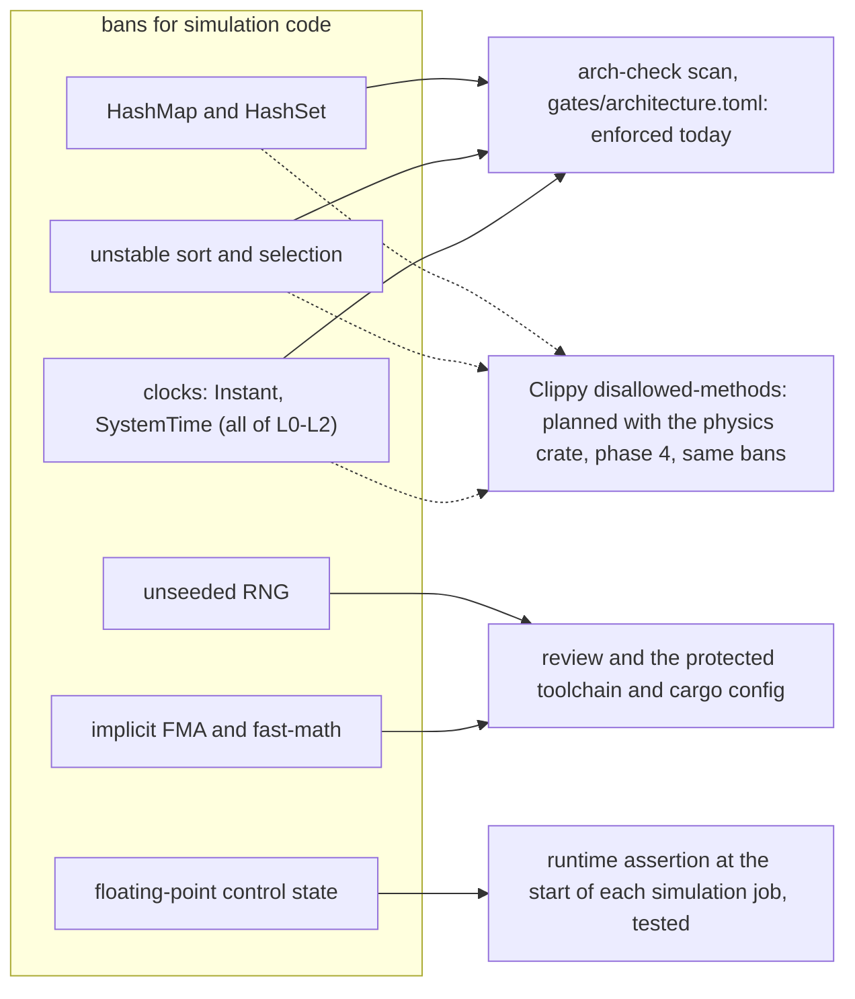
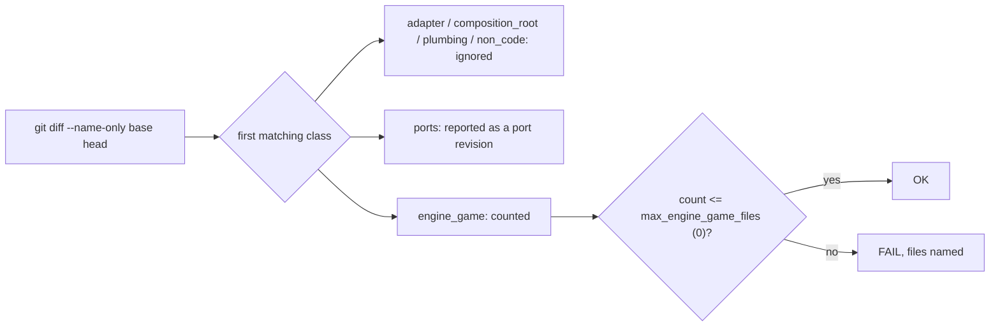

# Ports & Adapters: the Flexibility Mechanism `[P]` (v0.2)

> **Policy (owner):** the language's **standard library is not an external dependency to be wrapped**: `std` (allocation, collections, strings, math, atomics, threads, time) may be used directly in L0-L2. Wrapped behind ports: **OS-specific services** (window, input, file system, dynamic loading, lifecycle, platform queries), **graphics/audio/vendor APIs**, **third-party libraries**, **CPU intrinsics** and **compiler specifics**. Engine code is portable by construction, not by `#[cfg]`. History is in the README changelog.

## 1. Principle

> Engine code depends only on the language and its standard library, and on **ports it defines itself** for everything platform- or vendor-specific. Anything else is an *adapter* that satisfies a port.

Consequences: porting to a new OS/CPU/graphics API/audio API = writing adapters + a composition root. Engine and game code are untouched.

## 2. What counts as "external" (all of it is wrapped)

| Category | Examples | Rule |
|---|---|---|
| **Language and its standard library** | Rust `std` (`Vec`, `HashMap`, `String`, `Box`, atomics, threads, time, global allocator) | **Allowed** in L0-L2 (v0.6). Style rules still apply: no heap allocation per frame in hot paths (use arenas/pools there), benchmark before replacing a `std` facility with an own one. |
| **Platform-specific parts of the standard library** | e.g. `std::fs` and console I/O semantics that differ per OS (the exact `std` allow/deny list is open, [review-independent](../review-independent.md) A6) | Prefer the `IFileSystem` / log-sink ports (virtual mounts, async reads, testability); `std` may be used inside adapters and tools. |
| **Operating system** | Win32, POSIX/Linux, Cocoa, Android NDK, Emscripten, console SDKs | **Adapters only** (platform adapters). |
| **CPU / ISA** | SSE/AVX, NEON, WASM SIMD, cache-line size, endianness, atomics width | Behind a `simd`/`cpu` abstraction: scalar reference implementation + per-ISA adapters. |
| **Compiler / toolchain** | `cfg`/`target_feature` conditions, compiler attributes, intrinsics | One `base/toolchain` module (rustc is the only compiler; it isolates version- and target-specific conditions); nothing else mentions them. |
| **Graphics / audio / other APIs** | OpenGL, Vulkan, D3D12, Metal, WASAPI, ALSA, CoreAudio | Adapters only. |
| **Third-party libraries** | physics engines, bgfx, FMOD, EnTT, GLM, SDL, GLFW, miniaudio | Not in L0-L2. Allowed inside an adapter only as a **stopgap** with an exit plan. |
| **Dev-time tools** | test framework, benchmark lib, profiler, sanitizers, formatters | Allowed, never in shipped runtime. |

### Tier names used across the wiki (definitions widened)

| Tier | Meaning | Where allowed |
|---|---|---|
| **T0** | OS, vendor, third-party code, platform-specific headers (the language standard library is excluded, v0.6) | **nowhere** in L0-L2 |
| **T1** | External code reached through a port (OS APIs, graphics/audio APIs, ISA intrinsics) | L3 adapters only, one crate each |
| **T1-bindings** | Declaration-only binding crates or generated bindings for large OS/vendor APIs (Win32, OpenGL, Vulkan, D3D12), no behaviour of their own (D-7) | L3 only, pinned and listed in `THIRD_PARTY.md`; hand-written bindings only for small C APIs (GLFW, miniaudio) |
| **T1-stopgap** | A whole third-party library used temporarily inside an adapter (GLFW window, miniaudio) | L3 only, exit plan in `THIRD_PARTY.md` |
| **T2** | Dev-time only | test/bench/tools targets |

Adapter kinds: **native** (we write directly against the OS/vendor API - the goal), **stopgap** (wraps a third-party lib), **null/offline** (no external code - tests and CI).

### `std` allow/deny list for L0-L2 (N-1)

| | Items |
|---|---|
| **Allowed directly** | `core`, `alloc`; `std::{vec, string, boxed, rc, cell, mem, ptr, slice, iter, fmt, num, ops, option, result, marker, convert, hash}`; `std::collections::{BTreeMap, BTreeSet, VecDeque, BinaryHeap}`; `std::sync::{atomic, Arc, Mutex, RwLock, Condvar, Once}`; `HashMap`/`HashSet` outside simulation crates (with an explicit fixed hasher) |
| **Allowed only inside the owning module/adapter** | `std::thread::spawn` (job system, audio adapter, `platform_std`; **test-only code of any L0-L2 crate may also create threads**: `#[cfg(test)]` items and the crate's `tests/` folder, gate key `allow_in_tests`, card 1-4); `std::time::{Instant, SystemTime}` (the `IClock` default implementation in `platform_std`); `std::io`, `std::fs` (the `IFileSystem` default implementation, tools) |
| **Denied in L0-L2** | `std::fs`, `std::net`, `std::env`, `std::process`, `std::os::*`, `std::io`, direct clock reads, direct thread spawning (also behind a rename of any module called `thread`, such as `use std::thread as th` or `use self::thread as th`; `thread::sleep`, `current`, `yield_now` and similar are not thread creation and stay allowed when imported without a rename), anything OS-specific (`std::ffi` only in `platform`); `extern` blocks and `#[link]`; `std::arch`, `core::arch` and `asm!` outside `base`; reached only through ports or inside adapters/tools |
| **Denied in simulation crates (physics, math used by it)** | `HashMap`/`HashSet`, `slice::sort_unstable*`, `Instant::now`, `SystemTime`, any unseeded RNG, implicit FMA contraction and fast-math (Rust has neither; a flag or intrinsic that adds them must not be added; there is no scanner rule for it, review and the protected toolchain and cargo config cover it). An explicit `f32::mul_add` is allowed outside `physics` and refused in it (rule 1 in [physics](physics.md) section 3). In the `physics` crate also denied: libm float functions (`sin`, `cos`, `exp`, `powf`, ...), which it reaches through the math facade in `base` (rule 7; the bans are back since card 1-23), the fused multiply-add intrinsics (FMA reaches physics only through the facade, and is off in the D2 mode), and in `physics` and `base` the reciprocal-estimate intrinsics. Platform libm functions stay allowed in `base` and in non-simulation crates |

Enforced today by the **banned-import check** (crate graph + `use` scan from `gates/architecture.toml`, the Rust form of the old "banned-import" check): the OS-facing `std` modules, thread creation and clocks (L0-L2, outside the crates that own them), and in the `physics` crate only `HashMap`/`HashSet` (tests included) and unstable sort. Math code that lives in `base` is not covered by the `physics` rules and relies on review. Not scanned: unseeded RNG and implicit FMA or fast-math (review and the protected toolchain and cargo config), and the floating-point control state (a runtime assertion in each simulation job). Clippy `disallowed-methods` / `disallowed-types` is **not configured yet**; it is planned as a second line, per crate in a `clippy.toml`, when the first simulation crate exists (phase 4) `[K, verify V5]`.

`THIRD_PARTY.md` (phase 0) lists every external thing the repository touches - including each OS API family and each external crate - with tier, license, version, port, replacement plan. CI fails if something external appears that is not listed.

## 3. The Platform port family (new in v0.2)

The phase 2 shape of these ports (signatures, Null implementations, contract suites, the GLFW boundary) is proposed in [platform-ports](platform-ports.md).

| Port | Responsibility | Notes for portability (later platforms are hypothetical, Q17) |
|---|---|---|
| `IVirtualMemory` | optional: reserve/commit/decommit pages (for arenas and strict memory budgets). **Declared in `base` (L0)** because allocators need it (dependency inversion), implemented in L3; allocation otherwise uses the standard allocator behind `IAllocator` (v0.6) | consoles/WASM budgets are hypothetical (Q17) |
| `IThreads` | thread, mutex, condvar, semaphore, TLS, affinity hints, optional fibers; default implementation on `std` | `Caps.hasThreads` kept so the deterministic single-thread scheduler can run the same code |
| language atomics | `std` atomics used directly (v0.6) | |
| `IClock` | monotonic time, wall time, sleep | |
| `IFileSystem` | read/write/enumerate over **virtual mount points** (packaged assets, test fixtures), never raw OS paths; synchronous API plus background reads on the I/O pool; default implementation on `std` (async-first dropped, N-8, Q17) | |
| `IWindow` / `ISurface` | window or fullscreen surface, size/DPI, native handle *token* for the render adapter | mobile/console: surface may appear/disappear |
| `ILifecycle` | start, focus, quit; suspend/resume only if a later platform needs it | desktop subset first |
| `IInputDevice` | keyboard, mouse, gamepad, touch, sensors as event streams | |
| `IDynLib` | load module, resolve symbol | `Caps.canLoadCode` false on iOS/consoles/web -> static modules only |
| `ISystemInfo` | core count, cache line, ISA features, memory size, platform id | feeds capability-based decisions |
| `ILogSink`, `IProfilerSink` | output of logs/profile markers | |
| `INetwork` | sockets | deferred (not v1) |

**Design rule (v0.9, Q17):** design each platform port against the **two concrete platforms**, Windows (the real target) and Linux (proof of portability), and expose differences as `Caps`, never as `#ifdef`. Do not pre-shape ports for web, mobile or console; if one is added later, the port is revised then. The rule of two keeps the design honest.

## 4. Port design rules

1. **Shaped by the need, not by one vendor's API.** Graphics and audio ports are shaped after the most explicit API (Vulkan/D3D12) and emulate or degrade on the rest (Godot, Unreal RDG, O3DE lessons in [state of the art](../01-state-of-the-art.md)). **Platform ports are shaped after Windows + Linux only** (Q17).
2. **Rule of two.** A port stays `experimental` until two *real* adapters exist - for graphics two APIs; for the platform family **two different OS families** (e.g. Win32 + POSIX/Linux). **A stopgap library (GLFW, miniaudio) counts as one adapter even on two OSes** (D-5): window, input and audio ports become `stable` only after a **native** adapter exists next to the stopgap. Ports fully served by `std` (clock, threads, files) stay as thin seams for testing, with `std` as the default implementation.
3. **Null adapter mandatory** for every port (headless platform, null renderer, null/offline audio). It makes the whole engine runnable and testable with no OS services beyond a process.
4. **Contract test suite mandatory**, run against every adapter, including platform adapters (e.g. clock monotonicity, mutex fairness-agnostic correctness, file read semantics (sync and background reads), virtual memory commit/decommit).
5. **Coarse-grained** crossings: per frame / batch / buffer, never per object.
6. **Capabilities, not `#ifdef`.** Engine code never branches on OS or backend identity.
7. **No leaking.** Port headers expose no vendor/OS types (`HWND`, `pthread_t`, `VkDevice`). Native handles travel as opaque tokens that only the matching adapter can interpret (e.g. the GL adapter receives the window's native token from the matching platform adapter via the composition root).
8. **Versioned** ports; adapters declare the version they implement.
9. **Use the standard library by default (v0.6).** Own implementations only where a benchmark, an allocator-control need or a determinism need justifies them.

## 5. Enforcement (automated, runs on every PR)

| Check | How | Fails when |
|---|---|---|
| Include-graph rule | script walks `use` statements and the crate graph per target vs the layer table | L0-L2 file imports a higher layer or any non-allowlisted crate or module |
| **Banned-import list** | denylist of OS crates and modules (e.g. `windows-sys`, `libc`, `std::os::*`), graphics/audio/vendor and third-party crates | any banned include in L0-L2 |
| Link-graph rule | crate graph (`cargo metadata`) inspected by a test | engine target links an adapter, OS lib or third-party target |
| **Headless-only build** | full unit/acceptance suite linked with **only** Null + headless-platform adapters | engine needs any real OS/GPU/audio service |
| **Two-OS build matrix** | same engine sources built and contract-tested with Win32 and POSIX adapters (Linux) | platform contract fails on either |
| Contract suites | per adapter | any failure |
| Manifest check | every external dependency/API family listed in `THIRD_PARTY.md` | unlisted external |
| Swap-diff check (milestone) | adding platform/backend N+1 touches only `adapter_*` + composition root | engine/game files changed |

Status (card 0c-2): `tools/arch-check/arch_check.py` implements the include-graph, banned-import and link-graph rows for the crate graph (`cargo metadata --no-deps`) and the `use` scan of layers 0-2; its rules (layer of each crate, allowed and forbidden edges, banned crates and source patterns, the `std` deny list) are in `gates/architecture.toml`, a protected path. It runs in `ci` on every PR and fails on a seeded violation in its tests. A workspace crate with no layer is a violation (fail closed). A folder with a `Cargo.toml` that is not a workspace member is the finding `unlisted-crate`, except a dev-tool crate named in `standalone_tools` in `gates/architecture.toml` whose manifest has its own `[workspace]` table (card 1-28; first user `tools/alloc-bench`, card 1-27); such a tool gets none of the other checks, and no engine crate may depend on it. Partially implemented. Known gaps: the source scan is textual (a banned name built by a macro, or `std` reached through a type alias or a re-export, escapes it; `#[path]` (also inside `cfg_attr`), `include!`, `extern` blocks and `#[link]` are refused in layers 0-2, `std::arch`, `core::arch` and `asm!` outside `base`, and `std::ffi` outside `platform`; a cargo target whose source file is outside its crate folder is the finding `src-outside`); dev-dependencies are exempt from the layer, allowlist and cycle rules (a test may use a null adapter) but not from the banned-crate list and the forbidden edges; features and target-specific dependencies count as normal ones. The libm float-function bans were removed in card 1-13 (D2 withdrawn) and are back in card 1-23 for the `physics` crate (D2 returns, opt-in), together with a ban on fused multiply-add intrinsics in `physics` and on reciprocal-estimate intrinsics in `physics` and `base`; the scan tests them against the real config. Not covered yet: the manifest check (`THIRD_PARTY.md`), the headless-only build, the two-OS contract matrix. (The swap-diff check is a separate tool, below.) It runs from a trusted checkout of `main` in the `ci` `gates` job (card 0c-5); it still runs `cargo metadata` inside the PR tree, so it honours that tree's toolchain file and cargo config, both protected paths.

Swap-diff check (card 2-16): `tools/swap-diff/swap_diff.py --config gates/swap-diff.toml --base <rev> --head <rev>` counts the files that differ between two revisions and puts each into the first matching class of `gates/swap-diff.toml` (a protected path): `adapter` (`engine/adapter_*`), `composition_root` (`engine/app_*`), `ports` (the port declarations and contract suites of `engine/platform/src`; the std and Null implementations there count as engine code), `plumbing` (`Cargo.toml`, `Cargo.lock`), `non_code` (wiki, reviews, gates, tools, workflows, markdown) or, for everything else, `engine_game`. It fails when more than `max_engine_game_files` (0) files are engine or game code, and when the range has no adapter and no composition-root file (it adds no backend, so it proves nothing). It prints the two commits it resolved; the range is two-dot (`git diff base head`), so the base must be the state before the card. Port files never fail the check: they are printed as a port revision, because how many revisions a port has had before it is `stable` (one allowed, N-4) is history the tool cannot see; the owner counts. It is run by hand when a backend or platform is added (it is not a `ci` step yet; its unit tests are). Phase 2 measurement, the GLFW adapter (the second `IWindowSystem` after Headless, Windows and Linux): PR #88 changed 5 adapter files, 2 workspace-plumbing files, 4 non-code files and 1 port file (`engine/platform/src/contract.rs`, 13 lines), and 0 engine or game files; the Linux follow-up (PR #92) changed 1 adapter file. So swap-diff = 0 with one port revision in the range; whether that is the port's single allowed revision before `stable` is the owner's count, since the tool cannot see earlier ones.

## 6. Anti-corruption at the edges

Adapters translate both ways: engine vocabulary -> OS/vendor calls, OS/vendor errors and quirks -> engine `Error` values. Vendor and OS quirks (driver bugs, GL state leaks, path semantics, thread-priority differences) live in the adapter and its own tests, never in the port.

## 7. The honest hard parts

- **Cost of wrapping:** the platform family (window, input, file system, lifecycle) is real work before the first pixel. Mitigation: phase 0-2 builds exactly this foundation first and keeps each port minimal; stopgap adapters (GLFW window, miniaudio) shortcut the OS side where useful.
- **Shaders** remain the largest hidden coupling to graphics APIs ([rendering §4](rendering.md)).
- **Lowest-common-denominator risk:** capability queries and tiers (Godot-style Forward+/Mobile vs Compatibility) instead of one flat feature set.
- **Floating-point math differs per platform libm and per CPU.** Cross-platform identical results are an opt-in goal for the physics crate only (D2, back in v0.36): with the feature on, physics uses the engine's own math through the facade in `base`. Everything else may use the platform math; its results are reproducible per platform (D0, D1), not across platforms ([physics §3](physics.md)). The arch-check bans on libm functions were removed in card 1-13 and restored for `physics` in card 1-23.
- **Performance of portable code:** SIMD, atomics and memory orderings need per-ISA tuning inside adapters while the scalar reference stays the test oracle.
- **Verifiability:** "portable to every platform" is only a claim until built and tested on more than one. The two-OS rule makes it measurable; consoles/mobile/web remain design constraints until a real adapter exists.
