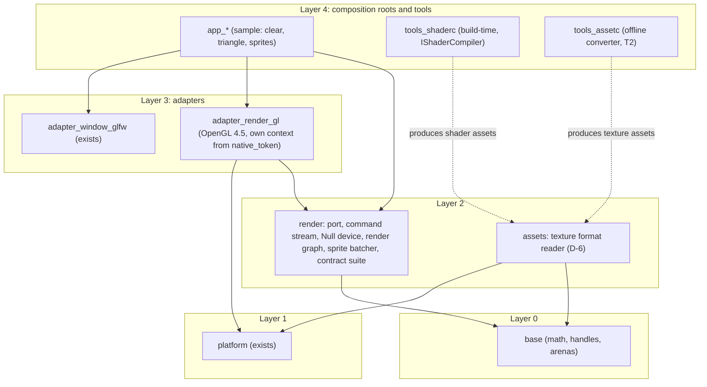
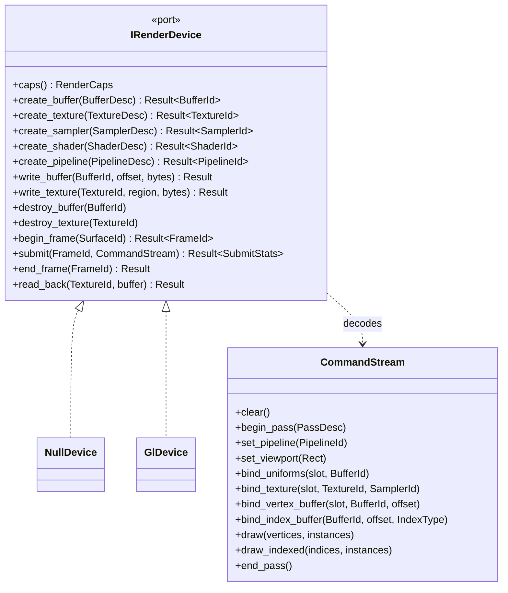
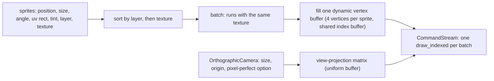
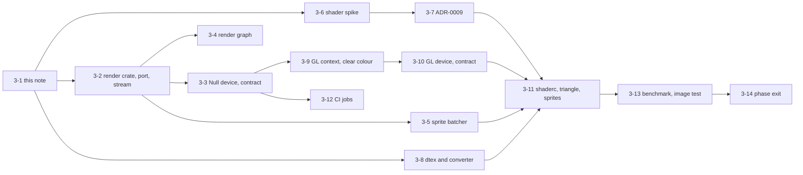
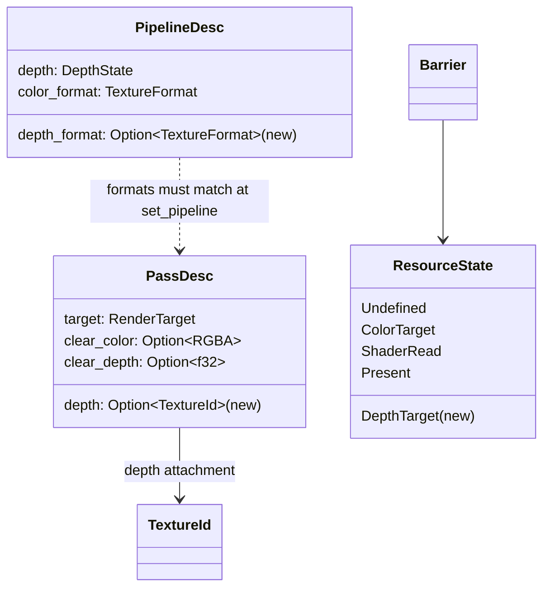
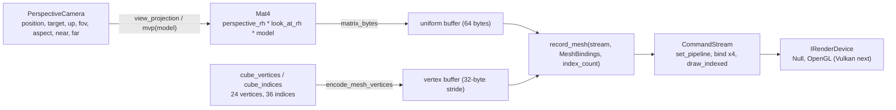

# Render port v0 and the 2D vertical slice: design note `[P]` (card 3-1)

Design note for phase 3, written before any code. It turns the phase 3 row of the [roadmap](../workflow/roadmap.md) and the architecture in [rendering](rendering.md) into the first buildable shape: the render device port `IRenderDevice`, the POD command stream, a small render graph, a 2D sprite batcher on an orthographic camera, the Null and OpenGL 4.5 adapters, the shader toolchain spike (Q25, ADR-0009) and the asset format decision (D-6). It ends with a proposed card breakdown and the choices that are the owner's.

Fixed inputs, not reopened here: the backend order Null, OpenGL 4.5, Vulkan, D3D12 (Q8); the port is shaped after the explicit APIs, not after OpenGL ([ports-and-adapters §4](ports-and-adapters.md)); external shader compilers are build-time tools behind `IShaderCompiler` (Q5); 2D is an orthographic frontend on the same port and graph as 3D (Q3); engine code never links an OS or vendor API, only adapters do; every port has a Null adapter and a contract suite and stays `experimental` until two real adapters pass it, which for graphics means Vulkan in phase 6; conventions: `f32`, SI units, right-handed Y-up, depth 0 to 1, column-major matrices ([conventions](conventions.md)); the roadmap's phase 3 exit: the contract suite passes on Null and OpenGL, golden command-stream tests, a frame benchmark scene, the Null-only CI build is green. What phase 2 already gives: a window with a `native_token` and `GLFW_NO_API` ([platform-ports §13](platform-ports.md)), Headless, the `FixedStep`, the file system port, the hosted Linux and ARM64 jobs.

**Scope in one line:** a window clears to a colour, shows a triangle, then textured sprites through the same port the future Vulkan backend will implement, and every step is testable without a GPU through the Null device.

## 1. Where the code lives

- **`render` (layer 2, new crate)** declares the port, the handles, the command stream, the Null device, the graph, the sprite batcher and the contract suite (feature `contract-tests`, like `platform`). It depends on `base` only. The Null device lives in `render` for the same reason Headless lives in `platform` (O2 below): no external code in it, usable by every test.
- **`adapter_render_gl` (layer 3, new crate)** is the only code that knows OpenGL. It depends on `render` and `platform` (for the `NativeToken` type) and on nothing third-party unless the owner picks the binding crate (O1). The window adapter stays untouched: it already creates windows without a graphics context, so the GL adapter makes its own context from the native token and never needs GLFW's GL support.
- **`assets` (layer 2, `assets = 2` already in the layer table)** reads the engine's own runtime texture format. It does not decode PNG or any source format; the offline converter `tools_assetc` does (D-6).
- **`tools_shaderc` and `tools_assetc` (layer 4 tool targets)** run on the build machine only. The shipped runtime never links a shader compiler or an image decoder.
- The arch-check needs two new rows in `gates/architecture.toml` only if a crate name is not covered by an existing glob; `adapter_*` is. Whether `render` and `assets` already have rows is checked in the first card (it is a governance file, so the card is declared one if a row must be added).

## 2. The device port `IRenderDevice` v0

Shaped after Vulkan and D3D12: pipeline state objects, explicit passes, no hidden global state. Resources are handles (`Handle<T>`) so a stale handle is detected and nothing crosses a boundary as a pointer. Dispatch is `dyn IRenderDevice` held in a `Renderer` bundle (O3): one virtual call per submitted stream, not per draw ([ADR-0005](../decisions/README.md)).

**What v0 contains and what it leaves out.**

- Resources: buffer (vertex, index, uniform), 2D texture with a mip count, sampler, shader module (an opaque precompiled blob plus entry-point names), graphics pipeline (shader pair, vertex layout, blend, depth state, colour format). Not in v0: compute, storage buffers, array or cube textures, render-to-texture beyond one offscreen colour target for the image test, multisampling, queries.
- **Surfaces.** A `SurfaceId` is created from a `NativeToken` plus the framebuffer size; resize is a call, not an event the device polls. The token is opaque ([ports-and-adapters §4](ports-and-adapters.md) rule 7).
- **Frames.** `begin_frame` returns the backbuffer as an imported resource; `submit` takes one stream per frame; `end_frame` presents. The caller owns the loop (app owns the loop, [conventions](conventions.md)).
- **Barriers and layouts.** Not exposed in v0: the graph tracks resource states and the command stream carries `barrier` opcodes that the Null device validates and OpenGL maps to no-ops or `glMemoryBarrier`. The opcodes are reserved from day one so Vulkan needs no stream change.
- **Capabilities.** `RenderCaps`: maximum texture size, uniform buffer alignment, supported index types, whether clip space depth is 0 to 1 natively, device name. Engine code branches on caps, never on backend identity.
- **Errors are values:** `RenderError` (out of memory, invalid handle, invalid description, shader rejected, surface lost, unsupported). No panic crosses the port.
- **Allocation.** Creating resources may allocate. Per frame, building a stream and submitting it must not: the stream is one byte buffer that keeps its capacity across frames (`clear()` then refill), checked by the counting-allocator test like the window pump.

## 3. The POD command stream

Backend-neutral, linear, little-endian bytes: a 16-bit opcode, a 16-bit length, then a fixed payload per opcode. Decoding is a loop over the buffer; there is no virtual call per command.

- **Why bytes and not a `Vec<Command>` enum:** the stream is meant to be recorded on several threads and merged, to be serialised and diffed, and to be replayed ([rendering §2](rendering.md)). Plain bytes with a version word make all three the same operation.
- **Golden form:** a text dump of a stream (one command per line, handles by creation index, not by raw value) is checked in as the expected result of a scene. That is the golden command-stream test the exit criteria ask for; it needs no GPU and runs on every platform.
- **Validation lives in the Null device**, not in the frontend: handle liveness and generation, pass nesting, pipeline bound before draw, index range against buffer size, uniform slot in range. The Null device is therefore also the reference for what the GL device must accept; the contract suite runs the same streams through both.
- **Versioning:** the stream header carries a version; v0 is `1`. A change that adds an opcode keeps old streams valid.

## 4. Render graph v0

A pass declares the resources it reads and writes; the graph orders the passes, drops passes whose output nothing reads, and derives the barriers. v0 is deliberately small, because phase 3 has one or two passes (clear plus sprites; later an offscreen pass for the image test).

- Resources are transient or imported (the backbuffer). Transient resources are created at graph build time and given back at the end of the frame; aliasing is reserved, not built.
- Compilation is a pure function from a pass list to an ordered list: unit-testable without a device, and allocation-free per frame by using a per-frame arena (`Arena`, no drop glue, fixed capacity, failure as a value, [core-runtime §2](core-runtime.md)).
- The graph writes into a `CommandStream`; it never talks to a device.

## 5. The 2D frontend: sprite batcher and orthographic camera

- The camera produces a 4 by 4 matrix with depth 0 to 1, right-handed, Y up, column-major ([conventions](conventions.md)). `base` has no orthographic constructor yet; it is added to `base::math` in the batcher card (a public API addition to layer 0, so Class 2).
- Sorting is by an explicit integer sort key (layer, then texture id, then insertion index), so the order is deterministic and a stable sort is not needed. No depth buffer in v0.
- A sprite is plain data; the batcher takes a slice and a camera and writes into a caller-supplied stream and vertex staging buffer. No hidden global state, no allocation per frame once the buffers are sized.
- Out of scope: tilemaps, text, particles, lighting, 2D physics debug draw.

## 6. The OpenGL 4.5 adapter

OpenGL is reached without any third-party GL crate unless the owner decides otherwise (O1): the adapter loads the system GL library at run time (the same pattern as `dynlib.rs`, hand-written declarations, no build dependency) and keeps a table of the roughly 60 functions v0 needs.

| Concern | Windows | Linux |
|---|---|---|
| Context from the native token | the token is the `HWND`; take its device context, choose a pixel format, create a temporary legacy context to reach `wglCreateContextAttribsARB`, then a 4.5 core context | the token is the X11 window id; GLX (O6) |
| Function loading | `wglGetProcAddress` for extension and 4.x functions, `GetProcAddress` on `opengl32` for GL 1.1 | `glXGetProcAddressARB` |
| Present | `SwapBuffers` | `glXSwapBuffers` |
| Wayland | not applicable | GLFW has no native token there: `Unsupported`, as for the window adapter |

- **Direct State Access** (4.5 core) for buffers, textures, framebuffers and vertex arrays; no state-machine binding in the hot path.
- **Depth 0 to 1:** `glClipControl(GL_LOWER_LEFT, GL_ZERO_TO_ONE)` so OpenGL matches the engine convention without a fix-up matrix; the cap `native_zero_to_one_depth` is true on this backend.
- **Pipelines** become a small cached state-setting sequence; barriers become no-ops. The cost of that emulation is in `Caps` and in the benchmark, not in the port.
- **Unsafe:** layer 3 is outside the unsafe-budget tool, as for the GLFW adapter; every block has a `// SAFETY:` comment. The adapter's unsafe count is reported in its card.
- **No GPU on hosted runners.** Windows hosted runners expose no OpenGL 4.5 device. The Linux job might: Mesa's software renderer (`llvmpipe`) under `xvfb` is said to offer OpenGL 4.5 core **[K, not verified here]**. The GL card starts with a short check of that on the actual runner image. Until it is shown, the GL contract suite follows the GLFW pattern: it runs where a device exists (the owner's machine, and the Linux job if `llvmpipe` works), prints `not run: device not set up` elsewhere, and a job that is meant to have a device sets `DUCK_REQUIRE_GL=1` so a missing device fails instead of skipping.

## 7. Shaders: the toolchain spike and what comes before it

[ADR-0009](../decisions/README.md) and Q25 say the authoring language and compilers are decided by a **spike in phase 3**, before the first non-trivial shader. The spike compares HLSL with DXC and SPIRV-Cross, GLSL with glslang or shaderc and SPIRV-Cross, and Slang, on build time, output quality per backend, reflection data, error messages, licence for closed-source use of the output, and maintenance activity. The result is recorded in the ADR, which is a governance file, so that card is declared a governance task.

- **Order.** The command stream, the Null device, the graph and the batcher need no shader and come first. The clear-colour window needs none. The **triangle** and the **sprite** need one: the spike runs before them and the ADR is recorded before the sprite shader is written. A hard-coded GLSL string for the triangle is **not** a way around the rule; if the owner wants the triangle earlier, that is a separate, labelled throwaway (O4).
- **Output.** The shipped shader asset is a per-backend precompiled blob plus the engine's own reflection record (binding layout, vertex inputs), so runtime code never sees a compiler's reflection format ([rendering §4](rendering.md)).
- **Where the tools come from.** The spike needs the candidate compilers on the machine that runs it. They are build-time tools (tier T2/T1 tool), not part of the engine, and are not installed system-wide by an agent: the spike downloads them into a git-ignored scratch folder inside the repository, or the owner installs them (O8).
- **Rule of two** for the compiler path (a second compiler demonstrable before the port is `stable`) is a phase 6 matter and stays there.

## 8. Assets: the minimal texture format (D-6)

D-6 decided: own simple runtime texture and sound formats and an offline converter tool (T2). Phase 3 needs only textures.

- **Runtime format `dtex` v0:** a fixed header (magic, version, width, height, mip count, pixel format) followed by the pixel data of each mip, tightly packed. v0 pixel format: RGBA8, sRGB flag in the header. Compressed formats are a later decision.
- **Converter `tools_assetc`:** reads PNG (and optionally other source formats), writes `dtex`. It is a dev-time tool (tier T2) and may use a pinned image-decoding crate that is **not** linked into the engine; the choice and its licence go into `THIRD_PARTY.md` as a T2 row (O5).
- **Reader in `assets`:** parses the header, validates sizes against the file length, returns a view over the bytes. Hostile input is the point of the contract tests (truncated file, huge dimensions, wrong magic). The file system port supplies the bytes ([platform-ports §2.3](platform-ports.md)).

## 9. Testing

| Level | What | Needs a GPU |
|---|---|---|
| Unit | graph compilation (order, culling, barriers), sprite sorting and batching, camera matrix, `dtex` parsing, stream encode and decode | no |
| Golden stream | a scene's command stream compared to a checked-in text dump | no |
| Contract | one suite for `IRenderDevice`: create and destroy, stale handle refused, upload then read back equal, clear colour read back equal, a triangle's pixel inside and outside, resize | Null always; GL where a device exists |
| Image | an offscreen sprite scene rendered by GL and compared to a reference with a per-channel tolerance | GL only |
| No-allocation | building and submitting a frame's stream does not allocate (counting allocator, per-thread counters) | no |
| Benchmark | the frame benchmark scene: a fixed number of sprites, instruction counts for the CPU side (stream building, sorting, batching); GPU time is reported, not gated | CPU part no |
| CI | the **Null-only build**: the workspace without `adapter_*` and `app_*` builds and tests green. The existing headless job already excludes adapters; it covers the render crate once added | no |

A red contract result on a real device is a stop, never a skip. "Not run: device not set up" is reported as not run and is not counted as green ([github-plan-findings](../workflow/github-plan-findings.md)).

## 10. How the cards follow from this

Accepted by the owner on 2026-11-02 ("I accept"); the cards are created in the Backlog and work on each starts only on the owner's pick. Numbers are the card ids.

| Card | Delivers | Class |
|---|---|---|
| 3-2 | `render` crate: handles, descriptions, `RenderCaps`, `RenderError`, `IRenderDevice` trait, command stream encode/decode, architecture rows if needed | 2 (new port), governance step only if `gates/architecture.toml` needs a row |
| 3-3 | Null device with validation, golden text dump, contract suite (`contract-tests` feature) | 2 |
| 3-4 | render graph v0 | 2 |
| 3-5 | sprite batcher, orthographic camera (`Mat4` constructor in `base`), no-allocation test | 2 (public API in layer 0 and 2) |
| 3-6 | shader toolchain spike: scratch tools, comparison on the listed criteria, a page in `wiki/spikes/` | spike (TDD exception) |
| 3-7 | record the result in ADR-0009; `THIRD_PARTY.md` rows for the chosen compilers | 3 (governance) |
| 3-8 | `dtex` format, `assets` reader, `tools_assetc` converter, `THIRD_PARTY.md` T2 row | 2, with a governance step for the `THIRD_PARTY.md` row |
| 3-9 | `adapter_render_gl` part 1: loader, context from the native token, clear colour in a window (first visible result), GL availability check on the Linux runner | 2, with a governance step if the unsafe or third-party tables change |
| 3-10 | `adapter_render_gl` part 2: buffers, textures, pipelines, draw, contract suite passing on GL | 2 |
| 3-11 | `tools_shaderc`, first shader asset, triangle then sprite sample (`app_*`) | 2 |
| 3-12 | CI: Null-only build proof for `render`, GL contract job on Linux if `llvmpipe` allows it | 3 (workflow) |
| 3-13 | frame benchmark scene and image test | 2 |
| 3-14 | phase 3 exit record and milestone review, as cards 2-17 and 2-18 | 1 (docs) |

Parallel work is possible after 3-2: 3-3, 3-4, 3-5, 3-6 and 3-8 do not depend on each other.

## 11. Choices for the owner

| # | Choice | Options | Recommendation |
|---|---|---|---|
| O1 | How OpenGL functions are declared | (a) own hand-written declarations of the roughly 60 functions v0 needs, loaded at run time · (b) a pinned binding crate listed in `THIRD_PARTY.md` as T1-bindings | (a): no dependency, the same pattern as the GLFW loader and gate G6, the function set is small; (b) is faster to start and grows the list of pinned crates. Decided at the first real backend per [rendering §9](rendering.md) |
| O2 | Where the Null device lives | in `render` (recommended) · in a separate `adapter_render_null` crate | in `render`: no external code, usable by every test, one fewer crate; same choice as O1 of phase 2 |
| O3 | How the port is used | `dyn IRenderDevice` in a `Renderer` bundle (recommended) · generics through the engine | `dyn`: one call per frame's stream; generics would spread type parameters through every module (ADR-0005) |
| O4 | The triangle before the shader spike | wait for the spike and ADR-0009 (recommended) · a labelled throwaway GLSL string now | wait: the clear-colour window is already the first visible result and does not need a shader; the rule in ADR-0009 stays unbroken |
| O5 | PNG decoding for the converter | a pinned dev-time crate in `tools_assetc` only (recommended) · an own decoder | a crate in the tool only: it never reaches the engine; an own inflate and PNG decoder is a project of its own for no runtime gain |
| O6 | OpenGL context on Linux | GLX, X11 only (recommended) · EGL | GLX: the native token is an X11 window id and Wayland is unsupported anyway; revisit with EGL if a Wayland or headless-GPU need appears |
| O7 | Where the GL contract runs in CI | the Linux job with `llvmpipe` if the runner offers 4.5 core, plus the owner's machine (recommended) · only locally | check `llvmpipe` in card 3-9; if it works, a CI job gives the GL path a recurring test at the cost of one more Linux job |
| O8 | Compilers for the shader spike | downloaded by the agent into a git-ignored folder inside the repository (recommended) · installed by the owner · skip candidates | scratch folder: nothing outside the repository changes; the candidates are build-time tools only |
| O9 | Order of the first cards | 3-2 first, then 3-3, 3-4, 3-5, 3-6, 3-8 in parallel (recommended) · spike first | the spike needs no engine code and can start with 3-2; start both |

O1 to O9 were accepted with the recommendations (owner, 2026-11-02, "I accept").

## 12. Risks and what this note does not settle

- **GL-shaped port (R-2).** The port follows the explicit APIs, but only one real backend exists until phase 6; the Null device's validation rules are the guard in the meantime.
- **Shader toolchain (R-4).** Unchanged: decided by the spike, with the output precompiled per backend.
- **No GPU in CI (new in effect).** Hosted runners have no GPU; the GL path is tested where a device exists. The owner's machine is the only certain one until `llvmpipe` is shown to work.
- **Stream layout.** The byte layout is fixed in card 3-2; changing it later changes the golden files. The version word is the mitigation.
- **Not settled here:** the shader language, the compilers, the sRGB handling of the swapchain, the texture compression formats, text rendering, the vertex layout declaration syntax. Each is decided in the card that first needs it.

## 13. Revision 1: depth in a pass, a pipeline and a barrier (card 6-2)

The one counted port revision of phase 6 ([vulkan-and-mesh-v0](vulkan-and-mesh-v0.md) section 5). Vulkan's dynamic rendering and the Null validation both need to know the depth attachment of a pass, so the port now says it.

- **`PassDesc.depth`**: a `Depth32F` texture of the colour target's size (for the backbuffer, the surface size). `None` is a pass without depth, as before. `clear_depth` without an attachment is still accepted (OpenGL clears the window's own depth buffer).
- **A depth texture is never its own colour target.** A pass whose colour target is the depth attachment is refused (OpenGL would find the framebuffer incomplete). `Present` and `ShaderRead` are allowed on depth textures (a depth texture may be sampled later); only the colour and depth target states are tied to the texture kind.
- **`PipelineDesc.depth_format`**: `Some(Depth32F)` for a pipeline used in a pass with a depth attachment, `None` otherwise. A pipeline that tests or writes depth must say `Some(Depth32F)`; any other format is refused. `set_pipeline` is refused when the pipeline's depth format and the pass's attachment disagree (Vulkan needs both formats at pipeline creation and at `begin_rendering`).
- **`ResourceState::DepthTarget`**: only for depth textures; `ColorTarget` is refused on them, and neither is for the backbuffer. The `barrier` command already names a texture handle, so a depth texture needs no new command: only the state tag `4` is new.
- **Stream bytes.** A `begin_pass` payload with a depth attachment is 38 bytes (the old 30 plus the depth handle); without one it is the 30 bytes it always was, so every stream recorded before the revision is byte-identical and the golden dumps did not change. A payload of any other length is refused. The stream version word stays `1`.
- **Null device.** Validates all of the above and clears a depth texture to `clear_depth` (the bytes read back as the float).
- **OpenGL adapter.** A pass with a colour texture and a depth texture draws through one shared framebuffer that is re-pointed at the two textures for each such pass, so no cached framebuffer can outlive a destroyed texture. A pass on the backbuffer keeps using the window's own depth buffer (OpenGL cannot attach a texture to the default framebuffer): the depth texture named there is checked, not drawn into. A later sample that reads such a depth texture on OpenGL would not see the depth; that is a known limit until a card needs it.
- **Contract suite.** New `depth_contract`: a pass with a matching depth texture is accepted; one of another size, a colour texture, or a destroyed texture is refused with the right error; the depth states of a barrier belong to depth textures. A deliberately broken device (accepts a wrong depth attachment) fails it.
- **Not in this revision.** Render graph support for a depth attachment (the graph still emits `depth: None`; the mesh frontend card extends it), stencil, depth formats other than `Depth32F`, multisampling, sampling a depth texture in a shader.

## 14. The mesh frontend (card 6-3)

The 3D counterpart of the sprite frontend: no port call is new. It is plain data in `render` (layer 2) and a perspective matrix constructor in `base` (layer 0), as [vulkan-and-mesh-v0](vulkan-and-mesh-v0.md) section 5 said.

- **`Mat4::perspective_rh(fov_y, aspect, near, far)`** and **`Mat4::look_at_rh(eye, target, up)`** (`base`, Class 2 public API like `orthographic_rh`): right-handed, Y up, the camera looks down -Z, depth 0 to 1 (`z = -near` maps to 0, `z = -far` to 1). Both return `None` for a view that cannot exist (field of view outside (0, pi), non-positive aspect or near, `far` not beyond `near`, `eye` equal to `target`, `up` parallel to the view direction, a value that is not finite).
- **`PerspectiveCamera`** (`render::camera`): `view_projection()` and `mvp(&model)`; `None` as above.
- **`MeshVertex`** (`render::mesh`): position (3 floats), normal (3 floats), uv (2 floats), 32 bytes in vertex slot 0, locations 0, 1, 2. Slot 0 only, as the design note recommended; no widening of the vertex input.
- **`cube_vertices()` and `cube_indices()`**: the unit cube, 24 vertices (four per face, so each face has its own normal and uv), 36 `u16` indices, counter-clockwise seen from outside, uv (0, 0) at the top-left of the image.
- **`record_mesh`**: pipeline, uniform (slot 0), index buffer, vertex buffer, texture (slot 0), one `draw_indexed`; nothing for an empty mesh. The pipeline must carry `depth_format: Some(Depth32F)` and the pass a depth texture (port revision 1, section 13).
- **Tests.** Camera and matrix maths on the CPU; cube geometry (outward counter-clockwise winding, one normal per face, a full texture per face); a golden stream (`engine/render/golden/mesh_scene.txt`); the Null device accepts a depth-tested frame and refuses the depth pipeline in a pass without depth; recording a frame makes no allocator call; and on a real OpenGL 4.5 device two cubes drawn near-first then far render with the near one in front, with a control frame (depth test off) in which the far cube wins the overlap. The GL test uses inline GLSL, so it needs no shader tool.
- **Not in this card.** The render graph still emits `depth: None` (a pass with a depth attachment is recorded by hand, as the image test does; the mesh sample, card 6-11, decides whether the graph should learn it), lighting, a mesh file format, more than one vertex slot, instancing.
