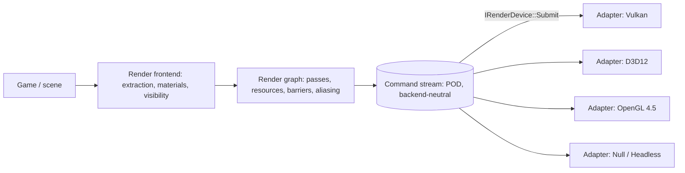
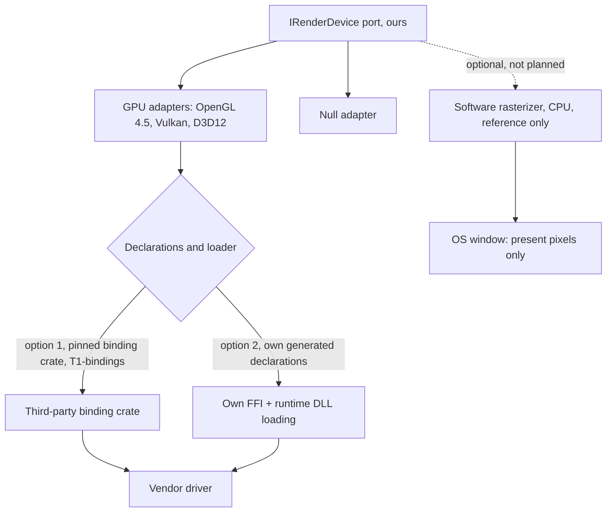

# Rendering Architecture `[P]`

Goal: engine and game code are written once; OpenGL, Vulkan, D3D12 (and Metal later) are adapters.

## 1. Three tiers

1. **Frontend (L2, ours):** visibility, sorting, materials, mesh/texture residency, extracted from the simulation world.
2. **Render graph (L2, ours):** passes declare the resources they read/write; the graph computes execution order, culls unused passes, derives barriers/layout transitions, and aliases transient memory. This mirrors Unreal's RDG feature set [S](https://dev.epicgames.com/documentation/en-us/unreal-engine/render-dependency-graph-in-unreal-engine). Having the graph compute barriers is what makes explicit APIs usable behind a neutral port.
3. **Device port `IRenderDevice` (RHI):** resource creation (buffers, textures, samplers, pipeline state objects, shader modules), queue submission, swapchain, presentation, `Caps`. Resources are handles.

## 2. Command stream

The frontend/graph records **backend-neutral POD commands** into a linear buffer (draw, dispatch, copy, barrier, begin/end pass, bind). The device decodes the stream in bulk. Effects:

- One virtual call per pass/stream, not per draw -> abstraction cost off the hot path.
- Stream can be recorded on many threads, merged, **serialised and diffed** -> excellent for TDD ("this scene must produce this command list"), replay and debugging.
- Same idea as Filament's engine -> driver command stream with swappable backends [S, third-party doc mirror](https://www.mintlify.com/google/filament/advanced/custom-backends).

## 3. Port shape: explicit-API-first

Model `IRenderDevice` on what Vulkan/D3D12/Metal agree on (PSOs, descriptor/binding layouts, command buffers, explicit barriers). Backends:

- **Vulkan / D3D12 / Metal**: thin mapping.
- **OpenGL 4.5 (DSA)**: emulation - barriers become `glMemoryBarrier` or no-ops, PSOs become state-setting sequences with state caching. Lower performance tier, flagged by `Caps`. This is the Godot lesson: GL does not map cleanly *up*, but explicit APIs map *down* to GL acceptably [S](https://docs.godotengine.org/fr/4.5/classes/class_renderingdevice.html).
- **Null**: records and validates the stream, no GPU. Used for the Null-only CI build and for golden command-stream tests.

## 4. Shaders - the hardest coupling

Shaders are written in a source language and a binding model that are API-flavoured. Options:

| Option | Pros | Cons |
|---|---|---|
| **A. Author in one existing language (e.g. HLSL), cross-compile offline per backend using external tools behind `IShaderCompiler`** | Pragmatic, production-proven approach [K]; tools are build-time only | Build-time dependency on external compilers (T1 tool); reflection comes from tools |
| **B. Own shader language + own compiler to SPIR-V/DXIL/GLSL/MSL** | Full independence | Very large effort; compilers are a project of their own |
| **C. A with a staged path to B** | De-risks | Longer plan |

**Decision (Q5, owner): external shader compilers are accepted.** Option **A** is adopted: one authoring language, offline cross-compilation per backend by external compilers, wrapped behind an `IShaderCompiler` tool port so any compiler can be replaced (consistent with the wrap-everything rule). Option B (own language and compiler) is not planned; option C's later stage is dropped unless the owner reopens it.

Rules that keep the independence claim honest:

- Compilers are **build-time tools only (T1 tool adapters)**. The shipped runtime and the engine libraries never link or call a shader compiler; the SDK carries **precompiled shader assets** per backend.
- Each compiler sits behind `IShaderCompiler` in `tools_shaderc` (an L4 tool target) with its own contract tests (same source -> valid output per backend, reflection data equal across compilers, error reporting). A second compiler path must be demonstrable before the port is `stable` (rule of two).
- Compiler name, version and licence are pinned in `THIRD_PARTY.md` (tier: build-time tool); licences must permit closed-source use of the tool's *output* **[K - verify per tool]**.
- Reflection (binding layout, vertex inputs) is converted to the engine's own descriptor format at build time, so runtime code never depends on a compiler's reflection format.
- Candidate toolchains **[K, unverified this session]**: DXC (HLSL -> SPIR-V / DXIL), glslang or shaderc (GLSL -> SPIR-V), SPIRV-Cross (SPIR-V -> GLSL / MSL / HLSL), Slang (one language -> several targets). Which authoring language and which compilers: decided by a **spike in phase 3** (Q25, owner), recorded in ADR-0009.

## 5. Backend bring-up order (proposal)

1. **Null** (frontend + graph fully testable).
2. **OpenGL 4.5** - fastest to first triangle on Windows; used to validate frontend/graph.
3. **Vulkan** - second real backend: *the milestone that proves Flexibility* (rule of two), freezes the port, and is where the graph's barrier logic gets real validation.
4. **D3D12**, **Metal** afterwards.

**Decided (Q8, owner accepted the default):** Null -> OpenGL 4.5 -> Vulkan -> D3D12 (Metal later). The alternative, starting with Vulkan to avoid a GL-shaped abstraction, was not chosen; the risk of a GL-shaped port is handled by designing `IRenderDevice` after the explicit APIs from the start and by the rule of two (the port is not `stable` until Vulkan passes the same contract suite). See [ADR-0006](../decisions/README.md).

## 6. Testing rendering under TDD

| Level | What | Technique |
|---|---|---|
| Unit | visibility, sorting, graph compilation (order, barriers, aliasing, culling) | pure functions on data; no GPU |
| Golden stream | frontend output for a scene | compare command stream to checked-in expected text/binary |
| Contract | each adapter honours port semantics (upload/readback, clear, draw-to-offscreen, resize) | shared suite, runs on real GPU in CI where available, Null always |
| Image | known scene rendered offscreen vs reference | perceptual diff with tolerance per backend (backends differ slightly) |
| Perf | frame cost of reference scenes | benchmark, tracked |

## 7. 2D as a subcase of 3D (Q3)

2D graphics use the **same render port, command stream and render graph** as 3D; only the frontend differs. This is the standard way to get 2D as a true subcase (an orthographic camera over the 3D pipeline) and means **zero port changes** when 3D is added.

| Aspect | 2D path (phase 3) | Added for 3D (phase 8) |
|---|---|---|
| Camera | orthographic, pixel-perfect option | perspective, frustum culling |
| Geometry | sprites/quads, tilemaps, via a **sprite batcher** that fills one dynamic vertex buffer and emits few draws | indexed meshes, skinning later |
| Depth / ordering | layer + sort key (painter's order), depth buffer optional | depth buffer, transparency sorting |
| Materials / shaders | unlit textured, tint, alpha blend | PBR-lite/lit shading, shadows later |
| Transforms | 2D transform (position, angle, scale) converted to the shared 4x4 matrix at extraction | full 3D transform |
| Text / UI | deferred (bitmap font later) | same |

Both frontends are tested the same way (golden command streams, contract tests); the sprite batcher's output is a deterministic command stream, which makes it very TDD-friendly. If 2D later needs features that do not fit the shared pipeline (e.g. 2D lighting), they are added as extra graph passes, not as a second renderer (Godot's separate Compatibility path shows the cost of splitting [S](https://docs.godotengine.org/fr/4.5/classes/class_renderingdevice.html)).

## 8. Out of scope for v1

Ray tracing, mesh shaders, virtualized geometry, advanced GI. The port reserves room (capabilities) but nothing is built before the basics are measured.

## 9. Can the graphics APIs be avoided? (feasibility, owner question 2026-10-26)

Question: is it possible to avoid OpenGL, Vulkan and D3D12? Answer: the GPU interface cannot be avoided, the third-party code around it can, and a CPU fallback is possible but is not a replacement. **The plan of section 5 is kept unchanged** (owner, 2026-10-26).

| Option | Verdict | Why |
|---|---|---|
| **Avoid the GPU APIs altogether** | Not feasible | They are the interface the drivers expose; the alternative is writing a vendor GPU driver (proprietary, undocumented, kernel privileges). |
| **Avoid third-party binding crates** (own FFI declarations, `vulkan-1.dll`, `d3d12.dll`, `opengl32.dll` loaded at run time) | Feasible, moderate cost (weeks per backend) | Removes a dependency, not the API. Vulkan: declarations generated from Khronos `vk.xml` by a dev-time tool (tier T2). OpenGL: own function loader. D3D12: heaviest, it is COM (vtables hand-declared or generated from Microsoft metadata). Nothing above `IRenderDevice` changes. |
| **Software rasterizer in plain Rust** | Feasible as a reference or test backend only | No graphics API needed (only a way to show pixels); deterministic and bit-exact, good for golden images and for proving the port is not shaped around one API. Far slower than a GPU for real 3D, so it conflicts with the Performance goal as a replacement. |

**Decision (owner, 2026-10-26): keep the plan** (Null -> OpenGL 4.5 -> Vulkan -> D3D12, Metal later; external graphics code stays behind `IRenderDevice` per [ports-and-adapters](ports-and-adapters.md)). Two points stay open and are decided later, not now:

- **Declarations source** (pinned binding crates vs own generated declarations): decided at the first real backend (OpenGL 4.5); both fit the tiers in [ports-and-adapters](ports-and-adapters.md). Own declarations are cleaner against lock-in, crates are faster to start.
- **Software reference backend**: not in the plan; it needs a new card if the owner wants it.
