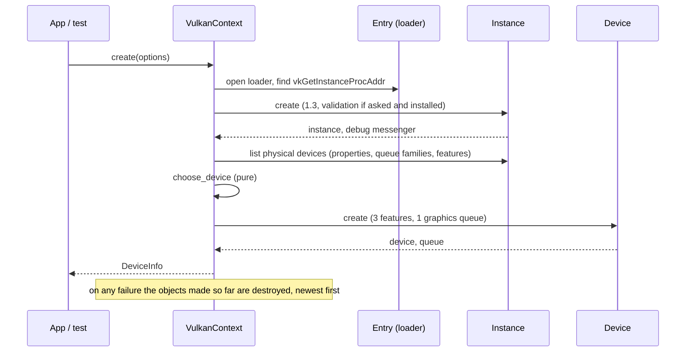
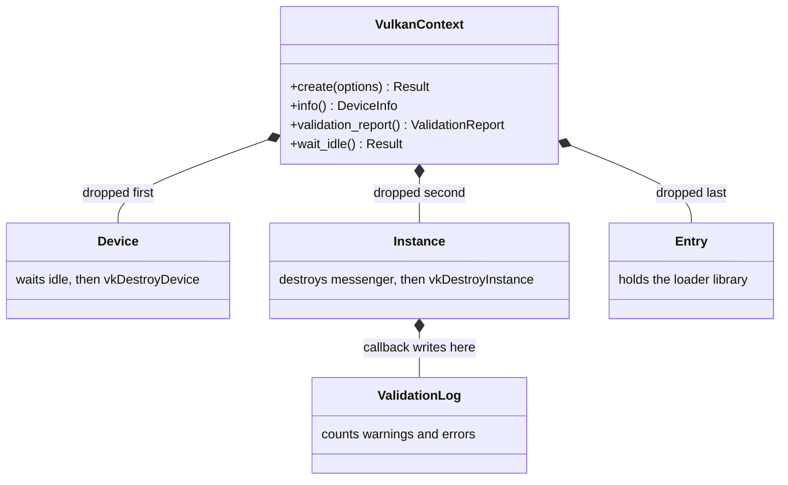
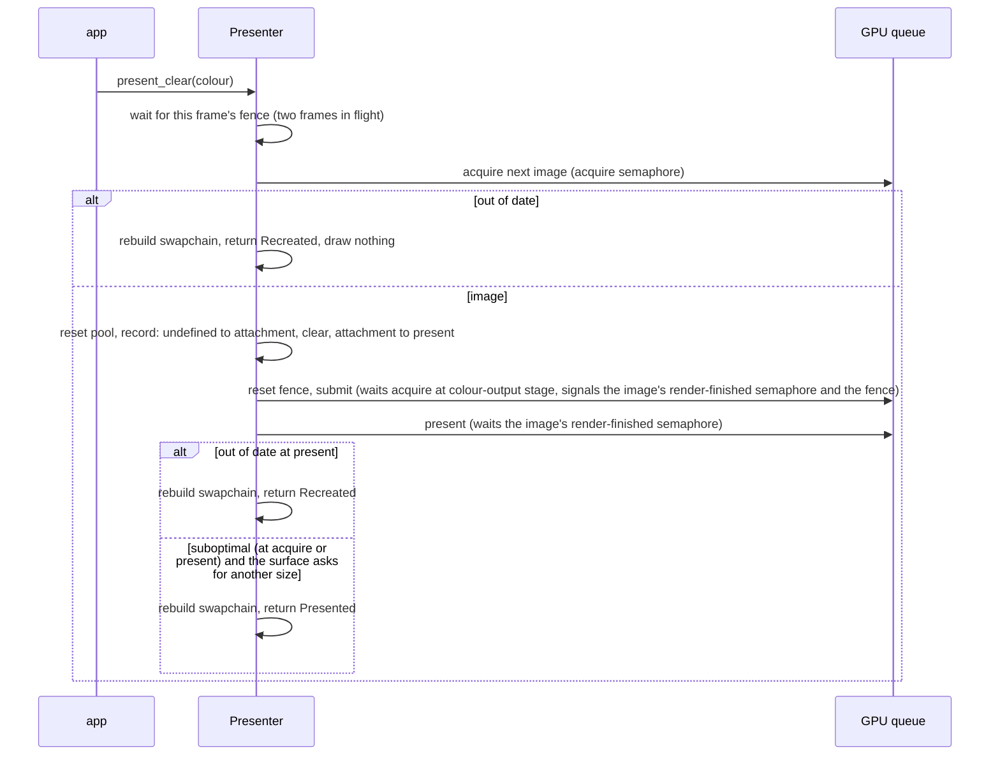
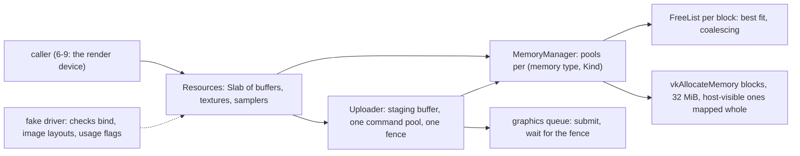
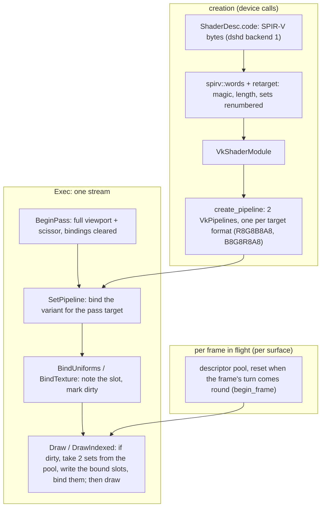

# Vulkan adapter v0: loader, device, swapchain, memory, resources and the render device (cards 6-6 to 6-9, parts 1 to 4a)

Status: parts 1 to 3 of 4 of `adapter_render_vk` (part 2 is section 5, part 3 is section 6), the second real render backend of phase 6 ([vulkan-and-mesh-v0](vulkan-and-mesh-v0.md) sections 2, 3 and 8). This page grows with each part (6-7 swapchain, 6-8 memory and resources, 6-9 shaders, pipelines and draw). Part 1 draws nothing: it starts Vulkan, chooses a device, makes the logical device and its graphics queue, and proves the start-up and the tear-down order without a GPU.

## 1. What part 1 delivers

- **A new layer 3 crate, `adapter_render_vk`.** It matches the `adapter_*` rule of `gates/architecture.toml` (layer 3), depends on nothing (no `render` yet: the port is first used in 6-9), and has no third-party dependency. Declarations of the Vulkan types and the functions the adapter calls are written by hand (choice O1); the layouts follow Vulkan-Headers 1.3.296 for 64-bit targets and were checked by hand against that header; the tests pin the sizes and offsets, they do not compare with the header itself.
- **The loader is opened at run time** (`vulkan-1.dll` on Windows, `libvulkan.so.1` on Linux) and everything else is found through its one exported function, `vkGetInstanceProcAddr`. No loader is an error value (`VulkanError::NoLoader`), never a panic.
- **A Vulkan 1.3 instance**, optionally with the Khronos validation layer and a debug messenger that counts and keeps warnings and errors.
- **One physical device**, chosen by a pure function: it must report Vulkan 1.3, the features `dynamicRendering`, `synchronization2` and `samplerAnisotropy`, and a queue family with graphics; among those, discrete beats integrated beats virtual beats software beats other, and the first of equals wins.
- **A logical device** with exactly those three features switched on and one queue from the graphics family.



## 2. Ownership and tear-down

`VulkanContext` owns, in this field order, the device, the instance and the loader. Rust drops fields in order, which is the order Vulkan needs: the device before the instance, the messenger before the instance, the loader last. Each owner destroys what it made in its `Drop`; a start-up failure drops what exists, so nothing leaks.



## 3. How it is tested

| Level | What | Needs a GPU |
|---|---|---|
| Unit | version packing and the 1.3 baseline; the device choice (kinds, ties, each missing requirement); error texts; struct sizes against the header (a `VkPhysicalDeviceProperties` is 824 bytes, its limits start at byte 296); the validation log (counts, caps, poisoned lock, null pointers) | no |
| Fake driver | `src/fake.rs` is a scripted `vkGetInstanceProcAddr` with the functions the adapter calls. It checks the call order and the teardown order (device, messenger, instance), the refusals (loader below 1.3, no devices, an unfit device, a failed create, a failed messenger, a failed device listing), that a failing layer list only turns validation off, the clean-up after each failure, the features and the queue family that reach `vkCreateDevice`, and that validation is only requested when asked for and installed | no |
| Loader | a missing library gives `NoLoader`; a system library that is not Vulkan gives `MissingFunction` | no |
| Real device | `tests/context.rs`: start on this machine's device, wait idle, ask the validation layer, start and drop five times | yes; "not run: device not set up" otherwise, a failure when `DUCK_REQUIRE_VK=1` |

## 4. Choices and limits

- **The queue family is chosen without a surface.** Part 1 takes the first family with graphics. Whether it can present to a window is checked when a presenter is made (section 5), which knows the surface; if the family cannot present, `create_presenter` refuses with `Unsupported`.
- **`VK_KHR_swapchain` is enabled when the device offers it** (part 2). A device without it still starts and works headless; it only cannot present.
- **The loader library is kept loaded on Linux** (a driver can leave threads and exit handlers behind, as the GL adapter's note says for its libraries); Windows closes it with the context.
- **The loader code is a copy** of the OpenGL adapter's (`dynlib.rs`, `lookup.rs`, a few hundred lines). A shared crate would be a same-layer dependency, which `gates/architecture.toml` does not allow without a governance edit; the copy is the price of keeping the two adapters independent.
- **`unsafe`:** layer 3 is outside the unsafe-budget tool. The production code has about 50 `unsafe` blocks and about 15 `unsafe fn` declarations (a script count over the modules `debug`, `device`, `dynlib`, `entry`, `instance`, `lookup`, without their `tests` modules; blocks in `cfg` branches for the two platforms are counted once each, and the `function_table!` macro generates one more `load` per table), each block with a `// SAFETY:` comment. The test fake has more and is not shipped; its blocks share one note instead of one comment each.
- **The validation layer is not installed on the machine where part 1 was developed**, so the debug-messenger path ran against the fake and the callback unit tests, not against the real layer. The real layer runs where it is installed (lavapipe job planned in 6-12) and in 6-7 onwards.
- **Single thread for now.** The handles hold raw pointers, so the context is neither `Send` nor `Sync`; revisited when the render thread needs it.

## 5. Part 2: surface, swapchain, frames, clear colour (card 6-7)

`VulkanContext::create_presenter(token, width, height)` turns the platform's native window token (an HWND on Windows, an X11 window id on Linux; Wayland is unsupported) into a `Presenter`. `present_clear(color)` draws one frame: the window is cleared to a colour and shown.

**What it does, in the order of a frame** (the table of [vulkan-and-mesh-v0](vulkan-and-mesh-v0.md) section 3 is the source):



**Rules the code keeps, each with a test against the fake driver:**

- The swapchain is Bgra8 UNORM in sRGB non-linear, FIFO, `min + 1` images (at least two, at most the surface's maximum), usage colour attachment plus transfer-source when the surface allows it. A surface without Bgra8 is `Unsupported`. These choices are pure functions in `plan.rs`.
- One render-finished semaphore per swapchain image, one acquire semaphore, one fence and one command pool per frame in flight; the fence starts signalled and is reset only right before the submit, so a failed acquire or a failed recording cannot leave the next wait hanging.
- Out of date is a rebuild and the frame is `Recreated`; suboptimal shows the frame and rebuilds only when the surface asks for another size, so a suboptimal result that is not about the size does not rebuild every frame. The old swapchain is handed to the new one and destroyed after the device is idle. When making the new swapchain fails, the driver has retired the old one anyway, so the presenter drops it and the next frame starts with none; it is never handed over twice. A lost surface is `VulkanError::SurfaceLost`, whichever call finds it. A window with no area has no swapchain, and the frame returns `Minimized`.
- Ownership: the device, instance and loader live in one shared `Core`. The presenter and the surface each hold a handle to it, so the device outlives both, whichever is dropped first. The presenter waits idle, then destroys frames, swapchain and capture buffer; the surface goes last.
- **Capture:** a test aid that copies the middle pixel into a 4-byte host-visible buffer (`enable_capture`, `captured_pixel`), so a test can see the colour that was drawn. Its memory comes from a direct `vkAllocateMemory`; the allocator of card 6-8 replaces it.

**How part 2 is tested:**

| Level | What | Needs a GPU |
|---|---|---|
| Unit | the swapchain choices (`plan.rs`); the struct sizes and offsets of the new Vulkan types | no |
| Fake driver | `src/fake/present.rs` adds surfaces, swapchains, semaphores, fences, command pools and buffers, the recorded barriers and clear, the submit and present wiring, and a list of live objects. about 35 presenter tests: properties of the swapchain, each refusal and its clean-up, a failure injected into each create call with the list of live objects checked afterwards, call order, barrier sequence, semaphore wiring, two frames in flight, out of date, suboptimal (with and without a size change), a failed rebuild, a failed recording, surface lost, resize, minimized, capture, drop order, device outliving the context | no |
| Real device and window | `tests/presenter.rs`: GLFW window, clear to red, green and blue and read the pixel back (Bgra byte order), 120 frames in flight, a resize request (the window is not resized: the window port has no call for it) | yes; "not run: device not set up" otherwise, a failure when `DUCK_REQUIRE_VK=1` |

**Limits of part 2:** the validation layer is not installed on the development machine, so the real-device tests ran without it; the structure-type constants are pinned to the header's numbers in a unit test because neither the fake nor an absent layer would catch a wrong one. The Linux surface path (Xlib) is compiled and checked with Clippy but has not run; it opens its own X connection without an error handler, so a stale window id would end the process (the presenter's contract is that the window outlives it). The token must name a live window: Vulkan does not check it. Only the clear is drawn; shaders, pipelines and resources come in 6-8 and 6-9.

## 6. Part 3: memory sub-allocator, buffers, textures, samplers, staged uploads (card 6-8)

`VulkanContext::create_resources()` returns a `Resources`: the tables of buffers, textures and samplers of one device, over a memory manager and an uploader. Each resource is named by a generational id (`BufferId`, `TextureId`, `SamplerId`); a destroyed or never-made id is `InvalidHandle`, and a reused slot does not answer to the old id. The adapter does not depend on `render` until 6-9, so the descriptions here (`BufferDesc`, `TextureDesc`, `SamplerDesc`, `Region`) are the adapter's own; card 6-9 maps the port's types onto them.



**The sub-allocator (choice O2).** A block is one `vkAllocateMemory` call of 32 MiB. A pool is one memory type and one kind of resource (linear buffers, or optimal-tiling images), so `bufferImageGranularity` never matters. Inside a block a `FreeList` (pure data, no `unsafe`) hands out the smallest free range that fits, the first of equals, at the requested power-of-two alignment, and joins neighbours when a range comes back; a second release of the same range is refused. A request larger than a quarter of a block gets a block of its own with its exact size, freed when it is empty. An emptied ordinary block goes back to the driver unless it is the last one of its pool. Host-visible blocks are mapped once, whole. A device-local request falls back to any allowed memory type; an upload request needs host-visible and coherent memory, else `Unsupported`.

**Uploads.** A write copies the bytes into a host-visible staging buffer (at least 64 KiB, grown when a write is larger) and submits one transfer on the graphics queue; the call returns after the fence signals, so the data is there when it returns and the staging buffer is idle for the next write. A buffer write is wrapped in two global memory barriers (everything to transfer, transfer to everything), whose first scope also covers earlier submissions. A texture write moves the image from its tracked layout to transfer-destination, copies, and leaves it in shader-read; `read_back` does the same round trip the other way, adds a barrier from the transfer write to the host read (a fence wait alone does not make device writes visible to the CPU), and returns the image to the layout it had. When the wait for a transfer fails after the submit, the texture is still recorded in its new layout and the next transfer waits for the pending one first.

**Rules the code keeps, each with a test against the fake driver:**

- A failed create call releases whatever was made before it (image, view, memory range, buffer); a failed start of `Resources` or of the uploader destroys the pool and the fence it already made (a test found the second one missing in the first version of the uploader).
- A resource owns only its own handles; dropping `Resources` waits for the device, destroys samplers, textures, buffers, the staging buffer and the transfer objects, then frees every block.
- `Resources` loads its own function tables, not the presenter's, so a device without the swapchain extension can hold resources.
- Texture size is checked against `maxImageDimension2D`, the mip count against the length of the chain, a write region against the texture and the byte count against the region, all before anything is recorded.
- Colour textures can be sampled, copied to and from, and drawn into; a depth texture is a depth attachment and is readable only when the device allows `D32` as a copy source.
- The fake driver checks what it can see: memory type allowed, offset aligned, no two resources sharing bytes, the layout an image is in when it is copied or the old layout an image barrier names, the usage flags a copy needs. It records the stage and access masks of global barriers (a test pins the host-read barrier of `read_back`) but does not judge the other masks: that is the validation layer's job, which is not installed here.
- `MemoryManager::free` takes the allocation by value, so a range cannot be freed twice; a request of size zero or an alignment that is not a power of two is refused before a block is made.
- A depth texture needs the device to support `D32` as a depth attachment (else `Unsupported`); it is readable only with the copy-source feature too.

**How part 3 is tested:**

| Level | What | Needs a GPU |
|---|---|---|
| Unit | `FreeList` (15 tests, including a long mixed run that never overlaps), `Slab` (8), the struct sizes and numbers of the new Vulkan types against the header | no |
| Fake driver | `MemoryManager` (15 tests: sharing, dedicated blocks, reuse, returning empty blocks, refused blocks, out of memory, a failed mapping) and `Resources` (40 tests: creation, bounds, write and read-back, partial writes, the barrier order, layout tracking, stale ids, injected failures with the live objects counted, drop) | no |
| Real device | `tests/resources.rs`: texel round trips from 1x1 to 300x17, a partial write, a 300 KB buffer write, 400 small resources sharing a few blocks, samplers, a depth texture and refused sizes | yes; "not run: device not set up" otherwise, a failure when `DUCK_REQUIRE_VK=1` |

**Limits of part 3:**

- A write waits for the GPU (one fence per transfer): simple and correct, but a CPU stall per upload. A frame-batched upload path is a later optimisation, to be justified by a benchmark.
- Destroying a resource frees it at once; the caller must know no submitted work still uses it. Card 6-9 owns that rule once frames exist.
- Only mip level 0 is written; the other levels of a texture are undefined until something fills them. A texture never written has undefined contents.
- A failed block allocation is an error; there is no retry with a smaller block.
- The validation layer is not installed on the development machine, so the real-device tests ran without it (each prints a note); the barrier masks are checked by the fake driver only where stated above, and no real-device test reads a buffer back.
- Read-back staging uses uncached host-coherent memory; a `HOST_CACHED` placement would read faster.
- An id carries nothing that ties it to the `Resources` that made it; an id from a second `Resources` with the same index and generation would be accepted.
- The presenter's capture buffer still uses a direct `vkAllocateMemory`; moving it onto the manager is left for a later card.

## 7. Part 4a: the render device, frames, passes and barriers (card 6-9, first half)

`VulkanDevice` is the `IRenderDevice` of the port on Vulkan 1.3. Card 6-9 is delivered in two pull requests: this one (4a) holds the device, the frame loop, passes, barriers and the resource calls, and passes the render contract suite; the next card (6-14, 4b, section 8) adds shaders, pipelines, descriptors and draw calls. In this part `create_shader` and `create_pipeline` answered `Unsupported`, and the stream commands that needed a pipeline (set pipeline, viewport, binds, draws) were accepted and did nothing; section 8 replaces that.

The adapter now depends on `base` and `render` (as the GL adapter does). A bookkeeping `NullDevice` inside the device issues the handles and checks every call and every stream, so the rules exist once; the Vulkan side acts only after it agrees, and gives the handle back when Vulkan then fails. The port's descriptions are mapped onto the adapter's own resource types by pure functions (`render_device/convert.rs`), and an adapter error onto the port's `RenderError` (memory failures are `OutOfMemory`, a lost device or surface is `SurfaceLost`, other driver failures `Unsupported`).

```mermaid
sequenceDiagram
  participant App
  participant Dev as VulkanDevice
  participant Shadow as NullDevice (bookkeeping)
  participant Pres as Presenter
  participant Exec as Exec (render_device/exec.rs)
  participant GPU as Vulkan queue
  App->>Dev: begin_frame(surface)
  Dev->>Shadow: begin_frame (one frame at a time)
  Dev->>Pres: begin_frame: wait fence, acquire image, reset pool, open buffer
  Note over Pres: out of date: rebuild, try once more; no area: frame executes nothing
  App->>Dev: submit(frame, stream)
  Dev->>Shadow: validate the whole stream
  Dev->>Exec: run(stream) on the open buffer
  Exec->>Exec: pass: image to attachment layout, begin rendering, clear or load
  Exec->>Exec: barrier: image to the layout of the named state
  App->>Dev: end_frame(frame)
  Dev->>Exec: backbuffer to present layout
  Dev->>Pres: end_frame: close buffer, submit (wait acquire, signal render-done), present
  Pres->>GPU: vkQueueSubmit2, vkQueuePresentKHR
```

**Layouts are tracked by the device, not read from the stream.** The backbuffer's layout lives in the frame (it starts undefined after every acquire); a texture's layout lives in `Resources` (`note_layout`), where uploads and read-back already keep it. A pass moves its colour target, and its depth target if it has one, to the attachment layouts first, so a stream that skips a barrier still draws, as on GL. A `Barrier` command moves the named image to the layout of the named state (`sync::state_access`, one pure function with a test per state: layout, stage, access). The `from` state of the command is not trusted. The barrier is also recorded when the layout does not change, because two passes that write the same attachment need the order; its source side waits for everything before it, which is correct and leaves a tighter source as an optimisation for a measured need. A texture cannot be moved to the present layout (refused), and a move to `Undefined` does nothing (the contents are given up, the layout stays). A depth attachment must cover the colour attachment, else the pass is refused.

**Frame rules.**

- One command buffer per frame in flight, reset with its pool at `begin_frame`; every `submit` of the frame appends to it; `end_frame` closes it, submits once and presents once, whatever the number of streams.
- A swapchain that is out of date at the acquire is rebuilt and the acquire tried once more; a window without area gives a frame that executes nothing (texture passes included) and ends without presenting; a lost surface is `SurfaceLost`, and the bookkeeping frame is closed so the next `begin_frame` can try again.
- One live surface per window: the Vulkan surface of a window can exist once, and each surface owns a presenter.

**How part 4a is tested.**

| Level | What | Needs a GPU |
|---|---|---|
| Unit | `state_access` (5 tests), port-to-adapter conversions and the error map (2), the handle table (5) | no |
| Fake driver | `Presenter::begin_frame/end_frame` (6 tests: order of calls, the two frames in flight, out of date, no area, failed submit); `VulkanDevice` (21 tests: caps, surfaces and their swapchains, resource calls and clean-up, destroy waits for the device, the layout path of a backbuffer clear, many streams in one frame, load or clear, texture passes with the fake checking each old layout, barrier commands, depth passes, refused streams record nothing, minimised windows, one frame at a time, lost surface, failed submit, everything freed on drop) | no |
| Real device | `tests/device.rs`: the generic render contract suite (caps, buffers, textures, surfaces, clear passes read back, depth passes, stream rules), and eight frames on the backbuffer | yes; "not run: device not set up" otherwise, a failure when `DUCK_REQUIRE_VK=1` |

**Limits of part 4a (all in the code comments of `render_device.rs` too):**

- Writes and `read_back` run at once on their own queue submission, so they see the frames already ended and not the commands recorded in the open frame. `write_texture` and `read_back` are therefore refused (`Unsupported`) while the open frame holds recorded commands: write before the `submit` that uses the data, read back after `end_frame`. `write_buffer` is not refused (a buffer has no layout), but it is seen by every draw of the frame, whatever the order of the calls. A per-frame upload ring would lift this; it comes with the first sample that needs it.
- Destroying a resource waits for the device to be idle first (a stall, but a frame in flight may use it). When the open frame holds recorded commands, which may name the resource, the destroy is kept and runs after `end_frame` has put the frame on the queue.
- A failed submit at `end_frame` drops the surface's presenter (its frame fence would stay unsignalled and the next `begin_frame` would wait for it for ever); the surface answers `SurfaceLost` from then on and is made again. A failure between the acquire and the first command (reset of the pool, start of the buffer) is not handled the same way yet; it is listed in the review as an open minor.
- Not sampleable: the backbuffer and depth textures are created without sampling usage, so a barrier to `ShaderRead` on them, and a depth texture as the colour target of a pass, are refused (`Unsupported`) although the bookkeeping device accepts them.
- The device uses the uniform alignment of the port (256), which Vulkan guarantees as an upper bound, and not the device's own value.
- The validation layer is not installed on the development machine, so the real-device tests ran without it (each prints a note). A job with the layer must run them before the milestone.

## 8. Part 4b: shaders, pipelines, descriptors, viewport, binds and draws (card 6-14)

With this part `VulkanDevice` draws: `create_shader`, `create_pipeline`, the viewport command, the bind commands and `Draw` / `DrawIndexed` are real. The render contract suite still passes unchanged on the GPU (no new contract case), and the sprite shaders of the engine draw a picture that a real-device test reads back.



**The fixed binding scheme.** One pipeline layout serves every pipeline: set 0 holds 8 uniform buffers, set 1 holds 8 combined image samplers, both visible to the vertex and the fragment stage; the binding number is the slot the stream binds (the port has 8 slots of each kind). The shader files carry the sets their GLSL source declared, and the engine's sprite sources put the uniform block and the texture both at `set = 0, binding = 0` (two namespaces in OpenGL, a clash in one Vulkan set). The adapter therefore owns the set numbers: `spirv::retarget` reads the instruction list of a private copy of the module and rewrites the `DescriptorSet` decoration of each variable by its storage class (uniform block to set 0, sampled texture to set 1); a binding of 8 or more, or a storage buffer, is refused (`Unsupported`). The asset is never changed. Entry point is `main` (what the shader compiler writes); a blob that is not whole words, is shorter than a header or has the wrong magic is `InvalidDescription`.

**Pipelines.** A pipeline is made for dynamic rendering (the colour and depth formats go in the create info's `VkPipelineRenderingCreateInfo`), triangle lists, filled, no culling (as GL here), viewport and scissor dynamic, depth compare `<=` when the test is on, blend `Opaque` = replace and `Alpha` = colour by source alpha / one minus source alpha with the alpha channel kept as OpenGL does (`ONE` / one minus source alpha; found by the image test of card 6-10, [examples](examples.md) section 6). The port ties a pipeline to a colour format only on paper (the bookkeeping device does not compare it with the pass), whereas Vulkan needs the formats to match at the draw, and the swapchain is always `B8G8R8A8`: the device therefore makes **two** pipelines per `create_pipeline` (for `R8G8B8A8` and `B8G8R8A8` targets) and `SetPipeline` binds the one for the pass's target. Pipeline creation costs twice as much and nothing is made later, so a failure is reported by `create_pipeline`, never by a draw.

**Descriptor sets.** Each surface has one descriptor pool per frame in flight, made with the surface and reset at `begin_frame` (after the frame's fence was waited for, so the sets of two frames ago are certainly not in use). A bind only notes the slot; the first draw after a bind takes two sets from the frame's pool, writes the bound slots (one `vkUpdateDescriptorSets` call per descriptor, no allocation) and binds both, and the next draw reuses them until another bind. A pool holds 1024 pairs; the 1025th changed binding in one frame fails with `VK_ERROR_OUT_OF_POOL_MEMORY`, which is `OutOfMemory`, and the next frame has its pool back. A texture bound for a draw must already be in the shader-read layout (a barrier cannot be recorded inside a rendering scope), else the stream fails with `InvalidDescription`.

**Viewport.** The port's viewport has its origin at the bottom left. Into the **backbuffer** the device sets a viewport with a negative height (`y = H - rect.y`, `height = -rect.height`), so one projection gives one picture in the window on both adapters; the scissor, which cannot be flipped, is converted by hand and clamped to the target. Into a **texture** nothing is flipped, because the port says row 0 of a texture is its bottom row (GL order): clip space `y = -1` lands on row 0, a texture holds the same rows on both adapters and a later pass samples it the same way. Every pass starts with the whole target as viewport and scissor and with nothing bound (the bookkeeping device resets the bindings at each pass too).

**Destroying.** A shader module is destroyed at once (a pipeline keeps its own copy of the code). A pipeline may be named by the open frame's recorded commands, so it follows the rule of the other resources: waited for and freed at once, or kept until `end_frame` has put the frame on the queue. The pools go with their surface. A failure inside a stream closes the open rendering scope, so the command buffer can still be ended and presented (a test covers it).

**How part 4b is tested.**

| Level | What | Needs a GPU |
|---|---|---|
| Unit | SPIR-V check and retarget (8 tests: header errors, sets by storage class, binding limit, storage buffer, instruction walk); viewport and scissor maths, flipped and not, clamped, empty (5); vertex format, depth format and error maps (2); struct sizes against the headers (3) | no |
| Fake driver | `Draw` (10 tests: layouts, objects freed on drop, a failed layout, module words, destroy once, the pipeline record, a refused pipeline, bound slots written, a full pool then a reset, state and draw commands); `VulkanDevice` (refused blobs, storage buffer, two variants per pipeline, a refused pipeline, the commands of a draw in order, sets made again only after a bind, flipped and unflipped viewports, index buffer width, a texture in another layout refused and the scope closed, pool reset per frame and a full pool, pipeline destroyed inside a frame, pools freed with the surface) | no |
| Real device | `tests/device.rs`: the contract suite (unchanged), the sprite SPIR-V from the shader compiler's golden file drawing a quad into a texture (row 0 at the bottom), a viewport rectangle, six frames of plain and indexed draws into the backbuffer | yes; "not run" otherwise, a failure when `DUCK_REQUIRE_VK=1` |

**Limits of part 4b:**

- The Khronos validation layer is still not installed on the development machine; the real-device runs were not validated by it (each prints a note). The fake driver checks the shapes it can (formats, dynamic states, pool capacity, live objects), not the Vulkan rules as a whole.
- One vertex buffer (slot 0), 8 + 8 binding slots, triangle lists, no culling, no stencil, no multisampling: what the port describes today.
- A shader has the entry point `main`, no storage buffers, no binding of 8 or more, and its descriptor sets are renumbered as above; a second shader convention would need a second scheme.
- A frame draws at most 1024 times with changed bindings.
- The per-frame pools are sized for that bound; they are never grown.
