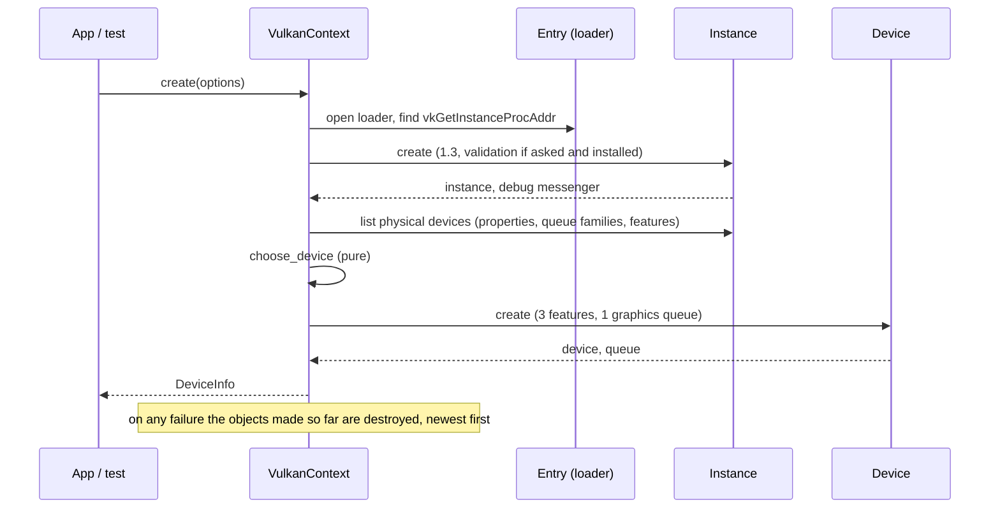
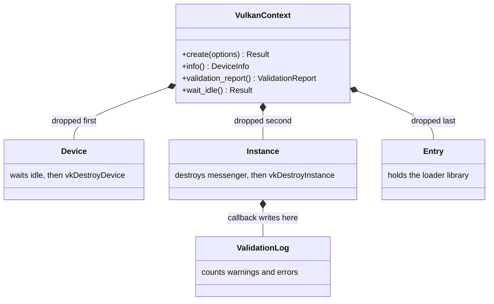
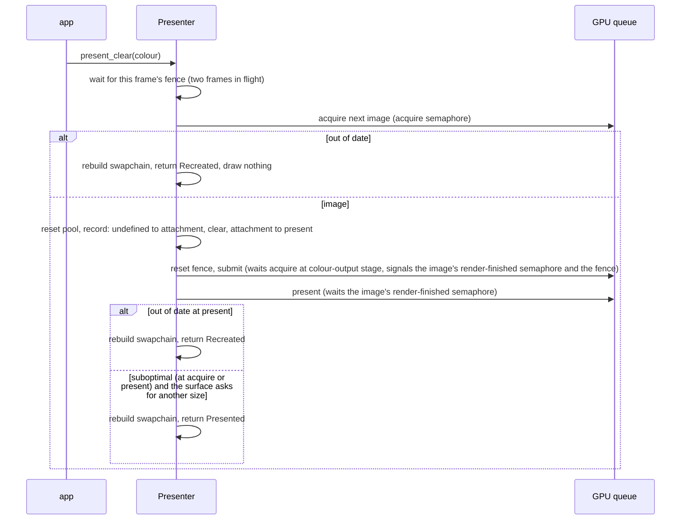

# Vulkan adapter v0: loader, device, surface, swapchain (cards 6-6 and 6-7, parts 1 and 2)

Status: parts 1 and 2 of 4 of `adapter_render_vk` (part 2 is section 5), the second real render backend of phase 6 ([vulkan-and-mesh-v0](vulkan-and-mesh-v0.md) sections 2, 3 and 8). This page grows with each part (6-7 swapchain, 6-8 memory and resources, 6-9 shaders, pipelines and draw). Part 1 draws nothing: it starts Vulkan, chooses a device, makes the logical device and its graphics queue, and proves the start-up and the tear-down order without a GPU.

## 1. What part 1 delivers

- **A new layer 3 crate, `adapter_render_vk`.** It matches the `adapter_*` rule of `gates/architecture.toml` (layer 3), depends on nothing (no `render` yet: the port is first used in 6-9), and has no third-party dependency. Declarations of the Vulkan types and the functions the adapter calls are written by hand (choice O1); the layouts follow Vulkan-Headers 1.3.296 for 64-bit targets and were checked by hand against that header; the tests pin the sizes and offsets, they do not compare with the header itself.
- **The loader is opened at run time** (`vulkan-1.dll` on Windows, `libvulkan.so.1` on Linux) and everything else is found through its one exported function, `vkGetInstanceProcAddr`. No loader is an error value (`VulkanError::NoLoader`), never a panic.
- **A Vulkan 1.3 instance**, optionally with the Khronos validation layer and a debug messenger that counts and keeps warnings and errors.
- **One physical device**, chosen by a pure function: it must report Vulkan 1.3, the features `dynamicRendering`, `synchronization2` and `samplerAnisotropy`, and a queue family with graphics; among those, discrete beats integrated beats virtual beats software beats other, and the first of equals wins.
- **A logical device** with exactly those three features switched on and one queue from the graphics family.

## 2. Ownership and tear-down

`VulkanContext` owns, in this field order, the device, the instance and the loader. Rust drops fields in order, which is the order Vulkan needs: the device before the instance, the messenger before the instance, the loader last. Each owner destroys what it made in its `Drop`; a start-up failure drops what exists, so nothing leaks.

## 3. How it is tested

| Level | What | Needs a GPU |
|---|---|---|
| Unit | version packing and the 1.3 baseline; the device choice (kinds, ties, each missing requirement); error texts; struct sizes against the header (a `VkPhysicalDeviceProperties` is 824 bytes, its limits start at byte 296); the validation log (counts, caps, poisoned lock, null pointers) | no |
| Fake driver | `src/fake.rs` is a scripted `vkGetInstanceProcAddr` with the functions the adapter calls. It checks the call order and the teardown order (device, messenger, instance), the refusals (loader below 1.3, no devices, an unfit device, a failed create, a failed messenger, a failed device listing), that a failing layer list only turns validation off, the clean-up after each failure, the features and the queue family that reach `vkCreateDevice`, and that validation is only requested when asked for and installed | no |
| Loader | a missing library gives `NoLoader`; a system library that is not Vulkan gives `MissingFunction` | no |
| Real device | `tests/context.rs`: start on this machine's device, wait idle, ask the validation layer, start and drop five times | yes; "not run: device not set up" otherwise, a failure when `DUCK_REQUIRE_VK=1` |

## 4. Choices and limits

- **The queue family is chosen without a surface.** Part 1 takes the first family with graphics. Whether it can present to a window is checked when a presenter is made (section 5), which knows the surface; if the family cannot present, `create_presenter` refuses with `Unsupported`.
- **`VK_KHR_swapchain` is enabled when the device offers it** (part 2). A device without it still starts and works headless; it only cannot present.
- **The loader library is kept loaded on Linux** (a driver can leave threads and exit handlers behind, as the GL adapter's note says for its libraries); Windows closes it with the context.
- **The loader code is a copy** of the OpenGL adapter's (`dynlib.rs`, `lookup.rs`, a few hundred lines). A shared crate would be a same-layer dependency, which `gates/architecture.toml` does not allow without a governance edit; the copy is the price of keeping the two adapters independent.
- **`unsafe`:** layer 3 is outside the unsafe-budget tool. The production code has about 50 `unsafe` blocks and about 15 `unsafe fn` declarations (a script count over the modules `debug`, `device`, `dynlib`, `entry`, `instance`, `lookup`, without their `tests` modules; blocks in `cfg` branches for the two platforms are counted once each, and the `function_table!` macro generates one more `load` per table), each block with a `// SAFETY:` comment. The test fake has more and is not shipped; its blocks share one note instead of one comment each.
- **The validation layer is not installed on the machine where part 1 was developed**, so the debug-messenger path ran against the fake and the callback unit tests, not against the real layer. The real layer runs where it is installed (lavapipe job planned in 6-12) and in 6-7 onwards.
- **Single thread for now.** The handles hold raw pointers, so the context is neither `Send` nor `Sync`; revisited when the render thread needs it.

## 5. Part 2: surface, swapchain, frames, clear colour (card 6-7)

`VulkanContext::create_presenter(token, width, height)` turns the platform's native window token (an HWND on Windows, an X11 window id on Linux; Wayland is unsupported) into a `Presenter`. `present_clear(color)` draws one frame: the window is cleared to a colour and shown.

**What it does, in the order of a frame** (the table of [vulkan-and-mesh-v0](vulkan-and-mesh-v0.md) section 3 is the source):

**Rules the code keeps, each with a test against the fake driver:**

- The swapchain is Bgra8 UNORM in sRGB non-linear, FIFO, `min + 1` images (at least two, at most the surface's maximum), usage colour attachment plus transfer-source when the surface allows it. A surface without Bgra8 is `Unsupported`. These choices are pure functions in `plan.rs`.
- One render-finished semaphore per swapchain image, one acquire semaphore, one fence and one command pool per frame in flight; the fence starts signalled and is reset only right before the submit, so a failed acquire or a failed recording cannot leave the next wait hanging.
- Out of date is a rebuild and the frame is `Recreated`; suboptimal shows the frame and rebuilds only when the surface asks for another size, so a suboptimal result that is not about the size does not rebuild every frame. The old swapchain is handed to the new one and destroyed after the device is idle. When making the new swapchain fails, the driver has retired the old one anyway, so the presenter drops it and the next frame starts with none; it is never handed over twice. A lost surface is `VulkanError::SurfaceLost`, whichever call finds it. A window with no area has no swapchain, and the frame returns `Minimized`.
- Ownership: the device, instance and loader live in one shared `Core`. The presenter and the surface each hold a handle to it, so the device outlives both, whichever is dropped first. The presenter waits idle, then destroys frames, swapchain and capture buffer; the surface goes last.
- **Capture:** a test aid that copies the middle pixel into a 4-byte host-visible buffer (`enable_capture`, `captured_pixel`), so a test can see the colour that was drawn. Its memory comes from a direct `vkAllocateMemory`; the allocator of card 6-8 replaces it.

**How part 2 is tested:**

| Level | What | Needs a GPU |
|---|---|---|
| Unit | the swapchain choices (`plan.rs`); the struct sizes and offsets of the new Vulkan types | no |
| Fake driver | `src/fake/present.rs` adds surfaces, swapchains, semaphores, fences, command pools and buffers, the recorded barriers and clear, the submit and present wiring, and a list of live objects. about 35 presenter tests: properties of the swapchain, each refusal and its clean-up, a failure injected into each create call with the list of live objects checked afterwards, call order, barrier sequence, semaphore wiring, two frames in flight, out of date, suboptimal (with and without a size change), a failed rebuild, a failed recording, surface lost, resize, minimized, capture, drop order, device outliving the context | no |
| Real device and window | `tests/presenter.rs`: GLFW window, clear to red, green and blue and read the pixel back (Bgra byte order), 120 frames in flight, a resize request (the window is not resized: the window port has no call for it) | yes; "not run: device not set up" otherwise, a failure when `DUCK_REQUIRE_VK=1` |

**Limits of part 2:** the validation layer is not installed on the development machine, so the real-device tests ran without it; the structure-type constants are pinned to the header's numbers in a unit test because neither the fake nor an absent layer would catch a wrong one. The Linux surface path (Xlib) is compiled and checked with Clippy but has not run; it opens its own X connection without an error handler, so a stale window id would end the process (the presenter's contract is that the window outlives it). The token must name a live window: Vulkan does not check it. Only the clear is drawn; shaders, pipelines and resources come in 6-8 and 6-9.
