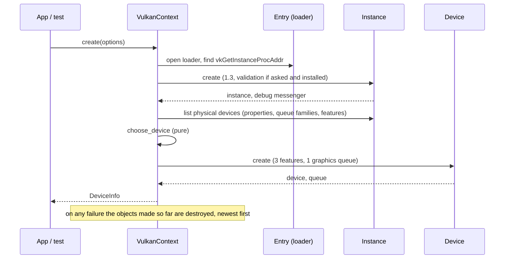

# Vulkan adapter v0: loader, instance, device, queue (card 6-6, part 1)

Status: part 1 of 4 of `adapter_render_vk`, the second real render backend of phase 6 ([vulkan-and-mesh-v0](vulkan-and-mesh-v0.md) sections 2, 3 and 8). This page grows with each part (6-7 swapchain, 6-8 memory and resources, 6-9 shaders, pipelines and draw). Part 1 draws nothing: it starts Vulkan, chooses a device, makes the logical device and its graphics queue, and proves the start-up and the tear-down order without a GPU.

## 1. What part 1 delivers

- **A new layer 3 crate, `adapter_render_vk`.** It matches the `adapter_*` rule of `gates/architecture.toml` (layer 3), depends on nothing (no `render` yet: the port is first used in 6-9), and has no third-party dependency. Declarations of the Vulkan types and the functions the adapter calls are written by hand (choice O1); the layouts follow Vulkan-Headers 1.3.296 for 64-bit targets.
- **The loader is opened at run time** (`vulkan-1.dll` on Windows, `libvulkan.so.1` on Linux) and everything else is found through its one exported function, `vkGetInstanceProcAddr`. No loader is an error value (`VulkanError::NoLoader`), never a panic.
- **A Vulkan 1.3 instance**, optionally with the Khronos validation layer and a debug messenger that counts and keeps warnings and errors.
- **One physical device**, chosen by a pure function: it must report Vulkan 1.3, the features `dynamicRendering`, `synchronization2` and `samplerAnisotropy`, and a queue family with graphics; among those, discrete beats integrated beats virtual beats software beats other, and the first of equals wins.
- **A logical device** with exactly those three features switched on and one queue from the graphics family.

## 2. Ownership and tear-down

`VulkanContext` owns, in this field order, the device, the instance and the loader. Rust drops fields in order, which is the order Vulkan needs: the device before the instance, the messenger before the instance, the loader last. Each owner destroys what it made in its `Drop`; a start-up failure drops what exists, so nothing leaks.

## 3. How it is tested

| Level | What | Needs a GPU |
|---|---|---|
| Unit | version packing and the 1.3 baseline; the device choice (kinds, ties, each missing requirement); error texts; struct sizes against the header (a `VkPhysicalDeviceProperties` is 824 bytes, its limits start at byte 296); the validation log (counts, caps, poisoned lock, null pointers) | no |
| Fake driver | `src/fake.rs` is a scripted `vkGetInstanceProcAddr` with the functions the adapter calls. It checks the call order and the teardown order (device, messenger, instance), the refusals (loader below 1.3, no devices, an unfit device, a failed create), the clean-up after each failure, the features and the queue family that reach `vkCreateDevice`, and that validation is only requested when asked for and installed | no |
| Loader | a missing library gives `NoLoader`; a system library that is not Vulkan gives `MissingFunction` | no |
| Real device | `tests/context.rs`: start on this machine's device, wait idle, ask the validation layer, start and drop five times | yes; "not run: device not set up" otherwise, a failure when `DUCK_REQUIRE_VK=1` |

## 4. Choices and limits

- **The queue family is chosen without a surface.** Part 1 takes the first family with graphics. Whether it can present to a window is checked in 6-7, which knows the surface; in practice the graphics family presents, and 6-7 refuses with `Unsupported` if not.
- **No device extension is enabled yet.** `VK_KHR_swapchain` comes with 6-7.
- **The loader library is kept loaded on Linux** (a driver can leave threads and exit handlers behind, as the GL adapter's note says for its libraries); Windows closes it with the context.
- **The loader code is a copy** of the OpenGL adapter's (`dynlib.rs`, `lookup.rs`, a few hundred lines). A shared crate would be a same-layer dependency, which `gates/architecture.toml` does not allow without a governance edit; the copy is the price of keeping the two adapters independent.
- **`unsafe`:** layer 3 is outside the unsafe-budget tool. The production code has 49 `unsafe` blocks and 16 `unsafe fn` declarations (counted by script over the modules `debug`, `device`, `dynlib`, `entry`, `instance`, `lookup`, without their `tests` modules; the operating-system loader declarations in `dynlib` are among the 16, and the `function_table!` macro generates one more `load` per table), each block with a `// SAFETY:` comment. The test fake has more and is not shipped; its blocks share one note instead of one comment each.
- **The validation layer is not installed on the machine where part 1 was developed**, so the debug-messenger path ran against the fake and the callback unit tests, not against the real layer. The real layer runs where it is installed (lavapipe job planned in 6-12) and in 6-7 onwards.
- **Single thread for now.** The handles hold raw pointers, so the context is neither `Send` nor `Sync`; revisited when the render thread needs it.
