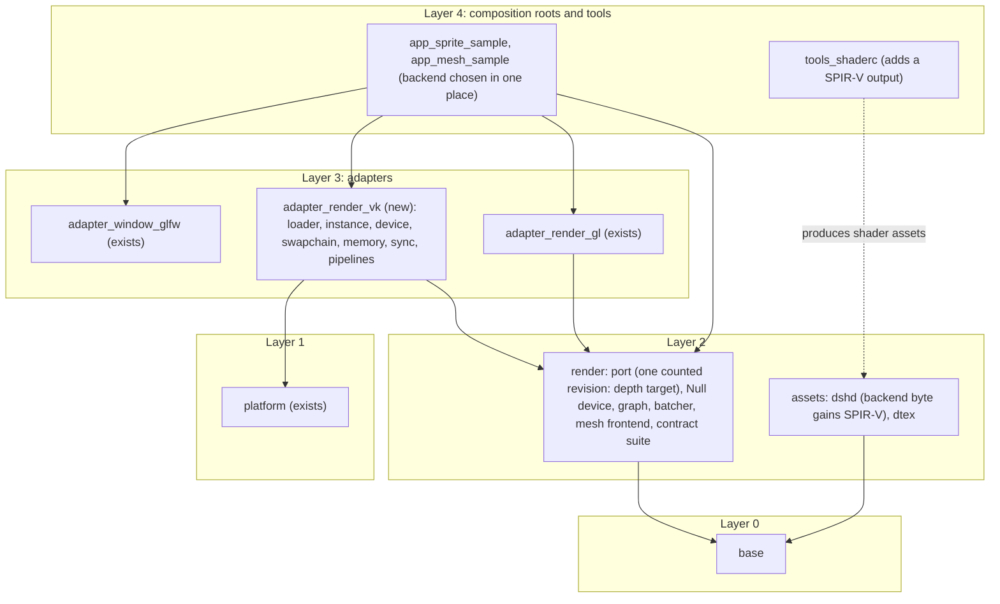
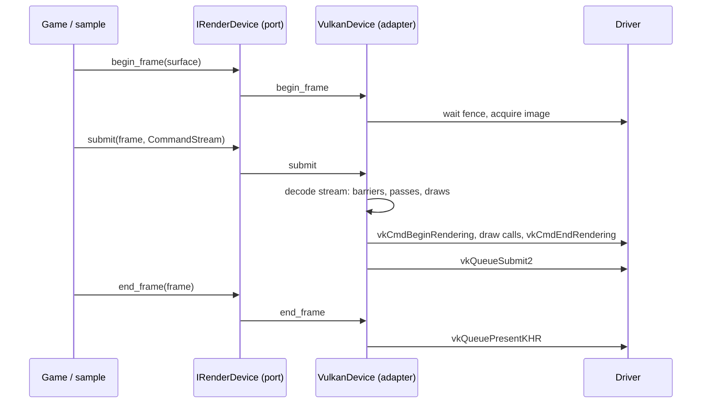
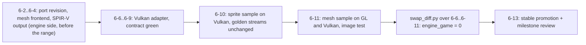

# Vulkan adapter and the textured mesh with depth: phase 6 design note `[P]` (card 6-1)

Design note for phase 6 ("Prove Flexibility"), written before any code. It turns the phase 6 row of the [roadmap](../workflow/roadmap.md) into a buildable shape: a second real render backend (Vulkan) behind the port that [render-port-v0](render-port-v0.md) defined, a textured mesh with depth on both backends, and the measurement that proves the claim ("swap diff = 0").

Fixed inputs, not reopened here: the backend order Null, OpenGL 4.5, Vulkan, D3D12 (Q8); the port is shaped after the explicit APIs; engine code never links an OS or vendor API, only adapters do; every port has a Null adapter and a contract suite and stays `experimental` until two real adapters pass it ([ports-and-adapters §4](ports-and-adapters.md)); depth 0 to 1, right-handed, Y up, column-major ([conventions](conventions.md)); shaders are authored in GLSL 450 and compiled by build-time tools behind `IShaderCompiler` ([ADR-0009](../decisions/README.md)); the roadmap's phase 6 exit: **swap diff = 0** for engine and game code (port files excluded, at most one counted port revision, N-4), the same contract suite green on both backends, the same sample app runs unchanged on GL and Vulkan, the port promoted to `stable`.

**Scope in one line:** the existing sprite sample runs on Vulkan with no change to engine or sample code; then a spinning textured mesh with a depth buffer runs on both backends; then the port is declared `stable`.

## 1. Evidence and what is still unverified

Findings are tagged **[K]** (known: read in this repository or in a source below) or **[U]** (unverified, to be checked in the card named). No Vulkan code exists in the repository yet.

| Claim | Tag | Source or check |
|---|---|---|
| The port already reserves what Vulkan needs: `ResourceState` (`Undefined`, `ColorTarget`, `ShaderRead`, `Present`), barrier opcodes in the stream, pipeline objects, explicit passes, handles, `Depth32F` as a texture format, `DepthState` in the pipeline, `clear_depth` in the pass | K | `engine/render/src/desc.rs`, `stream.rs`, [render-port-v0 §2](render-port-v0.md) |
| A pass can only target the backbuffer or one colour texture (`RenderTarget`): there is no way to say "draw with this depth texture". A mesh with depth cannot be written against the port as it is | K | `desc.rs` `RenderTarget`, `PassDesc` |
| The pipeline reads vertices from one vertex slot (`vertex_stride`, attributes of slot 0) | K | `desc.rs` `PipelineDesc` |
| The shader file `dshd` v0 carries one backend only: byte 6 is the backend, `0 = GLSL 450 text`. `tools_shaderc` already produces SPIR-V on the way (glslang) and then converts it to GLSL with SPIRV-Cross; for Vulkan the SPIR-V is the output | K | `engine/assets/src/dshd.rs`, `engine/tools_shaderc/src/external.rs` |
| The sprite sample takes the device as `&mut dyn IRenderDevice`; only `app.rs` names `GlDevice` | K | `engine/app_sprite_sample/src/sample.rs`, `app.rs` |
| The window adapter hands out an opaque native token (the `HWND` on Windows, an X11 window id on Linux) and creates no graphics context; a Vulkan surface can be made from that token the same way the GL adapter makes its context | K | [platform-ports §13](platform-ports.md), [render-port-v0 §6](render-port-v0.md) |
| The owner's Windows machine has a Vulkan loader (`vulkan-1.dll` in `System32`) | K | checked in this session |
| Vulkan 1.3 puts dynamic rendering (no render-pass or framebuffer objects) and synchronization2 into the core, and none of the 1.3 features is optional | K | [Khronos Vulkan 1.3 announcement](https://www.khronos.org/news/press/vulkan-reduces-fragmentation-and-provides-roadmap-visibility-for-developers), [Vulkan docs: hello triangle with 1.3 features](https://docs.vulkan.org/samples/latest/samples/api/hello_triangle_1_3/README.html) |
| Software Vulkan (Mesa lavapipe, package `mesa-vulkan-drivers`) is used by other projects' hosted-runner jobs, and the driver version matters | K | [Vulkan lavapipe CI examples](https://github.com/jakoch/install-vulkan-sdk-action), [Mozilla bug on the lavapipe version](https://bugzilla.mozilla.org/show_bug.cgi?id=1837027) |
| Which Mesa version and which Vulkan version lavapipe offers on the current `ubuntu-latest` image, and whether it passes the contract suite | **U** | card 6-5 starts with this check on the real runner image, as card 3-9 did for `llvmpipe` |
| Hosted Windows runners expose a Vulkan device | **U** | almost certainly not (no GPU); checked in 6-5. Until shown otherwise the Windows device runs on the owner's machine |
| Licences of any Vulkan binding crate or memory-allocator library | **U** | only relevant if the owner picks option O1 (b) or O2 (b) below; re-checked then |

## 2. Where the code lives

- **`adapter_render_vk` (layer 3, new crate)** is the only code that knows Vulkan, exactly as `adapter_render_gl` is the only code that knows OpenGL. It depends on `render` and `platform` (for the `NativeToken` type). The crate name matches the existing `adapter_*` glob of `gates/architecture.toml`, so no architecture row is needed (checked in 6-2).
- **`render` gains a frontend, not a backend:** a mesh frontend (vertex layout helpers, a perspective camera, a model-view-projection uniform) next to the sprite batcher. It records into the same `CommandStream`.
- **The composition root is the only place that changes between backends.** The sample builds its device in `app.rs`; everything after that goes through `&mut dyn IRenderDevice`. Phase 6 adds the choice of backend to `app.rs` (command line or build feature), nothing else.

## 3. The Vulkan baseline and how the port maps onto it

**Baseline: Vulkan 1.3 core, no render passes.** The adapter requires an instance and a device at version 1.3 and uses dynamic rendering and synchronization2. This removes the render-pass, subpass and framebuffer objects, which the port has no concept of, and makes `begin_pass` map one to one onto `vkCmdBeginRendering`. The cost is that Vulkan 1.2-only devices are refused with `RenderError::Unsupported`; the engine targets current desktop GPUs ("Windows is the real platform") and a software driver on Linux, so this is accepted as a decision for the owner (O3).

| Port concept | Vulkan | Note |
|---|---|---|
| `create_surface(native_token, size)` | `VkSurfaceKHR` from the token (`vkCreateWin32SurfaceKHR`, `vkCreateXlibSurfaceKHR`) plus a swapchain | Wayland: `Unsupported`, as for the GL adapter |
| `resize_surface` | recreate the swapchain; an out-of-date or suboptimal result also recreates it inside `begin_frame` and is not an error | surface lost is `RenderError::SurfaceLost`, a value |
| `begin_frame` / `end_frame` | acquire next image / present; frames in flight: two, with fences and semaphores owned by the adapter | the caller still owns the loop |
| `create_buffer` / `create_texture` | `VkBuffer` / `VkImage` with memory from the adapter's own sub-allocator (O2) | uploads go through a staging buffer and a transfer at the next submit |
| `create_sampler` | `VkSampler` | |
| `create_shader` | `VkShaderModule` from a SPIR-V blob (`dshd` backend byte 1) | the blob stays opaque to the port |
| `create_pipeline` | `VkPipeline` (dynamic rendering formats from `color_format` and the depth format), a pipeline cache keyed by the description | pipeline creation is a load-time cost; the benchmark reports it, the gate does not |
| bindings (`bind_uniforms`, `bind_texture`) | one descriptor-set layout for the engine's fixed binding scheme, descriptor sets from pools reset per frame | v0 has a fixed layout, as the reflection record already says where the uniform and the texture are |
| `begin_pass` / `end_pass` | `vkCmdBeginRendering` / `vkCmdEndRendering`, load op from `clear_color` / `clear_depth` | |
| barriers (`ResourceState` changes) | image layout transitions and access masks through synchronization2 | the mapping table `ResourceState` to (layout, stage, access) is one function with a unit test that needs no GPU |
| clip space | depth 0 to 1 natively (`caps.depth_zero_to_one = true`); Y points down in Vulkan clip space, so the adapter sets a **negative-height viewport** (core since Vulkan 1.1) instead of changing the engine's matrices | the image test compares pixels, so a flipped image would fail it |
| `read_back` | copy image to a host-visible buffer, wait, copy out | used by the contract and image tests |
| uploads | staging buffer, then image layout `Undefined` to transfer-destination, copy, transfer-destination to shader-read, with the queue-family ownership kept simple by using one graphics queue for everything in v0 | the single-queue choice is recorded as a limit |
| depth image | `Depth32F` maps to `VK_FORMAT_D32_SFLOAT` with the depth aspect mask; the pass's depth attachment uses it | follows the revision in section 5 |
| present | the `ColorTarget` to `Present` barrier is a layout transition to present-source in the stream, not an adapter shortcut | |
| synchronisation of frames | the acquire semaphore is waited at the colour-attachment-output stage; one render-finished semaphore **per swapchain image** (not per frame in flight); one fence and one command pool per frame in flight, the pool reset at the start of the frame | the usual source of present-time validation errors |
| scissor | the adapter sets a scissor equal to the viewport rectangle in framebuffer coordinates; the negative-height viewport does not change the scissor origin (top-left) | tested by the image test with a non-full viewport |
| swapchain format | `Bgra8` UNORM (the format the port already names for the swapchain), chosen from the formats the surface offers; if absent, `Unsupported`. sRGB handling stays outside v0, as in the GL adapter | one fixed choice so the image tests compare |
| errors | `VkResult` mapped to `RenderError`; device lost is `SurfaceLost` or a new value (see §5) | no panic crosses the port; validation layers are for development only |

**System libraries.** The Vulkan loader (`vulkan-1.dll`, `libvulkan.so.1`) is provided by the operating system or the GPU driver, like the OpenGL library; the engine loads it at run time and ships nothing. Whether a system library needs a `THIRD_PARTY.md` row is the owner's call (the GL adapter has none today); under the recommendations no other third-party item is added.

**Unsafe and loading.** Layer 3 is outside the unsafe-budget tool, as for the GLFW and GL adapters; every block has a `// SAFETY:` comment and the count is reported in the card (the GL adapter has a large hand-written `unsafe` surface; the Vulkan adapter will be larger). The Vulkan library is loaded at run time (`vulkan-1.dll`, `libvulkan.so.1`) with hand-written declarations of the functions v0 needs, in the pattern of `dynlib.rs` (O1). A machine without a Vulkan loader makes `VulkanDevice::create` return an error value and the sample prints "not run: device not set up", never a panic.

## 4. Shaders for Vulkan

`tools_shaderc` already runs glslang (GLSL 450 to SPIR-V). Today it then runs SPIRV-Cross to produce GLSL 450 for the GL adapter and the reflection JSON. For Vulkan the SPIR-V itself is the shipped code.

- `dshd` gets a second backend value (SPIR-V) next to `0 = GLSL 450 text`. This is a change to the engine's own asset format (a Class 2 change in `assets`, not a port revision, and not a governance file), with the reader's hostile-input tests extended (SPIR-V header magic and word alignment checked before the blob is handed to the driver).
- The same shader source yields both blobs, so the sprite sample's shaders are not rewritten. The GL file stays as it is.
- The Y flip and the depth range are handled by the viewport and the adapter, not by editing shaders (the SPIRV-Cross arguments set neither clip space nor the Y direction, as the header of `engine/tools_shaderc/src/external.rs` says, and stay that way).
- The rule of two for the compiler path ([render-port-v0 §7](render-port-v0.md)) says a second compiler path must be demonstrable before the port is `stable`. Here the second path is "SPIR-V direct" next to "SPIR-V converted to GLSL": the same front end, two outputs. Whether this satisfies the rule or a second compiler (Slang, DXC) must be shown is the owner's call (O4).

## 5. The one counted port revision: a depth target and mesh vertex input

The swap-diff rule allows at most one counted port revision before `stable`. A textured mesh with depth needs two things the port cannot say today. Both go into **one** revision, made early (card 6-2) and on the Null device and the GL adapter first, so the Vulkan work starts against the final port.

1. **Depth in a pass, a pipeline and a barrier.** Four small additions that belong together, because Vulkan dynamic rendering and the Null validation need all four: `PassDesc` gains `depth: Option<TextureId>` (a `Depth32F` texture); `PipelineDesc` gains `depth_format: Option<TextureFormat>` (today it names only the colour format, and dynamic rendering needs both); `ResourceState` gains `DepthTarget`; the `Barrier` command can name a depth texture (today its target is a `RenderTarget`, which cannot). The Null device validates them (depth texture format, size equal to the colour target, the pipeline's depth format and `DepthState` consistent with the pass).
   **Existing streams stay byte-identical.** The new fields are carried by new opcodes or by a trailing flag that old payloads do not have (the stream already has a version word and the rule "a change that adds an opcode keeps old streams valid"), so the checked-in golden dump of the sprite scene does not change. 6-2 starts with a test that the sprite scene's stream bytes equal the bytes recorded before the revision.
2. **More than one vertex slot, or a richer layout, only if the mesh needs it.** The recommendation is **not** to widen vertex input: one interleaved vertex buffer (position, normal or colour, uv) fits slot 0 as it is. Keeping slot 0 only keeps the revision small. If the mesh sample later wants separate streams, that is a post-`stable` addition.

Also in the same revision, if the research in 6-2 finds it necessary and not otherwise: a `SurfaceLost` distinction between "recreate and go on" and "device lost" (Vulkan reports both). The default is to fold both into `SurfaceLost` and let the caller recreate the device, which needs no revision.

Everything else the mesh needs is a frontend in `render`: a perspective camera (`Mat4` constructor in `base`, Class 2 public API, like the orthographic one), vertex layout helpers, a model-view-projection uniform buffer, an indexed draw. No new port call.

**The tool does not see this revision.** `gates/swap-diff.toml` lists as `ports` only files of the `platform` crate; the render port files (`desc.rs`, `device.rs`, `stream.rs`, `contract`) are classified as engine code. So the revision can only stay out of the failure by staying **outside the measured range** (section 7), and the owner counts it by hand: it is the one revision. Optionally, a governance card may add the render port files to `ports` so the tool reports them like the platform ones (O5); it is not needed for the exit. If a card inside the measured range discovers it must change a render port file, it stops and reports to the owner before changing it.

## 6. Testing

| Level | What | Needs a GPU |
|---|---|---|
| Unit | the `ResourceState` to (layout, stage, access) table; format and blend mapping; SPIR-V header checks; swapchain image-count and extent choice as pure functions | no |
| Contract | the same `IRenderDevice` suite as Null and GL: create and destroy, stale handle refused, upload then read back equal, clear colour read back equal, a triangle's pixel inside and outside, resize, plus the depth cases added in 6-2 | Vulkan where a device exists (lavapipe on Linux if 6-5 shows it works; the owner's machine) |
| Golden stream | the checked-in command-stream dumps of the sprite scene and the mesh scene | no (they must stay byte-identical: the proof that no engine or sample code changed) |
| Image | the offscreen sprite scene and the mesh scene rendered by GL and by Vulkan, compared to one reference with a per-channel tolerance, and to each other | each backend where a device exists |
| No-allocation | building and submitting a frame's stream does not allocate (existing test, runs against the Null device); the Vulkan adapter's own per-frame allocations are reported in the card, not gated in v0 | no |
| Benchmark | the existing frame benchmark scene (CPU side) plus a mesh scene; GPU time is reported, not gated | CPU part no |
| CI | the Null-only build stays green; a Vulkan contract job on Linux if lavapipe works (a governance card, like 3-12) | job-dependent |

A red contract result on a real device is a stop, never a skip. "Not run: device not set up" is reported as not run and is not counted as green. A job meant to have a device sets `DUCK_REQUIRE_VK=1` so a missing device fails.

## 7. How the exit criteria are measured

- **Swap diff = 0.** All engine-side preparation happens **before** the measured range: the port revision and its contract cases (6-2), the mesh frontend in `render` (6-3), and the SPIR-V output of `tools_shaderc` with the `dshd` backend value (6-4) are engine code (`engine/render`, `engine/assets`, `engine/tools_shaderc` all classify as engine or game code), so they sit in the ranges before the Vulkan work. The **measured range** starts at the commit before the first adapter card and ends at the last card of the phase that adds a backend; it may contain only `engine/adapter_*` files, `engine/app_*` files (the composition roots), workspace plumbing and non-code files, so `tools/swap-diff` must classify nothing as engine or game code, and the Vulkan contract run uses the suite as it stands, with no new cases added inside the range. The claim the tool supports is "adding Vulkan changed no existing engine or game file"; the owner reads the earlier ranges as the preparation they are (O5).
- **Same sample, unchanged.** The sprite sample's golden command-stream test compares byte for byte before and after; its image test runs once per backend. A sample difference between backends beyond the tolerance is a bug in the adapter, not a reason to touch the sample.
- **`stable` promotion.** The port's status line changes from `experimental` to `stable` in the wiki; this is a decision recorded with the owner at the milestone review. The window and input ports stay `experimental` (they need a native adapter, not a second stopgap).

## 8. How the cards follow from this

Proposed; created in the Backlog after the owner accepts the note. Numbers are card ids.

| Card | Delivers | Class |
|---|---|---|
| 6-2 | the port revision (depth in pass, pipeline and barrier; byte-identical old streams), Null device validation, GL adapter support, contract cases for depth | 2 (public port API, the one counted revision) |
| 6-3 | the mesh frontend in `render`: perspective camera (`Mat4` constructor in `base`), vertex layout helpers, model-view-projection uniform, indexed draw recording; golden stream of the mesh scene; tested on Null and GL | 2 (public API in layers 0 and 2) |
| 6-4 | `tools_shaderc` SPIR-V output, `dshd` backend value and reader hardening | 2 |
| 6-5 | Vulkan availability check on the runner images (lavapipe version, Windows hosted); decision on the CI job | spike (TDD exception), report |
| 6-6 | `adapter_render_vk` part 1: loader, instance, physical device choice, device, queue; `create` returns a value when there is no loader | 2 (new adapter, `unsafe`) |
| 6-7 | part 2: surface from the native token, swapchain, frames in flight, clear colour in a window (first visible result) | 2 |
| 6-8 | part 3: memory sub-allocator, buffers, textures, staging, samplers | 2 |
| 6-9 | part 4: shaders, pipelines, descriptors, passes, barriers, draw; the contract suite passes on Vulkan, validation layers clean | 2 |
| 6-10 | the sprite sample on Vulkan (backend choice in `app.rs`), image test on both | 2 |
| 6-11 | mesh sample (spinning textured cube with depth, composition root only) on both backends; image test | 2 |
| 6-12 | CI: Vulkan contract job on Linux if 6-5 allows it; swap-diff step over the measured range (6-6 to 6-11) | 3 (workflow, governance) |
| 6-13 | phase 6 exit record, `stable` promotion proposal, milestone review | 1 (docs) |

Governance steps that may be needed and are declared by the owner when they come: a `THIRD_PARTY.md` row if any binding crate or allocator library is chosen (not under the recommendations), the ADR-0006 status update at the milestone, 6-12, and optionally the `ports` list of `gates/swap-diff.toml` (O5 b).

## 9. Choices for the owner

| # | Choice | Options | Recommendation |
|---|---|---|---|
| O1 | How Vulkan functions are declared | (a) own hand-written declarations of the functions v0 needs, loaded at run time · (b) a pinned binding crate (T1-bindings) | (a): no dependency, the same pattern as GL and GLFW, gate G6; the function set is a few hundred lines. (b) is faster to start and adds a pinned crate to `THIRD_PARTY.md` |
| O2 | GPU memory | (a) own small sub-allocator in the adapter (fixed pools, tested without a GPU) · (b) a third-party allocator library | (a): v0 has few resources and no streaming; an allocator library is a larger dependency than the problem. Revisit if the benchmark shows fragmentation |
| O3 | Vulkan baseline | (a) 1.3 core with dynamic rendering and synchronization2 · (b) 1.2 with render passes and framebuffers | (a): fewer objects, a direct map from the port, no framebuffer cache. The price is refusing 1.2-only devices |
| O4 | The rule of two for the compiler path | (a) SPIR-V direct next to SPIR-V converted to GLSL counts · (b) a second compiler (Slang or DXC) must be demonstrated before `stable` | (a) for phase 6, (b) stays a precondition of D3D12 where DXC is needed anyway. Needs the owner because it reads an ADR-0009 line |
| O5 | What "swap diff = 0" is measured over, and whether the tool learns the render port files | (a) the range from the first adapter card to the mesh sample, with every engine-side preparation card (6-2 to 6-4) before it; the render port files stay unlisted and the owner counts the one revision · (b) the same, plus a governance card adding the render port files to `ports` in `gates/swap-diff.toml` | (a) for the exit. (b) is an improvement the owner may add (Class 3); the whole of phase 6 cannot be the range, because the preparation is engine code by design |
| O6 | Linux Vulkan in CI | a job with lavapipe if 6-5 shows it passes the suite (recommended) · only locally | decided by 6-5's evidence |
| O7 | Order | the engine-side cards 6-2 to 6-4 first, then the Vulkan cards in sequence, mesh sample last (recommended) · Vulkan first, preparation when the mesh needs it | preparation first: engine code written late would sit inside the swap-diff range and fail it |

## 10. Risks and what this note does not settle

- **R-2, the port shaped by one backend.** This phase is the test. The risk shows as "a Vulkan card needs a port change". The plan has one revision up front and a stop rule for any other.
- **The unsafe surface.** A hand-written Vulkan binding plus object lifetime rules is the largest unsafe area so far. Mitigation: a small number of owning wrapper types (device, swapchain, buffer, image) each with a `Drop`, the order of destruction written as a test against a fake dispatch table, validation layers on in the development runs, and an independent security-minded review of each part.
- **No GPU on hosted runners.** The Vulkan path is only exercised where a device exists. The owner's machine is the certain one; lavapipe may add a recurring check (6-3).
- **Driver differences.** A passing run on one GPU and lavapipe does not prove every driver. The claim of the phase is "two backends behind one port", not "every GPU".
- **Frames in flight and resize** are the usual source of Vulkan bugs. Both are covered by contract cases (resize during a frame sequence) and by a Null-device-driven test of the state machine in 6-5.
- **Not settled here:** compute, multisampling, render-to-texture beyond one offscreen target, descriptor indexing, pipeline-cache persistence on disk, HDR or sRGB swapchain handling, mesh file formats (the sample builds its cube in code), lighting. Each is decided in the card that first needs it.
