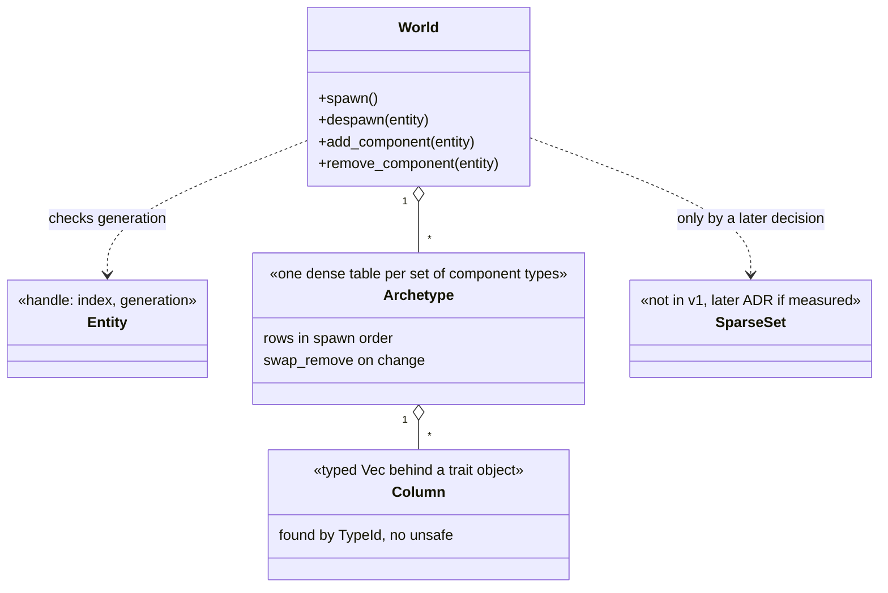

# ADR-0003 ECS storage: archetype tables with safe columns `[S]`

Status: **Accepted upon the owner's approval of the pull request that adds this page (governance task, card 7-3, declared by the owner in the session of 2026-11-14).** Until that approval the page is a proposal: the owner has not yet accepted the recommendation of the spike. The evidence is the report of card 7-2 (`wiki/spikes/ecs-storage-spike.md`, in `develop`; the page reaches `main` with the next release). This record decides the storage layout of the `ecs` crate (card 7-4). It is option A of the spike's section 7.

## 1. Context

The index proposed a hybrid like Bevy's (dense tables by default, opt-in sparse sets for components that change often) and left the decision to a benchmark ([core-runtime §4](../architecture/core-runtime.md)). Card 7-2 built four storages behind one workload API, all passing the same equivalence tests (a full-field digest over a scripted and a random session): archetype tables with safe typed columns, the same tables with type-erased byte columns (11 `unsafe` blocks), per-component sparse sets, and a hybrid. It measured iteration over one to three components, spawn and despawn, adding and removing a marker, memory, and allocator calls, on the shape of the phase 7 sandbox. Owner choice O3 of the phase 7 design note (`wiki/architecture/ecs-and-sandbox-v0.md`, in `develop`) says `unsafe` only on a measured clear win.

## 2. Decision

1. **Components are stored in archetype tables:** one dense table per set of component types, one column per type, rows in spawn order, `swap_remove` on despawn and on a structural change.
2. **A column is a typed `Vec<T>` behind a trait object,** found again by `TypeId` once per query and column. There is **no `unsafe` in the `ecs` crate**, so no entry in `gates/unsafe-budget.toml` is added.
3. **Entities are generation-checked handles;** a stale handle is refused, never dereferenced.
4. **Iteration order is table order, then row order.** No hash is iterated, so the order is a function of the spawn and structural-change history (the determinism rules of the phase 7 design note, in `develop`).
5. **Not decided here:** a second storage class (sparse sets) for components that toggle often. A later ADR adds it only if a measured workload shows the structural-change cost. The price to weigh then is the marker query, 13 to 15 times a table scan in the spike (an untuned path, so an upper bound).

## 3. Evidence (spike of card 7-2; Windows x86-64, release, one thread, wall-clock, median of three full runs)

| question | result |
|---|---|
| Iteration, one or two components | equal to sparse sets (0.4 to 0.6 ns per entity) |
| Iteration, three components | sparse join 2.5 to 2.8 times slower than tables |
| Add and remove a marker (10% of entities) | tables 27 ns per operation, sparse set 3 ns (9 times), hybrid 3.8 ns |
| Marker query | tables 3 to 5 times faster than the sparse set, 13 to 15 times faster than the hybrid (untuned upper bound) |
| Spawn and despawn | tables 14 ns, sparse 10 ns |
| Type-erased against safe columns | same iteration; row moves 10% to 30% slower; 11 `unsafe` blocks |
| Memory per entity | 67.4 bytes tables, 71.8 hybrid, 93.6 sparse |
| Allocator calls in steady state | 0 on all four |

At the sandbox's scale (a few thousand entities) every figure is microseconds against a frame of 16,700 microseconds (illustrative arithmetic, not a measurement), so the choice is about simplicity, determinism and the cost of changing it later.

## 4. Alternatives

| alternative | why not |
|---|---|
| B. Hybrid: tables plus a sparse class for components marked as often changing | toggles 7 to 9 times cheaper but two code paths and a dearer marker query; nothing in the sandbox needs it yet; the design leaves room for a later ADR |
| C. Type-erased columns | no speed win (10% to 30% slower row moves), 11 `unsafe` blocks and a budget entry in a governance file; O3 asks for a clear win |
| Pure sparse sets | three-component joins 2.5 to 2.8 times slower, 93.6 bytes per entity |

## 5. Consequences

- **Good:** no `unsafe` in the ECS, one storage path, iteration as good as the best of the four (equal within noise), deterministic order, zero allocator calls in steady state.
- **Bad:** adding or removing a component is about 9 times dearer than in a sparse set (27 ns); a workload that toggles a component on many entities every frame would feel it, and then needs the later ADR.
- **Not verified (the report's section 8):** no instruction counts (no `valgrind` on the machine used), no Linux, no ARM64, one thread, no parallel iteration, no generic query layer, no cold-cache sizes, a fixed component set with tables created at construction. The hybrid marker path is untuned.
- **Determinism:** unchanged, no hash iteration anywhere in the storage.

## 6. Validation

1. **Cards 7-4 and 7-5** (the ECS core and the typed queries) must pass the storage equivalence and determinism tests ported from the spike, the stale-handle tests, and a zero-allocation test in steady state.
2. **Card 7-6** registers the ECS iteration benchmark (instruction counts, the gate form of the physics benchmarks); the target is proposed from those measurements (owner choice O4). If the counts or a real workload contradict this decision (structural change dominates a frame), supersede this ADR with the hybrid.
3. **No `unsafe`** in `engine/ecs`: the unsafe-budget scan stays at its current state for the crate.
