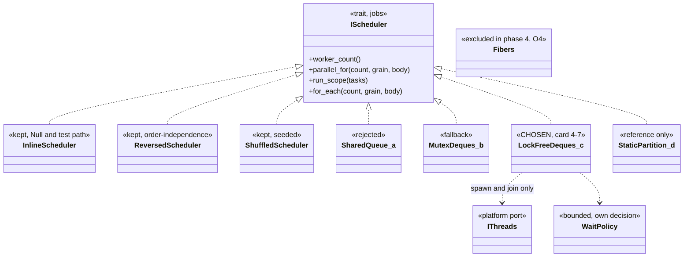
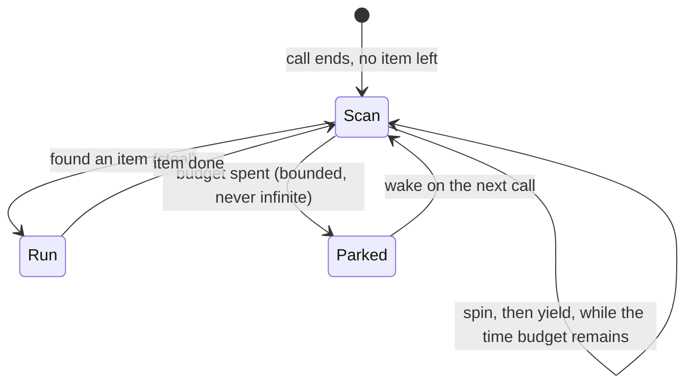

# ADR-0004 Job system: lock-free work-stealing pool behind `IScheduler` `[S]`

Status: **Accepted upon the owner's approval of the pull request that adds this page (governance task, card 4-6, declared by the owner in the session of 2026-11-03).** Until that approval the page is a proposal: the owner has not yet accepted the recommendation of the spike. The evidence is [scheduler-spike](../spikes/scheduler-spike.md) (card 4-5); every measured number below is taken from that page and cited by its section (the policy statements about `allowed_external` and O4 come from the design note).

## 1. Context

The index proposed a work-stealing thread pool with task counters behind `IScheduler`, a deterministic single-thread scheduler for tests, and fibers as the alternative, to be decided by a spike ([core-runtime §3](../architecture/core-runtime.md)). The `jobs` crate (card 4-4) has the `IScheduler` port and the inline, reversed and shuffled test schedulers. The design note ([physics-and-jobs-v0](../architecture/physics-and-jobs-v0.md) section 4) asked the spike which scheduler is the first real one, from `std` only (no third-party crate in L0-L2), with threads through the platform seam `IThreads`.

The spike (card 4-5) built four candidates, each passing the same contract suites at 1, 2, 3, 4 and 7 workers: (a) one shared queue with `Mutex` and `Condvar`, (b) per-worker mutex-protected stealing deques, (c) per-worker lock-free Chase-Lev deques, (d) static partition. Four synthetic workloads, 1 to 20 workers, one machine with 20 logical cores, Windows and Linux (WSL2).

## 2. Decision

1. **The first real scheduler is candidate (c): per-worker lock-free Chase-Lev deques with stealing and binary splitting of index ranges, behind `IScheduler`** (card 4-7). The deque is safe code on `AtomicU64` slots; the only `unsafe` is the lifetime erasure of the job closure that every candidate needs (spike section 5, finding 1).
2. **Threads come only through `IThreads`.** The pool takes its worker count as a constructor parameter (the caller plus N-1 spawned threads), so tests run at any count on any runner. The Null platform refuses a pool, and the inline scheduler is the path there.
3. **The wait policy is an explicit, bounded spin-then-yield-then-park, and it is a decision of its own.** Reason: the join-latency advantage of (b) and (c) in park mode came (on Linux, where the ablation is clear; on Windows it is noisy and shows no direction) from a post-call scan of about 128 steps (64 spins, then 64 `yield_now`) before parking, which (a) and (d) did not have. With the scan removed, on Linux at 4 workers (c) goes from 1.9 us to 15.7 us per call and (b) from 5.4 to 16.4 us, the level of (a) at 15.9 us (spike section 3.4a). With a spin budget given to (d), it was ahead of (c) on Linux at 4 workers (1.3 us against 2.1 us on w4a; section 3.3). So the wait policy, not the deque alone, carries the latency. The policy:
   - The **bound is a time budget**, chosen in card 4-7 and benchmarked there; the spike's scan was a count (64 + 64 steps), and its value as a time was not measured, so this ADR fixes the form (bounded, then park) and not the number.
   - **Never an unbounded spin**, and **no spin when the worker count exceeds the free cores**: (d) with a spin of 20000 iterations cost 1.5 ms per call at 20 workers on Windows, 23 times its park value (section 3.3).
   - The calling thread goes straight to the latch after its own share (the first harness version scanned in the caller and was unfair; finding 4).
4. **Fork-joins are batched.** Each `parallel_for` or `run_scope` should carry well over about 10 us of work: a rule of thumb, **no break-even was measured**. The data points are 1.4 us of work (inline 58 ns per call beats every pool) and 7.7 us per phase (1.9 times faster at 4 workers with (c) only) (section 5, finding 8). The grain is chosen from the item cost, never left at 1 (section 1 and finding 5: 12 to 29 ns per index at grain 1 for (a), (b), (c) with one worker on Linux; within 1 to 3 ns of inline at grain 64).
5. **Fibers are excluded from phase 4** (owner choice O4 of the design note): they need context switching, which is assembly or a third-party crate, both banned in L0-L2 without an owner decision. They were not measured. The exclusion may be revisited in phase 7 (ECS and mixer workloads do not exist yet) by a superseding ADR.
6. **The deterministic schedulers stay.** `InlineScheduler` is the Null and test path (no threads, ascending order); `ReversedScheduler` and the seeded `ShuffledScheduler` stay for the order-independence contract.
7. **Job-body contract (what keeps D1).** The port promises no order, no thread and no grouping. A body must be a pure function of its index range and of data that no other chunk of the same phase writes, so that its effect equals calling it per index in any order and any grouping. Then the result is identical at 1 and N workers. The contract suites (`scheduler_contract`, `order_independence_contract`) and the D1 replay hash check this; the spike hash was identical across candidates, worker counts, runs and both operating systems (0 differing cells, section 1).
8. **Soundness depends on abort-on-panic.** `panic = abort` is set in the workspace profiles but `cargo test` unwinds; a panic in the caller's own item would leave workers holding a dangling pointer and a panic in a worker would hang the caller in the latch (finding 3). The real pool must install an abort-on-unwind guard in its single `unsafe` module.
9. **Deferred:** thread affinity, priority and stack size are missing from `IThreads` and are a later port change (finding 9). Rules unchanged: no blocking I/O or locks inside jobs; the audio thread is outside the job system.

Wait policy of an idle worker (state view):

When the worker count exceeds the free cores the budget is zero: the worker goes from the call end straight to `Parked`.

## 3. Alternatives

| alternative | why not (spike evidence) |
|---|---|
| (a) shared queue, `Mutex` + `Condvar` | join latency grows with workers: 15.9 us at 4, 32.5 us at 6, 145 us at 20 (Linux, w4a); slowest on tiny jobs (95.9 ns per index at 6 workers at grain 1). Best on imbalance on Linux, and it was given no batching and no scan, so it is not a strawman |
| (b) mutex-protected stealing deques | same structure as (c) with a lock; 5.4 against 1.9 us per call at 4 workers with the scan, equal (16.4 against 15.7 us) without it. **The fallback** if the owner prefers the least code and no memory-order review: the loss is latency only |
| (d) static partition | 2.6 to 4 times slower than (a) on imbalanced work at 4 or more workers; needs a spin to be competitive on short phases, and then collapses when workers exceed free cores (1.5 ms per call at 20 workers, Windows). Kept as a reference |
| Fibers | excluded in phase 4 (O4), not measured (section 2, point 5) |
| A third-party pool | the policy allows none in L0-L2 and `allowed_external` is empty; the spike reached a safe-deque pool with `std` only |

## 4. Consequences

- **Good:** lowest join latency in park mode where the physics step needs it (1.9 us at 4 workers, Linux, with the scan; over (b), 5.4 us, the gain exists only with the scan, so (c) over (b) rests on a lock-free deque costing less than a lock under the same scan), a 1.9 times gain on a 7.7 us dependent phase at 4 workers, balanced work within 4% of (a) and (b) up to 6 workers, no `unsafe` beyond the one erasure module, zero allocation per call after construction (counted on the calling thread only).
- **Bad:** a memory-ordering review burden for the deque (complexity medium); a wait policy with a tunable that must be measured, not guessed; physics must be shaped into large batched fork-joins; one `unsafe` module added to the allowlist with a small budget (a governance edit in card 4-7).
- **Risks kept open:** the whole decision rests on synthetic work on one machine (section 5).
- **Determinism:** the scheduler cannot break D1 if the job-body contract holds; it is tested at 1, 2, 3, 4 and 7 workers.

## 5. Not verified

- **No ThreadSanitizer, no Miri.** Orderings were reasoned from the C11 formulation and stress-tested (exactly-once under 3 thieves), not model-checked; the protocol of the erasure module is argued, not proven.
- **One machine** (20 logical cores, physical and hybrid core effects uncontrolled), Windows and WSL2; no native Linux, no ARM, no machine with few cores. Windows numbers are noisy (the inline baseline moved up to 2.3 times between sessions).
- **Synthetic workloads only**; no real physics step. Real narrowphase and islands may change the ranking on imbalance, where (a) won on Linux.
- **The scan asymmetry is half ablated:** the scan was removed from (b) and (c) but not added to (a) and (d); the Windows ablation shows no clear direction. Linux spin results are one session.
- **The break-even work per fork-join** was not measured; "well over 10 us" is a rule of thumb.
- **Soundness needs abort-on-panic**, which the crate does not enforce (section 2, point 8).
- Idle CPU was measured on Windows only, at 16 ms resolution, and only for a bounded spin; an unbounded spin was not built. False sharing, frequency scaling, more than 20 threads and oversubscription by other processes were not studied.

## 6. Validation

1. **TSan on Linux nightly** for the real pool: card 4-21 (a CI job, governance).
2. **Card 4-7** (the pool) must pass the `jobs` scheduler contract suite and the order-independence suite at 1, 2, 3, 4 and 7 workers, the D1 replay hash (identical at 1 and N workers) and the zero-allocation test, and must state the spin time budget with its benchmark.
3. **Physics benchmarks** (the scaling benchmark of the phase 4 exit, a colour-by-colour solve with batched fork-joins) on the real step. If they contradict this decision (for example (b) or a spin policy matches (c) on the real work), supersede this ADR.
4. **Revisit in phase 7** with ECS and mixer workloads; reopen fibers only if an owner decision allows context switching.
