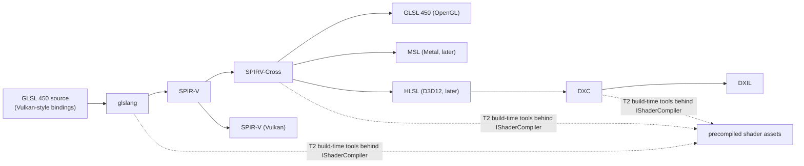

# ADR-0009 Shader strategy and toolchain `[S]`

Status: **DECIDED by owner (2026-11-02, card 3-7, governance task): shaders are written in GLSL 450 with Vulkan-style bindings, compiled to SPIR-V by glslang, and translated by SPIRV-Cross to GLSL 450 for OpenGL (and later to MSL for Metal). DXC joins only when the D3D12 backend exists, for DXIL. All are build-time tools behind `IShaderCompiler`.** This record completes the decision of Q5 (external compilers accepted, precompiled shader assets shipped) with the language and tools chosen by the phase 3 spike (Q25).

## 1. Context

Q5 accepted external shader compilers as build-time tools and no own compiler. Q25 left the authoring language and tools to a spike in phase 3. The spike (card 3-6, page `wiki/spikes/shader-toolchain-spike.md` on the `develop` branch, in `main` after the next release) compiled one sprite shader with three pipelines on Windows and Linux (WSL2): HLSL with DXC, GLSL with glslang and SPIRV-Cross, and Slang. All 23 steps succeeded; DXIL from all three validated; outputs were byte-identical on both systems for the files compared. The first backend is OpenGL 4.5.

## 2. Decision

1. **Authoring language: GLSL 450 with Vulkan-style set and binding numbers** (one uniform block at binding 0, texture and sampler as separate bindings). This is the neutral binding model: SPIRV-Cross turns it into OpenGL 4.5 `binding` qualifiers, and later into D3D12 and Metal slots.
2. **Pipeline:** glslang (GLSL to SPIR-V), SPIRV-Cross (SPIR-V to GLSL 450, later MSL, and HLSL when D3D12 starts), DXC (HLSL to DXIL, only once the D3D12 backend exists).
3. **Placement:** build-time tools only, tier T2, run by the shader tool crate (`tools_shaderc`, card 3-11) behind `IShaderCompiler`. The engine ships precompiled shader assets; no compiler runs in a game. Versions are pinned exactly in `THIRD_PARTY.md`.
4. **Tools are downloaded, not stored in git:** release archives are verified against their published SHA-256 digests; SPIRV-Cross has no binary release and is built from the pinned tag.
5. **Exit plan:** the compiler sits behind `IShaderCompiler`. Replacing a tool changes the tool and the shader sources, not the runtime. Slang is to be re-evaluated when the D3D12 or Metal backend starts, because one source for every backend is worth more there (owner, 2026-11-02).
6. **Second compiler path before the port is `stable`** (from the ADR index): the contract tests for `IShaderCompiler` get a second path (the Null compiler plus a real one) before stability.

## 3. Alternatives

| alternative | why not now |
|---|---|
| HLSL + DXC | fastest compiles and native DXIL, but the OpenGL route goes through SPIRV-Cross with a `row_major` matrix workaround that was not checked on a GPU; HLSL is not the language of the first backend |
| Slang | one source for every backend, best diagnostics and reflection; but a new language that locks shaders to one tool, 182 MB, about 190 ms per compile, weekly releases, and it needs the DXC library for DXIL. Re-evaluated at D3D12 or Metal |
| shaderc | not tested (no binary releases); it wraps glslang |

## 4. Consequences

- **Good:** small tools (about 70 MB); the GLSL to SPIR-V to GLSL round trip is clean (identical SPIR-V on recompile); permissive licences; easy exit because GLSL is a widely understood source.
- **Bad:** glslang diagnostics are terse; HLSL-minded authors get no first-class language; SPIRV-Cross must be built from source; reflection comes from SPIRV-Cross JSON.
- **Unverified:** no shader was run on a GPU; this is checked by the OpenGL adapter and the image test (cards 3-9 to 3-13).

## 5. Validation

Contract tests for `IShaderCompiler`; the sprite shader compiled in CI on Linux and Windows by `tools_shaderc`; the image test of card 3-13 compares rendered pixels; a second compiler path before the port is `stable`.
