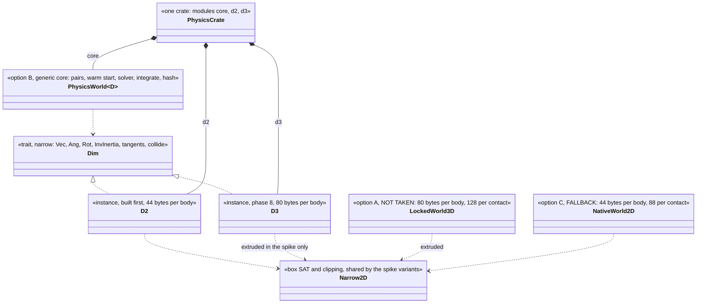
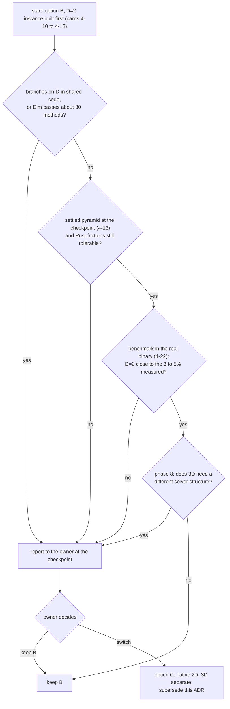

# ADR-0018 Physics core: dimension-generic with a narrow `Dim` trait, native 2D as the fallback `[S]`

Status: **Accepted upon the owner's approval of the pull request that adds this page (governance task, card 4-3, declared by the owner in the session of 2026-11-04).** Until that approval the page is a proposal: the owner has not yet accepted the recommendation of the spike. Option B was accepted by the owner as the default earlier (Q20) and this ADR keeps it; what the owner approves here is the evidence-based confirmation, the fallback rule and the crate layout. The evidence is [physics-core-spike](../spikes/physics-core-spike.md) (card 4-2); every measured number below is taken from that page and cited by its section. Nothing here is a new measurement.

## 1. Context

The owner wants both 2D and 3D physics, 2D first, 2D "as a subcase of 3D" (Q3). [physics §4](../architecture/physics.md) names three ways: **A** a 3D world with locked axes, **B** a dimension-generic core with a dimension trait (2D is the `D=2` instance), **C** two separate libraries. Option B was accepted as the default (Q20) on the condition that a spike validates it, because Rust has no template specialisation or `if constexpr` and const-generic expressions are limited (review-v0.10, B14). The [phase 4 design note](../architecture/physics-and-jobs-v0.md) (O1) put the spike first, and the layout of the `physics` crate (card 4-10) depends on its result.

The spike (card 4-2) ran one stacking scene (a pyramid of 55 boxes and a column of 10) through one algorithm in four variants: A (concrete locked-axis 3D), B at `D=2`, B at `D=3`, and C (concrete 2D). One Windows machine, three sessions, release build, each variant built alone and all in one binary (spike section 2).

## 2. Decision

1. **The physics core is dimension-generic: option B, a world generic over a narrow `Dim` trait; 2D is the `D=2` instance.** The owner's default (Q20) stands. The trait carries associated types (`Vec`, `Ang`, `Rot`, `InvInertia`) and the methods that differ per dimension; a number-based design (`const D: usize`) is not used because storage cannot be sized from a number and there is no specialisation (spike section 5, items 1 and 2). In the spike the trait had 15 methods and 4 associated types; `D2` took 90 lines and `D3` 87.
2. **Keep `Dim` narrow.** Vector and angular operations, the narrowphase and body construction go behind the trait; shapes and joints do not (spike section 5, last paragraph: pushing them in turns the generic part into a thin wrapper, the over-engineering the rule in physics §4 warns about). Rule kept from physics §4: **specialise rather than branch on `D`**; no `if D == 2` in shared code (held in the spike, section 4).
3. **Per-instance data is part of the instance, not a fixed array in the shared contact.** In the spike the shared contact reserved two tangent slots because an associated constant cannot size an array, so the 2D instance paid 16 bytes per contact (104 against 88). The design in card 4-10 should make the tangent and contact-point counts part of the instance, or accept the 16 bytes explicitly (spike section 7, points for card 4-3).
4. **Option C (native 2D) is the recorded fallback**, with the triggers in section 4. **Option A (locked-axis 3D) is not taken.**
5. **Crate layout confirmed: one `physics` crate with modules `core`, `d2` and later `d3`** (design note section 1). Compile time gave no reason to split (spike section 3.4: 0.60 to 0.64 s for any one variant, 0.81 s for all four), so no governance edit of the layer table or the scan rows is needed.
6. **Each instantiation is benchmarked in the binary it ships in**, not in one binary that holds all candidates, and not only for 2D (spike section 3.1: with all four variants in one binary B and C ran 4.5 to 5.2 times slower than built alone, for a cause not found; the hand-written C was hit as much as the generic B). This is a criterion of the physics benchmark card (4-22).
7. **The dimension-consistency test** (physics §4: a planar scene in `D=3` against `D=2`) is a tolerance test on short, non-chaotic scenes. The spike's bit equality held only because both paths share one extruded narrowphase (spike section 7); with a real 3D narrowphase it will not hold bit for bit.
8. **ADR-0012 is unchanged.** Nothing in the result touches the solver choice; the spike used sequential impulses with warm starting, not the Soft-Step solver (spike section 7, last point).

## 3. Alternatives

The numbers are the spike's pyramid of 55 boxes, Windows, release, median of 15 repetitions, three sessions (spike section 3.1 and 4).

| criterion | A: locked-axis 3D (not taken) | B: generic core (decision) | C: separate 2D and 3D (fallback) |
|---|---|---|---|
| Bytes per body (2D scene) | 80 | 44 at `D=2`, 80 at `D=3` | 44 |
| Bytes per contact | 128 | 104 at `D=2`, 128 at `D=3` | 88 |
| Contact points | 390 | 195 at `D=2` | 195 |
| Step time, built alone | 549 to 557 us | 61.6 to 63.1 us at `D=2` (3 to 5% over C), 556 to 577 us at `D=3` (1 to 4% over A) | 60.0 to 60.1 us |
| Total lines | 548 | 741 (both instances) | 790 (both) |
| Compile time (release) | 0.61 s | 0.60 to 0.64 s | 0.60 s |
| Rust feasibility | trivial | works, with the frictions below | trivial |
| Stack settles | yes | yes | yes |

**Why not A.** It is the wrong default for a 2D-first engine (spike summary, point 1):
- 80 bytes per body against 44 and 128 bytes per contact against 88, for the 2D scene (1.8 times the body size). Bytes and contact counts do not depend on the build.
- 2 to 9 times the step time: about 550 us against 60 us (9 times) when each variant is built alone, 267 to 289 us for native 2D (about 2 times) in the all-in-one binary, whose slowdown is of unknown cause. The honest range is 2 to 9 times and neither end is proven to be the true one.
- Part of the 9 times is the extruded face contact (4 points instead of 2); per contact point, built alone, A is still 4.6 times slower (1.41 us against 0.31 us).
- A's narrowphase in the spike is the 2D one on projected boxes, so a locked-axis engine with a true 3D box-box manifold would cost more, not less (spike section 6: a lower bound that favours A).
- It forces a robust 3D narrowphase before phase 4 can show a stack, which is what "2D first" is meant to avoid (spike section 7).

**Why B over C.**
- No body-size penalty (44 bytes at `D=2`) and 3 to 5% step time over hand-written 2D code at `D=2` (1 to 4% at `D=3`), built alone; state hash equal to the hand-written code after 120 steps in the spike, because both paths share one extruded narrowphase (spike summary, point 2).
- The generic core (265 lines) is 75% of the 2D instance and 63% of the 3D instance outside the narrowphase; B with both instances is 741 lines against 790 for two native solvers (6% less). The saving is small at this size; the spike has no broadphase tree, islands, sleeping or colouring, which physics §4 calls shared, so the spike understates it (spike section 3.3). Hence the choice rests mainly on the owner's requirement for both dimensions and on avoiding two copies of one algorithm (`native2d.rs` and `locked3d.rs` were the same functions in the same order, 242 and 249 lines), not on the line count.
- B with `D2` only is 585 lines against 472 for C only (113 lines, 24%, more): the price of the trait while 3D does not exist yet (spike section 3.3).

**Rust frictions of B** (spike section 5), met while writing the harness; items 1 to 3 reproduced on `rustc 1.94.1`, items 4 and 5 are observations:
1. An associated constant cannot size an array (`[f32; D::TANGENTS]`), and const-generic arithmetic fails the same way.
2. No specialisation: two `impl Vec<N>` blocks with the same method name fail with E0592.
3. `#[derive(Clone, Copy)]` on a struct with associated-type fields adds `D: Copy`; `Clone` and `Copy` were written by hand.
4. Generic arithmetic goes through operator bounds and every call into the dimension is `D::something(...)`: the solver is 265 lines against 242 concrete, a readability cost.
5. Run-time cost is small but code generation is fragile (spike section 5, items 5 and 6, which also records that compile time shows no cost at this size; see Consequences).

## 4. Fallback to option C: when it is triggered

The first three rows are the conditions under which the spike names C the better choice (spike section 7); the last two are this ADR's judgement from the spike's evidence, marked as such. The numeric weight of any of them is the owner's call at the checkpoint, because neither the design note nor the spike set a threshold.

| trigger | source | where it would show |
|---|---|---|
| the generic core grows `if`-like branches on `D` | spike section 7; physics §4 rule | review of cards 4-10 to 4-13 |
| the `Dim` trait passes about 30 methods (15 in the spike) | spike section 7 | review of cards 4-10 to 4-13 |
| phase 8 shows that 3D needs a different solver structure | spike section 7 | phase 8 |
| (judgement) the Rust frictions (no const array sizes, no specialisation, derive adds `D: Copy`) cost more than the saving as the core grows | spike section 5 (evidence only) | review of cards 4-10 to 4-13 |
| (judgement) the per-instantiation benchmark in the real binary shows the generic `D=2` instance clearly slower than the 3 to 5% measured over hand-written code | spike sections 3.1 and 4 (evidence only) | card 4-22, checkpoint |

What would make the owner switch: any one of the first three is the spike's own condition for C; the fourth and fifth are this ADR's judgements. The cost of switching is the one the spike gives: the 242-line solver is written twice (790 lines against 741 in the spike).

## 5. Consequences

- **Good:** 2D stays as small and as fast as hand-written 2D (44 bytes per body, within 3 to 5% at `D=2`, built alone); 3D is added in phase 8 without a redesign; the shared skeleton exists once with one set of tests; one crate, so the existing layer and scan rules apply with no governance step.
- **Bad:** the trait is a cost (about 180 lines of per-dimension glue at this size, 113 lines more than native 2D while only `D2` exists); 16 more bytes per contact in the 2D instance unless the tangent slots are made part of the instance; the Rust frictions above make the solver harder to read than the concrete code.
- **Code generation is fragile.** With all variants in one binary, B and C ran 4.5 to 5.2 times slower than built alone for an unknown cause (spike section 3.1). A benchmark that rests on one binary holding all candidates would mislead, so each instantiation is measured in its real binary (decision point 6).
- **Risks kept open:** the whole decision rests on a 55-box stacking scene, brute-force pairs, one machine and sequential impulses (section 6).
- **Determinism:** the spike's bit equality (B at `D=2` against C, B at `D=3` against A, equal state hash after 120 steps) is a property of identical arithmetic, not a determinism result for the real engine. The determinism gates (D0, D1) are measured on the real crate.

## 6. Not verified

All of this is taken from the spike's own not-verified list (spike section 8) or from its stated limits.

- One machine, one operating system (Windows), three sessions; no Linux, no ARM. Wall time includes whatever else the machine was doing (single repetitions up to 3.9 ms).
- The 4.5 to 5.2 times slowdown of B and C in the all-in-one binary is unexplained and the exploratory runs behind it were not kept as files; the high cost per contact of the 3D column is also unexplained. No figure or ratio is more reliable than that build-to-build variation, so the 2 to 9 times of option A is a range, not a point.
- No real 3D box-box narrowphase, no tree broadphase, islands, sleeping, colouring, joints, shapes other than boxes, threads or SIMD. The saving from sharing in a full engine and the SIMD fit of a 44-byte body against an 80-byte body (the reason Box2D v3 keeps body state small) are not measured.
- The Soft-Step or sub-stepping solver was not tried; the stability result is for sequential impulses with 10 iterations and a pyramid of 55 boxes. Taller stacks, high mass ratios and chains were not run.
- Compile time of a full engine is not predicted by a 750-line crate; the figures exclude `base`.
- Line counts are a script count of non-blank, non-comment lines; the shared percentages are of those counts, not a semantic measure.
- The thresholds of the fallback triggers (section 4) are not measured; only the conditions are the spike's.
- Coverage and mutation testing do not apply to the throw-away harness and were not run.

## 7. Validation

1. **Card 4-10** (the `physics` crate) follows this ADR: one crate with modules `core` and `d2`, a narrow `Dim` trait, the per-instance counts as part of the instance (or the 16 bytes accepted explicitly in the card).
2. **Checkpoint after card 4-13** (the first pyramid that settles), already proposed in the design note: check the triggers of section 4 that can be seen by then (branches on `D`, the number of `Dim` methods, the Rust frictions) and ask the owner for a go or switch decision.
3. **Card 4-22** (benchmarks): each instantiation in its real binary; the `D=2` instance against the 3 to 5% measured here; if the numbers contradict this ADR, supersede it.
4. **Phase 8:** the `D=3` instance and the dimension-consistency tolerance test on short scenes; the third trigger is judged here.
