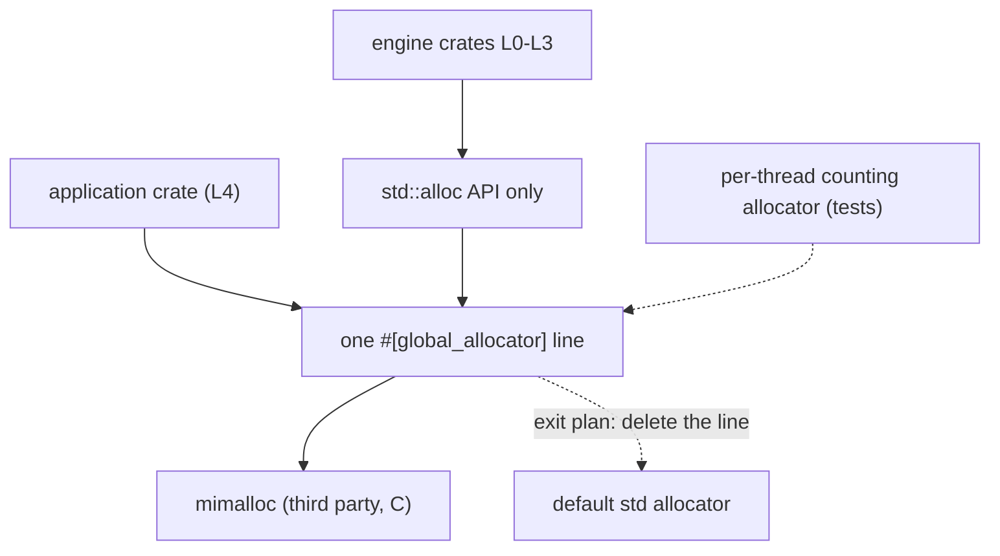

# ADR-0022 Allocation strategy and global allocator `[S]`

Status: **DECIDED by owner (2026-10-27): adopt mimalloc as the `#[global_allocator]` of application builds; the default `std` allocator is the exit plan.** This record decides the allocator and its tier. The `#[global_allocator]` line and the CI step that builds with and without it were added in card 1-30 (section 6).

## 1. Context

The engine's rule for allocation is a sequence of tools: design the allocation away, reuse capacity, arena, pool + handles, and only then the general allocator ([core-runtime §2](../architecture/core-runtime.md)). Whatever is left goes to the global allocator, and on Windows the default one (`HeapAlloc`) is slow for small objects. The first spike ([allocator-spike](../spikes/allocator-spike.md)) measured Windows only; risk R-22 asked for Linux. Card 1-27 ([allocator-benchmark](../spikes/allocator-benchmark.md)) compared the default allocator with mimalloc 0.1.52 on Windows and on Linux (WSL2), same machine, same program.

## 2. Decision

1. **Application builds (L4) use mimalloc as the global allocator,** declared once as a single `#[global_allocator]` line in the application crate. Engine crates (L0-L3) never name an allocator.
2. **Tier (defined here, as the digest and core-runtime §2 require):** a third-party global allocator is **L4 composition root, no port**. It is not an adapter, so `T1-stopgap` does not apply literally; in `THIRD_PARTY.md` the entry uses tier `T1-stopgap` with this ADR named as the reason for the placement.
3. **Exit plan:** delete the one line; the default `std` allocator takes over. Nothing else in the engine changes, because no engine crate depends on the allocator.
4. **Tests and tools keep the default allocator** unless a test is about the allocator itself. The per-thread counting allocator ([core-runtime §2](../architecture/core-runtime.md)) wraps whichever global allocator is chosen.
5. **The pass criterion of core-runtime §2 is applied as follows.** Speed parts (2 times on 64 B churn and on 8-thread scaling, both operating systems): met. "Nothing else slower beyond the gate tolerance": **not met on Linux for one case** (`Vec` growth, ratio 0.80, about 0.2 ns per push); the owner accepts this loss.

## 3. Evidence (from the benchmark; medians of three runs, default time / mimalloc time)

| case | Windows | Linux (WSL2) |
|---|---|---|
| 64 B allocate + free, 262,144 live | 6.3 | 3.2 |
| 64 B allocate + free, 4,096 live | 4.9 | 2.5 (unstable between runs) |
| 8 threads, each frees its own blocks | 5.2 | 3.7 |
| 8 threads, blocks freed by another thread | 1.7 | 2.8 |
| `Vec` growth to 1M pushes | 2.9 | 0.80 |

Faster in 14 of 14 cases on Windows and 13 of 14 on Linux. Full tables, method and limits are in [allocator-benchmark](../spikes/allocator-benchmark.md).

## 4. Alternatives

| alternative | why not |
|---|---|
| Keep the default allocator | Windows is the real platform and the default is 4 to 8 times slower on small objects there, and degrades with threads |
| A custom allocator everywhere | the order of tools already moves hot paths to arenas and pools; the global allocator only serves what remains |
| Another third-party allocator | not measured; mimalloc is the candidate the evidence is about. A later ADR can replace it by the same one-line exit |

## 5. Consequences

- **Good:** large gain for small allocations on the real platform; one line to remove; no engine code or port depends on it.
- **Bad:** mimalloc is C code compiled by the `cc` crate, so application builds and CI runners need a C compiler (verified in card 1-30: the `windows-latest` and `ubuntu-latest` runner images build it). One more third-party component to keep current. A small loss on Linux `Vec` growth.
- **Unmeasured (risks kept open):** memory use and fragmentation, native Linux (WSL2 is a virtual machine), ARM64. They do not block this decision, and they are follow-ups below.
- **Determinism:** the allocator does not change simulation results; simulation code must not depend on addresses (no hash of pointers), as before.

## 6. Follow-ups (not part of this record)

1. Done in card 1-30: the `#[global_allocator]` line is in `engine/app_runtime` behind the feature `mimalloc` (default on), and the `ci` workflow tests the crate with `--no-default-features` on both operating systems (switching back must compile and pass every test).
2. Native Linux run of `tools/alloc-bench` and a memory-use measurement; if either contradicts this decision, supersede this ADR.
3. Done in card 1-30: the CI run of PR 69 built mimalloc on both runner images.

## 7. Validation

Benchmark gate on instruction counts for hot paths ([rules-digest](../rules-digest.md) section 7), allocations per frame counted in tests (per-thread counters), and the with/without CI steps added in card 1-30 (clippy and tests of `app_runtime` with `--no-default-features`).

