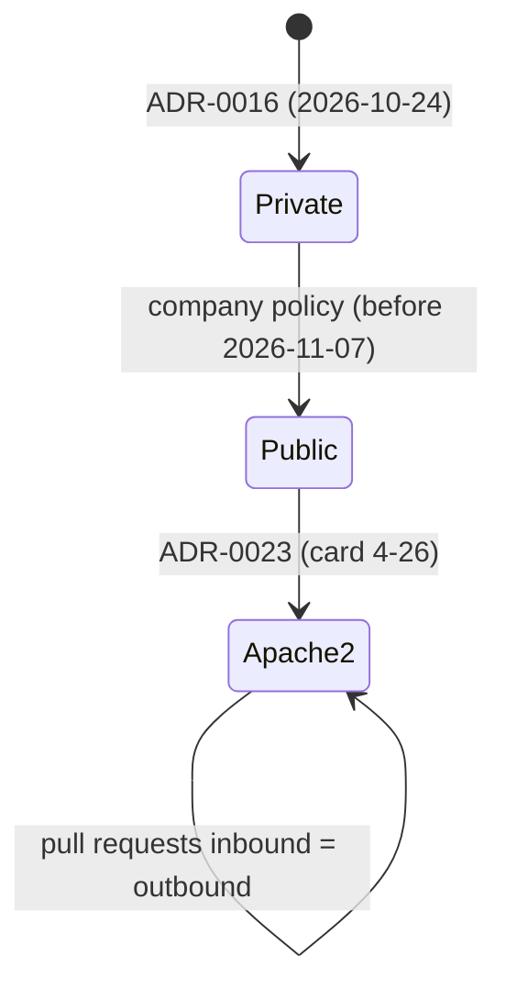

# ADR-0023 Public repository and Apache-2.0 licence `[S]`

Status: **DECIDED by owner (2026-11-07, card 4-26, governance task). Supersedes ADR-0016 (hosting and licensing) and the "private GitHub Release" part of ADR-0020.**

## 1. Context

ADR-0016 (owner, 2026-10-24) put the code in a private GitHub repository under an all-rights-reserved notice. By company policy the repository became public (it was public when the card 4-26 audit started, on 2026-11-07). A public repository changes who can read the code, the releases and the workflow runs, who can open pull requests, and what the GitHub Free plan allows; the notice "proprietary and confidential" is no longer true. The audit that this decision rests on found no credential in the history, the pull requests, the releases or the sampled run logs; history rewriting and any purge of old refs are separate decisions and are not made here.

## 2. Decision

1. **Licence: Apache-2.0**, copyright holder Giacomo Matzeu (`LICENSE` is the standard text, `NOTICE` names the project and the holder). Cargo manifests say `license = "Apache-2.0"`; `publish = false` stays. No per-file headers.
2. **Outside pull requests are accepted**, on inbound = outbound terms (Apache-2.0 section 5), without a CLA. `CONTRIBUTING.md` says how; governance files stay owner-only and the `governance-guard` check refuses a pull request that touches a protected path without a declared governance task. Vulnerabilities go through GitHub private vulnerability reporting (`SECURITY.md`).
3. **Releases stay as built**: a tag and a GitHub Release for every merge to `main`, now world-readable. What a release holds is listed in [docs/gates/release-workflow](../../docs/gates/release-workflow.md).
4. **The delivery workflow stays**: ordinary cards into `develop`, no CI on `develop` pull requests, governance cards into `main` first, the owner's approval against a diff hash. Merging stays **policy, not enforcement**, now as a choice: branch protection and rulesets are reachable on a public repository and are not configured.
5. **Workflows are safe on a public repository by test**: no secret, no self-hosted runner, hosted labels only, every action pinned by commit, a top-level permissions block, no untrusted event field expanded inside a script (`tools/release/test_workflows.py`, class `PublicRepositorySafety`).
6. **The owner drops the Workflows scope from the agent token** (an owner to-do, not verified as done [K]); after that the owner enables it for the push of a pull request that changes `.github/workflows/`.
7. **Third-party rule unchanged**: no GPL/AGPL; every licence in `THIRD_PARTY.md` and `deny.toml` permits redistribution under Apache-2.0.

## 3. Alternatives

| Option | Why not |
|---|---|
| Keep all rights reserved ("source visible, no licence") | Owner chose a permissive licence; discourages contribution |
| Custom source-available terms | Needs legal review; not OSI open source |
| MIT, or MIT OR Apache-2.0 | Apache-2.0 alone chosen by the owner (explicit patent grant, one text) |
| Dual licence with a CLA | Needs a contributor policy the owner declined |

## 4. How we will validate

`tools/release/test_workflows.py` (workflow safety), `tools/templates/test_templates.py` (no session identifiers in review reports), the wiki lint and digest check, and the owner's settings in [github-plan-findings](../workflow/github-plan-findings.md) section "Public repository: settings the owner keeps". Not validated here: the GitHub settings themselves (owner's UI), the legal side of the company policy.

