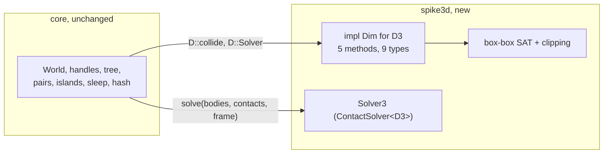

# 3D core spike (card 8-2) `[S]`

Card 8-2, 2026-11-17. A throw-away `D=3` instance written against the real generic core of the `physics` crate, to answer the ADR-0018 trigger questions before the instance is built for real ([phase8-3d-v0](../architecture/phase8-3d-v0.md) section 3). The code is not merged: it is commit `b6f1021` on the branch `spike/8-2-3d-core` (a test-only module `spike3d`, 760 lines with its tests and a 30-line debug trace). The spike is a TDD exception; its tests are measurements, not a safety net.

Statements marked *measured* were produced in this session; the 2D and old-spike figures are *recorded* from [ADR-0018](../decisions/adr-0018-physics-core.md) and are not re-run.

## 1. Summary

- **No ADR-0018 trigger fired.** The `Dim` trait did not grow: the unchanged five methods and nine associated types were enough for a 3D rigid body (quaternion rotation, diagonal inertia, box shape, AABB, 4-point manifold, a sequential-impulse solver). The shared core was not edited at all (the only change outside the new file is one `mod` line).
- **Every part of the core that is not the solver was reused unchanged:** world, handles, broadphase tree, pair list, islands, sleeping, state hash. A stack of 10 boxes settles (drift 1.4 mm, speed 0) and a 6-box stack replays to the same state hash twice over 120 steps. Sleeping was seen only on a single box in a debug trace, no test asserts it.
- **The solver is not shared.** `ContactSolver<D>` is per instance, so `Solver3` is new code. This was already true of the design; the spike measures what it costs and shows it is the main work of card 8-4 (section 4).
- **Recommendation:** go on with the plan (cards 8-3 to 8-6 on the existing ADR); no amendment is proposed.

## 2. The ADR-0018 trigger questions

| question | answer (measured) |
|---|---|
| Methods added to `Dim` | **0** (5 methods before and after; limit about 30) |
| Associated types | 9, the same set as `D2` (`Vec`, `Ang`, `Rot`, `InvInertia`, `Shape`, `Bounds`, `Manifold`, `Solver`, `Joint`) |
| Places in the core that needed a branch on `D` | **0**; no core file was edited |
| Does 3D need a different solver structure | No: the `ContactSolver` contract (`solve`, `commit` warm-start swap, `stats`, `write_bits`) fit. The solver body differs because the maths differs, which the design expected |
| Extra items outside `Dim` | the associated types need their own `HashBits` impls (`Box3`, `Aabb3`, `Manifold3`), a `Bounds` impl for `Aabb3`, the `Contact3` type, and `HashBits` and `Quantity` impls for `Quat` (done in the physics crate: the traits are its own) |

## 3. Sizes and times

| figure | D=2 | D=3 | recorded in ADR-0018 (D=2 / D=3) |
|---|---|---|---|
| `size_of::<Body<D>>()` (measured, bytes) | 84 | 128 | 44 / 80 |
| `size_of::<ContactManifold<D>>()` (measured, bytes) | 96 | 96 | 104 / 128 per contact (the old spike's contact struct, not the same type: not comparable) |
| 10 boxes stacked, one step (release, no warm-up, one thread) | not run | about 150 µs (162 µs in the author's run, 143 µs in the reviewer's; single runs, one machine, average of 600 steps, 60 solver iterations per sub-step) | 556 to 577 µs at D=3 in the old spike (different scene, extruded narrowphase) |

Body sizes grew in both dimensions since the ADR (the real `Body` has more fields than the old spike body); the Body ratio is 1.5 here (128/84) against 1.8 in the ADR (80/44); the cause was not checked. The two manifold sizes being equal was not investigated. The step time is not comparable with the old spike: other scene, other solver, no joints, no colouring.

## 4. What the spike code is

| part | lines | what |
|---|---|---|
| instance data and `impl Dim` | about 195 | `Box3`, `Aabb3`, `Manifold3`, `Quat` impls, `Dim` |
| narrowphase | about 165 | SAT over 15 axes, face clipping to at most 4 points, one point for an edge pair |
| `Solver3` | about 215 | sub-stepped sequential impulses, friction on two tangents, warm start, no joints, no colouring, single thread |

Not in the spike, so the real cost is higher: other shapes and GJK/EPA (8-3), joints, graph colouring and the parallel solve (D1 across thread counts is **not** tested), soft constraints, the `FpGuard` use beyond one guard, the sleep tuning. The 2D `Solver2` module `d2/solver/*` is 3031 lines, which includes its tests and the joint solver; no claim is made that 3D will be the same size.

## 5. Findings for the cards that follow

1. **Stability needed many iterations.** In interactive runs during the session (the commit holds only the final value of 60, so these runs are not reproducible from it) 30 iterations per sub-step settled the 5-stack but the 10-stack collapsed (top box thrown aside); 60 iterations settled both (drift 0.0017 and 0.0014 m, speed 0, lateral 0.005 and 0.0008 m). Only 12, 30 and 60 were tried; the commit's tests reproduce the 60 result; the spike solver has no soft constraint and no block solver. Card 8-4 should plan the soft-constraint path of `Solver2` for 3D and measure iterations, not copy 60.
2. **Warm starting was added together with re-applying the stored impulses at the start of each sub-step**, in one change; the effect of each alone was not separated. In an earlier run with 12 iterations and neither, the 5-stack still drifted sideways (0.03 m) and kept moving (not reproducible from the commit).
3. **`Body` mutators are crate-private**, so a `ContactSolver` implementation lives inside the physics crate (as `Solver2` does). Fine for `d3` in the same crate (ADR-0018); this suggests (inferred, not tried) that a solver in a separate crate would need those mutators made public.
4. **Math facade:** the spike used `Quat::rotate`, `conjugate`, `normalized`, `from_axis_angle` (the last only in a test) and `f32::sqrt` (friction mix, vector length). No `sin`, `cos` or other transcendental function was called in the stepping path, so under the D2 feature the `dmath` facade is needed only for building a rotation from an angle (`from_axis_angle`) and the facade has no quaternion function yet. Card 8-13 (determinism) should list which of these it routes; that is a proposal, not a measurement of the golden hash.
5. **Quaternion drift** was not measured; `advance_rotation` renormalises each step, and the resting scenes stayed upright. Fast rotation was not tested.

## 6. Not verified

- No Linux or ARM64 run; no D2 cross-platform golden hash for `D3`; no multi-thread run, so D1 is open.
- Moving-body scenes (tumbling, high speed, tunnelling), restitution, and sphere or capsule shapes were not tried.
- Stack stability was judged on two scenes with one friction value (0.6).
- Coverage and mutation do not apply (throw-away, test-only code).
- Mermaid read by the author, not rendered.

## 7. Decision for the owner

None blocks. If the owner wants, the spike branch can be deleted after this page is merged; the page and the commit hash are the record. Card 8-3 (shapes, GJK/EPA) is the next card in the design note, to be started on the owner's pick.
