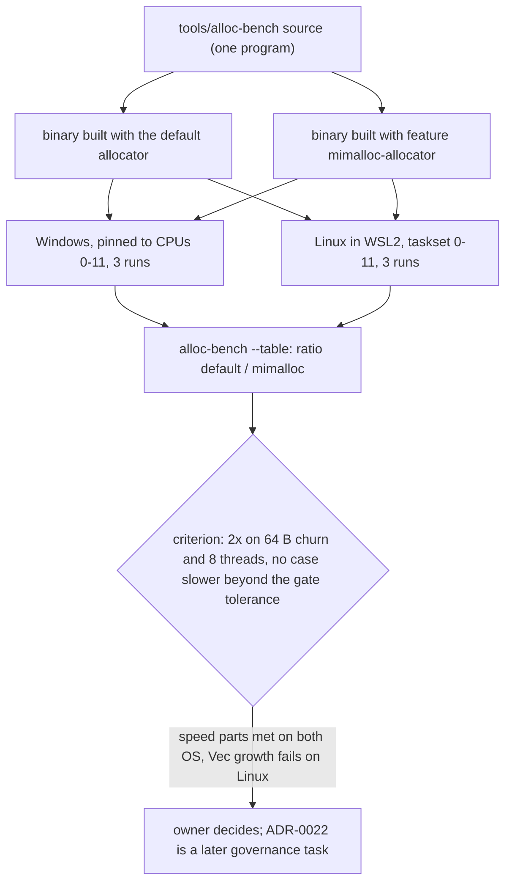

# Allocator benchmark: default allocator vs mimalloc on Windows and Linux `[S]`

Evidence for ADR-0022 (the global allocator), card 1-27, run on 2026-10-27. It answers the open part of risk R-22: the [allocator spike](allocator-spike.md) measured Windows only. This page records the method, the numbers and the pass criterion applied to them. **It adopts nothing.** The choice of the global allocator, the ADR-0022 record and any `#[global_allocator]` line are a later decision of the owner (ADRs are governance).

## 1. Summary

1. **mimalloc is faster than the default allocator in all 14 cases on Windows and in 13 of 14 on Linux (on the medians), and the gap is large for small objects.** Median of three runs, ratio = default time / mimalloc time (above 1 means mimalloc is faster):

| case | Windows (`HeapAlloc`) | Linux (glibc) |
|---|---|---|
| 64 B allocate + free, 262,144 live | 6.3 | 3.2 |
| 64 B allocate + free, 4,096 live | 4.9 | 2.5 (unstable, see section 5) |
| 8 threads, each frees its own 64 B blocks | 5.2 | 3.7 |
| 8 threads, blocks freed by another thread | 1.7 | 2.8 |

2. **The one case where mimalloc lost is `Vec` growth on Linux** (1M pushes into an empty `Vec<u32>`): mimalloc took 1.00 ns per push against 0.80 ns, ratio 0.80 on the medians (0.85, 0.93 and 0.64 in the three runs). Per run, about 0.2 ns per push. Windows shows the opposite (ratio 2.9).
3. **The proposed pass criterion** (section 4) has three parts. Two are met on both systems (2 times faster on 64 B churn and on 8-thread scaling). The third, "regresses nothing else beyond the benchmark-gate tolerance", is **not met on Linux** because of the `Vec` growth case (a 20% to 25% slowdown of a case that costs under 1.5 ns per push). The owner judges whether that case counts; section 6 gives the recommendation.
4. **Limits that matter:** one machine; Linux ran in WSL2 (a virtual machine on the same hardware), so Linux numbers are indicative and a native or CI run is better evidence; micro-benchmarks isolate allocation from the cache effects of a real frame; memory use (resident size) was not measured; ARM64 was not measured.

## 2. What was compared

| item | detail |
|---|---|
| Default allocator | Rust `std` `System` allocator: Windows `HeapAlloc` (user-mode heap of the OS), Linux glibc `malloc` |
| Candidate | mimalloc 0.1.52 (crate `mimalloc`, C library built with the `cc` crate), as the `#[global_allocator]`, selected by the Cargo feature `mimalloc-allocator` |
| Program | `tools/alloc-bench`, a standalone crate with its own workspace (not part of the engine workspace, not built by CI). Safe Rust, `unsafe_code` forbidden. 21 unit tests of the statistics, the output format, the argument parser and the workloads |
| Build | `cargo build --release`, `opt-level = 3`, `panic = "abort"`, two binaries from the same source |
| Binaries | the numbers come from the build before the review fix that added `black_box` on the two threaded batches (a no-cost guard against the compiler removing the allocations; the measured 5 to 10 ns per pair show they were not removed); the runs were not repeated after that edit |
| Measure | per case: one warm-up call, then 9 timed calls; the median of the 9 is the result of one run; 3 runs per binary, alternating default and mimalloc; the tables use the median of the three run medians |
| Pinning | Windows: process affinity mask `0xFFF` (logical CPUs 0 to 11, the six performance cores with their second hardware thread). Linux: `taskset -c 0-11`, the same CPU numbers inside the VM |
| Machine | Windows 11 Home, Intel i7-12700H (6 performance + 8 efficiency cores, 20 logical CPUs), Rust 1.94.1. Linux: Ubuntu in WSL2, kernel 6.18.54.1-microsoft-standard-WSL2, glibc 2.43, 12 CPUs visible after pinning |

## 3. Workloads

Times are nanoseconds per unit (one allocate + free pair, one list, one node, one push, one operation). For the threaded cases the unit is one pair of one thread, so the figure is the time one thread needs per pair while the others run, and a flat line means perfect scaling. Thread start and join are inside the timed call (negligible, and the same for both builds).

| case | what it does |
|---|---|
| churn 16 B / 64 B / 512 B | allocate N boxes of that size, write one byte in each, free all |
| lists | 2,000 lists of 1 to 8 `u32`, built by `push` (each list grows), then freed |
| tree build+free | boxed binary tree of 131,071 nodes, built, counted, freed |
| Vec growth | `Vec<u32>` from empty to 1,000,000 pushes (a few large reallocations) |
| map churn | `HashMap<u64, Box<[u8; 64]>>` with 100,000 live entries, 100,000 remove + insert operations |
| threads, own free | 1, 2, 4, 8 threads, each allocates and frees 1,000,000 64 B boxes in batches of 1,024 |
| threads, freed by another | 4 and 8 threads in a ring; each sends a batch of 5,000 fresh 64 B boxes to the next thread and frees the batch it receives (the cross-thread free the earlier spike found to be mimalloc's relatively weakest pattern) |

## 4. The pass criterion (a hypothesis proposed in the allocator spike, not yet an owner decision)

Adopt a third-party allocator only if it is at least 2 times faster than the default on small-object churn (64 B) and on 8-thread scaling, **on both operating systems**; it regresses nothing else beyond the benchmark-gate tolerance (warn 5%, fail 10%); and switching back compiles and passes every test.

| part | Windows | Linux |
|---|---|---|
| 64 B churn at least 2 times faster | met: 4.9 and 6.3 | met on the medians: 2.5 and 3.2; in the 4,096-live case 1 of 3 runs had mimalloc slower (0.79), so the 2 times rests on the 262,144-live case (3.0 to 4.4 per run) and on the medians |
| 8-thread scaling at least 2 times faster | met: 5.2 | met: 3.7 |
| nothing else slower beyond the gate tolerance | met (all cases faster) | **not met:** `Vec` growth 0.80 |
| switching back passes every test | not tested here: no allocator is adopted by this card | not tested here |

## 5. Results

Median of three runs (each the median of nine calls). The raw run outputs (12 text files) are not archived in the repository; the program reproduces the tables with `alloc-bench --table DEFAULT.txt CANDIDATE.txt`.

### Windows 11 (x86-64)

| case | param | default ns | mimalloc ns | default / mimalloc |
|---|---|---|---|---|
| churn 16 B | x 16384 | 42.08 | 10.06 | 4.18 |
| churn 64 B | x 4096 | 61.21 | 12.45 | 4.92 |
| churn 64 B | x 262144 | 70.79 | 11.20 | 6.32 |
| churn 512 B | x 16384 | 200.89 | 23.82 | 8.43 |
| lists | 2000 lists of 1..8 u32 | 86.90 | 19.95 | 4.36 |
| tree build+free | 131071 nodes | 45.49 | 8.78 | 5.18 |
| Vec growth | 1M u32 pushes | 2.53 | 0.88 | 2.88 |
| map churn | 100000 live, 100000 ops | 214.67 | 61.87 | 3.47 |
| threads, own free | 1 threads | 32.11 | 5.49 | 5.85 |
| threads, own free | 2 threads | 40.57 | 8.67 | 4.68 |
| threads, own free | 4 threads | 50.07 | 10.35 | 4.84 |
| threads, own free | 8 threads | 75.90 | 14.73 | 5.15 |
| threads, freed by another | 4 threads, batches of 5000 | 47.45 | 32.47 | 1.46 |
| threads, freed by another | 8 threads, batches of 5000 | 62.21 | 37.19 | 1.67 |

### Linux (Ubuntu in WSL2, x86-64)

| case | param | default ns | mimalloc ns | default / mimalloc |
|---|---|---|---|---|
| churn 16 B | x 16384 | 24.80 | 21.53 | 1.15 |
| churn 64 B | x 4096 | 43.96 | 17.49 | 2.51 |
| churn 64 B | x 262144 | 42.52 | 13.34 | 3.19 |
| churn 512 B | x 16384 | 128.65 | 30.73 | 4.19 |
| lists | 2000 lists of 1..8 u32 | 37.23 | 18.85 | 1.98 |
| tree build+free | 131071 nodes | 20.84 | 8.44 | 2.47 |
| Vec growth | 1M u32 pushes | 0.80 | 1.00 | 0.80 |
| map churn | 100000 live, 100000 ops | 103.27 | 76.89 | 1.34 |
| threads, own free | 1 threads | 29.18 | 8.10 | 3.60 |
| threads, own free | 2 threads | 31.12 | 9.27 | 3.36 |
| threads, own free | 4 threads | 33.68 | 10.94 | 3.08 |
| threads, own free | 8 threads | 46.21 | 12.34 | 3.74 |
| threads, freed by another | 4 threads, batches of 5000 | 104.70 | 35.10 | 2.98 |
| threads, freed by another | 8 threads, batches of 5000 | 110.81 | 40.02 | 2.77 |

### Reading the numbers

- **Windows is where the default is weak.** Small objects cost 40 to 70 ns per pair against 10 to 12 ns, and the default degrades with threads (32 to 76 ns from 1 to 8 threads) while mimalloc stays between 5 and 15 ns. The earlier spike's finding (5 to 7 times on small objects) is confirmed by an independent program (4.2 to 6.3 times here).
- **Linux's default is closer, as expected,** but mimalloc is still 2.5 to 3.2 times faster on 64 B churn and 3 to 3.7 times faster under threads.
- **Cross-thread frees:** the earlier spike's column is mimalloc time / default time, so its 0.46 to 0.55 for this pattern means mimalloc was about 1.8 to 2.2 times faster, its smallest gain of that spike. This program shows 1.5 to 1.7 times on Windows and 2.8 to 3.0 on Linux: consistent. The two programs do not do the same work.
- **Run-to-run spread on Linux is larger than on Windows** (WSL2 scheduling on a laptop): across the three runs the per-run ratios were 2.97, 1.15 and 0.87 for 16 B and 1.53, 4.65 and 0.79 for 64 B x 4,096, so those two Linux figures are not reliable. The other cases varied less (for example 3.0 to 3.9 with 2 to 8 threads, 3.0 to 4.4 for 64 B x 262,144).
- **Where mimalloc is not much better:** map churn on Linux (1.3), 16 B on Linux (1.15), lists on Linux (2.0). **Where it is worse:** `Vec` growth on Linux (0.80).

## 6. Recommendation (for the owner's decision; nothing is adopted)

The speed evidence favours adopting mimalloc as the engine's `#[global_allocator]` for application builds: it meets the two speed parts of the criterion on both systems, by a wide margin on Windows (the real platform). The criterion's no-regression part fails on one Linux case worth about 0.2 ns per push, which the owner may judge acceptable or may ask to investigate. Before an adoption I would want, as separate cards:

1. a native Linux run (CI runner or a second machine) to replace the WSL2 figures, repeated with the unstable Linux cases;
2. a memory-use measurement (resident size after the same workloads), which this card did not take;
3. the governance task that writes the ADR-0022 record, adds the `THIRD_PARTY.md` entry for mimalloc as an L4 dependency with the default allocator as exit plan, and adds the one `#[global_allocator]` line to an application crate, with a CI job that builds and tests with and without it (mimalloc is C code compiled by the `cc` crate, so the CI runners need a C compiler, which has not been checked on the runner images).

## 7. What this benchmark did not measure

- Memory use and fragmentation.
- Native Linux (WSL2 is a virtual machine) and ARM64.
- Allocation mixes of a real frame (cache effects); the engine's own rule stays that allocations are designed away, reused, arena-allocated or pooled first, so the global allocator matters for what is left.
- Large allocations (above 1 MB), `realloc`-heavy patterns other than `Vec` growth, and long-running fragmentation.
- Other candidates (for example a different third-party allocator). Only mimalloc was compared.
- The cost of switching back (no allocator is adopted by this card).

