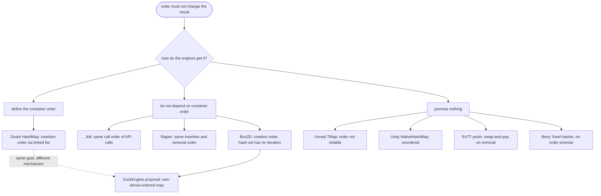

# Container survey: what competitor engines do `[S]`

Survey for DuckEngine, run on 2026-10-27 (card 1-22). Question from the owner: *does the recommendation of the container spike ([container-spike](container-spike.md), card 1-21) match what competitor engines do?* This page lists, per engine, which containers it uses where order matters, what it promises about iteration order and determinism, and a link for every claim. It is a reading survey, not a measurement. Nothing here is a decision.

## 1. Summary

**Short answer:** the survey supports the direction of the 1-21 recommendation and adds one concrete improvement. No engine read here offers a hash map whose iteration order is promised independent of its history, except Godot, whose `HashMap` defines insertion order that survives an erase. Bevy documents determinism by default for its hasher, but promises nothing about iteration order. So DuckEngine's own ordered map would not copy a standard solution. What the engines show is three habits.

1. **Physics engines get their order from somewhere other than a hash map.** Box2D takes contact order from body and shape creation order and avoids sorting; Jolt requires bodies and constraints to be added, removed and modified in exactly the same order and says plainly which of its own outputs are *not* deterministic; Rapier requires bodies, colliders and joints to be added to and removed from its sets in the same order. A hash set that is not iterated is fine: Box2D's shape-pair set has no iteration function (whether other code scans its public `items` array was not searched). This matches the wiki rule that simulation code must not iterate a hash table.
2. **The engines that have hash maps either define the order or say they do not.** Godot's `HashMap` "remembers insertion order and iterates by it" (a doubly linked list threaded through the entries, relinked on erase, so the order survives deletes). Unreal's `TMap` says its element order "is not reliable or stable". Unity's `NativeHashMap` is "an unordered, expandable associative array". Bevy's `HashMap` uses a fixed hasher, which its page says "provides determinism by default with an acceptable compromise to denial of service resistance in the context of a game engine", but the page promises nothing about iteration order. Separately, EnTT's component pools are sparse sets, not hash maps, and reorder on removal (swap-and-pop). Godot is the only engine read that defines a map order, with a different mechanism from the own dense-ordered map of the 1-21 recommendation: its order survives an erase, the own map's does not (it uses `swap_remove`). The Godot source gives no reason for the design, so it is not known whether it was meant as a determinism feature.
3. **Box2D treats hash quality for integer keys as a concern.** Its hash set carries the comment "I need a good hash because the keys are built from pairs of increasing integers" (and notes that a simple XOR of the two integers has many collisions) and uses the MurmurHash3 64-bit finalizer. This is a related concern to the 200-900x collapse the 1-21 spike measured with a multiplicative fixed hasher, not the same failure. It is one engine's comment, not a survey-wide habit.

**What this changes in the 1-21 recommendation (for the owner to accept):**
- Keep the own dense-ordered map for simulation code; it shares the goal of a defined order with Godot's `HashMap` and with the physics engines' habit of defining order explicitly, but it is a different design: its order does not survive a delete, Godot's does. If a stable order across deletes is wanted, that is a design choice for the map card.
- When the map is built, replace its multiply-and-fold hash with a stronger mixing function such as the MurmurHash3 64-bit finalizer that Box2D uses, and keep the skew test. This refines the map recommendation of 1-21; it is not a new decision.
- The sparse set matches EnTT's design (a sparse set with swap-and-pop), with the same caveat: the order changes on removal.
- The decision to ban `HashMap` in the `physics` crate is stricter than any competitor read here, which is acceptable because DuckEngine states D0 and D1 as requirements.

## 2. How the survey was done and how far to trust it

- **Sources:** the engines' own documentation pages and their source files on GitHub, read on 2026-10-27 through a web fetch tool that returns a summary of the page, not the raw text. Quotation marks below mark sentences the tool reported as quoted; they were not re-read against the raw page. The review of this page (`reviews/1-22.md`) states which claims were re-checked.
- **Documentation of the master or latest branch** was read, not of a specific release.
- **A missing statement is not evidence of absence.** "The page does not mention X" means the page read does not mention X.
- **Not covered:** Flecs (the search found no official statement about its table or iteration order), Unity DOTS Physics and Unreal Chaos determinism, and the ECS iteration order of Bevy. Rapier's internal containers were not examined (only its determinism page and its feature list).

## 3. Per engine

| Engine | Containers where order matters | Iteration order promise | Determinism statement | Sources |
|---|---|---|---|---|
| **Box2D v3** | A shape-pair hash set (`b2AddKey`, `b2RemoveKey`, `b2ContainsKey`; no iteration function), fixed Murmur-finalizer hash, no seed. Contact order comes from creation order, merged from per-thread bit arrays, to avoid sorting. | Contacts follow body and shape creation order ("should determine the order of contacts"); free lists in the pools can change body order after destroy and recreate. | Three levels: algorithmic, multithreaded and cross-platform; no roll-back determinism. Fast-math must not be used; FMA must be disabled (`-ffp-contract=off`); own approximate `sinf`, `cosf` and `atan2f` (used by `b2MakeRot()`, not called inside the library) because the library `atan2f` differed between platforms. | [determinism post](https://box2d.org/posts/2024/08/determinism/), [`table.h`](https://github.com/erincatto/box2d/blob/main/src/table.h) |
| **Jolt** | Own hash table with linear probing (per its header comment; open addressing by inspection) and 16-byte control-byte reads, tombstones on erase, maximum load 7/8, no visible seed. Own `QuickSort` and `Hash`; the docs say not to use `std::sort`, `std::push_heap`/`pop_heap` with equal elements, or `std::hash` in simulation because they differ between platforms. | Not documented for the hash table (iteration walks the buckets, so it depends on hash values and history). Stated as non-deterministic: broadphase queries, listener callback order, `GetActiveBodies`. Bodies and constraints must be added, removed and modified in exactly the same order; as a documented relaxation, adding A then B equals B then A if their body ids are consistent. | The same binary must run the simulation; cross-platform needs the `CROSS_PLATFORM_DETERMINISTIC` build option (about 8% slower per the doc); precise float mode, no contraction, own `Sin` and `Cos`. | [Architecture.md](https://github.com/jrouwe/JoltPhysics/blob/master/Docs/Architecture.md), [`HashTable.h`](https://github.com/jrouwe/JoltPhysics/blob/master/Jolt/Core/HashTable.h) |
| **Rapier** | Not examined (determinism page and feature list only). | The page requires that bodies, colliders and joints are built the same way and "added/removed to sets (rigid-body sets, etc.) in the exact same order" (the tool's wording; the exact sentence was not re-read for this cell). | "Locally deterministic": the same simulation run twice on the same machine with the same Rapier version and Rust compiler gives identical results. Cross-platform needs the `enhanced-determinism` feature (defined in the manifest as `simba/libm_force` plus `parry3d/enhanced-determinism`, no container dependency), IEEE 754-2008 and deterministic math functions for initial values; it cannot be combined with `simd8`; parallel results match sequential regardless of thread count. | [determinism guide](https://rapier.rs/docs/user_guides/rust/determinism/), [`Cargo.toml`](https://github.com/dimforge/rapier/blob/master/crates/rapier3d/Cargo.toml) |
| **Bevy** | `HashMap` and `HashSet` from `hashbrown` with `FixedHasher` as the default instead of `RandomState`; `HashTable` is exposed too. | The page says nothing about iteration order. | "This provides determinism by default with an acceptable compromise to denial of service resistance in the context of a game engine." | [`bevy_platform::collections`](https://docs.rs/bevy_platform/latest/bevy_platform/collections/index.html) |
| **Godot** | `HashMap` keeps entries in a doubly linked list (`_head_element`, `_tail_element`); the table is used only for lookup. Erase uses a shift-back in the probe chain and relinks the list. | Insertion order: the class comment says it "remembers insertion order and iterates by it"; iteration follows the list. An iterator to an erased element dangles. | None found in the file. The excerpt shows no random seed (the default hasher's implementation was not in the excerpt). | [`hash_map.h`](https://github.com/godotengine/godot/blob/master/core/templates/hash_map.h) |
| **Unreal** | `TMap` is hash-based on a sparse array; removed slots leave gaps that later inserts fill. | None: "the relative order of TMap elements in memory is not reliable or stable"; iterating is likely to return elements in a different order from insertion (paraphrase). `KeySort` and `ValueSort` order the map only until the next modification, and the page says sorting is unstable, so equivalent elements of a `TMultiMap` may appear in any order. | None found on the page. | [maps in Unreal](https://dev.epicgames.com/documentation/en-us/unreal-engine/map-containers-in-unreal-engine) |
| **Unity** (Collections package) | `NativeHashMap` is "an unordered, expandable associative array". | None: the page describes the map as unordered and says the key and value copies come "in no particular order"; it says nothing about enumeration. | None found on the page. | [`NativeHashMap`](https://docs.unity3d.com/Packages/com.unity.collections@2.5/api/Unity.Collections.NativeHashMap-2.html) |
| **EnTT** | Component pools are specialised sparse sets with paged sparse arrays; removal uses swap-and-pop unless in-place deletion (tombstones) is requested. | A multi-component view iterates the smallest pool, so the order "depends on how the components are arranged in their pool"; pools can be sorted with a comparator over components or by entity, or arranged to match another pool. No stable-sort statement. | None found on the page. | [`entity.md`](https://github.com/skypjack/entt/blob/master/docs/md/entity.md) |
| **Flecs** | Not found. | Not found. | Not found. | the search turned up no official page |

## 4. How this compares with the 1-21 recommendation

| 1-21 recommendation | What the engines read here show | Verdict |
|---|---|---|
| No iteration of the standard hash map in simulation code | Box2D's hash set has no iteration function; Jolt and Rapier get order from creation and call order; Unreal and Unity promise no order | **supports** |
| An own hash map with a defined order | Godot defines insertion order with a linked list (a different mechanism from the dense array of the own map). Bevy uses a fixed hasher but promises no order, which is the situation the 1-21 spike measured as "reproducible, not defined" | **supports the idea of a defined order**; the mechanisms differ (Godot's order survives an erase, the own map's does not), and no engine read presents such a map as a determinism feature |
| Sparse set for bounded ids | EnTT's pools are sparse sets with swap-and-pop; the order changes on removal, as in the own sparse set | **supports**; same caveat on order after removal |
| Stable sort, no unstable sort on equal keys | Unreal states its map sort is unstable; Jolt avoids `std::sort` for cross-platform reasons (D2, which DuckEngine pursues for physics only and opt-in since v0.36) and uses its own `QuickSort`; whether that sort is stable is not stated in what was read | **consistent**, but no engine read here gives a stable-sort rule to copy; Jolt's reason applies to the D2 mode of the physics crate, where the stable sort with a total order already covers it |
| Hash quality matters; keep a skew test | Box2D's comment and Murmur finalizer (one engine) | **supports, and suggests a stronger hash than the multiply-and-fold of the spike** |
| `BTreeMap` only for ordered traversal | No engine read here uses a tree map in simulation | **no evidence either way** |
| D0 and D1 always, D2 opt-in for physics (since v0.36; written as "not D2" before) | Box2D, Jolt (opt-in) and Rapier (opt-in) go to cross-platform; PhysX is same-platform only per a [third-party page](https://developer.playcanvas.com/user-manual/physics/ammo-alternatives/) that was not re-read | DuckEngine follows the leaders' opt-in shape for physics only; see [physics](../architecture/physics.md) section 3 |

**Where DuckEngine would differ from the engines read:** it bans `HashMap` and `HashSet` in the simulation crate by scanner (stricter than any of them), and it would write a dense-ordered map where the others either ban iteration (physics engines), define insertion order with a list that survives erase (Godot), or accept an unordered map (Unreal, Unity).

## 5. Limits

- **Eight engines, one reading each.** Documentation can lag the code, and the code was not read beyond a few headers.
- **Documents read through a summarising tool.** Quotes were not re-read against the raw pages by the author; the reviewer re-fetched every cited source (also through a summarising tool, using raw files where the link allowed) and the review report lists what was confirmed and what was not. The last 10,000 characters of the Jolt `Architecture.md` page were not read by either of us.
- **Box2D's "no iteration" is about the header only:** callers scanning the public `items` array were not searched, and whether this set is the broad-phase pair set was not traced.
- **The statements are about what is documented**, not about what the engines do in every code path (Jolt's iteration order, for instance, is derived from how its header walks the buckets, not from a promise).
- **No competitor measurement.** Speed and memory of the competitors' containers were not measured; the 1-21 numbers are about our own candidates.
- **Flecs, Unity DOTS Physics, Unreal Chaos and Bevy's ECS order were not covered.**

## 6. Decisions for the owner

1. **Accept the refinement:** when the dense-ordered map is built, use a stronger mixing function (MurmurHash3 64-bit finalizer or equivalent) and keep the high-bits skew test as a required test.
2. **Do the 1-21 decisions** (map, sparse set, sort rule, ring) as listed in [container-spike](container-spike.md) section 8; this survey did not change them.
3. **Optional follow-up:** a second reading pass on Flecs and on Bevy's and Unity DOTS's ordering, if the ECS storage spike (phase 7) wants it.
