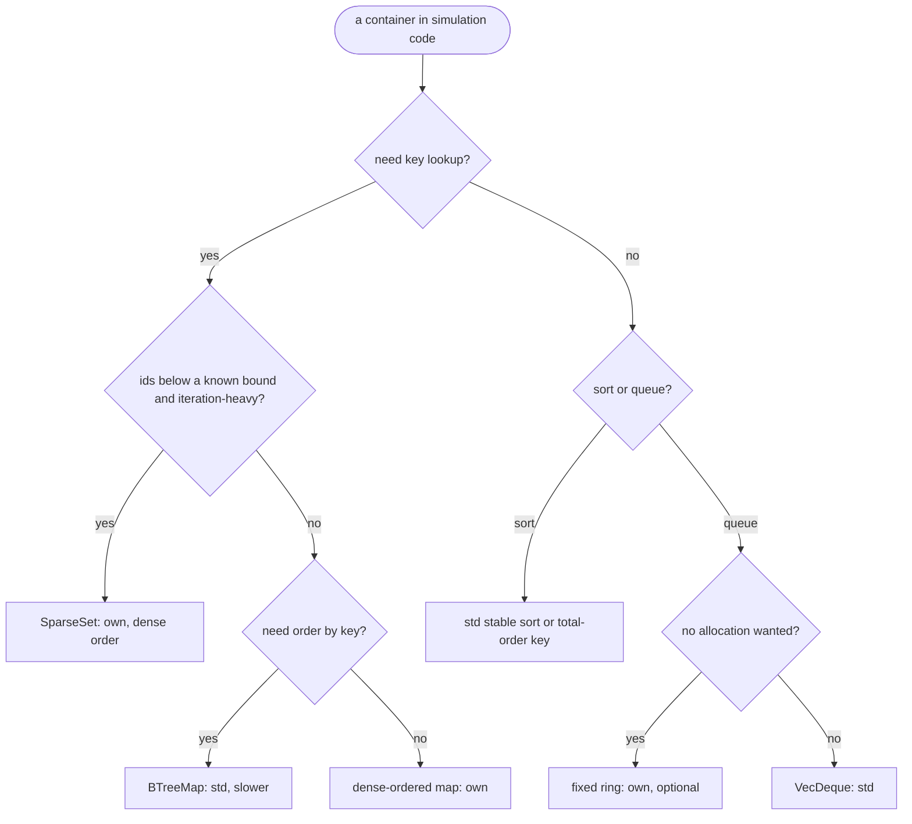
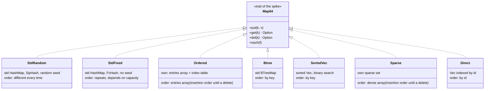

# Container spike: deterministic containers vs the standard ones `[S]`

Spike for DuckEngine, run on 2026-10-27 (card 1-21). Question from the owner: *what is a deterministic container, and should the engine use deterministic containers or the standard ones?* This page is the evidence copy of that report. The spike code and the raw output are not engine code and are not in this repository (they stay in the scratchpad of the session); the numbers below are copied from the second (final) run of the suite; a later spot rerun of the id table differed from them by up to 10%. Nothing here is a decision: the recommendation in section 1 waits for the owner's pick.

## 1. Summary

**Short answer:** the standard containers are not deterministic where it matters (iteration order), so simulation code needs its own. The cost of that is small, and for the main case (a hash map that is iterated) the own container is faster than the default standard one. Do not simply swap the standard hasher: it is deterministic only by accident, and it can collapse.

What the measurements say (Windows 11, i7-12700H, Rust 1.94.1; details in sections 4-7):

1. **`std::collections::HashMap` is not deterministic, not even in one process.** Two maps built with the same 1,000 inserts iterate in different orders, in the same process and across processes, and the `f32` sum of their values differs between processes (section 4). Eight threads building "the same" map do not agree on the order. This is why the rules ban iterating it in simulation code.
2. **A fixed hasher on the standard map is not enough.** With a fixed hasher (the FxHash algorithm) the order repeats from run to run and across threads, but it changes when only a capacity hint (`with_capacity`) changes, so it depends on how the map was built, not only on what was put in. Its quality is also ours to guarantee: keys that differ only in their high 32 bits made it **200-900 times slower** (a lookup took 4,780 ns instead of 11.8 ns at 100,000 keys, section 5.3).
3. **An own dense-ordered map** (dense entries array plus an index table, about 150 lines of safe code) is deterministic by definition: iteration visits the entries array, which is insertion order until the first delete (a delete moves the last entry into the freed position), whatever the capacity or the thread count. The spike also checked that the order after 50,000 mixed puts and deletes does not depend on the capacity hint. Against the default standard `HashMap` it is faster at insert (1.2-2.4x), at iteration (3-6x) and at finding present keys (1.7-5x) at 100, 10,000 and 1,000,000 entries; for absent keys it is faster at small sizes (6.3x at 100, 1.3x at 10,000) but slower at 1,000,000 (20 ns vs 14 ns); churn (remove + insert) at 1,000,000 entries is slower too (245 ns vs 156 ns). Against the standard map with a fixed hasher it is **slower at finding present keys (1.9-2.5x from 10,000 entries) and much slower at absent keys (2.5-7.8x from 10,000 entries)**, slower at churn (1.4x at 10,000, 2.8x at 1,000,000), and **2.4-6x faster to iterate**. At 100 entries it is on par or slightly faster.
4. **`BTreeMap` is deterministic but slow:** 7-44x slower lookups than the fixed-hasher map at every size measured. Use it only when key-ordered traversal is needed.
5. **Sorting needs no new container.** The standard stable sort is deterministic and costs up to 1.3x the unstable one on random keys; `sort_unstable` is deterministic as an algorithm but gives a different order of equal keys than the stable sort (it moved 99.6% of the elements when there were only 256 distinct keys), which is why the rule bans it on equal keys. An unstable sort with a total-order key (the index as tie-break) gives exactly the stable result. An own radix sort is about 2.1x faster on random integer keys of 100,000 or more, and 29x slower on already sorted input.
6. **Ring buffer: `VecDeque` is already deterministic.** The own fixed-capacity ring is 3.3x faster per push+pop (0.35 ns vs 1.15 ns), but the absolute gain is below one nanosecond per operation; the reason to write it is its contract (no allocation, a full queue is a value), not speed.
7. **Sparse set (ids below a known bound):** against the fixed-hasher map it iterates 4.5-7x faster and churns 1.9-2.3x faster at 1,000 and 100,000 live ids, with slower lookups at 100,000 (5.4 ns vs 3.7 ns), and it costs 4 bytes of table per possible id (4 MB for a universe of 1,000,000). A plain `Vec` indexed by id is faster still at lookup and churn but must scan the whole id range to iterate.

**Recommendation (for the owner to accept or change; nothing is built yet):**

| Need | Use | Why |
|---|---|---|
| Key-value lookup in simulation code, iterated or not | **own dense-ordered map** (safe code; working name `OrderedMap`, but its order is insertion order only until the first delete) | deterministic by definition, no collapse on the high-bits key pattern that broke the fixed hasher, faster than the default standard map on present keys, about 2x slower on present keys and 2.5-8x on absent keys than a fixed-hasher standard map from 10,000 entries |
| Id-indexed data with a known bound, iteration-heavy | **own `SparseSet`** | dense iteration order (insertion order until the first delete), fastest iteration; memory grows with the id bound |
| Ordered traversal by key | `BTreeMap` | deterministic, slower; only when order by key is the point |
| Sorting | **std stable sort** | no own code; radix sort only when a profile shows a large integer sort. (An unstable sort on a total-order key gives the same result, but the arch-check scan bans every `sort_unstable*` in the `physics` crate, so using it there would need a governance change.) |
| FIFO queue | `VecDeque`; own fixed-capacity ring only if the no-allocation contract is wanted | already deterministic |
| Hash map outside simulation crates (tools, import, editor) | std `HashMap` with the explicit fixed hasher that [ports-and-adapters](../architecture/ports-and-adapters.md) already requires there | order does not matter there; the hasher must pass the skew test of section 5.3 (the FxHash algorithm used in this spike does not) |
| A hot lookup-only map where the 2x matters | standard map with a well-mixing fixed hasher | **not allowed today in the `physics` crate**: the arch-check scan rejects the identifiers `HashMap` and `HashSet` there, so it would need a governance task. Elsewhere it needs a benchmark, a `PERF:` comment and the skew test; never iterated |

Follow-up cards if the owner agrees (each is Class 2, new public API; the ids are proposals, to be checked against the board when the cards are created): 1-22 dense-ordered map, 1-23 `SparseSet`, 1-24 fixed-capacity ring (optional, lowest priority). The deterministic sort card is not needed: the rule "use the stable sort" is enough, and the arch-check scan already bans the unstable sort in the `physics` crate.



## 2. What deterministic means here

A container is deterministic when the same sequence of operations always gives the same observable results, **including iteration order**, and nothing outside the program's inputs can change them: memory addresses, a per-process random seed, thread timing, capacity hints. This is what the replay-hash rule needs ([rules-digest](../rules-digest.md) section 5): a simulation that visits bodies in a different order sums floats in a different order and diverges. Identical results across platforms (D2) are not pursued, so the spike compares on one machine only.



## 3. What was compared and how

**Hash-map candidates** (all with `u64` keys and `u64` values, 16 bytes per entry):

| Name | What it is |
|---|---|
| std HashMap (RandomState) | the default: SipHash with a random seed per map |
| std HashMap + fixed hasher | the same table with an own FxHash-algorithm hasher, no seed |
| own dense-ordered map (called `Ordered` in the spike) | `Vec<(key, value)>` of entries plus an open-addressing table of `u32` positions (linear probing, load at most 0.5, backward-shift delete, `swap_remove` on the entries). Safe code, about 150 lines |
| own dense-ordered map + hash tag | the same with a 32-bit hash tag stored next to each position, tried to see whether the gap to the standard map closes (it does not: up to 23% on misses at 1,000,000 entries, nothing at 10,000, and a third more memory); not in the recommendation |
| std BTreeMap | ordered by key |
| sorted Vec | binary search, `O(n)` insert; only for 100 and 10,000 entries |

**Id-indexed candidates** (ids below 1,000,000): the fixed-hasher map, the own ordered map, the own **sparse set** (a `u32` table per possible id plus dense id and value arrays, `swap_remove`), and a plain **`Vec` indexed by id** with a sentinel.

**Sorting** (`(u32 key, u32 index)` pairs): the standard stable `sort_by_key`, `sort_unstable_by_key` on the key, `sort_unstable_by_key` on `(key << 32) | index` (a total order), and an own LSD radix sort (3 passes of 11 bits, stable, scratch buffer reused).

**Queues:** `VecDeque` with capacity 1,024 and an own fixed-capacity ring (power-of-two mask, full queue returns `Err`).

**Per-operation measures** (ns per operation unless noted): *insert* into a fresh map that grows from empty; *hit* (every key, shuffled order); *miss* (as many absent keys; for the sequential-key tables the absent keys are probed in ascending order while hits are probed in shuffled order, which flatters ordered structures such as the `BTreeMap` on misses); *iterate* (wrapping sum of the values only; the keys are not read, which favours a dense array); *churn* (remove a random live key, insert an absent one, 100,000 times or four times the entry count, whichever is smaller, at least 1,000; the timed loop also contains two random numbers, two modulo operations and a swap, which every map pays equally and which compress the ratios, mostly for the fastest structures); *iterate after churn*; *bytes per entry* retained after the build, counted with a counting allocator (including the table of a sparse set or direct index).

**Method:** release build (`opt-level=3`, Rust 1.94.1, MSVC), no dependencies. For small maps the whole cycle repeats until about 200,000 operations are timed (`inner` rounds). One warm-up round, then 7 timed rounds at 100 entries, 5 at 10,000 and 3 at 1,000,000 (ids: 7 rounds at 1,000 live and 5 at 100,000; sort: 15, 7 and 5 rounds at 1,000, 100,000 and 1,000,000 elements; queues: 5 rounds of 20 million operations), and the table shows the **median**. Results go through `black_box`. **Correctness first:** the own maps, the sparse set and the direct index are checked against `std::HashMap` over 400,000 random put/delete/get steps each (all agree), and the sort variants are checked against each other (the tie-break and the radix sort equal the stable sort exactly). Keys are random 64-bit values or the sequential values `0..n`; the id tables use a random subset of `0..1,000,000`.

**Environment:** Windows 11 Home, 12th Gen Intel Core i7-12700H, 15.7 GB, Rust 1.94.1 (the pinned toolchain), single thread for the timings, the machine not otherwise idle-controlled (no core pinning, no priority change, unlike the allocator spike). The full suite ran twice (the second run added the hash-tag variant); the rows that appear in both usually agree within about 15%, and the largest difference is the own map's churn at 1,000,000 entries (208 and 245 ns, 18%). Differences of 20-30% (the 1.2-1.3x ratios) are therefore not distinguishable from noise. Inside the second run one row is odd: the hash-tag variant inserts 10,000 random keys in 31.0 ns but 10,000 sequential keys in 14.8 ns, while the plain variant is flat at about 22.5 ns; the hash-tag variant is not part of the recommendation and its numbers are inconclusive.

## 4. Determinism: what the standard map does

Each row builds a map with the same 1,000 inserts (inserts only, with values of very different sizes so that an `f32` sum depends on the order; order after deletes was checked separately, see below), fingerprints the iteration order, and sums the values in iteration order. "6 processes" means the program was started six times.

| map | same order in 6 processes | same sum bits in 6 processes | same process, same inserts, twice | same with capacity hint | 8 threads agree |
|---|---|---|---|---|---|
| std HashMap (RandomState) | NO | NO | NO | NO | NO |
| std HashMap + fixed hasher | yes | yes | yes | NO | yes |
| own insertion-ordered map | yes | yes | yes | yes | yes |
| own ordered map + hash tag | yes | yes | yes | yes | yes |
| std BTreeMap | yes | yes | yes | yes | yes |
| sorted Vec | yes | yes | yes | yes | yes |

**Reading.**
- **`RandomState` fails every test**, including "same process, same inserts, twice": each new map gets a different seed. Nothing about its iteration can be relied on, and the float sum changes with it.
- **The fixed hasher repeats** across processes, in the same process and across threads, but it fails "same with a capacity hint": the same inserts into `with_capacity(1000)` and into a map that grew gave different orders. Its order is a function of the table layout, which depends on internal details of the hash-table implementation (here the one shipped with Rust 1.94.1, which is pinned by `rust-toolchain.toml`) and on how the map was created. It is reproducible, not defined.
- **The own dense-ordered map, `BTreeMap` and the sorted `Vec` pass every row.** For the own map the order is a rule: the entries array, in insertion order, where a delete moves the last entry into the freed position. A separate check ran 50,000 mixed puts and deletes into an own map with no capacity hint and one with a capacity of 100,000 and got the same order for both, while the same check on the fixed-hasher standard map got different orders. The order is deterministic, but it is not stable insertion order after a delete, so a user who needs one (for serialisation, say) must not rely on it.

## 5. Results: hash maps

### 5.1 Random and sequential keys (ns per operation)

#### random 64-bit keys, n = 100 (ns per operation)

| map | insert | hit | miss | iterate | churn (del+put) | iterate after churn | bytes/entry |
|---|---:|---:|---:|---:|---:|---:|---:|
| std HashMap (RandomState) | 19.3 | 6.4 | 8.8 | 1.19 | 27.7 | 1.79 | 21.9 |
| std HashMap + fixed hasher | 13.2 | 1.7 | 1.6 | 0.74 | 11.6 | 0.73 | 21.9 |
| own insertion-ordered map | 8.5 | 1.3 | 1.4 | 0.31 | 11.8 | 0.31 | 30.7 |
| own ordered map + hash tag | 9.3 | 1.5 | 1.7 | 0.32 | 13.1 | 0.32 | 41.0 |
| std BTreeMap | 25.4 | 11.7 | 13.0 | 1.48 | 57.8 | 1.60 | 24.0 |
| sorted Vec | 21.1 | 5.8 | 5.7 | 0.32 | 54.9 | 0.32 | 20.5 |

#### random 64-bit keys, n = 10000 (ns per operation)

| map | insert | hit | miss | iterate | churn (del+put) | iterate after churn | bytes/entry |
|---|---:|---:|---:|---:|---:|---:|---:|
| std HashMap (RandomState) | 35.0 | 6.6 | 6.7 | 1.27 | 41.9 | 1.27 | 27.9 |
| std HashMap + fixed hasher | 25.7 | 1.6 | 2.0 | 1.21 | 24.1 | 1.25 | 27.9 |
| own insertion-ordered map | 22.6 | 3.7 | 5.1 | 0.21 | 32.7 | 0.23 | 39.3 |
| own ordered map + hash tag | 31.0 | 3.4 | 5.2 | 0.22 | 31.7 | 0.22 | 52.4 |
| std BTreeMap | 72.0 | 50.6 | 52.2 | 2.01 | 151.2 | 2.08 | 27.4 |
| sorted Vec | 478.9 | 15.5 | 15.4 | 0.21 | 1869.3 | 0.21 | 26.2 |

#### random 64-bit keys, n = 1000000 (ns per operation)

| map | insert | hit | miss | iterate | churn (del+put) | iterate after churn | bytes/entry |
|---|---:|---:|---:|---:|---:|---:|---:|
| std HashMap (RandomState) | 50.8 | 44.6 | 14.2 | 2.39 | 155.7 | 2.31 | 35.7 |
| std HashMap + fixed hasher | 36.0 | 10.6 | 4.8 | 2.33 | 87.2 | 2.44 | 35.7 |
| own insertion-ordered map | 34.4 | 20.9 | 20.2 | 0.81 | 245.4 | 0.78 | 25.2 |
| own ordered map + hash tag | 36.6 | 18.8 | 16.9 | 0.91 | 210.4 | 0.78 | 33.6 |
| std BTreeMap | 171.4 | 199.2 | 212.1 | 15.07 | 694.0 | 15.26 | 27.1 |

#### sequential keys 0..n, n = 100 (ns per operation)

| map | insert | hit | miss | iterate | churn (del+put) | iterate after churn | bytes/entry |
|---|---:|---:|---:|---:|---:|---:|---:|
| std HashMap (RandomState) | 19.6 | 6.5 | 9.0 | 1.20 | 28.2 | 1.83 | 21.9 |
| std HashMap + fixed hasher | 11.8 | 1.6 | 1.2 | 0.74 | 11.0 | 0.87 | 21.9 |
| own insertion-ordered map | 8.2 | 1.2 | 0.9 | 0.32 | 10.4 | 0.33 | 30.7 |
| own ordered map + hash tag | 9.3 | 1.4 | 1.2 | 0.34 | 11.9 | 0.34 | 41.0 |
| std BTreeMap | 24.5 | 11.2 | 10.2 | 1.47 | 56.1 | 1.62 | 35.5 |
| sorted Vec | 16.9 | 5.7 | 5.6 | 0.32 | 53.0 | 0.33 | 20.5 |

#### sequential keys 0..n, n = 10000 (ns per operation)

| map | insert | hit | miss | iterate | churn (del+put) | iterate after churn | bytes/entry |
|---|---:|---:|---:|---:|---:|---:|---:|
| std HashMap (RandomState) | 30.1 | 6.5 | 6.6 | 1.26 | 41.8 | 1.22 | 27.9 |
| std HashMap + fixed hasher | 18.9 | 1.5 | 1.2 | 0.66 | 17.6 | 1.17 | 27.9 |
| own insertion-ordered map | 22.4 | 3.8 | 4.8 | 0.21 | 33.2 | 0.21 | 39.3 |
| own ordered map + hash tag | 14.8 | 3.5 | 5.1 | 0.21 | 32.1 | 0.21 | 52.4 |
| std BTreeMap | 50.7 | 51.7 | 20.9 | 1.35 | 155.8 | 2.22 | 34.3 |
| sorted Vec | 31.8 | 16.1 | 13.6 | 0.23 | 1791.3 | 0.20 | 26.2 |

#### sequential keys 0..n, n = 1000000 (ns per operation)

| map | insert | hit | miss | iterate | churn (del+put) | iterate after churn | bytes/entry |
|---|---:|---:|---:|---:|---:|---:|---:|
| std HashMap (RandomState) | 49.2 | 45.1 | 13.5 | 2.38 | 166.0 | 2.56 | 35.7 |
| std HashMap + fixed hasher | 45.5 | 12.0 | 2.9 | 1.99 | 82.6 | 2.26 | 35.7 |
| own insertion-ordered map | 39.4 | 22.7 | 22.5 | 0.64 | 256.5 | 0.63 | 25.2 |
| own ordered map + hash tag | 40.1 | 19.7 | 17.3 | 0.82 | 253.4 | 0.71 | 33.6 |
| std BTreeMap | 63.9 | 209.2 | 34.2 | 5.77 | 570.1 | 5.71 | 34.3 |

**Reading** (own = the insertion-ordered map, fixed = standard map with the fixed hasher, default = standard map with `RandomState`):
- **Against the default map the own map wins on insert, present-key lookup and iteration:** insert 8.5 vs 19.3 ns (100), 22.6 vs 35.0 (10,000), 34.4 vs 50.8 (1,000,000, random keys); hit 1.3 vs 6.4, 3.7 vs 6.6, 20.9 vs 44.6; miss 1.4 vs 8.8, 5.1 vs 6.7, 20.2 vs 14.2 (**slower at 1,000,000**); iterate 0.31 vs 1.19, 0.21 vs 1.27, 0.81 vs 2.39. Churn is the exception at 1,000,000 entries: 245 vs 156 ns.
- **Against the fixed-hasher map the own map loses on lookups**: on present keys slightly faster at 100 entries (1.3 vs 1.7 ns), then 3.7 vs 1.6 ns at 10,000 and 20.9 vs 10.6 ns at 1,000,000; on absent keys 5.1 vs 2.0 ns at 10,000 and 20.2 vs 4.8 ns at 1,000,000 (random keys; 22.5 vs 2.9 ns for sequential keys). A likely cause, not investigated here: the own map reads the index table and then the entries array (two dependent memory accesses), while the standard table filters on a small control byte before touching a slot. Storing a hash tag next to the position helped only up to 23% on misses at 1,000,000 entries and nothing at 10,000. Churn is 1.4x slower at 10,000 and 2.8x at 1,000,000 (the delete shifts the index table and fixes the moved entry; the cause was not isolated).
- **Iteration is where the own map pays back:** entries are one dense array, so iterating costs 0.2-0.8 ns per entry against 0.7-2.4 for the standard table, which must skip empty buckets, and it stays at that cost after churn (the standard table's order and speed depend on its history).
- **`BTreeMap` is 7-44x slower to look up** than the fixed-hasher map (present keys 11.7 vs 1.7 ns at 100 entries, 50.6 vs 1.6 ns at 10,000, 199 vs 10.6 ns at 1,000,000; absent keys up to 212 vs 4.8 ns).
- **The sorted `Vec` is usable only at about 100 entries** (5.8 ns lookup, 55 ns churn, 5x the hash maps) and collapses at 10,000 (1,869 ns churn).
- **Memory:** the own map uses 31 bytes per entry at 100 entries, 39 at 10,000 and 25 at 1,000,000, the standard table 22, 28 and 36. These figures depend on where `n` sits relative to a power of two (1,000,000 entries fill 95% of a 1,048,576-slot entries vector and a 2,097,152-slot index table), so the memory column is not a general advantage for either side.

**Scale check (frame budget 16.7 ms).** 100,000 present-key lookups in a 10,000-entry map per frame cost 0.37 ms with the own map (2.2% of a frame), 0.16 ms with the fixed-hasher map, 0.66 ms with the default map; 100,000 absent-key lookups cost 0.51 ms, 0.20 ms and 0.67 ms. The 2x lookup difference to the fixed-hasher map is real but is a fraction of a millisecond until lookups reach the hundreds of thousands per frame. Iterating 100,000 entries costs 0.02 ms with the own map and 0.12-0.13 ms with the standard ones.

### 5.2 Ids below 1,000,000 (ns per operation)

The "insert" and "bytes/entry" columns of the sparse set and the direct index include creating and zeroing their table of 1,000,000 slots (4 MB and 8 MB), repeated at every round, which is why they look huge at 1,000 live ids; in a real engine the table is created once. Their "miss" column is also distorted: the table is freshly mapped at every round and an absent id touches a page that the inserts never wrote, so the direct index shows 4.9 ns for a miss against 1.0 ns for a hit with the same code. Read the miss column of these two rows as a cold-table cost.

#### ids below 1,000,000, 1000 live (ns per operation)

| map | insert | hit | miss | iterate | churn (del+put) | iterate after churn | bytes/entry |
|---|---:|---:|---:|---:|---:|---:|---:|
| std HashMap + fixed hasher | 19.1 | 1.5 | 1.3 | 0.59 | 11.4 | 0.58 | 34.8 |
| own insertion-ordered map | 10.3 | 4.5 | 5.8 | 0.14 | 40.8 | 0.15 | 24.6 |
| own ordered map + hash tag | 10.8 | 4.0 | 6.1 | 0.16 | 39.0 | 0.14 | 32.8 |
| own sparse set | 810.0 | 1.0 | 5.0 | 0.13 | 6.1 | 0.11 | 4012.3 |
| Vec indexed by id | 1547.3 | 1.0 | 5.1 | 717.98 | 6.6 | 645.62 | 8000.0 |

#### ids below 1,000,000, 100000 live (ns per operation)

| map | insert | hit | miss | iterate | churn (del+put) | iterate after churn | bytes/entry |
|---|---:|---:|---:|---:|---:|---:|---:|
| std HashMap + fixed hasher | 21.6 | 3.7 | 4.4 | 1.13 | 53.6 | 3.09 | 22.3 |
| own insertion-ordered map | 26.5 | 7.5 | 8.4 | 0.28 | 63.3 | 0.29 | 31.5 |
| own ordered map + hash tag | 29.6 | 8.9 | 9.0 | 0.39 | 62.3 | 0.32 | 41.9 |
| own sparse set | 18.0 | 5.4 | 3.8 | 0.17 | 23.5 | 0.15 | 55.7 |
| Vec indexed by id | 20.9 | 2.6 | 4.9 | 6.59 | 10.5 | 6.50 | 80.0 |

**Reading.**
- The **sparse set** iterates fastest (0.11-0.17 ns per entry, 4.5-7x faster than the fixed-hasher map) and churns 1.9-2.3x faster than the fixed-hasher map (6.1 ns at 1,000 live ids, 23.5 ns at 100,000). Its lookup is slower than the hash map at 100,000 live ids (5.4 vs 3.7 ns); the cause was not investigated (a lookup reads the table, then the ids array, then the values array).
- The **direct `Vec`** has the fastest lookup (1.0-2.6 ns) and the fastest churn at 100,000 live ids (10.5 ns against 23.5 ns for the sparse set), but iterating means scanning the whole universe (718 ns per live entry at 1,000 live ids). It fits only dense id spaces.
- The own dense-ordered map is the all-round choice when ids are sparse in a huge space (no table per possible id): 25-32 bytes per entry here. Its id-table timings are not monotone and unexplained: a present-key lookup takes 4.5 ns at 1,000 live ids, against 1.3 ns at 100 random keys and 3.7 ns at 10,000, and churn takes 40.8 ns against 32.7 ns at 10,000 random keys. The id keys are a random subset of a small range, which the hash may spread unevenly; this was not investigated.

### 5.3 Keys that differ only in the high bits (robustness of the hasher)

#### keys that differ only in the high 32 bits (i << 32), n = 100000 (ns per operation)

| map | insert | hit | miss | iterate | churn (del+put) | iterate after churn | bytes/entry |
|---|---:|---:|---:|---:|---:|---:|---:|
| std HashMap (RandomState) | 29.1 | 11.8 | 10.1 | 1.12 | 82.2 | 2.30 | 22.3 |
| std HashMap + fixed hasher | 6232.5 | 4779.6 | 9066.6 | 0.70 | 18426.7 | 0.75 | 22.3 |
| own insertion-ordered map | 18.8 | 5.1 | 0.9 | 0.30 | 32.1 | 0.29 | 31.5 |

The fixed hasher multiplies, and a multiplication never moves information down into the low bits; for keys of the form `i << 32` (a value in the high half and nothing below) the low 32 bits of the hash are all zero, so, if the table takes its bucket from the low bits as the usual design does, every key starts probing at the same place: **a lookup costs 4,780 ns instead of about 12 ns, and a churn step 18 µs.** The default map hashes properly (11.8 ns) and the own map, which folds the high half of the product into the low half, did not collapse on this pattern (5.1 ns). That is one pattern, not a proof: any fixed hash has some key pattern that collides, so "robust to the pattern tested" is the most this spike can say. Which half of a handle holds the index is not stated in the wiki (`core-runtime` says "slot index plus a generation"); it must be checked before a hasher is chosen. The point stands: **a fixed hasher is code we would own and test**, and "deterministic" does not mean "well distributed".

## 6. Results: sort and queues

### 6.1 Sorting (time per sort)

| distribution | n | stable `sort_by_key` | `sort_unstable_by_key` | unstable + index tie-break | own radix (stable) | unstable differs from stable in |
|---|---:|---:|---:|---:|---:|---:|
| random 32-bit | 1000 | 0.005 ms | 0.006 ms | 0.007 ms | 0.004 ms | 0 of 1000 |
| random 32-bit | 100000 | 1.573 ms | 1.392 ms | 1.508 ms | 0.748 ms | 0 of 100000 |
| random 32-bit | 1000000 | 19.986 ms | 15.404 ms | 17.110 ms | 9.326 ms | 104 of 1000000 |
| 256 distinct keys | 1000 | 0.006 ms | 0.007 ms | 0.008 ms | 0.009 ms | 719 of 1000 |
| 256 distinct keys | 100000 | 0.640 ms | 0.493 ms | 1.409 ms | 0.877 ms | 99604 of 100000 |
| 256 distinct keys | 1000000 | 10.447 ms | 5.404 ms | 16.511 ms | 9.945 ms | 997921 of 1000000 |
| already sorted | 1000 | 0.000 ms | 0.000 ms | 0.001 ms | 0.009 ms | 0 of 1000 |
| already sorted | 100000 | 0.042 ms | 0.040 ms | 0.059 ms | 1.243 ms | 0 of 100000 |
| already sorted | 1000000 | 0.547 ms | 0.504 ms | 0.678 ms | 16.062 ms | 0 of 1000000 |

**Reading.**
- **Stable and total-order sorts give the identical result** (checked on every row), so both are deterministic in the sense the rules need. The plain unstable sort is deterministic as an algorithm on one toolchain, but its order of equal keys differs from the stable one (it moved 99.6% of the elements with 256 distinct keys at 100,000 elements, and 104 of 1,000,000 with random 32-bit keys, which have a few duplicates); the standard library documents that the order of equal elements is not specified for the unstable sort.
- **Cost of determinism:** random keys at 1,000,000: stable 20.0 ms, unstable 15.4 ms (stable costs 1.3x), total-order unstable 17.1 ms. With many equal keys (256 distinct): stable 10.4 ms, unstable 5.4 ms (stable costs 1.9x), total-order unstable 16.5 ms (slower than the stable sort, probably because every element now has a distinct key so the many-equal-keys shortcut does not apply; not investigated). So for data with many ties the standard stable sort is the cheaper deterministic choice.
- **Radix sort** is about 2.1x faster on random keys from 100,000 elements (9.3 ms vs 20.0 ms at 1,000,000), about equal on few distinct keys at 1,000,000 (1.4x slower at 100,000), and loses on small or already sorted inputs (16 ms vs 0.5 ms at 1,000,000) because the standard sort detects the presorted run. Worth building only for a measured large integer sort (draw-call or sprite keys come to mind); not now.

### 6.2 Queues (ns per push+pop)

| queue | ns per push+pop (steady, 1,024 live) | ns per push+pop (bursts of 1,024) |
|---|---:|---:|
| std VecDeque | 1.15 | 1.42 |
| own fixed-capacity ring | 0.35 | 0.37 |

**Reading.** `VecDeque` is a FIFO, so its order is deterministic. The own ring is 3.3-3.8x faster per push+pop, but both are at or near one nanosecond; a million queue operations per frame would be the difference between 1.1 ms and 0.35 ms. The speed ratio itself is unverified: the own ring has a constant, power-of-two capacity in a tight loop, which the compiler may specialise in a way it cannot for `VecDeque`, and the assembly was not inspected. The reason to write the own ring is the contract (fixed capacity, no allocation after creation, a full queue is an `Err`), which fits the rule "zero allocations per frame on hot paths" and the arena style, not speed.

## 7. Limits and what was not measured

- **One machine, one OS, one run per mode (the suite twice).** No Linux, no ARM64, no core pinning or priority control, no statistical test. Spreads of 10-15% between the two runs are normal here; differences below that should not be read as real.
- **`u64` keys and `u64` values only.** Larger values change the picture: the own map's dense entries array stores them contiguously (good for iteration), while the standard table moves them on resize; payloads were not measured. Keys that are not `u64` (strings, composite keys) were not measured.
- **The own map is spike quality.** No `Entry` API, no removal while iterating, no shrinking, positions limited to `u32` (4 billion entries), a fixed multiplicative hash. Its order is insertion order only until the first delete. Production code would be written test-first with property tests against `std::HashMap` and a determinism suite, and measured again.
- **The sparse set and the direct index** depend on the id bound: their memory is per possible id. A bound of 1,000,000 was the only one measured.
- **Single-thread timings.** Concurrent containers are not covered; the determinism rows only check that independent threads building the same map agree.
- **Rust 1.94.1 only.** The standard table's iteration order is an implementation detail that the standard library does not promise; the spike did not test another toolchain, so whether a bump changes the fixed-hasher map's order is unmeasured.
- **Explanations of the standard table's speed or layout** (control bytes, bucket selection from the low bits) are the usual design of that table and are not measured here; they are marked as likely causes where they appear.
- **Miri and allocation counts** were not run on the spike code; it is throwaway and contains no `unsafe` (only the counting allocator that measured bytes).
- **The default hasher's DoS resistance** is irrelevant for engine ids and was not considered a benefit.

## 8. Decisions for the owner

1. **Hash map in simulation code: build the own dense-ordered map?** (recommended) Or allow the standard map with a fixed hasher where it is never iterated: faster lookups (about 2x on present keys, 2.5-8x on absent keys from 10,000 entries), but the `physics` crate's arch-check scan rejects the identifiers `HashMap` and `HashSet` outright, so this needs a governance task to change the scanner, and the hasher must be built and tested.
2. **Build `SparseSet`?** (recommended, for component-style data where iteration dominates and ids are bounded.)
3. **Sorting:** accept "stable sort or a total-order key" as the whole answer, and drop the separate deterministic sort card?
4. **Fixed-capacity ring:** build it (optional, lowest priority), or use `VecDeque` until the no-allocation rule needs it?

## 9. Reproduce (the spike folder is outside this repository)

```
cargo build --release                      # spike crate, no dependencies
containers check                           # own maps vs std::HashMap, 400,000 random steps each; order after deletes
containers determinism                     # starts itself 6 times; order, float sum, capacity hint, threads
containers hash | ids | skew | sort | ring   # the timing tables above
```

The source is one file (about 900 lines): the `Map64` trait with seven implementations, the benchmark function, the determinism runner, the checker, the sorts and the ring. It can be re-created from this page's descriptions; it is not kept in the repository because it is throwaway code.
