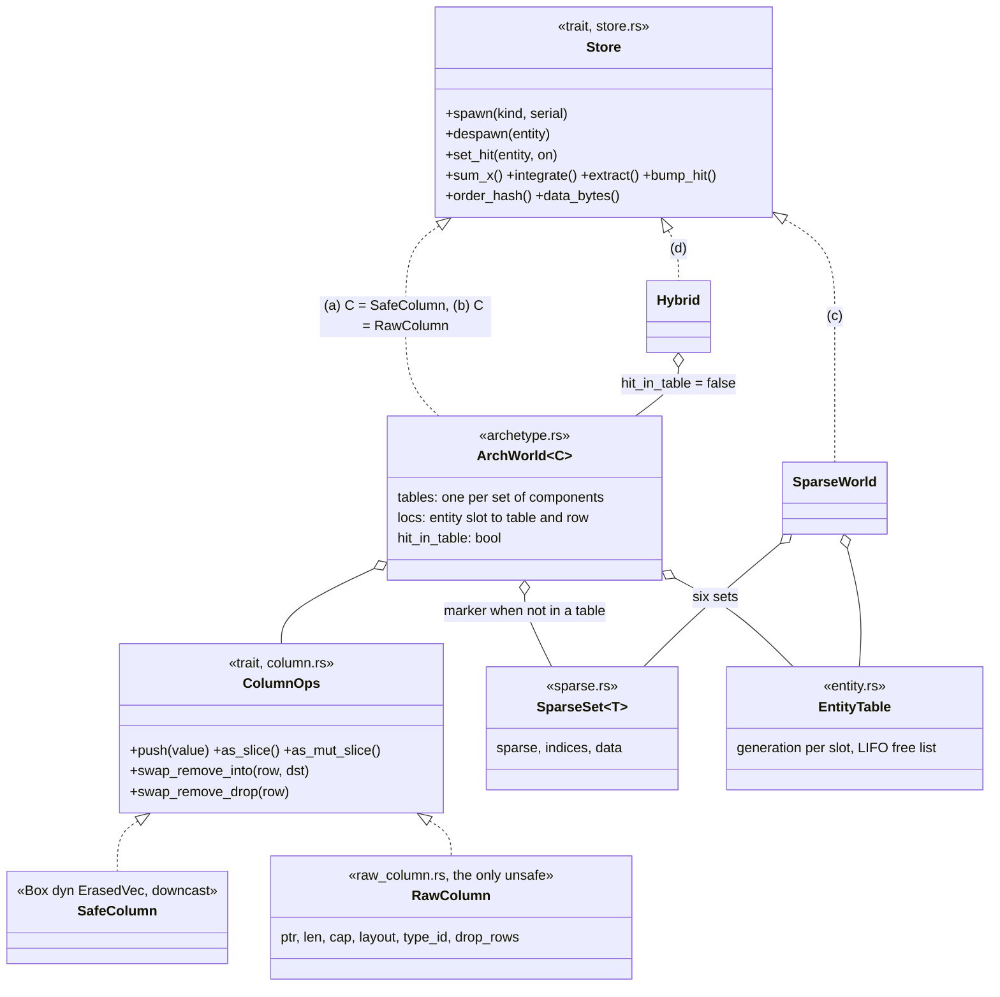

# ECS storage spike: archetype tables (safe and type-erased), sparse sets and a hybrid `[S]`

Status: card 7-2, evidence for ADR-0003 (the ADR text is card 7-3, a governance task the owner declares). Class 2 (new tool crate, `unsafe` in a tool crate). Throw-away harness `engine/tools_ecs_spike` (layer 4 tool, `publish = false`, `std` and `base` only, no third-party dependency). Design note: [ecs-and-sandbox-v0](../architecture/ecs-and-sandbox-v0.md) section 3. Review: `reviews/7-2.md`.

## 1. Summary

Four ECS storages were built from `std` only and driven through one workload API on the shape of the phase 7 sandbox (four kinds of entity, six component types, 1,000 to 100,000 entities): **(a) archetype tables with safe columns** (a typed `Vec<T>` behind a trait object), **(b) archetype tables with type-erased byte columns** (the only `unsafe` of the crate), **(c) one sparse set per component**, **(d) a hybrid**: archetype tables plus a sparse set for the one component that is added and removed often. All four give the same answers (checksums over every query agree after a scripted session and after a random session of 3,000 operations), are deterministic (the same operations give the same iteration order in two runs), refuse a stale entity handle, and make no allocator call in steady state (0 calls, counting allocator).

What the evidence says, on one machine, one thread, wall-clock:

- **Iteration of tables is the same for (a), (b) and (d), and as fast as a sparse set on one or two components.** At 10,000 and 100,000 entities: one component 0.4 to 0.5 ns per entity, two components with a write 0.5 to 0.6 ns. (Cells of 0.1 ns are at the resolution of the printout; three runs differ by at most 1.3 times at 10,000 and 100,000 entities.)
- **A join over three sparse sets costs 2.5 to 2.8 times a table scan** (1.1 against 0.4 ns per entity at 10,000, 1.4 against 0.5 at 100,000; the sparse variant here already starts from the smallest set, chosen by hand, the best case).
- **Structural change is where the layouts differ.** Adding and removing one component on 10% of the entities: 27 ns per operation in tables, 3 ns in a sparse set (9 times less), 3.8 ns in the hybrid. Spawning and despawning: 14 ns in tables, 10 ns in sparse sets.
- **The price of the hybrid is the query that starts from the sparse component:** "entities with the marker, and their transform" costs 2.6 ns per entity in the hybrid against 0.2 in tables (13 times at 10,000 and 15 at 100,000, with 0.2 at the resolution of the printout; 0.6 ns in a pure sparse set).
- **Type erasure won nothing.** (b) iterates exactly like (a), spawns and despawns about 10% slower and moves a row between tables about 30% slower (35.3 against 27.2 ns at 10,000). An earlier set of three runs, from an earlier build of the same code, gave 4% and 14%: the direction is stable and the size depends on code layout. A likely cause is that the typed version moves a value of known size and the erased one copies a run-time number of bytes; that was not measured. It costs 11 `unsafe` blocks and one `unsafe fn` in 210 lines, against 125 lines of safe code, plus Miri.
- **Memory:** 67.4 bytes per entity in tables, 71.8 in the hybrid (its sparse marker set), 93.6 in sparse sets (one `u32` slot per entity for every component type, 1.4 times the tables).

**Recommendation (for the owner, section 7): archetype tables with safe columns for ADR-0003, no `unsafe` in the ECS (choice O3 says `unsafe` only on a measured clear win, and there is none), and no second storage class in version 1.** The hybrid is worth building when a measured workload shows structural-change cost; at the sandbox's scale it does not: all figures here, multiplied by a few thousand entities, are microseconds against a frame of 16,700 microseconds (illustrative arithmetic, not a measurement of the sandbox). The numbers in section 4 let you choose the other way if you prefer cheap toggles.



## 2. What was built

The shape follows the sandbox of the design note: **Box** (transform, velocity, sprite, body) 40%, **Disc** (the same plus a radius) 30%, **Particle** (transform, velocity, sprite) 25%, **Wall** (transform, sprite) 5%, and a **marker** component (`Hit`, 4 bytes) that is added and removed at run time. Components are 16, 8, 16, 8, 4 and 4 bytes. Entity ids are an index and a generation (eight bytes), the shape of `base::pool::Handle`; the spike keeps its own so that every storage pays the same.

- **(a) and (b)** are one generic `ArchWorld<C: ColumnOps>`: a table per component set (eight tables, four with the marker), a location table from entity slot to table and row, `swap_remove` on despawn with the moved entity's location fixed. The two differ only in the column. `SafeColumn` holds a `Box<dyn ErasedVec>` over `Vec<T>` and finds the type again with `Any::downcast`, once per column per query, not per row. `RawColumn` stores `ptr, len, cap, layout, type_id` and the drop glue of the type; every typed access first compares the `TypeId`, so a wrong type is refused (an empty slice, a dropped value), never reinterpreted. The module doc states the four invariants every `unsafe` block relies on.
- **(c)** `SparseWorld`: one `SparseSet<T>` per component (sparse array of `u32` slots, dense index list, dense values). A query starts from the set the author names (the smallest), and looks the others up by slot.
- **(d)** `Hybrid`: (a) with the marker held in a `SparseSet` instead of a table, so adding or removing it moves no row.

Not built, deliberately: a generic query layer (every query is a hand-written function over the same data, so the numbers are the storage cost, not the cost of an API), access checking, a command buffer, parallel iteration, change detection. Those are cards 7-4 and 7-5.

## 3. Method

- **Workloads** (the same function on every storage; the answer is compared): iterate one component (sum of `x`), iterate two with a write (`pos += vel`), iterate three read-only (the render extract: transform, sprite, body), iterate the marker plus one component (half the entities are marked), spawn and despawn 10% of the entities, add and remove the marker on 10%. Every workload leaves the set of entities and their tables as it found it, so a run can be repeated (the two workloads that write, `integrate` and the marker bump, accumulate integer values in the components, which stay exact in `f32`).
- **Sizes** 1,000, 10,000 and 100,000 entities. **Timing:** one warm-up run, then 40 samples; a sample is the time of enough repeated runs to cover about 400,000 entity visits (up to 400 runs for the small world) divided by the number of runs; the table gives the median per entity touched (for the structural workloads an operation is one spawn, despawn, add or remove). The report was run three times; the tables below give the median of the three medians.
- **Machine:** Windows 11, x86-64, 20 logical CPUs, release build, one thread, the owner's development machine, load not controlled. **No instruction counts:** `valgrind` is not available on this machine; the Linux runner can give them when the benchmark is registered (cards 7-5 and 7-6).
- **Correctness checks (in the crate's tests):** 16 tests. A scripted session (populate, integrate twice, mark half, bump, churn, toggle, despawn every seventh, integrate) and a random session of 3,000 operations give identical results on all four storages, the results including a digest of every field of every component of every entity (so the marker bump, the velocity writes and the radius are compared too; red evidence: making the sparse marker query do nothing fails two tests); two identical runs give the same iteration-order hash on each storage; a stale handle is refused by despawn, by `set_hit` and after the slot is reused; adding or removing the marker twice is harmless; despawning everything leaves an empty world. For the type-erased column: order and values across growth, a wrong type refused, a swap-remove moves without dropping, a drop runs exactly once per value (with a counting `Drop` type), a zero-sized type, a 32-byte alignment. One test shows that components registered at run time need no `unsafe` in the safe column (a registry of constructor function pointers).
- **Miri** (nightly) is clean on the eight column tests and on four of the seven storage tests (the random session, stale handles, marker toggles, despawn-all, which run all four storages including the type-erased tables); the other three storage tests are too slow under Miri (the first did not finish in 580 s) and were not run there.
- **Lints:** `cargo clippy --all-targets` has no warning (pedantic, the nesting and size limits of the repository); `unsafe_code = "deny"` with one `#![expect]` at the crate root and `undocumented_unsafe_blocks = "deny"`.

## 4. Results

Nanoseconds per entity touched, **median of three full runs**; the spread (largest over smallest of the three) is at most 1.3 times for every cell except the 1,000-entity iteration cells, where it reaches 3 times (a clock resolution effect: one run is under a microsecond).

**1,000 entities**

| workload | archetype-safe | archetype-raw | sparse-set | hybrid |
|---|---|---|---|---|
| iterate 1 component | 0.4 | 0.4 | 0.4 | 0.4 |
| iterate 2 components (write) | 0.4 | 0.4 | 0.6 | 0.4 |
| iterate 3 components (extract) | 0.4 | 0.4 | 1.0 | 0.4 |
| iterate marker + 1 | 0.2 | 0.1 | 0.6 | 2.5 |
| spawn + despawn 10% | 14.8 | 15.5 | 8.1 | 13.4 |
| add + remove marker 10% | 27.4 | 36.1 | 3.4 | 4.0 |

**10,000 entities**

| workload | archetype-safe | archetype-raw | sparse-set | hybrid |
|---|---|---|---|---|
| iterate 1 component | 0.4 | 0.4 | 0.4 | 0.4 |
| iterate 2 components (write) | 0.5 | 0.5 | 0.5 | 0.6 |
| iterate 3 components (extract) | 0.4 | 0.4 | 1.1 | 0.4 |
| iterate marker + 1 | 0.2 | 0.2 | 0.6 | 2.6 |
| spawn + despawn 10% | 14.2 | 15.6 | 9.8 | 13.9 |
| add + remove marker 10% | 27.2 | 35.3 | 3.0 | 3.8 |

**100,000 entities**

| workload | archetype-safe | archetype-raw | sparse-set | hybrid |
|---|---|---|---|---|
| iterate 1 component | 0.4 | 0.5 | 0.5 | 0.5 |
| iterate 2 components (write) | 0.6 | 0.6 | 0.7 | 0.6 |
| iterate 3 components (extract) | 0.5 | 0.5 | 1.4 | 0.5 |
| iterate marker + 1 | 0.2 | 0.2 | 1.1 | 3.0 |
| spawn + despawn 10% | 15.0 | 15.5 | 11.1 | 14.1 |
| add + remove marker 10% | 27.4 | 35.5 | 3.1 | 4.0 |

**Memory** (component data and bookkeeping at every size; the dense arrays by length, the sparse arrays by entity slot, which the harness reserves at 1.1 times the entity count): archetype-safe 67.4, archetype-raw 67.4, sparse-set 93.6, hybrid 71.8 bytes per entity.

**Allocator calls in one steady-state run** (10,000 entities, after a warm-up run, six workloads, counting allocator): 0 for every storage and every workload. The warm-up run grows the component columns once (only the entity lists are reserved at construction); after it the structural workloads reuse that capacity; the zero-allocation rule of the digest holds for all four.

## 5. Reading the numbers

| Question of the design note | Answer from the data |
|---|---|
| Do archetype tables win iteration? | Against a sparse set on one or two components, no: equal within noise. On a join of three they win by 2.5 to 2.8 times, and on the marker query by 3 to 5 times against a sparse set and 13 to 15 times against the hybrid. All are fractions of a nanosecond to a few nanoseconds per entity |
| Do sparse sets win structural change? | Yes, clearly for add and remove (9 times), modestly for spawn and despawn (1.4 times) |
| What does the hybrid cost? | The marker query goes through a location lookup per entity (13 to 15 times slower than a table scan for that query; the harness path is hand-written and not optimised, it looks the table and column up again for every marked entity, so this is an upper bound of what a tuned hybrid costs); the code has two storage paths and two kinds of component. It gets almost all of the sparse set's toggle advantage (3.8 against 3.0 ns) |
| Does type erasure pay? | No. Same iteration, about 10% (spawn, despawn) to 30% (add, remove) slower row moves in the latest runs (4% and 14% in an earlier set), 11 `unsafe` blocks, a Miri run, a security-minded review. The case for it is not speed but a single column type for run-time registration, and the safe column can do that too (the registration test) |
| Is the zero-allocation rule reachable? | Yes, on all four, once capacity is reserved |
| Are results deterministic? | Yes, no hash anywhere: iteration order is table order, row order within a table, which is spawn order modified by `swap_remove` |

## 6. What it means at the sandbox's scale

An illustration, not a measurement: a sandbox of 5,000 entities that runs all three iteration queries once a frame costs about 5,000 x (0.4 + 0.5 + 0.4) ns = 6.5 microseconds in tables; toggling a marker on 500 of them twice a frame (1,000 structural operations) costs about 28 microseconds in tables and 3 in a sparse set. A frame at 60 Hz is 16,700 microseconds. Either storage is far inside any plausible frame budget; the storage choice here is therefore about **simplicity, determinism and the cost of change later**, which is what the recommendation uses. The real ECS adds a typed query layer, access checks and a command buffer on top; their cost is measured in cards 7-4 and 7-5, and the target for the ECS iteration benchmark is proposed there from those measurements (choice O4).

## 7. Proposed ADR-0003 text and the choice for the owner

**Proposed ADR-0003 (ECS storage), for the governance card 7-3:**

> **Decision.** The ECS stores components in archetype tables: one dense table per set of component types, one column per type, rows in spawn order with `swap_remove` on despawn and on structural change. A column is a typed vector behind a trait object, found again by `TypeId` once per query and column; there is no `unsafe` in the `ecs` crate. Entities are generation-checked handles. Iteration order is table order then row order; no hash is iterated.
> **Not decided here.** A second storage class (sparse sets) for components that change often. It is added by a later decision when a measured workload shows the structural-change cost, and the marker query cost in the spike (13 to 15 times a table scan, 2.6 to 3.0 ns per entity, an untuned path) is the price to weigh then.
> **Evidence.** [ecs-storage-spike](ecs-storage-spike.md): equal iteration, 9 times dearer add and remove than a sparse set (27 ns each), safe columns 10% to 30% faster than type-erased ones on row moves, 0 allocator calls in steady state.
> **Consequence.** No entry in `gates/unsafe-budget.toml` for `ecs`; card 7-3 then only records the ADR.

**Choice for the owner.**

| | Option | Evidence | Recommendation |
|---|---|---|---|
| A | Archetype tables, safe columns, no sparse class in v1 (the text above) | iteration equal or better, 9 times dearer toggles, simplest, no `unsafe` | **recommended**: nothing in the sandbox needs the other |
| B | The hybrid: tables plus a sparse class for components marked as often changing | toggles 7 to 9 times cheaper, marker query 13 to 15 times dearer, two code paths | when a measured workload needs it; the design keeps room for it |
| C | Type-erased columns | no speed win, 10% to 30% slower moves, 11 `unsafe` blocks, a budget entry in a governance file | not recommended; O3 asks for a clear win |

## 8. What the spike does not show

- **One machine, one thread, wall-clock.** No instruction counts (no `valgrind` here), no Linux, no ARM64. The Linux runner and the benchmark registration (cards 7-5, 7-6) give counts. Windows noise: the load was not controlled; three runs agree within 1.3 times except the smallest world.
- **No parallel iteration.** Both layouts split into disjoint chunks (a table, a dense array), so `IScheduler::parallel_for` applies; the cost and the scaling are measured in card 7-5.
- **No generic query layer.** Each query is a hand-written function, so the cost of typed queries, declared access, and a command buffer is not in these numbers, nor is the cost of finding the matching tables when there are many (the spike has eight).
- **Cold caches.** 100,000 entities (4 MB of transform, sprite and body data) fit in the caches of this machine; a million entities would show memory-bound behaviour that this report does not.
- **The component set is fixed** (six types, known at compile time): the archetype tables are created at construction, not on demand. Lazy table creation is a one-time cost, not measured. Components are plain data except in the column tests (a `String` and a counting `Drop` type), so drop cost is not in the workloads.
- **Query matching across many tables and lazy table creation** are not measured (eight tables, all created at construction).
- **The one-component query is a serial `f64` add chain**, so it partly measures floating-point latency; the sparse joins read slots in perfectly sequential order (no churn has shuffled them), which flatters the sparse set.
- **The hybrid marker query is untuned** (section 5): its 13 to 15 times is an upper bound.
- **The sparse variant is the best case:** typed fields, no lookup by component id, the driving set chosen by hand.
- **`unsafe` was not reviewed by a second security reviewer**, since the recommendation does not use it; the Miri runs above are the only check beyond the tests. The type-erased column is not `Send` or `Sync` (a raw pointer); a production version would need `unsafe impl`s guarded by a registration bound.

## 9. Reproduce

```text
cargo test -p tools_ecs_spike
cargo run --release -p tools_ecs_spike                 # full report, a few minutes
cargo run --release -p tools_ecs_spike -- --reps 5 --sizes 1000,10000
cargo +nightly miri test -p tools_ecs_spike --test raw_column
```
